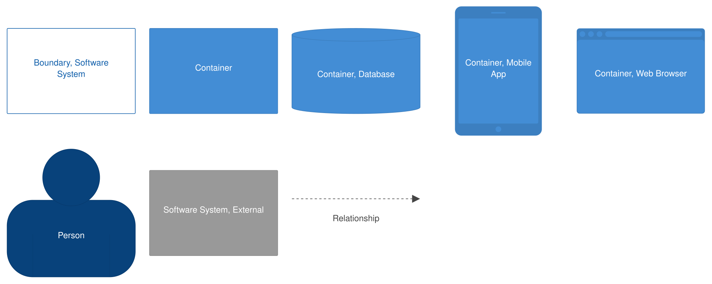

# Anexos

## Anexo A: EventStorming del dominio de OptiFlow

En este anexo se presenta la evidencia correspondiente al modelado del dominio mediante **EventStorming**, utilizado para identificar los principales eventos, comandos, actores y agrupaciones funcionales de la solución OptiFlow (ver Figura A1).

**Figura A1**

*EventStorming del dominio de OptiFlow*

## Anexo B: Bounded Contexts identificados

Los cinco canvases de [2.5.1.3](Capitulo2.md#2513-bounded-context-canvases) especifican responsabilidades, reglas, contratos, supuestos y criterios de verificación para los contextos resumidos en este anexo.

La siguiente evidencia corresponde a la identificación de los cinco Bounded Contexts que estructuran el dominio de OptiFlow:

- **Search & Booking Context**
- **Clinical & Commercial Context**
- **Production & Tracking Context**
- **Notification & Loyalty Context**
- **Store Management & Inventory Context**

Estos contextos fueron delimitados a partir de las agrupaciones funcionales identificadas durante el análisis del dominio.

## Anexo C: Domain Message Flows

En este anexo se resume la comunicación entre los Bounded Contexts de OptiFlow mediante eventos de dominio. Para cada evento se indica el comando que lo origina, los datos que transporta, el contexto que lo recibe y el comando que este ejecuta. Los diagramas de cada escenario se presentan en la sección [2.5.1.2](Capitulo2.md#2512-domain-message-flows-modeling).

La relación entre eventos, contextos receptores y comandos se detalla en la Tabla C1.

**Tabla C1**

*Relación entre eventos, contextos receptores y comandos*

| Contexto emisor | Comando de origen | Evento | Datos del evento | Contexto receptor | Comando ejecutado |
|---|---|---|---|---|---|
| Search & Booking | `BookAppointment` | `AppointmentBooked` | appointmentId, patientId, opticalStoreId, timeSlotId | Clinical & Commercial | `ExaminePatient` |
| Search & Booking | `BookAppointment` | `AppointmentBooked` | appointmentId, patientId, opticalStoreId, timeSlotId | Notification & Loyalty | `ScheduleAppointmentReminder` |
| Clinical & Commercial | `CloseSale` | `SaleWasClosed` | saleId, quotationId, clinicalRecordId, patientId, totalAmount, items (productSku, quantity) | Production & Tracking | `GenerateWorkOrder` |
| Clinical & Commercial | `CloseSale` | `SaleWasClosed` | saleId, quotationId, clinicalRecordId, patientId, totalAmount, items (productSku, quantity) | Store Management & Inventory | `UpdateInventory` |
| Production & Tracking | `UpdateWorkOrderStatus` | `WorkOrderStatusUpdated` | workOrderId, patientId, previousStatus, status | Notification & Loyalty | `NotifyLensOrderProgress` |
| Production & Tracking | `NotifyDeliveryDelay` | `DeliveryDelayNotified` | workOrderId, patientId, delay | Notification & Loyalty | `SendDeliveryDelayNotification` |
| Production & Tracking | `MarkOrderAsDelivered` | `OrderWasMarkedAsDelivered` | workOrderId, saleId, patientId | Notification & Loyalty | `SendSatisfactionSurvey` |

Ningún contexto accede directamente a los datos de otro: cada uno reacciona a los eventos que recibe y actualiza solo su propio modelo.

## Anexo D: Context Mapping

En este anexo se presenta el context map final de OptiFlow, con las relaciones entre los Bounded Contexts, los sistemas externos (Pasarela de Pagos y Firebase Cloud Messaging) y los patrones de integración que aplica cada una (ver Figura D1). El proceso de elaboración, las alternativas evaluadas y el detalle de cada relación se presentan en la sección [2.5.2](Capitulo2.md#252-context-mapping).

**Figura D1**

*Context map final de OptiFlow*

*Nota.* Elaboración propia.

## Anexo E: Arquitectura de Software

Se presentan como evidencia complementaria los diagramas correspondientes a los diferentes niveles de la arquitectura de software de OptiFlow.

### E.1. Context Level Diagram

El Context Level Diagram se presenta en la Figura E1.

**Figura E1**

*Context Level Diagram*

### E.2. Container Level Diagram

Se reproduce el Container Level Diagram de la sección 2.5.3.2, con un único contenedor backend, la base de datos local de la aplicación móvil, la persistencia relacional y los sistemas externos (ver Figura E2).

**Figura E2**

*Container Level Diagram de OptiFlow elaborado en Structurizr*

La leyenda de los elementos del diagrama se presenta a continuación (ver Figura E3).

**Figura E3**

*Leyenda del Container Level Diagram*

### E.3. Component Diagrams

Las vistas conservadas documentan el diseño de componentes. Las bases documentales o adaptadores adicionales que aparezcan en esas imágenes no acreditan su implementación: la persistencia vigente es la única base PostgreSQL y los módulos con migraciones V1–V4. Inventory permanece como diseño propuesto.

#### Clinical & Commercial

El Clinical & Commercial Component Diagram se observa en la Figura E4.

**Figura E4**

*Clinical & Commercial Component Diagram*

#### Notification & Loyalty

El Notification & Loyalty Component Diagram se muestra en la Figura E5.

**Figura E5**

*Notification & Loyalty Component Diagram*

#### Production & Tracking

El Production & Tracking Component Diagram se presenta en la Figura E6.

**Figura E6**

*Production & Tracking Component Diagram*

#### Search & Booking

El Search & Booking Component Diagram se observa en la Figura E7.

**Figura E7**

*Search & Booking Component Diagram*

#### Store Management & Inventory

El Store Management & Inventory Component Diagram se muestra en la Figura E8.

**Figura E8**

*Store Management & Inventory Component Diagram*

## Anexo F: Diagramas de diseño táctico

La cardinalidad vigente de cotización–venta se especifica en [2.6.2.6.2](Capitulo2.md#26262-bounded-context-database-design-diagram): una cotización genera como máximo una venta, respaldada por la restricción de unicidad del backend.

Los diagramas de este anexo complementan el diseño táctico. Las secciones 2.6.1.6.2 a 2.6.5.6.2 describen el modelo físico actual: una base PostgreSQL compartida, con 27 tablas definidas en V1–V9. Los diagramas de base de datos de este anexo y del capítulo II se elaboraron a partir de esas migraciones.

### F.1. Production & Tracking

#### Domain Layer Class Diagram

El Production & Tracking Domain Layer Class Diagram se presenta en la Figura F1.

**Figura F1**

*Production & Tracking Domain Layer Class Diagram*

#### Database Design Diagram

La Figura F2 reproduce el modelo físico relacional de la migración V3: `work_orders`, `work_order_lenses`, `work_order_status_history`, `technicians` y `laboratories`. La sección 2.6.3.6.2 especifica las claves físicas y las referencias lógicas.

**Figura F2**

*Production & Tracking Database Design Diagram*

### F.2. Notification & Loyalty

La persistencia de Notification & Loyalty utiliza `notifications`, `loyalty_accounts` y `device_tokens` en PostgreSQL, según V4 y V7. La sección 2.6.5.6.2 detalla sus columnas y restricciones.

## Anexo G: Product Backlog

Como evidencia complementaria del levantamiento y priorización de requisitos, se presenta el Product Backlog desarrollado para OptiFlow.

Entre las funcionalidades priorizadas se encuentran el inicio de sesión, registro de pacientes, gestión de historias clínicas, consulta de recetas, búsqueda de ópticas, reserva de citas y consulta de inventario mediante escáner móvil.

## Anexo H: Entrevistas de validación

Como evidencia de la validación de OptiFlow, se comparte el video con las entrevistas realizadas a usuarios de los segmentos objetivo, quienes interactuaron con la Landing Page y la aplicación móvil.

[Ver video de las entrevistas de validación en OneDrive](https://upcedupe-my.sharepoint.com/:v:/g/personal/u20241d317_upc_edu_pe/IQBEVy_3hrA9QZmTordSZKlaAYrAH0PSADXMEQfwdz9GFn8?e=eCtW3I&nav=eyJyZWZlcnJhbEluZm8iOnsicmVmZXJyYWxBcHAiOiJTdHJlYW1XZWJBcHAiLCJyZWZlcnJhbFZpZXciOiJTaGFyZURpYWxvZy1MaW5rIiwicmVmZXJyYWxBcHBQbGF0Zm9ybSI6IldlYiIsInJlZmVycmFsTW9kZSI6InZpZXcifX0=)   

https://upcedupe-my.sharepoint.com/:v:/g/personal/u20241d317_upc_edu_pe/IQBEVy_3hrA9QZmTordSZKlaAYrAH0PSADXMEQfwdz9GFn8?e=eCtW3I&nav=eyJyZWZlcnJhbEluZm8iOnsicmVmZXJyYWxBcHAiOiJTdHJlYW1XZWJBcHAiLCJyZWZlcnJhbFZpZXciOiJTaGFyZURpYWxvZy1MaW5rIiwicmVmZXJyYWxBcHBQbGF0Zm9ybSI6IldlYiIsInJlZmVycmFsTW9kZSI6InZpZXcifX0=
