

# Anexos

Los anexos reúnen los artefactos de diseño y las evidencias que complementan los capítulos del informe. Cada registro conserva su alcance: modelado del dominio, arquitectura, implementación o validación.

**Contenido:** [A. EventStorming](#anexo-a-eventstorming-del-dominio-de-optiflow), [B. Bounded Contexts](#anexo-b-bounded-contexts-identificados), [C. Domain Message Flows](#anexo-c-domain-message-flows), [D. Context Mapping](#anexo-d-context-mapping), [E. Arquitectura](#anexo-e-arquitectura-de-software), [F. Diseño táctico y persistencia](#anexo-f-diagramas-de-diseño-táctico), [G. Product Backlog](#anexo-g-product-backlog), [H. Entrevistas](#anexo-h-entrevistas-de-validación), [I. Evidencias del Sprint 2](#anexo-i-evidencias-técnicas-del-sprint-2) y [J. Sustento académico](#anexo-j-relación-entre-investigación-y-decisiones-del-proyecto).

## Anexo A: EventStorming del dominio de OptiFlow

En este anexo se presenta la evidencia correspondiente al modelado del dominio mediante **EventStorming**, utilizado para identificar los principales eventos, comandos, actores y agrupaciones funcionales de la solución OptiFlow (ver Figura A1).

**Figura A1**

*EventStorming del dominio de OptiFlow*

## Anexo B: Bounded Contexts identificados

Los cinco canvases de [2.5.1.3](Capitulo2.md#2513-bounded-context-canvases) especifican responsabilidades, reglas, contratos, supuestos y criterios de verificación para los contextos resumidos en este anexo.

La siguiente evidencia corresponde a la identificación de los cinco Bounded Contexts que estructuran el dominio de OptiFlow:

- **Search & Booking Context**
- **Clinical & Commercial Context**
- **Production & Tracking Context**
- **Notification & Loyalty Context**
- **Store Management & Inventory Context**

Estos contextos fueron delimitados a partir de las agrupaciones funcionales identificadas durante el análisis del dominio.

## Anexo C: Domain Message Flows

En este anexo se resume el diseño de comunicación entre los Bounded Contexts de OptiFlow mediante eventos de dominio. Para cada evento se indica el comando que lo origina, los datos que transporta, el contexto que lo recibe y el comando que este ejecuta. Los diagramas de cada escenario se presentan en la sección [2.5.1.2](Capitulo2.md#2512-domain-message-flows-modeling).

La relación entre eventos, contextos receptores y comandos se detalla en la Tabla C1.

**Tabla C1**

*Relación entre eventos, contextos receptores y comandos*

| Contexto emisor | Comando de origen | Evento | Datos del evento | Contexto receptor | Comando ejecutado |
|---|---|---|---|---|---|
| Search & Booking | `BookAppointment` | `AppointmentBooked` | appointmentId, patientId, opticalStoreId, timeSlotId | Clinical & Commercial | `ExaminePatient` |
| Search & Booking | `BookAppointment` | `AppointmentBooked` | appointmentId, patientId, opticalStoreId, timeSlotId | Notification & Loyalty | `ScheduleAppointmentReminder` |
| Clinical & Commercial | `CloseSale` | `SaleWasClosed` | saleId, quotationId, clinicalRecordId, patientId, totalAmount, items (productSku, quantity) | Production & Tracking | `GenerateWorkOrder` |
| Clinical & Commercial | `CloseSale` | `SaleWasClosed` | saleId, quotationId, clinicalRecordId, patientId, totalAmount, items (productSku, quantity) | Store Management & Inventory | `UpdateInventory` |
| Production & Tracking | `UpdateWorkOrderStatus` | `WorkOrderStatusUpdated` | workOrderId, patientId, previousStatus, status | Notification & Loyalty | `NotifyLensOrderProgress` |
| Production & Tracking | `NotifyDeliveryDelay` | `DeliveryDelayNotified` | workOrderId, patientId, delay | Notification & Loyalty | `SendDeliveryDelayNotification` |
| Production & Tracking | `MarkOrderAsDelivered` | `OrderWasMarkedAsDelivered` | workOrderId, saleId, patientId | Notification & Loyalty | `SendSatisfactionSurvey` |

El diseño asigna a cada contexto la propiedad de su modelo y define contratos para comunicar los cambios. La presencia de un flujo en la Tabla C1 expresa esa decisión de diseño; su implementación se contrasta con la revisión de código y las evidencias del Anexo I.

## Anexo D: Context Mapping

En este anexo se presenta el context map de diseño de OptiFlow, con las relaciones entre los Bounded Contexts, los sistemas externos previstos (Pasarela de Pagos y Firebase Cloud Messaging) y sus patrones de integración (ver Figura D1). El proceso de elaboración, las alternativas evaluadas y el detalle de cada relación se presentan en la sección [2.5.2](Capitulo2.md#252-context-mapping).

**Figura D1**

*Context map final de OptiFlow*

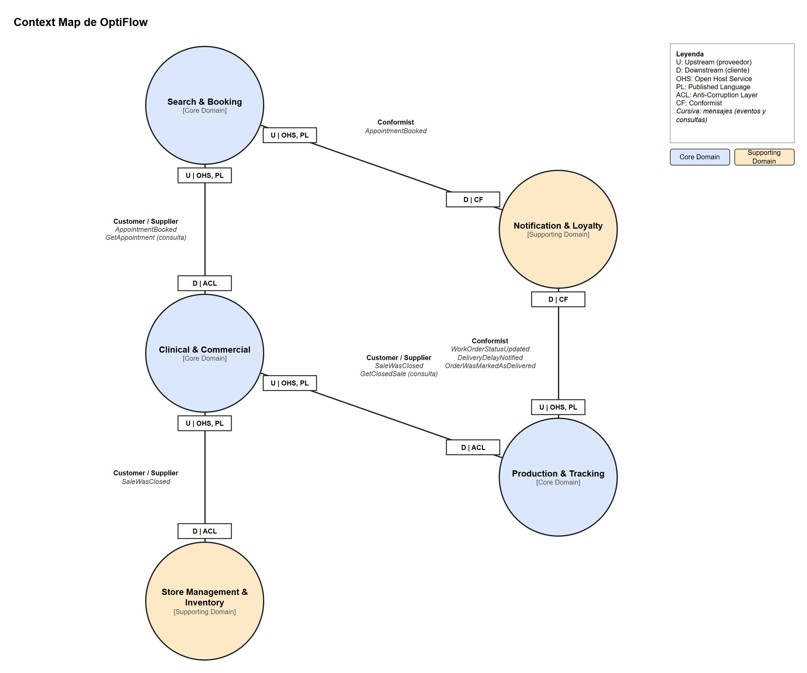

*Nota.* Elaboración propia.

## Anexo E: Arquitectura de Software

Se presentan como evidencia complementaria los diagramas de arquitectura de OptiFlow. Estas vistas incluyen el alcance previsto de la solución. El corte de implementación de AV2 se identifica por repositorio y commit en el Anexo I.

### E.1. Context Level Diagram

El Context Level Diagram se presenta en la Figura E1.

**Figura E1**

*Context Level Diagram*

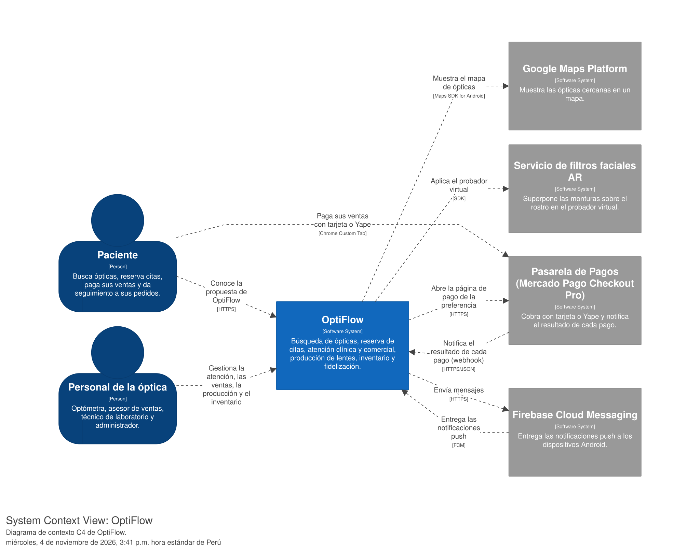

### E.2. Container Level Diagram

Se reproduce el Container Level Diagram de la sección 2.5.3.2, con un único contenedor backend, la base de datos local de la aplicación móvil, la persistencia relacional y los sistemas externos (ver Figura E2).

**Figura E2**

*Container Level Diagram de OptiFlow elaborado en Structurizr*

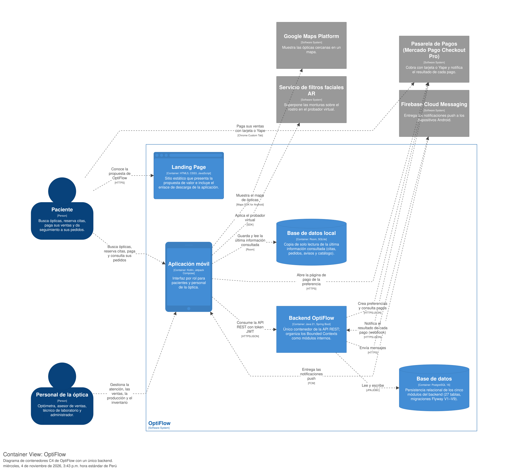

La leyenda de los elementos del diagrama se presenta a continuación (ver Figura E3).

**Figura E3**

*Leyenda del Container Level Diagram*

### E.3. Component Diagrams

Los Component Diagrams representan los componentes propuestos de cada módulo, incluidos los adaptadores hacia la Pasarela de Pagos (`PaymentGatewayAdapter`) y Firebase Cloud Messaging (`FirebaseMessagingAdapter`). El backend utiliza una base PostgreSQL compartida. Los adaptadores externos y el módulo de inventario se mantienen identificados como parte del diseño; su aparición en el diagrama no se toma como evidencia de integración en AV2.

#### Clinical & Commercial

El Clinical & Commercial Component Diagram se observa en la Figura E4.

**Figura E4**

*Clinical & Commercial Component Diagram*

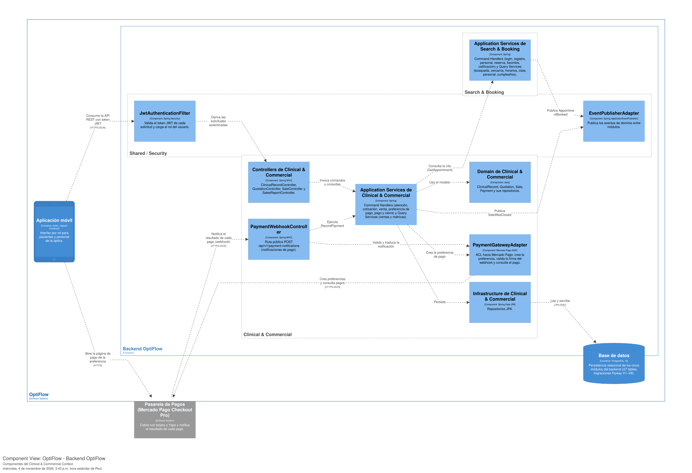

#### Notification & Loyalty

El Notification & Loyalty Component Diagram se muestra en la Figura E5.

**Figura E5**

*Notification & Loyalty Component Diagram*

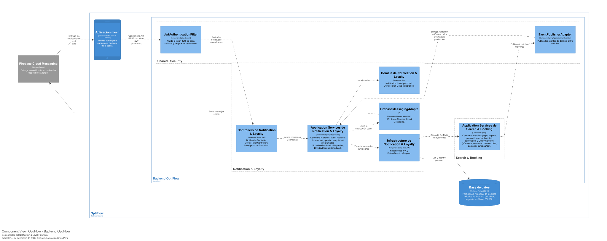

#### Production & Tracking

El Production & Tracking Component Diagram se presenta en la Figura E6.

**Figura E6**

*Production & Tracking Component Diagram*

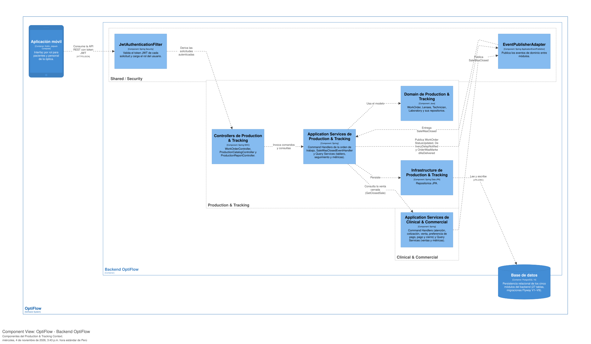

#### Search & Booking

El Search & Booking Component Diagram se observa en la Figura E7.

**Figura E7**

*Search & Booking Component Diagram*

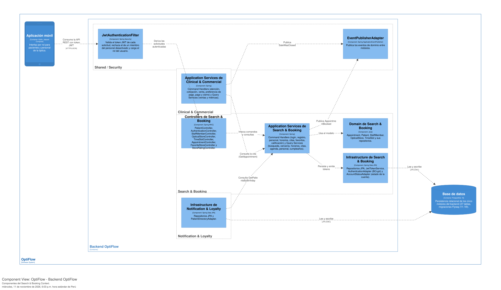

#### Store Management & Inventory

El Store Management & Inventory Component Diagram se muestra en la Figura E8.

**Figura E8**

*Store Management & Inventory Component Diagram*

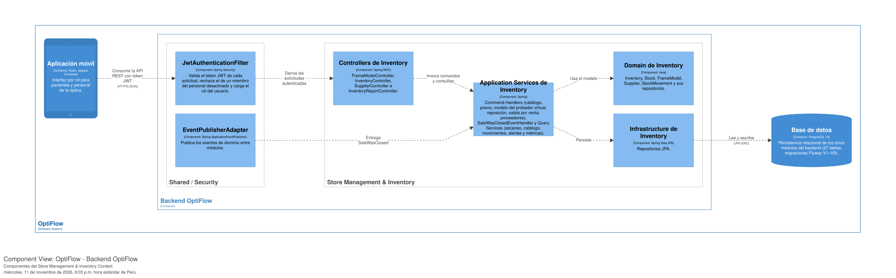

## Anexo F: Diagramas de diseño táctico

La cardinalidad vigente de cotización–venta se especifica en [2.6.2.6.2](Capitulo2.md#26262-bounded-context-database-design-diagram): una cotización genera como máximo una venta, respaldada por la restricción de unicidad del backend.

Los diagramas de este anexo complementan el diseño táctico del capítulo II. La revisión del backend `41bcb44`, consultada el 10/11/2026 para AV2, contiene las migraciones V1 a V9, que definen 27 tablas en una base PostgreSQL compartida. V5 añade coordenadas, V6 incorpora inventario, V7 registra dispositivos, V8 amplía pacientes y personal, y V9 incorpora datos de checkout y pago. El modelo ampliado de diseño se distingue de este corte de implementación mediante la Tabla F1.

**Tabla F1**

*Persistencia identificada en el backend 41bcb44*

| Bounded Context | Migraciones | Tablas identificadas | Cantidad |
|---|---|---|:---:|
| Search & Booking | V1, V5 y V8 | `patients`, `optical_stores`, `time_slots`, `appointments`, `favorite_stores`, `store_ratings`, `staff_members`. | 7 |
| Clinical & Commercial | V2 y V9 | `clinical_records`, `medical_histories`, `optical_prescriptions`, `quotations`, `quotation_items`, `sales`, `electronic_receipts`. | 7 |
| Production & Tracking | V3 | `technicians`, `laboratories`, `work_orders`, `work_order_lenses`, `work_order_status_history`. | 5 |
| Notification & Loyalty | V4 y V7 | `loyalty_accounts`, `notifications`, `device_tokens`. | 3 |
| Store Management & Inventory | V6 | `frame_models`, `inventories`, `suppliers`, `inventory_stocks`, `stock_movements`. | 5 |
| **Total** | | | **27** |

Fuente: [migraciones del commit 41bcb44](https://github.com/BL-App-Movil-1ACC0238-2620-4951/Logix-OptiFlow-Back-End/tree/41bcb448a06abe9aeaf32be9cef46ce2965e30e0/src/main/resources/db/migration). La correspondencia de claves y restricciones se revisa sobre esos archivos. La relación `sales.quotation_id UNIQUE` respalda que una cotización genere como máximo una venta.

### F.1. Production & Tracking

#### Domain Layer Class Diagram

El Production & Tracking Domain Layer Class Diagram se presenta en la Figura F1.

**Figura F1**

*Production & Tracking Domain Layer Class Diagram*

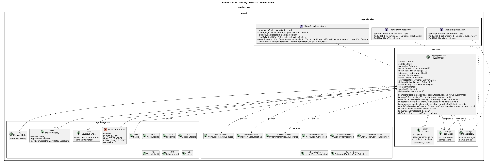

#### Database Design Diagram

La Figura F2 reproduce el modelo físico relacional de la migración V3: `work_orders`, `work_order_lenses`, `work_order_status_history`, `technicians` y `laboratories`. La sección 2.6.3.6.2 especifica las claves físicas y las referencias lógicas.

**Figura F2**

*Production & Tracking Database Design Diagram*

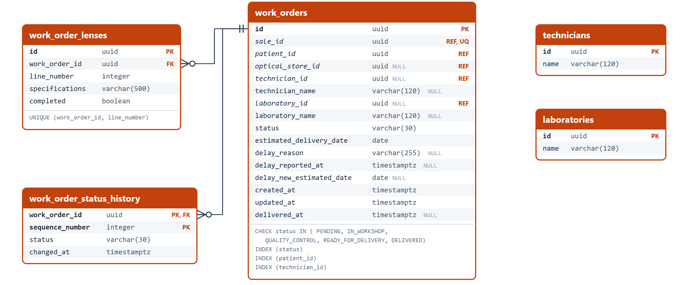

### F.2. Notification & Loyalty

En la revisión `41bcb44`, Notification & Loyalty persiste en `notifications`, `loyalty_accounts` y `device_tokens`, definidas por V4 y V7. El backend incorpora registro de dispositivos, respuesta a encuestas y un adaptador de Firebase con pruebas automatizadas. El diagrama de V4 conserva su alcance original de dos tablas; V7 amplía ese modelo con los dispositivos. La entrega de mensajes a un dispositivo real se comprueba con las credenciales y el entorno de distribución correspondientes.

## Anexo G: Product Backlog

El [Product Backlog del capítulo II](Capitulo2.md#243-product-backlog) reúne las historias, sus títulos y estimaciones. Para la ejecución se utilizan el [Sprint Backlog 1](Capitulo4.md#4213-sprint-backlog-1) y el [Sprint Backlog 2](Capitulo4.md#4223-sprint-backlog-2), que descomponen las historias en tareas y registran responsables y estados.

Entre las funcionalidades priorizadas se encuentran el inicio de sesión, registro de pacientes, gestión de historias clínicas, consulta de recetas, búsqueda de ópticas, reserva de citas y consulta de inventario mediante escáner móvil.

## Anexo H: Entrevistas de validación

Se conserva el video de las entrevistas anteriores, en el que participaron usuarios de ambos segmentos y se recorrieron la Landing Page y la aplicación móvil. La Figura H1 muestra un cuadro de esa grabación. El diseño de tareas, el registro por participante y el seguimiento de AV2 se encuentran en [4.3. Validation Interviews](Capitulo4.md#43-validation-interviews).

[Ver video de las entrevistas de validación en OneDrive](https://upcedupe-my.sharepoint.com/:v:/g/personal/u20241d317_upc_edu_pe/IQBMU94REze_ToVH6ypsrwSQATv7xCWf36Atyff8XiIB2Ms?e=QorMe1&nav=eyJyZWZlcnJhbEluZm8iOnsicmVmZXJyYWxBcHAiOiJTdHJlYW1XZWJBcHAiLCJyZWZlcnJhbFZpZXciOiJTaGFyZURpYWxvZy1MaW5rIiwicmVmZXJyYWxBcHBQbGF0Zm9ybSI6IldlYiIsInJlZmVycmFsTW9kZSI6InZpZXcifX0%3D)

**Figura H1**

*Cuadro del video histórico de entrevistas de validación*

Las sesiones de AV2 se asocian con la versión efectivamente probada. La grabación anterior conserva su fecha y alcance, sin trasladar automáticamente sus resultados al cliente Flutter.

## Anexo I: Evidencias técnicas del Sprint 2

La Tabla I1 identifica las revisiones utilizadas en el capítulo IV. La Tabla I2 reúne sus artefactos de construcción, contrato, ejecución y publicación.

**Tabla I1**

*Revisiones de código del Sprint 2*

| Producto | Repositorio y rama | Commit revisado | Alcance |
|---|---|---|---|
| Backend | [Logix-OptiFlow-Back-End](https://github.com/BL-App-Movil-1ACC0238-2620-4951/Logix-OptiFlow-Back-End), `develop`. | [41bcb44](https://github.com/BL-App-Movil-1ACC0238-2620-4951/Logix-OptiFlow-Back-End/commit/41bcb448a06abe9aeaf32be9cef46ce2965e30e0) | Servicios, seguridad, inventario, pagos, notificaciones y reportes; revisión local con H2. |
| Flutter | [Logix-OptiFlow-Flutter](https://github.com/BL-App-Movil-1ACC0238-2620-4951/Logix-OptiFlow-Flutter), `main`. | [0344413](https://github.com/BL-App-Movil-1ACC0238-2620-4951/Logix-OptiFlow-Flutter/commit/03444133bb4889773dda3b250c708e315bb545b6) | Código de la versión `1.0.0+1`; revisión del contrato y de los datos de demostración. |
| Landing Page | [Logix-OptiFlow-landing-page](https://github.com/BL-App-Movil-1ACC0238-2620-4951/Logix-OptiFlow-landing-page), `main`. | [ef1c032](https://github.com/BL-App-Movil-1ACC0238-2620-4951/Logix-OptiFlow-landing-page/commit/ef1c03205352fb20a22bbd7fcd54a41f90ef6dca) | Código y publicación en GitHub Pages comprobada el 08/11/2026. |

**Tabla I2**

*Artefactos y alcance de las evidencias de AV2*

| Evidencia | Archivo o enlace | Relación con el informe |
|---|---|---|
| Pruebas del backend | [Resumen de Maven](assets/cap4/sprint2/revision-20261110/test-summary.json) y [captura](assets/cap4/sprint2/revision-20261110/tests-current.png) | 131 pruebas aprobadas en 27 suites el 10/11/2026; cuatro escenarios Cucumber incluidos. Sección 4.2.2.5. |
| Integración continua | [Workflow 42771709596](https://github.com/BL-App-Movil-1ACC0238-2620-4951/Logix-OptiFlow-Back-End/actions/runs/42771709596) y [captura](assets/cap4/sprint2/revision-20261110/backend-ci.png) | `mvn -B test` completado para `41bcb44` con Java 21. |
| Aceptación del Sprint 2 | [Reporte Cucumber](assets/cap4/sprint2/revision-20261110/cucumber.html) y [JSON](assets/cap4/sprint2/revision-20261110/cucumber.json) | Cuatro escenarios de búsqueda y reserva aprobados en la revisión actual. |
| Solicitudes HTTP locales | [Resultados JSON](assets/cap4/sprint2/revision-20261110/service-results.json) | 28 solicitudes registradas; 25 con código esperado comprobado y tres respuestas de rutas antiguas. Tokens omitidos. Sección 4.2.2.5. |
| Contrato versionado | [OpenAPI local](assets/cap4/sprint2/revision-20261110/openapi-local.json) | 67 operaciones sobre 58 rutas del backend `41bcb44`. Sección 4.2.2.7. |
| Interacción con Swagger | [Vista general](assets/cap4/sprint2/revision-20261110/swagger-current.png), [cercanía](assets/cap4/sprint2/revision-20261110/nearby-current.png), [reserva](assets/cap4/sprint2/revision-20261110/booking-current.png) y [permisos](assets/cap4/sprint2/revision-20261110/forbidden-current.png) | Capturas de ejecución local del 10/11/2026. Sección 4.2.2.6. |
| Colaboración | [Backend](assets/cap4/sprint2/revision-20261110/backend-contributors.png), [Flutter](assets/cap4/sprint2/revision-20261110/flutter-contributors.png) y [Landing](assets/cap4/sprint2/revision-20261110/landing-contributors.png) | Gráficos públicos de GitHub Insights. Sección 4.2.2.9. |
| Revisión anterior del Sprint 2 | [Registro Maven del 08/11/2026](assets/cap4/sprint2/build-results.txt) y [HTTP anterior](assets/cap4/sprint2/service-results.json) | Antecedentes del backend `4a1364e`, preservados con sus resultados originales. |
| Publicación de Pages | [Workflow 42338220243](https://github.com/BL-App-Movil-1ACC0238-2620-4951/Logix-OptiFlow-landing-page/actions/runs/42338220243) y [captura](assets/cap4/sprint2/workflow-pages.png) | Ejecución exitosa para el commit `ef1c032`, documentada en 4.2.2.8. |
| Landing publicada | [Sitio público](https://bl-app-movil-1acc0238-2620-4951.github.io/Logix-OptiFlow-landing-page/) y [captura](assets/cap4/sprint2/landing-publica.png) | Acceso público con HTTP 200 comprobado el 08/11/2026. |
| Aceptación del primer incremento | [Reporte Cucumber](assets/cap4/sprint1/testing/cucumber.html) y [JSON](assets/cap4/sprint1/testing/cucumber.json) | Evidencia histórica del Sprint 1, con su versión y resultado en 4.2.1.5. |

Las revisiones de código y los resultados se conservan por separado de la publicación del APK y de la validación con participantes. Los videos de App Validation, About-the-Product y About-the-Team se registran en [Conclusiones](Conclusiones.md#video-app-validation).

## Anexo J: Relación entre investigación y decisiones del proyecto

La Tabla J1 relaciona cuatro publicaciones de 2025 con el dominio del problema y las técnicas de desarrollo móvil. Las referencias completas se encuentran en [Bibliografía](Bibliografia.md#bibliografía).

**Tabla J1**

*Publicaciones recientes y aplicación en OptiFlow*

| Categoría | Publicación | Revista y año | Relación con el proyecto |
|---|---|---|---|
| Dominio de negocio | [Abbas et al.](https://doi.org/10.1016/j.jcjo.2025.04.012) | *Canadian Journal of Ophthalmology*, 2025. | Factores asociados con la inasistencia; sustenta la selección de variables para evaluar reserva y seguimiento. |
| Dominio de negocio | [Kammrath Betancor et al.](https://doi.org/10.3389/fdgth.2025.1567397) | *Frontiers in Digital Health*, 2025. | Programación en línea en entornos oftalmológicos; orienta el análisis de asistencia y eficiencia sin trasladar sus resultados al proyecto. |
| Desarrollo móvil | [Coppola et al.](https://doi.org/10.1016/j.jss.2025.112346) | *Journal of Systems and Software*, 2025. | Adopción de Kotlin y mantenibilidad, vinculadas con la organización del cliente Android del Sprint 1. |
| Desarrollo móvil | [Kuroishi et al.](https://doi.org/10.1016/j.infsof.2024.107573) | *Information and Software Technology*, 2025. | Infraestructuras de pruebas móviles y diversidad de entornos; sustenta la comprobación en emulador y dispositivo físico. |

Los estudios aportan evidencia externa para las decisiones del proyecto. La medición de sus resultados en OptiFlow se realiza mediante los indicadores y sesiones propios, descritos en los capítulos I y IV.

## Anexo K: Registro de evaluación heurística

Este anexo conserva la identificación de la sesión, las tareas evaluadas, la escala de severidad y las fichas de los problemas de la Landing Page y de la aplicación Android/Kotlin. Complementa las tablas por segmento de [4.3.3. Evaluaciones según heurísticas](Capitulo4.md#433-evaluaciones-según-heurísticas).

**UX Heuristics & Principles Evaluation** 
*Usability - Inclusive Design - Information Architecture*

La Tabla K1 identifica la sesión de evaluación con los campos del Anexo E del enunciado.

**Tabla K1**

*Identificación de la evaluación heurística histórica*

| Campo | Dato |
| :--- | :--- |
| **CARRERA** | Ingeniería de Software |
| **CURSO** | 1ACC0238 Aplicaciones para Dispositivos Móviles |
| **NRC** | 4951 |
| **PROFESORES** | Jorge Luis Mayta Guillermo |
| **AUDITOR** | Logix |
| **CLIENTE(S)** | Camila Gutiérrez Zosa, Marcos Ruiz Coba y Yanel |

**SITE o APP A EVALUAR:**
OptiFlow: Landing Page ([https://bl-app-movil-1acc0238-2620-4951.github.io/Logix-OptiFlow-landing-page/](https://bl-app-movil-1acc0238-2620-4951.github.io/Logix-OptiFlow-landing-page/)) y aplicación móvil Android (versión 1.0.0).

**TAREAS A EVALUAR:**
El alcance de esta evaluación incluye la revisión de la usabilidad de las siguientes tareas:

1. Conocer la propuesta de valor de OptiFlow desde la Landing Page.
2. Revisar los planes y las preguntas frecuentes, y solicitar una demo desde la Landing Page.
3. Iniciar sesión desde la Landing Page.
4. Registrarse e iniciar sesión en la aplicación móvil según el rol (paciente o personal clínico).
5. Buscar una óptica y consultar sus horarios disponibles.
6. Reservar una cita de atención optométrica.
7. Cancelar o reprogramar una cita.
8. Consultar la receta óptica y el historial clínico.
9. Revisar el estado y el seguimiento de un pedido de lentes.
10. Configurar las notificaciones y los recordatorios de control visual, y consultar la ayuda.
11. Registrar un paciente nuevo desde el rol de personal clínico.
12. Agendar una cita desde el rol de personal clínico.
13. Consultar el stock de una montura mediante el escáner.
14. Generar una cotización vinculada a la receta del paciente.
15. Actualizar el estado de una orden de trabajo en el tablero de producción.
16. Revisar los reportes y las alertas de stock crítico.

No están incluidas en esta versión de la evaluación las siguientes tareas:

1. Prueba virtual de monturas con la cámara del dispositivo.
2. Registro de pagos y emisión de comprobantes.
3. Generación y exportación de reportes.
4. Gestión de permisos por roles.
5. Consulta de información sin conexión a internet.

**ESCALA DE SEVERIDAD:**
Los hallazgos se clasifican según la escala de severidad de la Tabla K2.

**Tabla K2**

*Escala de severidad de los problemas de usabilidad*

| Nivel | Descripción |
| :---: | :--- |
| 1 | **Problema superficial:** puede ser fácilmente superado por el usuario y ocurre con muy poca frecuencia. No necesita ser arreglado a no ser que exista disponibilidad de tiempo. |
| 2 | **Problema menor:** puede ocurrir un poco más frecuentemente o es un poco más difícil de superar para el usuario. Se le debería asignar una prioridad baja resolverlo de cara al siguiente *release*. |
| 3 | **Problema mayor:** ocurre frecuentemente o los usuarios no son capaces de resolverlo. Es importante que sea corregido y se le debe asignar una prioridad alta. |
| 4 | **Problema muy grave:** un error de gran impacto que impide al usuario continuar con el uso de la herramienta. Es imperativo que sea corregido antes del lanzamiento. |

**TABLA RESUMEN:**

Los problemas identificados en la Landing Page (problemas 1 al 6) y en la aplicación móvil (problemas 7 al 15) se resumen en la Tabla K3.

**Tabla K3**

*Resumen de problemas identificados en la evaluación heurística*

| # | Problema | Escala de severidad | Heurística/Principio violada(o) |
| :---: | :--- | :---: | :--- |
| 1 | La Landing Page no ofrece un acceso para pacientes: todos los botones de llamada a la acción llevan al formulario de demo para ópticas. | 3 | Information Architecture: Is it findable? |
| 2 | La opción "Iniciar sesión" pide correo y contraseña, pero no permite ingresar y responde con el mensaje "Solicitud lista". | 3 | Information Architecture: Is it usable? |
| 3 | Los diálogos de demo y de inicio de sesión no tienen un botón para cerrarlos. | 2 | Usability: Libertad y control del usuario |
| 4 | El plan Básico cuesta S/ 49 al mes, pero su botón dice "Empezar gratis". | 2 | Usability: Consistencia y estándares |
| 5 | La pregunta frecuente "¿Necesito instalar algo?" indica que no, aunque la solución se usa mediante una aplicación Android. | 2 | Information Architecture: Is it credible? |
| 6 | En celular, las etiquetas de las estadísticas se muestran con 8 px y los fondos decorativos desplazan el contenido. | 2 | Inclusive Design: Proporciona experiencias comparables |
| 7 | "Cancelar cita" cancela la reserva con un solo toque, sin confirmación ni opción para deshacer. | 3 | Usability: Prevención de errores |
| 8 | En "Nueva cita" del personal clínico, el servicio, la sucursal y la fecha están fijos y no se pueden cambiar. | 3 | Usability: Libertad y control del usuario |
| 9 | El registro de pacientes usa ejemplos de teléfono (+56) y de identificación (RUT) de Chile. | 2 | Usability: Correspondencia entre el sistema y el mundo real |
| 10 | La misma entidad se llama "paciente" y "cliente" en el flujo de registro. | 1 | Usability: Consistencia y estándares |
| 11 | Las opciones de ayuda y documentación no muestran contenido. | 2 | Usability: Ayuda y documentación |
| 12 | La pantalla de inicio muestra recetas y pedidos que el paciente no tiene, y no coinciden con su perfil. | 3 | Usability: Visibilidad del estado del sistema |
| 13 | Un paciente puede cambiar a la vista del personal clínico desde su perfil sin credenciales. | 3 | Information Architecture: Is it credible? |
| 14 | Los botones que solo muestran un ícono (notificaciones, volver y configuración) no tienen etiqueta accesible para lectores de pantalla. | 2 | Inclusive Design: Proporciona experiencias comparables |
| 15 | Las cotizaciones y los reportes muestran montos en "$" con formato chileno, mientras la Landing Page cobra en soles (S/). | 2 | Usability: Correspondencia entre el sistema y el mundo real |

**DESCRIPCIÓN DE PROBLEMAS:**

**PROBLEMA #1:** La Landing Page no ofrece un acceso para pacientes

**Severidad:** 3

**Heurística violada:** Information Architecture - Is it findable?

**Problema:**

El título principal, "Tu cita óptica ideal, en tu bolsillo", está dirigido a los pacientes, pero todos los botones de llamada a la acción ("Solicitar Demo", "Empezar gratis", "Elegir Profesional" y "Contactar ventas") abren el formulario de demo para ópticas. No existe un enlace para descargar la aplicación ni para registrarse como paciente, por lo que el segundo segmento objetivo no encuentra cómo empezar a usar OptiFlow (ver Figura K1).

**Figura K1**

*Sección principal de la Landing Page con un único botón dirigido a ópticas*

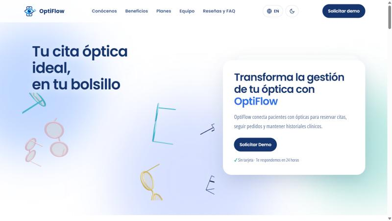

**Recomendación:**

Agregar en la sección principal y en la barra de navegación un botón por segmento, por ejemplo "Soy paciente: descarga la app" y "Tengo una óptica: solicita una demo", con enlace a la descarga de la aplicación.

**PROBLEMA #2:** La opción "Iniciar sesión" no permite ingresar

**Severidad:** 3

**Heurística violada:** Information Architecture - Is it usable?

**Problema:**

En el pie de página, la opción "Iniciar sesión" abre el formulario "Entra a tu óptica", que solicita correo y contraseña. Al presionar "Continuar", el usuario recibe un diálogo titulado "Solicitud lista" que indica que el acceso todavía no valida contraseñas. El usuario completa datos para una función que no está disponible y el título del mensaje no corresponde a la acción que realizó (ver Figura K2).

**Figura K2**

*Mensaje mostrado después de intentar iniciar sesión desde la Landing Page*

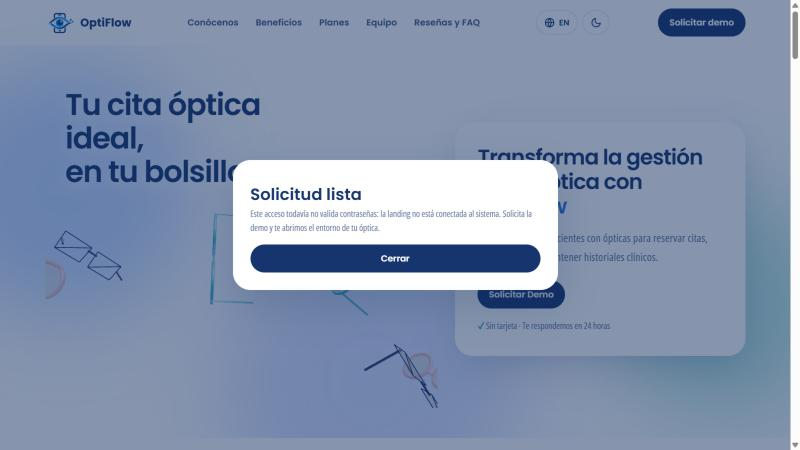

**Recomendación:**

Reemplazar la opción por un enlace a la aplicación móvil hasta que el acceso web esté conectado a los Web Services. Si se mantiene, avisar antes de pedir credenciales y usar un título acorde, como "Acceso no disponible".

**PROBLEMA #3:** Los diálogos de demo y de inicio de sesión no tienen botón para cerrar

**Severidad:** 2

**Heurística violada:** Usabilidad - Libertad y control del usuario

**Problema:**

Los diálogos "Solicita OptiFlow para tu óptica" y "Entra a tu óptica" solo se cierran con la tecla Esc o al hacer clic fuera de ellos. No muestran un botón "Cerrar" ni un ícono ×, a diferencia de los diálogos de privacidad y de términos. En un celular, donde no existe la tecla Esc, el usuario puede no saber cómo salir sin enviar el formulario (ver Figura K3).

**Figura K3**

*Diálogo de solicitud de demo sin control para cerrarlo*

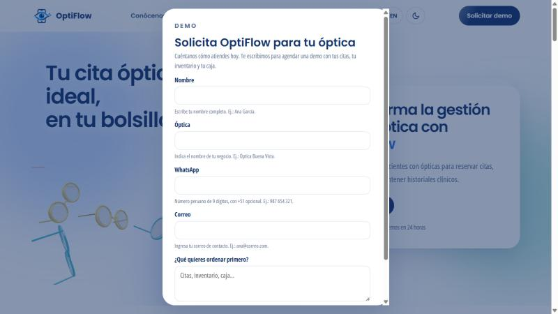

**Recomendación:**

Añadir un botón de cierre visible (×) en la esquina superior de todos los diálogos y un botón "Cancelar" junto a la acción principal.

**PROBLEMA #4:** El plan Básico ofrece "Empezar gratis" aunque es de pago

**Severidad:** 2

**Heurística violada:** Usabilidad - Consistencia y estándares

**Problema:**

El plan Básico cuesta S/ 49 al mes, pero su botón dice "Empezar gratis" y la página no explica si existe un periodo de prueba ni su duración. Además, el botón abre el mismo formulario de demo que los otros planes. El texto genera una expectativa que la página no cumple (ver Figura K4).

**Figura K4**

*Sección de planes con el botón "Empezar gratis" en un plan de pago*

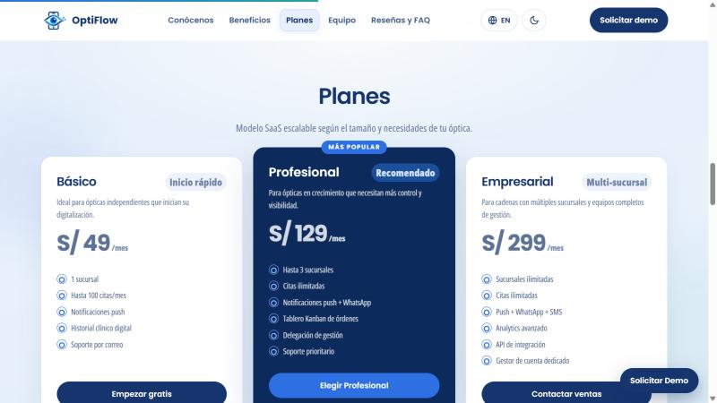

**Recomendación:**

Cambiar el texto a "Elegir Básico" o, si se ofrece una prueba gratuita, indicar su duración junto al precio (por ejemplo, "14 días gratis").

**PROBLEMA #5:** La sección de preguntas frecuentes contradice el uso de la aplicación

**Severidad:** 2

**Heurística violada:** Information Architecture - Is it credible?

**Problema:**

La respuesta a "¿Necesito instalar algo?" indica que no, porque OptiFlow funciona desde el celular y el navegador. Sin embargo, los beneficios de la página y la solución se basan en una aplicación Android que se debe instalar. La contradicción resta credibilidad a la información y no responde cómo obtener la aplicación (ver Figura K5).

**Figura K5**

*Respuesta de la sección de preguntas frecuentes sobre la instalación*

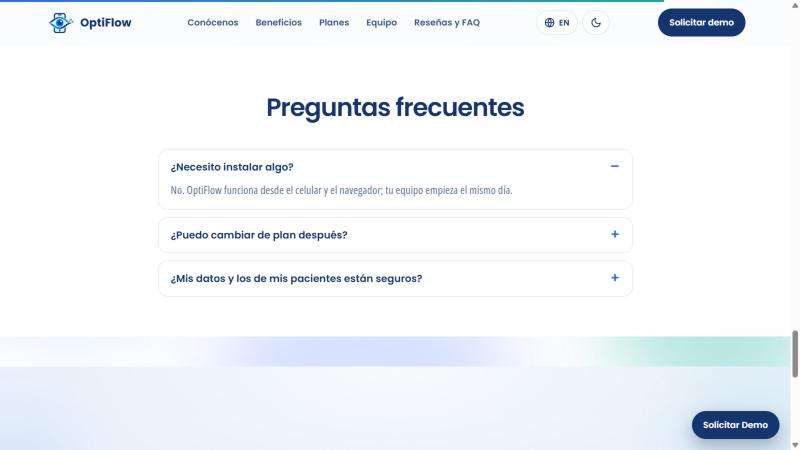

**Recomendación:**

Corregir la respuesta para indicar que pacientes y personal usan la aplicación Android, y agregar preguntas sobre cómo descargarla y cómo reservar una cita como paciente.

**PROBLEMA #6:** Textos de 8 px y contenido desplazado en celular

**Severidad:** 2

**Heurística violada:** Inclusive Design - Proporciona experiencias comparables

**Problema:**

En un ancho de 375 px, las etiquetas de las estadísticas ("Sin recordatorios", "Menos ausentismo" y "Menos tiempo") se muestran con un tamaño de 8 px, difícil de leer para personas mayores o con baja visión. Además, los fondos decorativos sobresalen del ancho de la pantalla, lo que deja una franja vacía a la derecha y descentra el contenido (ver Figura K6).

**Figura K6**

*Sección de estadísticas de la Landing Page en un ancho de celular*

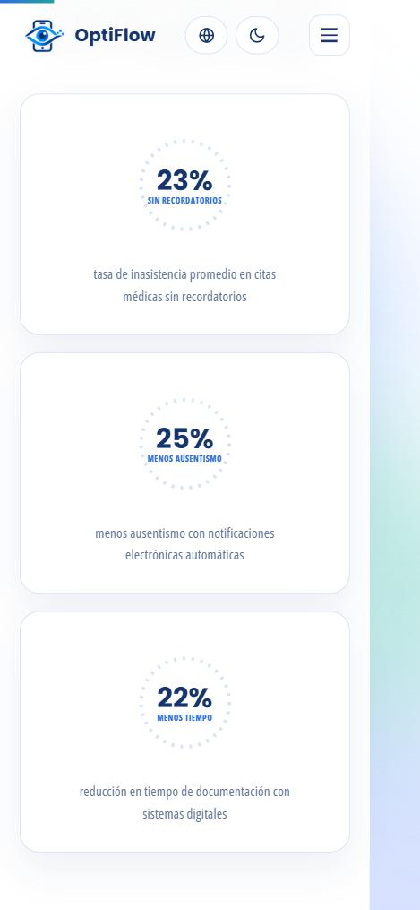

**Recomendación:**

Usar un tamaño mínimo de 12 px (idealmente 14 px) en textos secundarios y recortar los elementos decorativos con `overflow-x: hidden` en el elemento `html` para evitar el desplazamiento horizontal.

**PROBLEMA #7:** Cancelar una cita no pide confirmación

**Severidad:** 3

**Heurística violada:** Usabilidad - Prevención de errores

**Problema:**

En "Detalle de cita", el texto "Cancelar cita" cancela la reserva con un solo toque, muestra el mensaje breve "Cita cancelada" y regresa a "Mis citas". No hay un diálogo de confirmación ni una opción para deshacer la acción, por lo que un toque accidental libera el horario y el paciente pierde su cita (ver Figura K7).

**Figura K7**

*Detalle de la cita antes de cancelar (izquierda) y resultado inmediato después de un toque (derecha)*

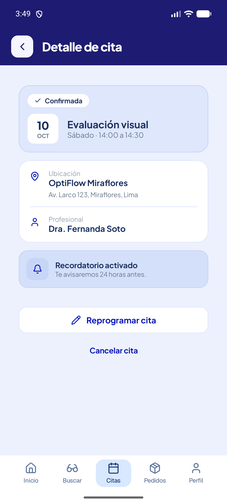 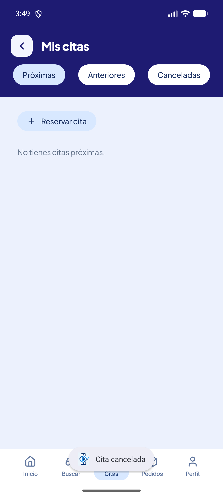

**Recomendación:**

Mostrar un diálogo de confirmación con la fecha y hora de la cita y las opciones "Cancelar cita" y "Mantener cita". Presentar la acción como un botón con color de advertencia para diferenciarla de "Reprogramar cita".

**PROBLEMA #8:** La nueva cita del personal clínico tiene datos fijos

**Severidad:** 3

**Heurística violada:** Usabilidad - Libertad y control del usuario

**Problema:**

En "Nueva cita" del rol de personal clínico, los campos "Servicio", "Óptica / sucursal" y "Fecha" muestran una flecha de selección, pero no responden al tocarlos. La fecha permanece fija en "Miércoles, 20 de junio" (junio de 2025), por lo que el usuario solo puede elegir la hora y no puede agendar una cita en otra fecha, sede o servicio (ver Figura K8).

**Figura K8**

*Pantalla "Nueva cita" del personal clínico con servicio, sucursal y fecha fijos*

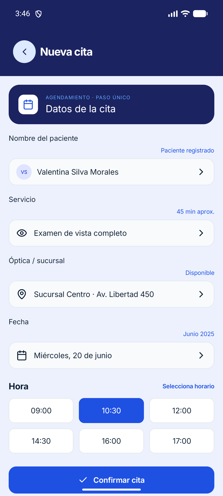

**Recomendación:**

Implementar selectores reales: lista de servicios, sucursales obtenidas de los Web Services y un calendario con la disponibilidad de la óptica. Quitar la flecha de los campos que no sean editables.

**PROBLEMA #9:** El registro de pacientes usa formatos de Chile

**Severidad:** 2

**Heurística violada:** Usabilidad - Correspondencia entre el sistema y el mundo real

**Problema:**

El formulario "Registro rápido de paciente" muestra como ejemplos el teléfono "+56 9 8745 9210" y la identificación "RUT 18.942.105-K", que son formatos de Chile. Las ópticas y los pacientes de OptiFlow están en el Perú, donde se usa el prefijo +51 y el DNI de 8 dígitos, por lo que los ejemplos pueden inducir a registrar datos con un formato incorrecto (ver Figura K9).

**Figura K9**

*Formulario de registro de pacientes del personal clínico*

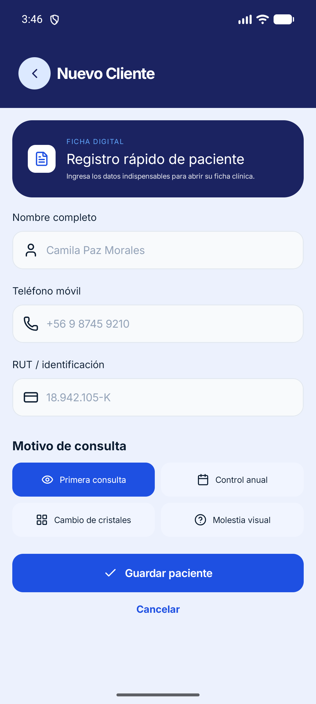

**Recomendación:**

Usar ejemplos locales ("+51 987 654 321" y "DNI / CE") y validar 9 dígitos para el celular y 8 dígitos para el DNI.

**PROBLEMA #10:** La misma entidad se llama "paciente" y "cliente"

**Severidad:** 1

**Heurística violada:** Usabilidad - Consistencia y estándares

**Problema:**

En la pantalla de inicio del personal, el acceso rápido se llama "Nuevo paciente", pero la pantalla que abre se titula "Nuevo Cliente" y su encabezado dice "Registro rápido de paciente". Usar dos términos para la misma entidad genera dudas sobre si se registra a un paciente o a un cliente comercial (ver Figura K9).

**Recomendación:**

Usar el término "paciente" en todo el flujo, de acuerdo con el lenguaje ubicuo del proyecto.

**PROBLEMA #11:** Las opciones de ayuda no muestran contenido

**Severidad:** 2

**Heurística violada:** Usabilidad - Ayuda y documentación

**Problema:**

En "Mi Perfil", la opción "Ayuda y soporte" lleva a la pantalla "Configuración", y allí "Ayuda y documentación" no abre ningún contenido. Lo mismo ocurre con "Privacidad y seguridad", "Idioma" y "Términos y privacidad", y con "Ayuda y documentación" en el menú "Más" del personal clínico. Todas muestran una flecha que sugiere que llevan a otra pantalla (ver Figura K10).

**Figura K10**

*Pantalla "Configuración" con opciones de ayuda sin contenido*

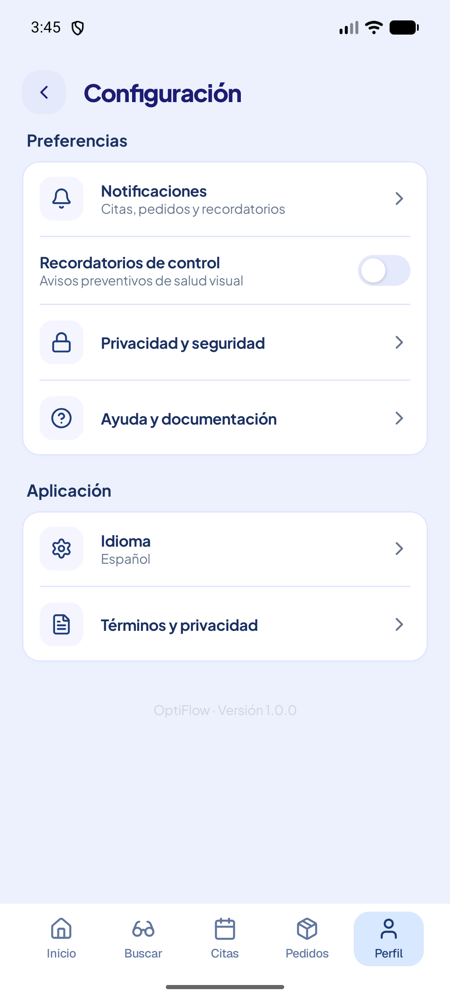

**Recomendación:**

Crear una pantalla de ayuda con preguntas frecuentes y datos de contacto de la óptica (WhatsApp o correo). Mientras no exista, ocultar las opciones que no tienen contenido.

**PROBLEMA #12:** La pantalla de inicio muestra datos que no corresponden al paciente

**Severidad:** 3

**Heurística violada:** Usabilidad - Visibilidad del estado del sistema

**Problema:**

Una cuenta de paciente recién creada, sin recetas ni pedidos registrados, muestra en "Accesos rápidos" los indicadores "Mis recetas · 2 activas" y "Mis pedidos · 1 en camino". En "Mi Perfil", la misma cuenta indica "1 recetas disponibles". La información sobre el estado del paciente no corresponde a sus datos y no coincide entre pantallas (ver Figura K11).

**Figura K11**

*Inicio (izquierda) y perfil (derecha) de una cuenta de paciente recién creada*

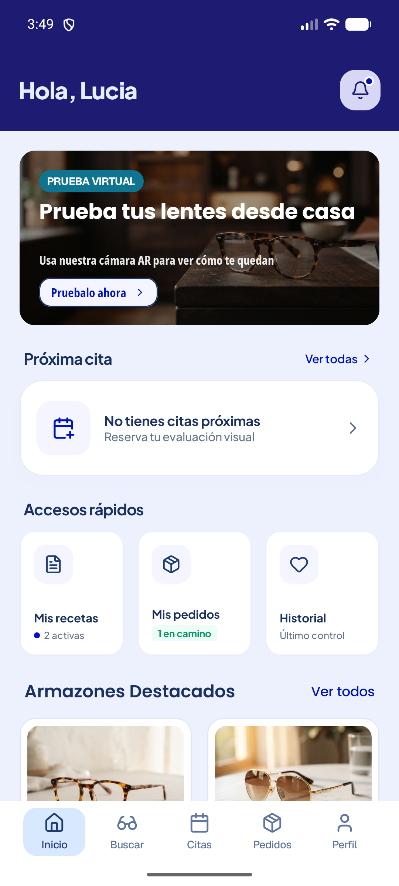 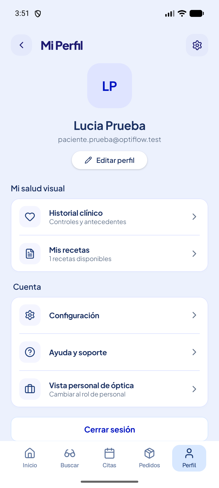

**Recomendación:**

Obtener los indicadores de recetas y pedidos desde los Web Services (historias clínicas y órdenes de trabajo del paciente) y mostrar un estado vacío cuando no existan registros, por ejemplo "Aún no tienes recetas".

**PROBLEMA #13:** Un paciente puede cambiar a la vista del personal clínico sin credenciales

**Severidad:** 3

**Heurística violada:** Information Architecture - Is it credible?

**Problema:**

En "Mi Perfil", la opción "Vista personal de óptica" cambia a la experiencia del personal clínico (agenda, pacientes, inventario y ventas) sin pedir credenciales ni validar el rol. Un paciente puede acceder a información de la óptica, y la elección de rol al iniciar sesión pierde sentido, lo que afecta la confianza en el manejo de los datos (ver Figura K12).

**Figura K12**

*Vista del personal clínico abierta desde el perfil de un paciente*

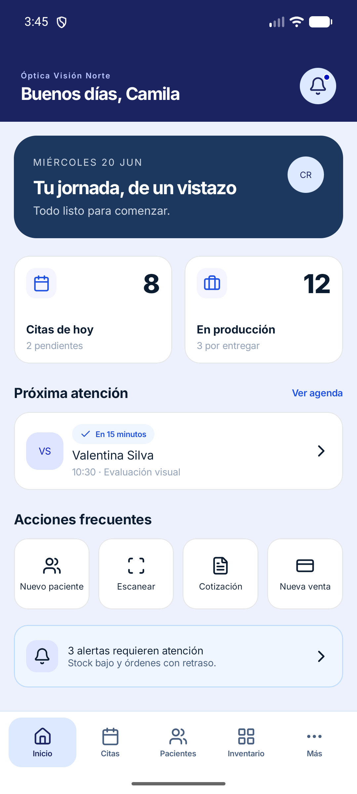

**Recomendación:**

Retirar la opción del perfil del paciente. El acceso a la experiencia del personal clínico debe darse solo al iniciar sesión con una cuenta de personal autorizada.

**PROBLEMA #14:** Los botones de solo ícono no tienen etiqueta accesible

**Severidad:** 2

**Heurística violada:** Inclusive Design - Proporciona experiencias comparables

**Problema:**

Los botones que solo muestran un ícono, como el de notificaciones (campana) de la pantalla de inicio, la flecha para volver y el engranaje de configuración, no tienen descripción de contenido (*content description*) en el árbol de accesibilidad de Android. Un usuario que navega con un lector de pantalla, como TalkBack, escucha un botón sin nombre y no sabe qué acción realiza (ver Figura K13).

**Figura K13**

*Pantalla de inicio del paciente con el botón de notificaciones sin etiqueta accesible*

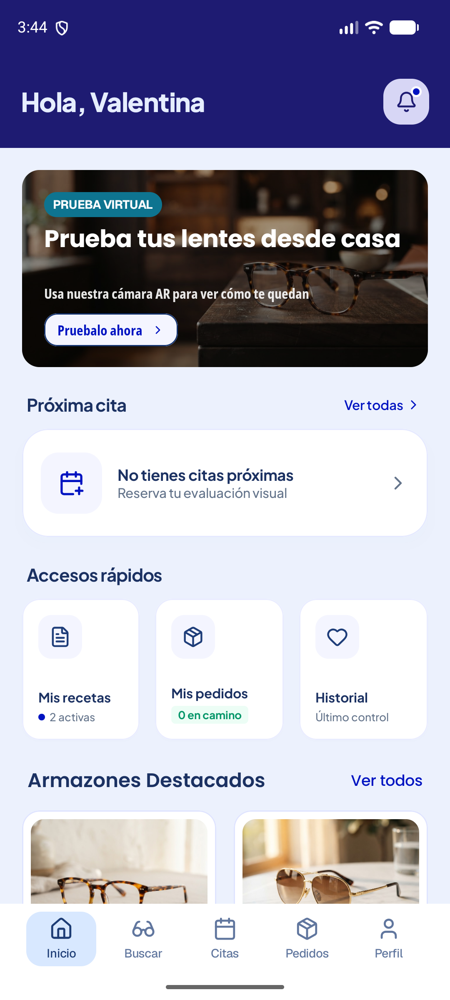

**Recomendación:**

Añadir una `contentDescription` a cada botón de solo ícono (por ejemplo, "Notificaciones", "Volver" y "Configuración") para que el lector de pantalla anuncie su función.

**PROBLEMA #15:** Los montos se muestran en una moneda que no corresponde al Perú

**Severidad:** 2

**Heurística violada:** Usabilidad - Correspondencia entre el sistema y el mundo real

**Problema:**

En el rol de personal clínico, la pantalla "Nueva cotización" muestra precios como "$89.900" y la pantalla "Reportes" muestra ventas totales de "$8.460.200", con el símbolo de dólar y el punto como separador de miles, formato propio del peso chileno. La Landing Page presenta los planes en soles (S/), y las ópticas y pacientes de OptiFlow pagan en soles, por lo que los montos pueden interpretarse de forma incorrecta (ver Figura K14).

**Figura K14**

*Montos en las pantallas "Nueva cotización" (izquierda) y "Reportes" (derecha)*

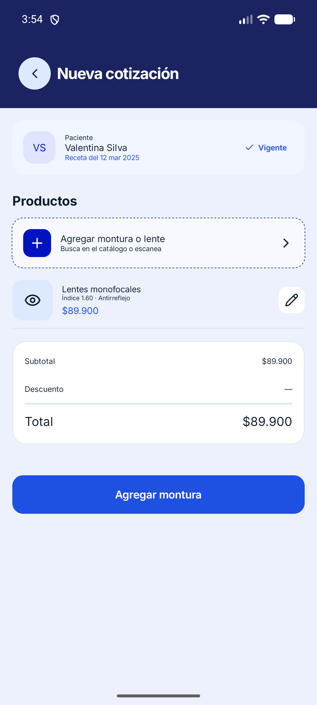 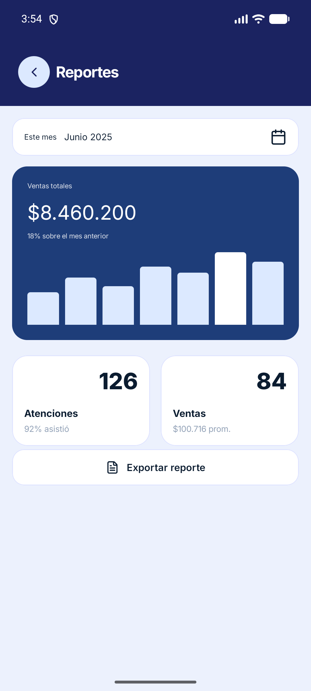

**Recomendación:**

Mostrar todos los montos en soles con el formato peruano (por ejemplo, "S/ 899.00"), usando un formateador de moneda con la configuración regional `es-PE`, igual que en la Landing Page.

### Seguimiento de las observaciones para AV2

Los hallazgos anteriores se mantienen con sus capturas y severidad. Un cambio de estilos o de navegación en el repositorio no basta para cerrar una observación: se debe repetir la tarea sobre la versión entregada y registrar el resultado. Las pruebas técnicas de 4.2.2 detectaron además dos problemas de integración: rutas antiguas del cliente Flutter y ausencia del encabezado de autenticación en sus solicitudes protegidas.

La Tabla K4 permite dejar constancia del cierre o de la persistencia de cada observación sin modificar la evidencia histórica.

**Tabla K4**

*Seguimiento de validación y compatibilidad para AV2*

| Referencia | Qué debe comprobarse | Versión / fecha | Resultado de la repetición | Evidencia y responsable |
|---|---|---|---|---|
| Hallazgos de la Landing Page | CTA, accesibilidad, navegación y lectura en móvil. | `main`, `6258035`, 11/11/2026. | Página pública en línea. Los botones de descarga llevan al vínculo de invitación de la versión 1.0 de Firebase App Distribution. | Tabla 135, Figuras 199 y 200, [ejecución 43140453746](https://github.com/BL-App-Movil-1ACC0238-2620-4951/Logix-OptiFlow-landing-page/actions/runs/43140453746). Becerra Ttito, Felix Orlando. |
| Hallazgos de la aplicación anterior | Repetir las tareas en el cliente que se entregará, sin trasladar automáticamente el resultado entre tecnologías. | Kotlin 1.0 (1), `22bf023`, 11/11/2026; ajustes del 12/11/2026. | Se repitieron contra Render el inicio de sesión, la búsqueda y reserva de citas, la ficha clínica, la cotización y el cierre de la venta. El 12/11/2026 el personal puede cancelar citas desde la ficha del paciente, la receta ya no muestra una DP sin dato y se quitó el recordatorio que no enviaba avisos. | Capturas de 4.2.2.6 y Tabla 135. Becerra Ttito, Felix Orlando. |
| Compatibilidad del contrato | Rutas `/api/v1`, respuesta de autenticación y encabezado Bearer del cliente Flutter. | Kotlin `22bf023` y Flutter `0344413`, 11/11/2026. | Kotlin: cumple; usa 64 de las 70 operaciones de `/api/v1`, inicia sesión con `POST /api/v1/auth/tokens` y envía el token Bearer. Flutter `0344413`: pendiente; mantiene `/login` y rutas antiguas y no envía el token. | Tablas 129 y 130. Kotlin: Becerra Ttito, Felix Orlando. Flutter: Atoche Gonzales, Nicolas Fernando (S2-T04). |
| Datos de demostración | Mostrar qué pantallas usan datos locales y cuáles confirman información persistida. | Kotlin `d6a6439`, 11/11/2026. | Kotlin: las pantallas de paciente y personal leen y guardan en el backend; Room solo conserva los últimos datos descargados para consultarlos sin conexión. Flutter: parte de las vistas usa `DemoData` y no se cuenta como integración terminada. | Tablas 129 y 130. Becerra Ttito, Felix Orlando. |
| Instalación y acceso | APK distribuido, dispositivo de prueba y conexión con la revisión del backend. | Kotlin 1.0 (1) y backend `71ed60c`, 11/11/2026. | APK release firmado, distribuido al grupo `optiflow-testers`, instalado en un celular Android y probado contra el backend `71ed60c` en Render. | Tabla 135 y Figuras 201 a 203. Becerra Ttito, Felix Orlando. |
