

# Capítulo II: Requirements Development and Software Solution Design

## 2.1. Competidores
El análisis competitivo examina soluciones de gestión óptica para identificar sus fortalezas, limitaciones y oportunidades de diferenciación. Aunque la propuesta integral de OptiFlow incluye procesos clínicos, comerciales y logísticos, el incremento priorizado para TB1 se concentra en la búsqueda de ópticas y la reserva de citas desde la perspectiva del paciente.

Se seleccionaron tres competidores: SIT-OPTICAL, OptiGestion y OPTOL. Los dos primeros presentan una orientación directa hacia el mercado peruano, mientras que OPTOL posee una propuesta con presencia internacional y una mayor trayectoria dentro del sector óptico.

**SIT-OPTICAL:**  Es una plataforma SaaS especializada en la gestión de ópticas en Perú. Su propuesta integra historia clínica optométrica, inventario multitienda, facturación electrónica mediante SUNAT, CRM especializado y herramientas de Business Intelligence. Asimismo, cuenta con funcionalidades de gestión de laboratorio, compras, recursos humanos y automatización mediante inteligencia artificial. La plataforma opera completamente en la nube y puede ser utilizada desde computadoras, tablets o teléfonos mediante navegador web.

**OptiGestion:**  Es una solución SaaS dirigida a ópticas, consultorios oftalmológicos y centros de salud visual del mercado peruano. La plataforma incluye funcionalidades de admisión de pacientes, historias clínicas, recetas digitales, cálculo de lunas y tratamientos, cotizaciones, inventario multi-sucursal, punto de venta y un Kanban logístico para el seguimiento de pedidos. Actualmente se encuentra en fase beta y desarrolla una estrategia de adquisición basada en un programa de usuarios fundadores.

**OPTOL:**  Es una plataforma SaaS especializada en ópticas, laboratorios ópticos y almacenes. Su propuesta integra gestión de inventario, ficha médica, ventas, órdenes de trabajo, facturación, campañas de marketing, laboratorios y múltiples sucursales. La solución se encuentra disponible desde diferentes dispositivos y permite utilizar la cámara de teléfonos o tablets para realizar operaciones relacionadas con inventario. También ofrece seguimiento de órdenes de trabajo y notificaciones automáticas para pacientes.

La selección de estos competidores permite contrastar la propuesta de OptiFlow con soluciones existentes que ya cubren parcialmente las necesidades identificadas. Por este motivo, el análisis no se limita a comparar funcionalidades, sino que busca identificar oportunidades reales de diferenciación en términos de movilidad, experiencia de usuario, integración entre áreas y trazabilidad del flujo completo de una orden óptica.

### 2.1.1. Análisis competitivo

El análisis competitivo tiene como objetivo identificar las principales diferencias entre OptiFlow y las soluciones existentes para la gestión de ópticas, permitiendo reconocer oportunidades de diferenciación y establecer estrategias frente a los principales competidores del mercado (ver Tabla 6).

**Tabla 6**

*Análisis competitivo de OptiFlow frente a SIT-OPTICAL, OptiGestion y OPTOL*

<table>
  <thead>
    <tr>
      <th colspan="6">Competitive Analysis Landscape</th>
    </tr>
  </thead>

  <tbody>
    <tr>
      <td><strong>¿Por qué llevar a cabo este análisis?</strong></td>
      <td colspan="5">
        Determinar cómo puede OptiFlow diferenciarse de las soluciones digitales existentes para ópticas mediante una experiencia mobile-first que integre los procesos clínicos, comerciales y logísticos, reduzca la fragmentación de información y mejore la trazabilidad de las órdenes de trabajo.
      </td>
    </tr>
    <tr>
      <td colspan="2"><strong>Competidor</strong></td>
      <td align="center">
    <strong>OptiFlow</strong>  
     

  </td>

  <td align="center">
    <strong>SIT-OPTICAL</strong>  
    

  </td>

  <td align="center">
    <strong>OptiGestion</strong>  
    

  </td>

  <td align="center">
    <strong>OPTOL</strong>  
    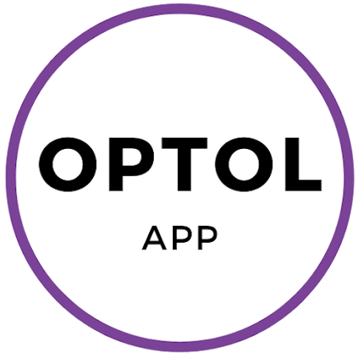

  </td>
    </tr>
    <tr>
      <td rowspan="2"><strong>Perfil</strong></td>
      <td><strong>Overview</strong></td>
      <td>
        Solución digital especializada en ópticas que integra gestión clínica, inventario, ventas y seguimiento de órdenes de trabajo, con énfasis en una experiencia móvil diferenciada según los roles del negocio.
      </td>
      <td>
        Plataforma SaaS especializada en ópticas peruanas que integra historia clínica, inventario multitienda, CRM, facturación electrónica y herramientas de gestión empresarial.
      </td>
      <td>
        Plataforma SaaS dirigida a ópticas y consultorios que integra historias clínicas, inventario, ventas, cotizaciones y seguimiento logístico de pedidos.
      </td>
      <td>
        Plataforma especializada en la gestión de ópticas, laboratorios y almacenes, con funcionalidades clínicas, comerciales, administrativas y logísticas.
      </td>
    </tr>
    <tr>
      <td>
        <strong>Ventaja competitiva 
        ¿Qué valor ofrece a los clientes?</strong>
      </td>
      <td>
        Integración continua entre consultorio, ventas y laboratorio mediante una experiencia mobile-first. Busca reducir errores de transcripción, tiempos de atención y dependencia de estaciones de trabajo fijas.
      </td>
      <td>
        Amplia cobertura funcional adaptada al mercado peruano, incluyendo gestión multitienda, facturación electrónica e integración de diferentes procesos administrativos.
      </td>
      <td>
        Centralización de procesos clínicos, comerciales y logísticos dentro de una solución orientada específicamente a establecimientos ópticos.
      </td>
      <td>
        Amplia experiencia en el sector óptico, soporte para múltiples sucursales, laboratorios y almacenes, además de funcionalidades disponibles desde dispositivos móviles.
      </td>
    </tr>
    <!-- PERFIL DE MARKETING -->
    <tr>
      <td rowspan="2"><strong>Perfil de Marketing</strong></td>
      <td><strong>Mercado objetivo</strong></td>
      <td>
        Ópticas medianas y cadenas en crecimiento que necesitan mejorar la coordinación entre administradores, optómetras, asesores de ventas y personal de laboratorio.
      </td>
      <td>
        Optómetras independientes, ópticas comerciales y cadenas de ópticas principalmente del mercado peruano.
      </td>
      <td>
        Ópticas, consultorios oftalmológicos y centros especializados en salud visual.
      </td>
      <td>
        Ópticas independientes, cadenas de ópticas, laboratorios ópticos y almacenes especializados.
      </td>
    </tr>
    <tr>
      <td><strong>Estrategias de marketing</strong></td>
      <td>
        Demostraciones B2B, pruebas piloto, Landing Page, difusión digital y validaciones directas con establecimientos ópticos.
      </td>
      <td>
        Demostraciones del producto, periodos de prueba, planes escalables y atención comercial mediante canales digitales.
      </td>
      <td>
        Programa de usuarios fundadores, acceso durante la etapa beta y captación temprana de ópticas interesadas en digitalizar sus operaciones.
      </td>
      <td>
        Demostraciones comerciales, pruebas del servicio, presencia digital, testimonios de clientes y comercialización internacional.
      </td>
    </tr>
    <!-- PERFIL DE PRODUCTO -->
    <tr>
      <td rowspan="3"><strong>Perfil de Producto</strong></td>
      <td><strong>Productos &amp; Servicios</strong></td>
      <td>
        Historia clínica digital, gestión de inventario, ventas, seguimiento Kanban de órdenes de trabajo, notificaciones push, consulta de stock y seguimiento de pedidos.
      </td>
      <td>
        Historia clínica, inventario multitienda, CRM, facturación electrónica, agenda, gestión de laboratorio, reportes y herramientas empresariales.
      </td>
      <td>
        Historias clínicas, admisión de pacientes, cotizaciones, inventario multi-sucursal, punto de venta y seguimiento Kanban de pedidos.
      </td>
      <td>
        Ficha médica, inventarios, ventas, facturación, órdenes de laboratorio, almacenes, agenda, marketing y reportes.
      </td>
    </tr>
    <tr>
      <td><strong>Precios &amp; Costos</strong></td>
      <td>
        Modelo SaaS por validar con los segmentos objetivo. Se proyecta una suscripción escalable según número de usuarios o sucursales.
      </td>
      <td>
        Modelo de suscripción mensual mediante diferentes planes según funcionalidades y tamaño de la operación.
      </td>
      <td>
        Modelo SaaS actualmente asociado a una estrategia de captación temprana mediante acceso beta y beneficios para usuarios fundadores.
      </td>
      <td>
        Modelo de suscripción mediante planes diferenciados de acuerdo con las funcionalidades y necesidades del establecimiento.
      </td>
    </tr>
    <tr>
      <td><strong>Canales de distribución (Web y/o Móvil)</strong></td>
      <td>
        Aplicación móvil nativa o multiplataforma, servicios RESTful y Landing Page web.
      </td>
      <td>
        Plataforma SaaS accesible principalmente mediante navegador web desde diferentes dispositivos.
      </td>
      <td>
        Plataforma SaaS web accesible mediante navegador.
      </td>
      <td>
        Plataforma SaaS accesible mediante navegadores web, smartphones y tablets.
      </td>
    </tr>
    <!-- SWOT -->
    <tr>
      <td rowspan="4"><strong>Análisis SWOT</strong></td>
      <td><strong>Fortalezas</strong></td>
      <td>
        Enfoque mobile-first; experiencia según roles; integración clínica, comercial y logística; trazabilidad de órdenes; utilización de recursos del dispositivo móvil.
      </td>
      <td>
        Especialización en el mercado peruano; amplia cobertura funcional; administración multitienda; facturación electrónica y CRM.
      </td>
      <td>
        Especialización en ópticas; integración de procesos clínicos y comerciales; seguimiento Kanban; solución adaptada al contexto local.
      </td>
      <td>
        Trayectoria en el sector; presencia internacional; soporte para ópticas, laboratorios y almacenes; capacidad multitienda y acceso móvil.
      </td>
    </tr>
    <tr>
      <td><strong>Debilidades</strong></td>
      <td>
        Producto nuevo sin una cartera consolidada de clientes; menor reconocimiento de marca; modelo comercial y funcionalidades todavía sujetos a validación.
      </td>
      <td>
        Una amplia cantidad de funcionalidades puede incrementar la complejidad para pequeñas ópticas que únicamente necesitan procesos esenciales.
      </td>
      <td>
        Menor trayectoria y reconocimiento frente a competidores consolidados; producto todavía en proceso de crecimiento.
      </td>
      <td>
        Su amplia cobertura funcional puede generar una mayor complejidad de adopción para establecimientos con necesidades más simples.
      </td>
    </tr>
    <tr>
      <td><strong>Oportunidades</strong></td>
      <td>
        Creciente digitalización de ópticas que todavía utilizan papel, hojas de cálculo y mensajería; aumento del uso de smartphones y necesidad de mayor trazabilidad.
      </td>
      <td>
        Crecimiento de cadenas de ópticas y necesidad de soluciones integradas adaptadas al contexto empresarial peruano.
      </td>
      <td>
        Captación de pequeñas y medianas ópticas que buscan reemplazar procesos manuales mediante soluciones SaaS especializadas.
      </td>
      <td>
        Expansión hacia nuevos mercados y crecimiento de organizaciones que requieren gestionar varias sucursales y laboratorios.
      </td>
    </tr>
    <tr>
      <td><strong>Amenazas</strong></td>
      <td>
        Competidores con mayor trayectoria; resistencia al cambio del personal; aparición de nuevos SaaS especializados y posibilidad de que soluciones existentes fortalezcan sus experiencias móviles.
      </td>
      <td>
        Aparición de soluciones más simples, móviles y especializadas que compitan mediante una experiencia de usuario de menor complejidad.
      </td>
      <td>
        Competidores consolidados con mayor cartera de clientes, recursos y reconocimiento en el mercado.
      </td>
      <td>
        Soluciones locales mejor adaptadas al mercado peruano y nuevos productos especializados en experiencias móviles más simples.
      </td>
    </tr>
  </tbody>
</table>

### 2.1.2. Estrategias y tácticas frente a competidores

A partir del análisis competitivo realizado sobre SIT-OPTICAL, OptiGestion y OPTOL, OptiFlow plantea una serie de estrategias orientadas a responder a las fortalezas de los competidores, aprovechar oportunidades identificadas en sus debilidades y reforzar los elementos diferenciales de la propuesta. Estas estrategias se enfocan principalmente en la simplicidad operativa, la continuidad de la información, la especialización por roles y el aprovechamiento del contexto móvil.

#### Estrategia 1: Simplificación de la experiencia según el rol del usuario

SIT-OPTICAL y OPTOL disponen de una amplia cantidad de módulos y funcionalidades, lo cual representa una fortaleza en términos de cobertura funcional, pero también puede incrementar la complejidad de interacción para usuarios que solo necesitan realizar un conjunto específico de tareas.

OptiFlow buscará aprovechar esta oportunidad mediante una experiencia diferenciada según cada rol. Como tácticas, se plantea desarrollar dashboards específicos para administradores, optómetras, asesores de ventas y personal de laboratorio, limitar las acciones disponibles de acuerdo con sus responsabilidades y priorizar visualmente las tareas de mayor frecuencia e importancia. De esta manera, cada usuario podrá concentrarse únicamente en la información necesaria para cumplir sus objetivos.

#### Estrategia 2: Competencia basada en simplicidad antes que en amplitud funcional

Los competidores más consolidados poseen una cantidad considerable de funcionalidades. Intentar igualar su cobertura desde las primeras versiones podría incrementar la complejidad del producto y desviar los esfuerzos de OptiFlow de los procesos que generan mayor valor.

Como táctica, OptiFlow priorizará inicialmente las funcionalidades asociadas al core business: registro y consulta de información clínica, inventario, ventas, generación y seguimiento de órdenes de trabajo y comunicación con el paciente. Las capacidades complementarias se incorporarán posteriormente únicamente cuando las entrevistas, validaciones y métricas demuestren su relevancia para los segmentos objetivo.

#### Estrategia 3: Reducción de la dependencia de procesos manuales y canales informales

Además de los competidores digitales, OptiFlow debe considerar que muchas ópticas pueden continuar utilizando alternativas como papel, hojas de cálculo o aplicaciones de mensajería. Estas herramientas representan una competencia indirecta debido a su familiaridad y bajo costo de adopción.

Las tácticas consistirán en centralizar las recetas, ventas, inventario y órdenes de trabajo dentro de un mismo ecosistema, mantener un historial trazable de los cambios realizados y automatizar las comunicaciones relacionadas con el estado de los pedidos. El objetivo será que el sistema reduzca tareas manuales en lugar de añadir pasos adicionales al trabajo cotidiano.

#### Estrategia 4: Facilitar la adopción del producto

La resistencia al cambio constituye una amenaza relevante frente a cualquier solución que busque reemplazar procesos previamente realizados mediante herramientas conocidas por el personal.

OptiFlow buscará reducir esta barrera mediante un proceso de adopción progresivo. Entre las tácticas propuestas se encuentran un onboarding guiado, interfaces con terminología propia del dominio óptico, instrucciones contextuales y pruebas piloto con establecimientos reales. Además, las principales tareas deberán poder comprenderse sin necesidad de conocimientos técnicos especializados.

#### Estrategia 5: Fortalecer la trazabilidad y comunicación con el paciente

Los competidores ya incorporan mecanismos relacionados con seguimiento de órdenes y notificaciones, por lo que OptiFlow deberá ofrecer una experiencia clara y consistente en este aspecto para generar valor adicional tanto para el personal como para los pacientes.

Como tácticas, se plantea implementar estados comprensibles para las órdenes, notificaciones push ante cambios relevantes y mecanismos para consultar recetas y seguimiento de pedidos. Esto busca reducir consultas repetitivas mediante llamadas o mensajería y aumentar la transparencia durante el proceso de fabricación de los lentes.

## 2.2. Entrevistas

### 2.2.1. Diseño de entrevistas

Preguntas generales:

1.  Datos de perfil: ¿Podrías indicarme tu nombre,  edad, estado civil y ocupación exacta?
2.  Contexto personal: ¿En qué distrito resides?
3.  Entorno digital: ¿Qué dispositivos (móvil, tablet, laptop) usas más en tu vida diaria y cuáles son tus canales digitales o marcas preferidas para informarte sobre el sector?

**Primer Segmento: *Optómetra***

4.  ¿Cómo describirías el funcionamiento general de tu óptica en el día a día?
5.  ¿Cuáles son las principales responsabilidades que tienes como administrador/a y cuánto tiempo te quita la parte operativa?( Agendamiento, historial médico,etc)
6.  ¿Qué es lo que más valoras en la gestión de una óptica para considerar que el negocio es realmente "eficiente"?
7.  ¿Cómo es actualmente el proceso desde que el cliente elige una montura hasta que el pedido llega al laboratorio?
8.  En cuanto a los historiales médicos, ¿cómo aseguras que la información de la consulta esté disponible inmediatamente para la venta comercial?
9.  ¿Cómo gestionas el inventario para saber exactamente qué tienes en stock y cuándo necesitas reponer sin tener que contar piezas manualmente?
10.  ¿Qué tipo de herramientas o sistemas utilizas hoy para centralizar las ventas, la clínica y la administración?¿Cuáles son?
11.  ¿Qué tan fácil te resulta hoy obtener un reporte de rentabilidad o de productos más vendidos al final del mes?
12.  ¿Cómo es la relación con tus clientes y qué procesos sigues para recordarles que deben volver para un ajuste o una nueva revisión?
13.  ¿Cómo manejas la competencia y qué aspectos consideras que hacen que un cliente prefiera tu servicio frente a una gran cadena?
14.  ¿Qué mejoras o procesos te gustaría automatizar en el futuro para que tú y tu equipo puedan enfocarse más en el paciente y menos en el papeleo?
15.  ¿Cómo imaginas que debería evolucionar una óptica para adaptarse a un mercado donde el cliente espera rapidez y acceso digital a su información

**Segundo Segmento: *Clientes de la óptica***

4. ¿Con qué frecuencia acudes a la óptica a medirte la vista o renovar tus lentes, y por qué motivo principal?
5. ¿Qué tipo de corrección visual utilizas actualmente (visión sencilla, bifocales, progresivos) y cuántas horas al día usas pantallas?
6. ¿Cómo ha sido tu experiencia habitual al momento de esperar por la fabricación o entrega de tus lentes?
7. ¿Alguna vez has experimentado retrasos o errores en la entrega de tus lentes? ¿Cómo te comunicaron ese problema?
8. ¿Cómo prefieres enterarte de que tus lentes ya están listos para ser recogidos (WhatsApp, SMS, llamada)?
9. ¿Te gustaría contar con un historial o carné digital con la receta de tus lentes accesible desde tu teléfono?
10. ¿Qué tan dispuesto/a estarías a recibir recordatorios automáticos sobre tus controles visuales o vencimiento de la receta?
11. ¿Estarías dispuesto/a a rastrear el estado de fabricación de tus lentes mediante un enlace de seguimiento en tiempo real?
12. ¿Qué es lo que más valoras de la atención en una óptica (rapidez, precio, asesoría, puntualidad en la entrega)?
13. ¿Qué canales digitales utilizas para investigar ofertas, marcas de monturas o salud visual antes de comprar?
14. ¿Has tenido problemas para recordar el tipo de luna o tratamiento que compraste en tu última visita?
15. ¿Qué haría que recomiendes una óptica a tus familiares o amigos sobre otras alternativas?

### 2.2.2. Registro de entrevistas

En esta sección presentamos los registros de las entrevistas que hicimos para cada segmento objetivo de nuestra aplicación.

**Segmento 1: *Staff de la Óptica***

El registro de la entrevista 1 del segmento staff de la óptica se presenta en la Tabla 7.

**Tabla 7**

*Registro de la entrevista 1 del segmento staff de la óptica*

| Campo | Detalle |
| :--- | :--- |
| **Entrevista** | **#1** |
| **Nombre** | Liz |
| **Apellidos** | Guevara |
| **Edad** | 30 |
| **Distrito** | Tarapoto |
| **Evidencia** | 

 |
| **Link** | [Ver grabación aquí](https://upcedupe-my.sharepoint.com/:v:/g/personal/u202411521_upc_edu_pe/IQBXLLgufdLNR4wlRKUybGTaAT9_nKNDnHk8RC6EUQi7FB4?e=UPxDWc&nav=eyJyZWZlcnJhbEluZm8iOnsicmVmZXJyYWxBcHAiOiJTdHJlYW1XZWJBcHAiLCJyZWZlcnJhbFZpZXciOiJTaGFyZURpYWxvZy1MaW5rIiwicmVmZXJyYWxBcHBQbGF0Zm9ybSI6IldlYiIsInJlZmVycmFsTW9kZSI6InZpZXcifX0%3D)
| **Duración** | 0:00 min - 13:22 min |
| **Resumen** | La entrevista a Liz Guevara evidenció que la óptica tiene una gestión principalmente manual, utilizando celular, redes sociales, Word y Excel para atender a los clientes y administrar el negocio. Sus principales funciones son realizar mediciones visuales, asesorar sobre lentes y concretar ventas, buscando garantizar la satisfacción del paciente. El control de historiales e inventario se realiza manualmente, lo que dificulta obtener reportes precisos. Entre las principales necesidades identificadas están la automatización de recordatorios, mayor publicidad y una aplicación que permita a los clientes consultar el estado de sus pedidos y las monturas disponibles, mejorando la atención y ampliando el alcance del negocio.|

El registro de la entrevista 2 del segmento staff de la óptica se resume en la Tabla 8.

**Tabla 8**

*Registro de la entrevista 2 del segmento staff de la óptica*

| Campo | Detalle |
| :--- | :--- |
| **Entrevista** | **#2** |
| **Nombre** | Marcos |
| **Apellidos** | Ruiz Coba |
| **Edad** | 52 |
| **Distrito** | Lambayeque |
| **Evidencia** | 

 |
| **Link** | [Ver grabación aquí](https://upcedupe-my.sharepoint.com/:v:/g/personal/u202411521_upc_edu_pe/IQA_o5xWsuv7S64CxdxlRuxAATN3jH0bNCNtNslhofYA-TY?e=DTSMx8&nav=eyJyZWZlcnJhbEluZm8iOnsicmVmZXJyYWxBcHAiOiJTdHJlYW1XZWJBcHAiLCJyZWZlcnJhbFZpZXciOiJTaGFyZURpYWxvZy1MaW5rIiwicmVmZXJyYWxBcHBQbGF0Zm9ybSI6IldlYiIsInJlZmVycmFsTW9kZSI6InZpZXcifX0%3D)
| **Duración** | 0:00 min - 15:17 min |
| **Resumen** | La entrevista a Marcos Ruiz evidenció que la óptica utiliza equipos especializados y herramientas digitales para el diagnóstico y registro de pacientes. Cuenta con una base de clientes frecuentes gracias a la calidad del servicio y utiliza un sistema que automatiza recordatorios de citas, controles y seguimiento de pedidos mejorando la organización y rapidez de atención. Entre sus principales objetivos está digitalizar y optimizar aún más los procesos, incorporando herramientas como internet e inteligencia artificial para mejorar la atención, agilizar la gestión e investigación de casos y mantener la competitividad de la óptica.|

El registro de la entrevista 3 del segmento staff de la óptica se detalla en la Tabla 9.

**Tabla 9**

*Registro de la entrevista 3 del segmento staff de la óptica*

| Campo | Detalle |
| :--- | :--- |
| **Entrevista** | **#3** |
| **Nombre** | Adan |
| **Apellidos** | Ruiz Coba |
| **Edad** | 34 |
| **Distrito** | Tarapoto |
| **Evidencia** | 

 |
| **Link** | [Ver grabación aquí](https://upcedupe-my.sharepoint.com/:v:/g/personal/u202411521_upc_edu_pe/IQCQotJFa40lRYgoZDHd8J7YAX1rOEMI58vA1Df2vhpqixQ?e=ZJP0PV&nav=eyJyZWZlcnJhbEluZm8iOnsicmVmZXJyYWxBcHAiOiJTdHJlYW1XZWJBcHAiLCJyZWZlcnJhbFZpZXciOiJTaGFyZURpYWxvZy1MaW5rIiwicmVmZXJyYWxBcHBQbGF0Zm9ybSI6IldlYiIsInJlZmVycmFsTW9kZSI6InZpZXcifX0%3D)
| **Duración** | 0:00 min - 45:00 min |
| **Resumen** | La entrevista a Adán Ruiz Jova permitió identificar que el celular es la principal herramienta tecnológica en su trabajo, ya que lo utiliza para comunicarse con pacientes, realizar pagos mediante Yape, Plin y Visa, y acceder a capacitaciones. La computadora se utiliza principalmente para tareas administrativas y contables. Asimismo, señaló que el negocio enfrenta dificultades por la competencia, la situación económica y política y la disminución de clientes, debido también a que muchas personas postergan la compra de lentes. Aunque reconoce el uso de historias clínicas digitales y equipos tecnológicos para mediciones visuales, considera que la digitalización debe complementar y no reemplazar la atención médica. Para él, la atención personalizada, la interacción humana y el criterio profesional siguen siendo fundamentales para atender las necesidades particulares de cada paciente.|

**Segmento 2: *Clientes de la óptica***

El registro de la entrevista 1 del segmento clientes de la óptica se presenta en la Tabla 10.

**Tabla 10**

*Registro de la entrevista 1 del segmento clientes de la óptica*

| Campo | Detalle |
| :--- | :--- |
| **Entrevista** | **#1** |
| **Nombre** | Azumy Cristal |
| **Apellidos** | Bautista Coral |
| **Edad** | 20 |
| **Distrito** | El Agustino |
| **Evidencia** | 

 |
| **Link** | [Microsoft stream](https://upcedupe-my.sharepoint.com/:v:/g/personal/u202417405_upc_edu_pe/IQBIEeX3NHMTSJ-Hs-6tRzXVAfGqU3hm1XieccvWsvphaTI?nav=eyJyZWZlcnJhbEluZm8iOnsicmVmZXJyYWxBcHAiOiJTdHJlYW1XZWJBcHAiLCJyZWZlcnJhbFZpZXciOiJTaGFyZURpYWxvZy1MaW5rIiwicmVmZXJyYWxBcHBQbGF0Zm9ybSI6IldlYiIsInJlZmVycmFsTW9kZSI6InZpZXcifX0%3D&e=LflBFo)
| **Duración** | 0:00 min - 7:34 min |
| **Resumen** | Azumy es una estudiante universitaria de 20 años y trabajadora a medio tiempo que reside en El Agustino. Pasa aproximadamente 6 horas diarias frente a pantallas y utiliza lentes de visión sencilla debido a la fatiga visual. Valora la buena asesoría y la puntualidad en la entrega por parte de las ópticas. Mostró gran interés en una solución digital que le permita tener su historial y receta a la mano en el teléfono, dado que suele olvidar qué tipo de luna o tratamiento eligió en compras anteriores. Considera muy útil poder rastrear el estado de fabricación de sus lentes mediante un enlace en tiempo real (comparándolo con la logística de Shalom) y acepta recibir recordatorios de renovación vía WhatsApp. Recomienda que la interfaz de cualquier aplicación sea sumamente clara y fácil de entender, especialmente pensando en la accesibilidad para adultos mayores. |

El registro de la entrevista 2 del segmento clientes de la óptica se resume en la Tabla 11.

**Tabla 11**

*Registro de la entrevista 2 del segmento clientes de la óptica*

| Campo | Detalle |
| :--- | :--- |
| **Entrevista** | **#2** |
| **Nombre** | Alejandro  |
| **Apellidos** | Livano Flores |
| **Edad** | 29 |
| **Distrito** | Chorrillos |
| **Evidencia** | 

 |
| **Link** | [Microsoft stream](https://upcedupe-my.sharepoint.com/:v:/g/personal/u20211b387_upc_edu_pe/IQBMUlBOK_rhRI8Pq8g7udEgAVBBYM9n0z2XQPdOsLIoIWM?e=ekXG8g&nav=eyJyZWZlcnJhbEluZm8iOnsicmVmZXJyYWxBcHAiOiJTdHJlYW1XZWJBcHAiLCJyZWZlcnJhbFZpZXciOiJTaGFyZURpYWxvZy1MaW5rIiwicmVmZXJyYWxBcHBQbGF0Zm9ybSI6IldlYiIsInJlZmVycmFsTW9kZSI6InZpZXcifX0%3D)|
| **Duración** | 0:00 min - 4:36 min |
| **Resumen** | Alejandro es un arquitecto soltero de 29 años que reside en Chorrillos. Pasa entre 8 y 9 horas diarias frente a pantallas debido a su trabajo y acude a la óptica con una frecuencia de cada cuatro meses para revisar su graduación visual. Valora principalmente la rapidez en el servicio y la claridad en la comunicación al momento de atenderse. Mostró gran interés en contar con un historial o carné digital en el celular para consultar su receta y tratamientos, ya que no suele recordar con exactitud las especificaciones técnicas de sus lunas anteriores. Considera muy conveniente recibir notificaciones automáticas tanto para el recojo de sus lentes como para recordarle sus controles periódicos, dado que por su rutina laboral suele olvidarlos. Además, valida positivamente poder rastrear el estado de fabricación de sus monturas en tiempo real y destaca que la agilidad en la entrega es el factor determinante para recomendar una óptica a sus conocidos. |

El registro de la entrevista 3 del segmento clientes de la óptica se detalla en la Tabla 12.

**Tabla 12**

*Registro de la entrevista 3 del segmento clientes de la óptica*

| Campo | Detalle |
| :--- | :--- |
| **Entrevista** | **#3** |
| **Nombre** | Antares Megan  |
| **Apellidos** | Celis Berrospi |
| **Edad** | 18 |
| **Distrito** | San Juan de Lurigancho |
| **Evidencia** | 

 |
| **Link** | [Microsoft stream](https://upcedupe-my.sharepoint.com/:v:/g/personal/u201911249_upc_edu_pe/IQDB7sUDSxCQQI6LAjHWwDwEASD3T5jyumGZBik3DVA76Nw?e=GyE33S&nav=eyJyZWZlcnJhbEluZm8iOnsicmVmZXJyYWxBcHAiOiJTdHJlYW1XZWJBcHAiLCJyZWZlcnJhbFZpZXciOiJTaGFyZURpYWxvZy1MaW5rIiwicmVmZXJyYWxBcHBQbGF0Zm9ybSI6IldlYiIsInJlZmVycmFsTW9kZSI6InZpZXcifX0%3D)|
| **Duración** | 0:00 min - 6:32 min |
| **Resumen** | Antares Megan Celis es una joven de 18 años que reside en San Juan de Lurigancho. Utiliza principalmente su celular y laptop durante el día y pasa aproximadamente entre 8 y 9 horas frente a pantallas debido a sus actividades diarias y entretenimiento. Actualmente utiliza lentes de visión sencilla para corregir la miopía y suele acudir a la óptica aproximadamente una vez al año o cuando percibe cambios en su visión. Durante la entrevista señaló que valora principalmente una buena asesoría y la puntualidad en la entrega de sus lentes. Además, mostró interés en contar con una solución digital que le permita acceder desde su teléfono a su receta e historial visual, ya que suele olvidar datos como la medida, el tipo de luna o los tratamientos adquiridos anteriormente. También considera útil poder rastrear en tiempo real el estado de fabricación de sus lentes para saber cuándo estarán listos sin necesidad de contactar constantemente a la óptica. Prefiere recibir notificaciones y recordatorios mediante WhatsApp, tanto para conocer cuándo sus lentes están disponibles como para recordar futuros controles visuales. Finalmente, considera que una buena atención, la claridad en los precios, el asesoramiento y el cumplimiento de los tiempos de entrega son factores importantes para recomendar una óptica a familiares o amigos. |

### 2.2.3. Análisis de entrevistas

El análisis de las entrevistas organiza los hallazgos por segmento para fundamentar los perfiles de usuario y las decisiones de diseño. Los porcentajes describen solo a los participantes entrevistados.

**Segmento 1: *Staff de la Óptica***

En las tres entrevistas realizadas a profesionales de ópticas de Tarapoto y Lambayeque se identificó un nivel de digitalización variada. El 67% utiliza el celular para comunicación, pagos y capacitaciones, mientras que el 33% cuenta con equipos especializados y sistemas digitales para el diagnóstico y registro de pacientes.

Respecto a la gestión, el 33% ya utiliza un sistema para automatizar citas, controles y seguimiento de pedidos; otro 33% mantiene una gestión principalmente manual, utilizando celular, redes sociales, Word y Excel; y el 33% restante presenta un nivel intermedio, utilizando herramientas digitales pero manteniendo la atención personalizada como elemento fundamental. Asimismo, el 33% muestra una mayor madurez digital y desea incorporar inteligencia artificial para optimizar la gestión e investigación de casos, mientras que el 67% todavía prioriza necesidades básicas como automatizar recordatorios, mejorar el control de inventario y permitir a los clientes consultar sus pedidos y monturas disponibles.

Finalmente, el 100% de los entrevistados consideran que la calidad del servicio y la satisfacción del paciente son primordiales para el éxito de la óptica.

**Segmento 2: *Clientes de la Óptica***

Para el segmento de clientes se realizaron tres entrevistas a jóvenes de 18 a 29 años de distintos distritos de Lima, identificando necesidades y expectativas comunes en la adquisición y uso de lentes. El 100% pasa entre 6 y 9 horas diarias frente a pantallas y tiene un buen manejo de dispositivos móviles y plataformas digitales. Asimismo, el 100% considera necesario acceder desde el celular a su receta e historial visual, ya que suelen olvidar detalles de compras anteriores, como el tipo de luna o los tratamientos.

De igual forma, el 100% mostró interés en rastrear en tiempo real el estado de fabricación de sus lentes y recibir notificaciones y recordatorios por WhatsApp sobre sus pedidos y próximos controles visuales. Los principales aspectos valorados por el 100% son la rapidez del servicio, puntualidad en la entrega y claridad en la comunicación. Además, la rapidez de entrega es un factor importante para recomendar una óptica, mientras que los precios claros y una buena asesoría favorecen la fidelización.

En conclusión, el 100% de los entrevistados presenta expectativas relacionadas con el acceso inmediato a su información, seguimiento de pedidos, notificaciones y una atención rápida. También se destaca la importancia de una interfaz sencilla e inclusiva, que pueda ser utilizada fácilmente por personas de diferentes edades.

**Conclusión del análisis**

En conjunto, las entrevistas identifican necesidades de acceso a la información, coordinación y seguimiento que orientan la propuesta de OptiFlow. Los testimonios aportan evidencia cualitativa para priorizar requisitos, pero no permiten demostrar por sí solos una reducción de errores, tiempos o costos. Esos efectos deberán contrastarse mediante evaluaciones posteriores de la solución.

## 2.3. Needfinding

### 2.3.1. User Personas

A partir de las entrevistas y del análisis del servicio óptico se construyeron dos *User Personas*: Marcelo Ruiz, que representa al personal del establecimiento, y Valeria Morales, que representa al paciente. Son arquetipos de diseño que sintetizan necesidades, motivaciones y frustraciones de los segmentos. Su propósito es orientar la priorización de tareas y el diseño de las experiencias móviles.

**1. Segmento 1: Staff de la Óptica (Administrador y Optómetra)**

Para este segmento se elaboró el User Persona Marcelo Ruiz. Se consideraron factores representativos como su experiencia gestionando la atención en ópticas independientes y medianas, su rol activo realizando evaluaciones refractivas y su responsabilidad directa sobre el inventario y las órdenes de laboratorio. Sus principales frustraciones giran en torno a la dispersión de información en formatos manuales (papel, Excel, chats informales), los descuadres de stock y la falta de trazabilidad cuando los pacientes consultan por el estado de fabricación de sus monturas. Asimismo, se integró su familiaridad con dispositivos móviles para cobranzas y su necesidad crítica de contar con una plataforma *mobile-first* que automatice recordatorios, centralice historias clínicas electrónicas (EHR) y organice el flujo del taller mediante un tablero visual Kanban, sin perder la cercanía ni la calidad del trato humano (ver Figura 7).

**Figura 7**

*User Persona Marcelo Ruiz del segmento staff de la óptica*

  

 

**2. Segmento 2: Clientes de la Óptica (Paciente Frecuente)**

Para este segmento se elaboró el User Persona Valeria Morales. Se consideraron aspectos como su estilo de vida digital acelerado, su alta exposición diaria a pantallas de trabajo y estudio (entre 6 y 9 horas) y su necesidad periódica de renovar lentes o mitigar la fatiga visual. Sus motivaciones se orientan a optimizar su tiempo y tener control autónomo sobre su salud visual. Entre sus frustraciones destacan el olvido recurrente de las especificaciones técnicas de compras anteriores (fórmulas, tipos de lunas y tratamientos), la incertidumbre respecto a las fechas reales de entrega de sus pedidos y la falta de cumplimiento en los tiempos pactados por el establecimiento. Su perfil refleja una necesidad esencial de disponer de un carné o receta clínica accesible desde el smartphone, así como de recibir notificaciones oportunas vía WhatsApp y herramientas de rastreo en tiempo real para el recojo de sus lentes (ver Figura 8).

**Figura 8**

*User Persona Valeria Morales del segmento clientes de la óptica*

  

### 2.3.2. User Task Matrix

La User Task Matrix compara las tareas de los dos arquetipos según su frecuencia e importancia, independientemente de que utilicen OptiFlow. Esta relación permite reconocer actividades prioritarias para el personal y el paciente y justificar dónde la propuesta puede aportar mayor valor (ver Tabla 13).

**Tabla 13**

*User Task Matrix de los segmentos objetivo*

<table border="1" cellpadding="8" cellspacing="0" style="border-collapse:collapse; width:100%; font-family:Arial, sans-serif; text-align:center;">
  <thead>
    <tr style="background-color:#;">
      <th rowspan="2">Tarea (Task)</th>
      <th colspan="2">Personal de Óptica (Marcelo)</th>
      <th colspan="2">Cliente / Paciente (Valeria)</th>
    </tr>
    <tr style="background-color:#;">
      <th>Frecuencia</th>
      <th>Importancia</th>
      <th>Frecuencia</th>
      <th>Importancia</th>
    </tr>
  </thead>
  <tbody>
    <tr>
      <td style="text-align:left;">Evaluación optométrica y emisión de receta médica</td>
      <td>Often</td><td>High</td>
      <td>Occasionally</td><td>High</td>
    </tr>
    <tr>
      <td style="text-align:left;">Exploración y selección de monturas según las necesidades del cliente</td>
      <td>Often</td><td>High</td>
      <td>Often</td><td>Occasionally</td>
    </tr>
    <tr>
      <td style="text-align:left;">Consulta de receta anterior e historial de medidas</td>
      <td>Often</td><td>High</td>
      <td>Occasionally</td><td>High</td>
    </tr>
    <tr>
      <td style="text-align:left;">Envío de orden de trabajo y seguimiento de fabricación en laboratorio</td>
      <td>Often</td><td>High</td>
      <td>Occasionally</td><td>High</td>
    </tr>
    <tr>
      <td style="text-align:left;">Verificación de disponibilidad y stock de productos</td>
      <td>Often</td><td>High</td>
      <td>Occasionally</td><td>Medium</td>
    </tr>
    <tr>
      <td style="text-align:left;">Consulta del estado y fecha estimada de entrega del pedido</td>
      <td>Often</td><td>High</td>
      <td>Often</td><td>High</td>
    </tr>
    <tr>
      <td style="text-align:left;">Cierre diario de caja y registro de operaciones realizadas</td>
      <td>Often</td><td>High</td>
      <td>Never</td><td>Low</td>
    </tr>
  </tbody>
</table>

**Análisis del Task Matrix:**

Se evidencia que las tareas de Envío de orden de trabajo y seguimiento de fabricación en laboratorio y Consulta del estado y fecha estimada de entrega del pedido presentan una Importancia **High** para ambos arquetipos. Estas actividades representan un punto crítico dentro del servicio óptico, debido a que el personal necesita organizar y controlar las órdenes mientras que el cliente necesita reducir la incertidumbre respecto al estado y fecha de entrega de sus lentes.

Asimismo, tareas como Evaluación optométrica y emisión de receta médica, Exploración y selección de monturas y Consulta de receta anterior e historial de medidas presentan una Importancia **High**, principalmente por la necesidad de disponer de información clínica y comercial de manera accesible durante el proceso de atención. Esto evidencia una oportunidad para centralizar la información y facilitar su consulta desde dispositivos móviles.

Por otro lado, la Verificación de disponibilidad y stock de productos y el Cierre diario de caja y registro de operaciones realizadas presentan una frecuencia **Often** e importancia **High** para Marcelo, debido a que forman parte de sus responsabilidades operativas dentro de la óptica. La optimización de estas tareas permitiría reducir errores, agilizar la atención y evitar retrasos ocasionados por información desactualizada.

### 2.3.3. User Journey Mapping

El User Journey Mapping representa las etapas del servicio óptico y las expectativas, dificultades y emociones asociadas a cada una. Permite relacionar los puntos de fricción del proceso actual con las oportunidades de diseño de OptiFlow, sin confundir la experiencia propuesta con una mejora ya validada.

**1. Segmento 1: Staff de la Óptica (Marcelo Ruiz)**

A continuación, se detalla el recorrido operativo de Marcelo Ruiz, reflejando las dificultades asociadas a la gestión manual de historiales, la verificación física de inventario y la falta de trazabilidad con el laboratorio, junto con las oportunidades de automatización que ofrece la plataforma móvil (ver Figura 9).

**Figura 9**

*User Journey Map del segmento staff de la óptica*

  

 

**2. Segmento 2: Clientes de la Óptica (Valeria Morales)**

El recorrido de Valeria Morales abarca desde la necesidad de atención visual hasta el recojo y uso de sus lentes. El mapa identifica la incertidumbre sobre los plazos y el acceso a la información clínica, y propone notificaciones y seguimiento del pedido como oportunidades para mejorar esa experiencia (ver Figura 10).

**Figura 10**

*User Journey Map del segmento clientes de la óptica*

  

### 2.3.4. Empathy Mapping

El Empathy Mapping es una herramienta de diseño centrada en el usuario que permite profundizar en la comprensión de los arquetipos identificados, analizando lo que dicen, hacen, piensan, sienten, oyen y ven durante su interacción con los servicios ópticos. Este análisis resulta fundamental para alinear los requisitos funcionales de OptiFlow con los dolores (*pains*) y motivaciones (*gains*) prioritarios de cada segmento.

**1. Segmento 1: Staff de la Óptica (Marcelo Ruiz)**

A continuación, se presenta el mapa de empatía de Marcelo Ruiz, sintetizando su perspectiva operativa como optómetra y administrador frente a las limitaciones de los registros manuales y su necesidad de trazabilidad clínica y logística (ver Figura 11).

**Figura 11**

*Empathy Map del segmento staff de la óptica*

  

 

**2. Segmento 2: Clientes de la Óptica (Valeria Morales)**

Se detalla el mapa de empatía de Valeria Morales, reflejando su experiencia como paciente digital, su frustración ante la incertidumbre en los plazos de entrega y su expectativa de autonomía sobre su historial médico visual (ver Figura 12).

**Figura 12**

*Empathy Map del segmento clientes de la óptica*

  

### 2.3.5. Big Picture EventStorming

Como parte culminante de la fase de Needfinding, el equipo de desarrollo de **OptiFlow** llevó a cabo una sesión colaborativa de Big Picture EventStorming empleando la plataforma virtual Miro. Esta técnica de diseño estratégico nos permite modelar de forma visual y participativa el dominio integral de las ópticas independientes y medianas. La sesión congregó a desarrolladores y expertos del negocio con el propósito de alinear la comprensión del flujo operativo, identificar eventos significativos del dominio y detectar puntos críticos de fricción antes de formalizar la arquitectura técnica del sistema.

El desarrollo del taller se estructuró en fases iterativas orientadas a construir la línea de tiempo de extremo a extremo (*end-to-end*):

- **Recolección de eventos de dominio:** Los participantes plasmaron los hechos concretos que suceden en la operación diaria de una óptica, redactándolos en participio pasado sobre tarjetas adhesivas naranjas (por ejemplo, *cita fue confirmada*, *examen refractivo fue completado*, *receta médica EHR fue generada*).
- **Ordenamiento cronológico y revisión inversa:** Los eventos se distribuyeron secuencialmente en un eje temporal horizontal, aplicando una auditoría en sentido inverso para verificar la consistencia de las dependencias y descartar omisiones operativas.
- **Segmentación por carriles de actores:** Se incorporaron tarjetas de actor (amarillas) para agrupar los eventos según las responsabilidades de los roles involucrados: Paciente (Valeria Morales), Asesor Comercial / Recepción, Optómetra (Marcelo Ruiz), Técnico de Laboratorio y Mostrador y Fidelización.
- **Detección de puntos críticos (*hotspots*):** Se delimitaron tres macro-etapas operativas y se marcaron mediante rombos de advertencia (?) las zonas de vulnerabilidad e ineficiencia que ralentizan el servicio.

A continuación, la primera vista del tablero expone la recolección exhaustiva de los veintiocho eventos de dominio ordenados cronológicamente a lo largo de la línea temporal:

La Recolección y orden cronológico de eventos de dominio en el Big Picture EventStorming se presenta en la Figura 13.

**Figura 13**

*Recolección y orden cronológico de eventos de dominio en el Big Picture EventStorming*

  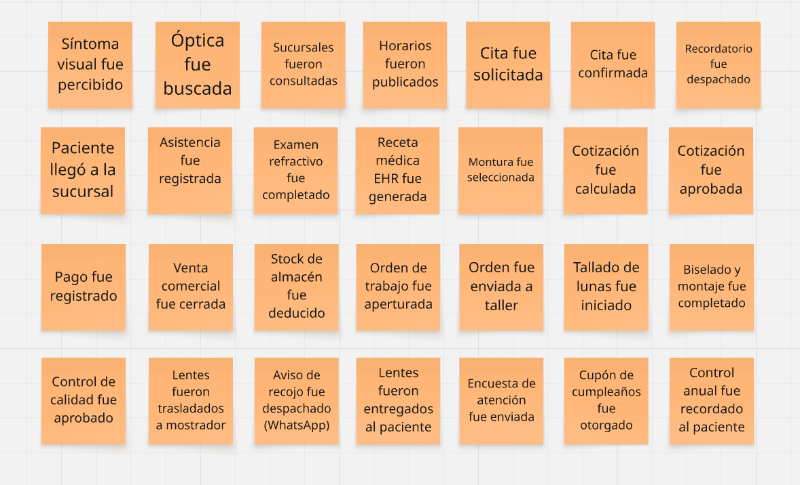

 

Complementariamente, la segunda vista del tablero detalla la distribución de los eventos a lo largo de los carriles funcionales de actores, dividiendo el flujo en tres macro-etapas operativas y explicitando los cuatro puntos críticos descubiertos durante el taller:

Los Carriles de actores, etapas del proceso y puntos críticos en el Big Picture EventStorming se observan en la Figura 14.

**Figura 14**

*Carriles de actores, etapas del proceso y puntos críticos en el Big Picture EventStorming*

  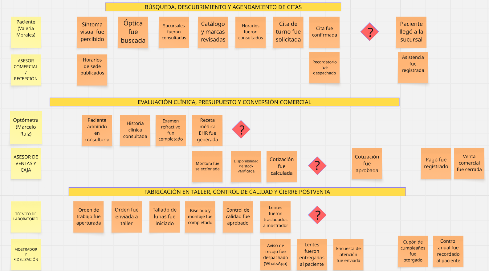

 

A partir de esta modelación colaborativa, el análisis detallado del negocio permitió aislar tres macro-etapas operativas y sus respectivos focos de fricción representados por los rombos de advertencia (?):

**1. Búsqueda, Descubrimiento y Agendamiento de Citas (Paciente y Recepción)**
Esta fase inicial modela el comportamiento del paciente frente a la necesidad de corrección visual. El usuario explora ópticas cercanas, examina sucursales, consulta el catálogo y solicita formalmente su cita.
- **Punto Crítico 1 (Ausentismo en Citas):** Ubicado tras la confirmación de la cita, refleja el ausentismo no alertado debido al olvido del turno pactado por parte del paciente, generando tiempos muertos en el consultorio y desaprovechamiento de los horarios médicos.

**2. Evaluación Clínica, Presupuesto y Conversión Comercial (Optómetra y Asesor de Ventas y Caja)**
Comprende la atención presencial dentro de la óptica. El optómetra ejecuta la refracción en cabina y genera la receta médica digital (EHR). Posteriormente, el asesor comercial asiste en la elección de la montura, valida existencias en inventario, calcula la cotización y concreta la venta tras confirmar el cobro (efectivo en caja, o tarjeta o Yape pagados por el paciente desde su aplicación).
- **Punto Crítico 2 (Pérdida de Historial Clínico):** Ubicado tras la generación de la receta médica, responde a la dificultad histórica de los pacientes para conservar recetas de papel anteriores y recordar especificaciones de tratamientos (antirreflejo o filtros), obligando a repetir consultas previas.
- **Punto Crítico 3 (Desfase de Stock y Contingencia Offline):** Ubicado tras el cálculo de la cotización, señala el riesgo de prescribir monturas exhibidas en vitrina que no cuentan con existencia real en almacén, así como la vulnerabilidad de la atención ante cortes imprevistos de internet en el salón, lo cual exige que la aplicación conserve localmente la última información consultada para seguir mostrándola sin conexión.

**3. Fabricación en Taller, Control de Calidad y Cierre Postventa (Técnico de Laboratorio y Mostrador y Fidelización)**
Engloba la trazabilidad técnica posterior al cierre comercial. Se apertura la orden de trabajo para el taller, se inicia el tallado y montaje de lunas, y se somete la pieza a inspección de calidad antes de enviarla a mostrador. Finalmente, se entrega el producto terminado al paciente y se activan los flujos de fidelización (encuestas de atención, saludos de cumpleaños y recordatorios anuales).
- **Punto Crítico 4 (Incertidumbre en Tiempos de Fabricación):** Ubicado al finalizar el control de calidad y traslado a mostrador, refleja la falta de visibilidad del paciente sobre el avance real de sus lentes en taller, provocando consultas telefónicas reiteradas y sobrecarga operativa en el personal de atención.

**Articulación con los Bounded Contexts de OptiFlow**
Las fronteras funcionales y semánticas descubiertas durante el Big Picture EventStorming justifican formalmente la descomposición arquitectónica del backend en cinco Bounded Contexts:
- **Search & Booking Context:** Soporta la búsqueda de sucursales, horarios de atención y reserva formal de citas.
- **Clinical & Commercial Context:** Centraliza el historial clínico electrónico (EHR), recetas médicas, cotizaciones y cobros comerciales.
- **Production & Tracking Context:** Administra la orden de trabajo en taller, el tablero Kanban y la trazabilidad de fabricación.
- **Store Management & Inventory Context:** Controla el catálogo de monturas, precios, reabastecimiento y stock físico.
- **Notification & Loyalty Context:** Gestiona los avisos de recojo mediante notificaciones push (Firebase Cloud Messaging), encuestas de satisfacción y recordatorios preventivos de salud visual.

### 2.3.6. Ubiquitous Language

El lenguaje ubicuo constituye el vocabulario común y riguroso compartido entre los expertos del dominio (personal de óptica y pacientes) y el equipo de ingeniería de software. Su objetivo es eliminar la ambigüedad terminológica en el código, las historias de usuario y las interfaces de OptiFlow (ver Tabla 14).

**Tabla 14**

*Ubiquitous Language de OptiFlow*

<table border="1" cellpadding="8" cellspacing="0" style="border-collapse:collapse; width:100%; font-family:Arial, sans-serif;">
  <thead>
      <th style="width:25%;">Término</th>
      <th style="width:50%;">Definición en el Dominio de OptiFlow</th>
      <th style="width:25%;">Contexto Delimitado Asociado</th>
    </tr>
  </thead>
  <tbody>
    <tr>
      <td><strong>Patient (Paciente)</strong></td>
      <td>Usuario final que acude a la óptica para evaluación visual, adquisición de monturas o seguimiento de recetas.</td>
      <td style="text-align:center;">Search & Booking / Clinical</td>
    </tr>
    <tr>
      <td><strong>Appointment (Cita)</strong></td>
      <td>Reserva formal de un bloque de horario para atención presencial o examen optométrico en una sucursal.</td>
      <td style="text-align:center;">Search & Booking Context</td>
    </tr>
    <tr>
      <td><strong>Optical Prescription (Receta Médica / Ficha EHR)</strong></td>
      <td>Registro clínico digital que contiene los parámetros refractivos (esfera, cilindro, eje, adición) del paciente.</td>
      <td style="text-align:center;">Clinical & Commercial Context</td>
    </tr>
    <tr>
      <td><strong>Quotation (Cotización)</strong></td>
      <td>Presupuesto comercial detallado que calcula el costo sumando monturas, tipos de luna y tratamientos específicos.</td>
      <td style="text-align:center;">Clinical & Commercial Context</td>
    </tr>
    <tr>
      <td><strong>Sale (Venta)</strong></td>
      <td>Transacción comercial registrada por el asesor a partir de una cotización aprobada. Queda pendiente de pago hasta que el paciente paga desde la aplicación (tarjeta o Yape, mediante la pasarela de pagos) o en caja (efectivo), y el asesor la cierra para confirmar el pedido.</td>
      <td style="text-align:center;">Clinical & Commercial Context</td>
    </tr>
    <tr>
      <td><strong>Work Order (Orden de Trabajo)</strong></td>
      <td>Documento operativo que describe las especificaciones técnicas enviadas al taller para el tallado y biselado de lunas.</td>
      <td style="text-align:center;">Production & Tracking Context</td>
    </tr>
    <tr>
      <td><strong>Work Order Status (Estado de la Orden)</strong></td>
      <td>Fase de avance del pedido dentro del tablero Kanban (Pendiente, En Taller, Control de Calidad, Listo para Entrega).</td>
      <td style="text-align:center;">Production & Tracking Context</td>
    </tr>
    <tr>
      <td><strong>Delivery Date (Fecha Estimada de Entrega)</strong></td>
      <td>Fecha pactada con el cliente para el recojo del producto terminado, calculada según la complejidad del pedido.</td>
      <td style="text-align:center;">Production & Tracking Context</td>
    </tr>
    <tr>
      <td><strong>Frame Model (Modelo de Montura)</strong></td>
      <td>Artículo físico del catálogo con atributos de material, forma, color y compatibilidad con el tipo de rostro.</td>
      <td style="text-align:center;">Store Management & Inventory</td>
    </tr>
    <tr>
      <td><strong>Virtual Try-On (Probador Virtual)</strong></td>
      <td>Prueba de una montura del catálogo sobre el rostro del paciente, en tiempo real, mediante la cámara frontal del celular y un servicio de filtros faciales de realidad aumentada.</td>
      <td style="text-align:center;">Store Management & Inventory</td>
    </tr>
    <tr>
      <td><strong>Low Stock Alert (Alerta de Stock Crítico)</strong></td>
      <td>Notificación automática generada cuando las unidades de una montura caen por debajo del umbral mínimo configurado.</td>
      <td style="text-align:center;">Store Management & Inventory</td>
    </tr>
    <tr>
      <td><strong>Order Progress Notification (Notificación de Avance)</strong></td>
      <td>Notificación push enviada mediante Firebase Cloud Messaging al dispositivo del paciente al cambiar el estado de su orden en el taller.</td>
      <td style="text-align:center;">Notification & Loyalty Context</td>
    </tr>
    <tr>
      <td><strong>Annual Check-up Reminder (Recordatorio de Control Anual)</strong></td>
      <td>Recordatorio enviado al paciente doce meses después de su cita para incentivar el control de su graduación visual.</td>
      <td style="text-align:center;">Notification & Loyalty Context</td>
    </tr>
  </tbody>
</table>

## 2.4. Requirements Specification

### 2.4.1. User Stories

Esta sección presenta las historias de usuario de **OptiFlow** para los procesos de búsqueda y reserva, atención optométrica, gestión comercial y seguimiento de pedidos. Cada historia expresa una necesidad desde el rol que la realiza y sirve de referencia para priorizar el Product Backlog. El alcance seleccionado para el Sprint 1 se detalla en el capítulo IV (ver Tabla 15).

**Tabla 15**

*User Stories de OptiFlow*

| Epic / Story ID | Título | Descripción | Criterios de Aceptación | Relacionado con (Epic ID) |
| :--- | :--- | :--- | :--- | :--- |
| EP01 / US01 | Inicio de sesión en la aplicación móvil | **Como** usuario de la óptica (administrador, optómetra o asesor), **quiero** iniciar sesión en la plataforma móvil **para** acceder de forma segura a las funcionalidades correspondientes a mi rol. | **Escenario 1:** Inicio de sesión exitoso. **Dado que** el usuario cuenta con credenciales válidas, **cuando** ingresa su usuario y contraseña y selecciona "Iniciar sesión", **entonces** el sistema valida sus credenciales y muestra el dashboard correspondiente a su rol.  **Escenario 2:** Credenciales incorrectas. **Dado que** el usuario ingresa credenciales inválidas, **cuando** intenta iniciar sesión, **entonces** el sistema rechaza el acceso y muestra un mensaje indicando que las credenciales no son válidas. | EP01: Authentication & User Management |
| EP01 / US02 | Registro de pacientes desde el móvil | **Como** optómetra o asesor de ventas, **quiero** registrar nuevos pacientes desde la aplicación móvil **para** centralizar su información personal y facilitar su atención. | **Escenario 1:** Registro exitoso. **Dado que** el usuario se encuentra en el módulo de pacientes, **cuando** completa los campos obligatorios y selecciona "Guardar", **entonces** el sistema registra al paciente correctamente.  **Escenario 2:** Datos incompletos. **Dado que** existen campos obligatorios vacíos, **cuando** el usuario intenta guardar el registro, **entonces** el sistema indica los campos que deben completarse. | EP01: Authentication & User Management |
| EP02 / US03 | Gestión de la historia clínica electrónica | **Como** optómetra, **quiero** registrar y actualizar la historia clínica electrónica del paciente desde un dispositivo móvil **para** mantener disponible y organizada su información clínica. | **Escenario 1:** Registro exitoso. **Dado que** el optómetra selecciona un paciente, **cuando** registra las mediciones, observaciones y diagnóstico y selecciona "Guardar", **entonces** el sistema almacena la información en su historia clínica.  **Escenario 2:** Datos inválidos. **Dado que** existen valores que no cumplen las validaciones establecidas, **cuando** se intenta guardar la información, **entonces** el sistema muestra un mensaje de validación y solicita corregir los datos. | EP02: Clinical Management |
| EP02 / US04 | Consulta del historial clínico y receta | **Como** optómetra o asesor autorizado, **quiero** consultar el historial clínico y las recetas anteriores de un paciente **para** disponer de sus antecedentes durante la atención. | **Escenario 1:** Historial disponible. **Dado que** el paciente posee registros clínicos, **cuando** el usuario accede a su perfil, **entonces** el sistema muestra sus antecedentes y recetas registradas.  **Escenario 2:** Sin historial. **Dado que** el paciente no posee registros anteriores, **cuando** se consulta su historial, **entonces** el sistema muestra un mensaje indicando que no existen registros disponibles. | EP02: Clinical Management |
| EP03 / US05 | Búsqueda de ópticas y disponibilidad de atención | **Como** paciente, **quiero** consultar las ópticas disponibles, sus sucursales y horarios de atención **para** elegir dónde recibir el servicio. | **Escenario 1:** Consulta de establecimientos. **Dado que** existen ópticas y sucursales registradas, **cuando** el paciente accede al módulo de búsqueda, **entonces** el sistema muestra los establecimientos disponibles, sus direcciones y horarios.  **Escenario 2:** Sin establecimientos disponibles. **Dado que** no existen sucursales disponibles, **cuando** el paciente realiza una búsqueda, **entonces** el sistema muestra un mensaje informativo.  **Escenario 3:** Ópticas cercanas en el mapa. **Dado que** el paciente concede el permiso de ubicación, **cuando** abre la vista de mapa, **entonces** la aplicación muestra en Google Maps las ópticas cercanas a su posición, ordenadas por distancia. | EP03: Search & Booking |
| EP03 / US06 | Reserva de cita para atención optométrica | **Como** paciente, **quiero** seleccionar una fecha y horario disponible para reservar una cita **para** recibir atención optométrica de manera organizada. | **Escenario 1:** Reserva exitosa. **Dado que** existen horarios disponibles, **cuando** el paciente selecciona una fecha, horario y sucursal y confirma la reserva, **entonces** el sistema registra la cita y muestra su confirmación.  **Escenario 2:** Horario no disponible. **Dado que** otro paciente ha ocupado el horario seleccionado, **cuando** se intenta confirmar la reserva, **entonces** el sistema informa que el horario ya no está disponible y solicita seleccionar otro. | EP03: Search & Booking |
| EP04 / US07 | Consulta de inventario mediante escáner móvil | **Como** asesor de ventas, **quiero** escanear el código de una montura utilizando la cámara del dispositivo móvil **para** consultar rápidamente su disponibilidad, características y precio. | **Escenario 1:** Producto encontrado. **Dado que** la montura posee un código registrado, **cuando** el asesor realiza el escaneo, **entonces** el sistema muestra su stock, características y precio actualizado.  **Escenario 2:** Producto no encontrado. **Dado que** el código no está registrado, **cuando** se realiza el escaneo, **entonces** el sistema informa que el producto no existe en el catálogo. | EP04: Inventory & Catalog Management |
| EP04 / US08 | Generación de cotización vinculada a receta | **Como** asesor de ventas, **quiero** generar una cotización utilizando la receta del paciente y los productos disponibles **para** elaborar un presupuesto de manera rápida y precisa. | **Escenario 1:** Cotización generada. **Dado que** el paciente cuenta con una receta válida y existen productos disponibles, **cuando** el asesor selecciona los productos y genera la cotización, **entonces** el sistema calcula y muestra el monto total.  **Escenario 2:** Receta no disponible. **Dado que** el paciente no posee una receta registrada, **cuando** se intenta generar una cotización que requiere dicha información, **entonces** el sistema solicita registrar o seleccionar una receta válida. | EP04: Inventory & Catalog Management |
| EP04 / US09 | Gestión de catálogo de monturas | **Como** administrador, **quiero** registrar y actualizar la información de las monturas del catálogo **para** mantener actualizados sus características, precios y disponibilidad. | **Escenario 1:** Actualización exitosa. **Dado que** el administrador selecciona una montura existente, **cuando** modifica sus datos y selecciona "Guardar", **entonces** el sistema actualiza la información del producto.  **Escenario 2:** Datos inválidos. **Dado que** se ingresan valores incorrectos en los campos obligatorios, **cuando** se intenta guardar, **entonces** el sistema muestra los errores de validación correspondientes. | EP04: Inventory & Catalog Management |
| EP05 / US10 | Gestión de órdenes de trabajo | **Como** administrador o responsable del laboratorio, **quiero** visualizar y actualizar las órdenes de trabajo mediante un tablero Kanban **para** controlar visualmente el avance de fabricación de los lentes. | **Escenario 1:** Cambio de estado. **Dado que** existe una orden de trabajo activa, **cuando** el responsable cambia su estado en el tablero, **entonces** el sistema actualiza la orden y registra su nuevo estado.  **Escenario 2:** Sin conexión. **Dado que** el dispositivo no tiene conexión, **cuando** el responsable intenta cambiar el estado de una orden, **entonces** el sistema muestra el tablero guardado en modo de solo lectura e indica que el cambio requiere conexión. | EP05: Production & Order Tracking |
| EP05 / US11 | Seguimiento del estado de los pedidos | **Como** paciente, **quiero** consultar el estado de mi pedido y su avance de fabricación **para** conocer cuándo estarán disponibles mis lentes. | **Escenario 1:** Consulta de pedido. **Dado que** el paciente posee una orden activa, **cuando** accede al seguimiento, **entonces** el sistema muestra el estado actual y la información disponible sobre su entrega.  **Escenario 2:** Pedido finalizado. **Dado que** la orden ha terminado su proceso de fabricación, **cuando** el paciente consulta el seguimiento, **entonces** el sistema indica que el pedido está listo para su entrega. | EP05: Production & Order Tracking |
| EP06 / US12 | Notificaciones del progreso de pedidos | **Como** paciente, **quiero** recibir notificaciones sobre los cambios importantes de mi pedido **para** mantenerme informado sin tener que consultar constantemente la aplicación. | **Escenario 1:** Cambio de estado. **Dado que** una orden cambia de estado, **cuando** el sistema registra el cambio, **entonces** envía una notificación push al dispositivo del paciente mediante Firebase Cloud Messaging.  **Escenario 2:** Dispositivo sin permiso de notificaciones. **Dado que** el paciente no concedió el permiso de notificaciones en su dispositivo o no tiene un dispositivo registrado, **cuando** cambia el estado del pedido, **entonces** el sistema registra el aviso sin notificación push y el paciente lo encuentra en la sección de notificaciones de la aplicación. | EP06: Notifications & Loyalty |
| EP06 / US13 | Recordatorios de control visual | **Como** paciente, **quiero** recibir recordatorios de mi cita y de mi próximo control visual **para** no olvidar la atención y mantener un seguimiento periódico de mi salud visual. | **Escenario 1:** Recordatorio de cita. **Dado que** el paciente reservó una cita, **cuando** faltan 24 horas para la cita, **entonces** el sistema le envía un recordatorio con la óptica, la fecha y la hora.  **Escenario 2:** Recordatorio de control anual. **Dado que** el paciente fue atendido en una cita, **cuando** se cumplen 12 meses desde esa cita, **entonces** el sistema le envía un recordatorio para reservar un nuevo control visual. | EP06: Notifications & Loyalty |
| EP07 / US14 | Alertas de stock crítico | **Como** administrador de la óptica, **quiero** recibir alertas cuando un producto alcance su stock mínimo **para** gestionar el reabastecimiento oportunamente. | **Escenario 1:** Stock crítico detectado. **Dado que** la cantidad de un producto alcanza el límite mínimo configurado, **cuando** el sistema actualiza el inventario, **entonces** muestra una alerta de stock crítico.  **Escenario 2:** Stock suficiente. **Dado que** la cantidad disponible supera el mínimo establecido, **cuando** se consulta el inventario, **entonces** el sistema no genera una alerta de reposición. | EP07: Store Management & Inventory |
| EP07 / US15 | Historial de movimientos de inventario | **Como** administrador, **quiero** consultar el historial de entradas y salidas de productos **para** controlar los movimientos del inventario y detectar posibles diferencias. | **Escenario 1:** Historial disponible. **Dado que** existen movimientos registrados, **cuando** el administrador consulta el historial, **entonces** el sistema muestra la fecha, producto, cantidad y usuario asociado a cada movimiento.  **Escenario 2:** Sin movimientos. **Dado que** no existen movimientos registrados, **cuando** se consulta el historial, **entonces** el sistema muestra un estado vacío informativo. | EP07: Store Management & Inventory |
| EP07 / US16 | Gestión de permisos por roles | **Como** administrador, **quiero** asignar permisos según el rol de cada usuario **para** proteger la información y funcionalidades sensibles de la óptica. | **Escenario 1:** Acceso autorizado. **Dado que** un usuario posee permisos para un módulo, **cuando** intenta acceder a este, **entonces** el sistema permite visualizar y utilizar sus funcionalidades.  **Escenario 2:** Acceso restringido. **Dado que** un usuario no posee permisos para un módulo, **cuando** intenta acceder, **entonces** el sistema deniega el acceso y muestra un mensaje de permisos insuficientes. | EP07: Store Management & Inventory |
| EP08 / US17 | Registro de ventas y pagos | **Como** paciente, **quiero** pagar desde la aplicación la venta que registró el asesor **para** confirmar mi pedido sin pagar en caja. | **Escenario 1:** Pago aprobado. **Dado que** el asesor registró una venta pendiente de pago, **cuando** el paciente selecciona "Pagar", completa el pago con tarjeta o Yape en la pasarela de pagos y esta lo aprueba, **entonces** el sistema registra el pago con la referencia de la pasarela y la venta queda lista para que el asesor la cierre.  **Escenario 2:** Pago rechazado. **Dado que** la pasarela de pagos rechaza el pago, **cuando** el paciente regresa a la aplicación, **entonces** el sistema mantiene la venta pendiente, muestra el motivo del rechazo y permite reintentar.  **Escenario 3:** Pago en efectivo. **Dado que** el paciente paga en caja, **cuando** el asesor registra el pago en efectivo, **entonces** el sistema registra el pago y permite cerrar la venta. | EP08: Clinical & Commercial |
| EP08 / US18 | Dashboard de métricas operativas | **Como** administrador de la óptica, **quiero** visualizar indicadores de atención, ventas y pedidos **para** conocer el estado general del negocio y tomar decisiones oportunas. | **Escenario 1:** Visualización de indicadores. **Dado que** existen registros operativos, **cuando** el administrador accede al dashboard, **entonces** el sistema muestra los principales indicadores del periodo seleccionado.  **Escenario 2:** Sin información. **Dado que** no existen registros para el periodo consultado, **cuando** se accede al dashboard, **entonces** el sistema muestra los indicadores en cero y un mensaje informativo. | EP08: Analytics & Reporting |
| EP08 / US19 | Generación y exportación de reportes | **Como** administrador, **quiero** generar y exportar reportes de las operaciones de la óptica **para** analizar y compartir información con las áreas correspondientes. | **Escenario 1:** Reporte generado. **Dado que** existen datos en el periodo seleccionado, **cuando** el administrador solicita un reporte, **entonces** el sistema genera el documento con la información correspondiente.  **Escenario 2:** Sin datos. **Dado que** el periodo seleccionado no contiene registros, **cuando** se solicita el reporte, **entonces** el sistema informa que no existen datos disponibles para exportar. | EP08: Analytics & Reporting |
| EP09 / US20 | Consulta de información sin conexión | **Como** usuario de la aplicación, **quiero** consultar la última información descargada aunque no tenga conexión a internet **para** seguir revisando mis citas, pedidos, avisos y el catálogo durante una interrupción temporal. | **Escenario 1:** Consulta sin conexión. **Dado que** el usuario abrió antes sus citas, pedidos, avisos o el catálogo con conexión, **cuando** el dispositivo pierde la conexión, **entonces** la aplicación muestra la información guardada en el dispositivo e indica la fecha de su última actualización.  **Escenario 2:** Operación que requiere conexión. **Dado que** el dispositivo no tiene conexión, **cuando** el usuario intenta reservar, pagar o registrar información, **entonces** la aplicación le indica que la operación requiere conexión y no la envía. | EP09: Mobile Offline Capability |
| EP04 / US21 | Probador virtual de monturas | **Como** paciente, **quiero** probarme virtualmente las monturas del catálogo con la cámara frontal de mi celular **para** elegir el modelo que mejor se adapta a mi rostro antes de visitar la óptica. | **Escenario 1:** Prueba de montura. **Dado que** la montura tiene un modelo de prueba virtual, **cuando** el paciente selecciona "Probar" y concede el permiso de cámara, **entonces** la aplicación muestra la montura sobre su rostro en tiempo real mediante el servicio de filtros faciales AR.  **Escenario 2:** Montura sin modelo virtual. **Dado que** la montura no tiene un modelo de prueba virtual, **cuando** el paciente consulta su detalle, **entonces** la aplicación no muestra la opción "Probar". | EP04: Inventory & Catalog Management |
### 2.4.2. Impact Mapping

El Impact Mapping es una herramienta que nos permitió estructurar y visualizar de manera clara la relación entre los objetivos del proyecto, los actores involucrados y las funcionalidades propuestas en la solución. A partir de la información recopilada en las entrevistas y el análisis de necesidades, se identificaron los principales problemas que enfrentan los usuarios.

***IMPACT MAPPING 1***

El Impact Map del segmento staff de la óptica se muestra en la Figura 15.

**Figura 15**

*Impact Map del segmento staff de la óptica*

***IMPACT MAPPING 2***

El Impact Map del segmento clientes de la óptica se presenta en la Figura 16.

**Figura 16**

*Impact Map del segmento clientes de la óptica*

### 2.4.3. Product Backlog

El backlog relaciona las historias con su prioridad y estimación para organizar los incrementos. El [Anexo G](Anexos.md#anexo-g-product-backlog) resume este artefacto; el compromiso de US05 y US06 para TB1 se desarrolla en el Sprint 1 del capítulo IV (ver Tabla 16).

**Tabla 16**

*Product Backlog de OptiFlow*

| # Orden | User Story Id | Título | Descripción | Story Points (1/2/3/5/8) |
| :--- | :--- | :--- | :--- | :---: |
| **1** | **US01** | Inicio de sesión en la aplicación móvil | **Como** usuario de la óptica (administrador, optómetra o asesor), **quiero** iniciar sesión en la plataforma móvil **para** acceder de forma segura a las funcionalidades correspondientes a mi rol. | **3** |
| **2** | **US02** | Registro de pacientes desde el móvil | **Como** optómetra o asesor de ventas, **quiero** registrar nuevos pacientes directamente desde la aplicación móvil **para** gestionar su información dentro del sistema de la óptica. | **5** |
| **3** | **US03** | Gestión de historia clínica electrónica | **Como** optómetra, **quiero** registrar y actualizar la historia clínica electrónica del paciente **para** mantener un control organizado de sus evaluaciones visuales. | **8** |
| **4** | **US04** | Consulta de historial clínico y receta | **Como** paciente, **quiero** consultar mi historial clínico y receta desde la aplicación **para** acceder fácilmente a mi información visual. | **5** |
| **5** | **US05** | Búsqueda de ópticas y disponibilidad de atención | **Como** paciente, **quiero** buscar ópticas disponibles, verlas en un mapa y consultar su disponibilidad de atención **para** elegir dónde recibir el servicio. | **5** |
| **6** | **US06** | Reserva de cita para atención optométrica | **Como** paciente, **quiero** reservar una cita para atención optométrica **para** programar mi visita de manera rápida y organizada. | **8** |
| **7** | **US07** | Consulta de inventario mediante escáner móvil | **Como** asesor de ventas, **quiero** escanear el código de una montura **para** consultar su stock y precio en tiempo real frente al cliente. | **5** |
| **8** | **US08** | Generación de cotización vinculada a receta | **Como** asesor de ventas, **quiero** generar una cotización vinculada a la receta del paciente **para** elaborar un presupuesto de manera rápida y precisa. | **5** |
| **9** | **US09** | Gestión de catálogo de monturas | **Como** asesor de ventas, **quiero** consultar y gestionar el catálogo de monturas **para** ofrecer productos disponibles de acuerdo con las necesidades del paciente. | **5** |
| **10** | **US10** | Gestión de órdenes de trabajo | **Como** técnico de laboratorio o administrador, **quiero** gestionar las órdenes de trabajo mediante un tablero Kanban **para** controlar visualmente el proceso de fabricación de los lentes. | **8** |
| **11** | **US11** | Seguimiento del estado de pedidos | **Como** paciente, **quiero** consultar el estado de mi pedido **para** conocer el avance de la elaboración de mis lentes. | **5** |
| **12** | **US12** | Notificaciones del progreso de pedidos | **Como** paciente, **quiero** recibir notificaciones sobre el progreso de mi pedido **para** conocer oportunamente los cambios en su estado. | **5** |
| **13** | **US13** | Recordatorios de control visual | **Como** paciente, **quiero** recibir recordatorios de mi cita y de mi próximo control visual **para** mantener un seguimiento periódico de mi salud visual. | **3** |
| **14** | **US14** | Alertas de stock crítico | **Como** administrador, **quiero** visualizar alertas de stock crítico **para** identificar oportunamente los productos que necesitan reposición. | **5** |
| **15** | **US15** | Historial de movimientos de inventario | **Como** administrador, **quiero** consultar el historial de movimientos de inventario **para** mantener la trazabilidad de los productos de la óptica. | **5** |
| **16** | **US16** | Gestión de permisos por roles | **Como** administrador, **quiero** gestionar permisos según los roles de los usuarios **para** controlar el acceso a las funcionalidades e información de la aplicación. | **5** |
| **17** | **US17** | Registro de ventas y pagos | **Como** administrador, **quiero** registrar las ventas y pagos realizados **para** mantener actualizado el control comercial de la óptica. | **8** |
| **18** | **US18** | Dashboard de métricas operativas | **Como** administrador, **quiero** visualizar un dashboard con métricas operativas y comerciales **para** conocer el rendimiento de la óptica y facilitar la toma de decisiones. | **8** |
| **19** | **US19** | Generación y exportación de reportes | **Como** administrador, **quiero** generar y exportar reportes de las operaciones de la óptica **para** analizar y compartir información relevante del negocio. | **5** |
| **20** | **US20** | Consulta de información sin conexión | **Como** usuario de la aplicación, **quiero** consultar la última información descargada cuando no tenga conexión a internet **para** evitar interrupciones en la consulta. | **5** |
| **21** | **US21** | Probador virtual de monturas | **Como** paciente, **quiero** probarme virtualmente las monturas del catálogo con la cámara de mi celular **para** elegir el modelo que mejor se adapta a mi rostro. | **8** |

## 2.5. Strategic-Level Domain-Driven Design

### 2.5.1. EventStorming

**Big Picture Event Storming**

El proceso se documenta a partir de los tableros existentes y de las necesidades recogidas en las entrevistas. El resultado se utiliza para pasar del recorrido de negocio a los límites de los contextos.

1. **Delimitar el recorrido.** Se toma como inicio la búsqueda de atención y como cierre la entrega de los lentes y el seguimiento posterior. Se distinguen las perspectivas del paciente, recepción, atención clínica, asesor comercial y laboratorio.
2. **Identificar hechos de negocio.** Se registran eventos expresados en pasado, como cita confirmada, receta generada y venta cerrada. Un evento describe algo que ya ocurrió; una intención del usuario se representa como comando y una solicitud de información como consulta.
3. **Ordenar y revisar la secuencia.** Los eventos se agrupan cronológicamente y se revisan en sentido inverso para comprobar sus antecedentes. Por ejemplo, el taller requiere una orden y esta se vincula con una venta cerrada. Se separan caminos alternativos, como rechazo de cotización o demora de fabricación, del recorrido principal.
4. **Relacionar actores, comandos y decisiones.** Se identifica quién solicita cada acción, qué información necesita y qué regla controla su ejecución. En la reserva se comprueba la disponibilidad; en el registro de venta se exige una cotización aprobada y sin otra venta asociada. Las consultas de disponibilidad no deben representarse como cambios de estado del negocio.
5. **Analizar puntos de fricción.** Se relacionan los problemas de inasistencia, dispersión de la información clínica, diferencias de inventario e incertidumbre de entrega con la etapa afectada. Los problemas detectados orientan requisitos e hipótesis.
6. **Proponer fronteras y validar vocabulario.** Se agrupan reglas e información que cambian por motivos similares, obteniendo los cinco contextos candidatos. Los mensajes que cruzan estas fronteras se especifican en 2.5.1.2 y las responsabilidades, supuestos y reglas de cada contexto se amplían en 2.5.1.3. El Context Map documenta las relaciones entre esos módulos.

El [Anexo A](Anexos.md#anexo-a-eventstorming-del-dominio-de-optiflow) conserva la evidencia del tablero; el [Anexo B](Anexos.md#anexo-b-bounded-contexts-identificados) resume los contextos resultantes. Las cuatro zonas de fricción descritas en 2.3.5 sirven como referencia para revisar la relación entre entrevistas, eventos y requisitos (ver Figura 17).

**Figura 17**

*Recolección y orden de eventos del EventStorming en los pasos 1 a 3*

El resultado final del EventStorming con los contextos candidatos se observa en la Figura 18.

**Figura 18**

*Resultado final del EventStorming con los contextos candidatos*

#### 2.5.1.1. Candidate Context Discovery

A partir de las agrupaciones funcionales definidas en el Paso 3 del EventStorming ("Big Picture" y límites de subdominios), se identificaron los siguientes contextos delimitados candidatos que encapsulan el lenguaje ubicuo y los límites de responsabilidad del sistema OptiFlow:

**Search & Booking Context:** Encargado de la gestión de identidades de pacientes, la publicación de horarios disponibles (Publish available time slots) y el flujo de agendamiento de citas.

**Clinical & Commercial Context:** Centraliza tanto el proceso médico (Record medical history, Generate optical prescription) como el transaccional (Approve quotation, Close sale, Record payment), unificando el flujo del paciente en el salón.

**Production & Tracking Context:** Maneja el ciclo de vida de la orden de trabajo desde su generación, asignación a técnicos (Assign work order), envío al laboratorio y actualización de estados hasta la entrega final.

**Notification & Loyalty Context:** Gestiona la comunicación proactiva con el paciente, incluyendo el beneficio de cumpleaños, los recordatorios de cita y de control anual, los avisos del avance y la demora del pedido y las encuestas de satisfacción.

**Store Management & Inventory Context:** Controla el catálogo de productos físicos (Add new frame model), precios, abastecimiento de proveedores (Suppliers) y alertas de bajo stock, con persistencia en las tablas de la migración V6.

#### 2.5.1.2. Domain Message Flows Modeling

El Domain Message Flow Modeling muestra cómo colaboran los Bounded Contexts de OptiFlow para completar los procesos principales del negocio (DDD Crew, s. f.-c). Cada diagrama representa un escenario de punta a punta e indica qué actor inicia el proceso, desde qué sistema lo hace, qué mensajes intercambian los contextos, en qué orden ocurren y qué datos lleva cada mensaje. Los diagramas se elaboraron en Miro, sobre la plantilla de Domain Message Flow Modelling del tablero de diseño estratégico, a partir de los comandos, eventos y consultas definidos en el diseño estratégico e implementados en el backend.

Los diagramas utilizan la siguiente notación, que se repite en la leyenda de cada figura:

- **Actor:** persona que inicia el proceso o consulta su resultado, como el paciente, el optómetra, el asesor comercial o el técnico de laboratorio.
- **Sistema:** la aplicación móvil App OptiFlow, desde la cual el actor envía sus comandos y consultas, y los sistemas externos que participan en el proceso: la Pasarela de Pagos y Firebase Cloud Messaging.
- **Bounded Context:** nube con el nombre del contexto y su clasificación estratégica, Core o Supporting.
- **Mensajes:** tarjetas con un número que indica el orden en que ocurren: celeste para los comandos, naranja para los eventos y verde para las consultas. La cabecera de cada tarjeta lleva el nombre del mensaje y la parte inferior, los datos que transporta; en las consultas se distinguen los datos de la solicitud (Req) y de la respuesta (Res).
- **Dirección del mensaje:** flecha punteada que va del emisor al receptor. Cada mensaje se ubica junto a la flecha que lo transporta.

Los diagramas solo muestran los mensajes que viajan entre participantes. Lo que cada contexto hace internamente al recibir un evento se resume en la Tabla 17.

La Tabla 17 resume los eventos que conectan a los Bounded Contexts y el comando que ejecuta cada contexto al recibirlos.

**Tabla 17**

*Eventos entre Bounded Contexts y comandos que desencadenan*

| # | Contexto emisor | Evento | Contexto receptor | Comando ejecutado | Escenario |
| :-: | :--- | :--- | :--- | :--- | :-: |
| 1 | Search & Booking | `AppointmentBooked` | Clinical & Commercial | `ExaminePatient` | 1 |
| 2 | Search & Booking | `AppointmentBooked` | Notification & Loyalty | `ScheduleAppointmentReminder` | 1 |
| 3 | Clinical & Commercial | `SaleWasClosed` | Production & Tracking | `GenerateWorkOrder` | 3 |
| 4 | Clinical & Commercial | `SaleWasClosed` | Store Management & Inventory | `UpdateInventory` | 3 |
| 5 | Production & Tracking | `WorkOrderStatusUpdated` | Notification & Loyalty | `NotifyLensOrderProgress` | 4 |
| 6 | Production & Tracking | `DeliveryDelayNotified` | Notification & Loyalty | `SendDeliveryDelayNotification` | 5 |
| 7 | Production & Tracking | `OrderWasMarkedAsDelivered` | Notification & Loyalty | `SendSatisfactionSurvey` | 6 |

La tabla solo incluye eventos. Los dos sistemas externos participan en los escenarios 3 a 6: Clinical & Commercial crea en la Pasarela de Pagos la preferencia de pago que el paciente paga desde la aplicación y recibe de ella la notificación del resultado, y Notification & Loyalty envía cada aviso como notificación push mediante Firebase Cloud Messaging. Además, dos contextos consultan información de otro: Clinical & Commercial consulta la cita a Search & Booking (`GetAppointment`, escenario 2) y Production & Tracking consulta la venta cerrada a Clinical & Commercial (`GetClosedSale`, escenario 3). Además de estos flujos entre contextos, Notification & Loyalty gestiona internamente el descuento de cumpleaños: el comando `GrantBirthdayDiscount` registra el beneficio y publica el evento `BirthdayDiscountWasSent`, sin intervención de otros contextos.

**Escenario 1: Búsqueda y reserva de cita**

El paciente busca una óptica desde App OptiFlow y consulta sus horarios disponibles mediante las consultas `SearchOpticalStores` y `GetAvailableTimeSlots`, cuyas notas muestran los datos enviados (Req) y recibidos (Res). Al elegir un horario, la aplicación envía el comando `BookAppointment` a Search & Booking, que registra la cita y publica el evento `AppointmentBooked` hacia Clinical & Commercial y Notification & Loyalty, como se muestra en la Figura 19. Al recibirlo, Clinical & Commercial abre el expediente clínico de la atención (`ExaminePatient`) y Notification & Loyalty programa el recordatorio de la cita (`ScheduleAppointmentReminder`), que se envía como notificación push antes de la atención.

**Figura 19**

*Domain Message Flow del escenario de búsqueda y reserva de cita*

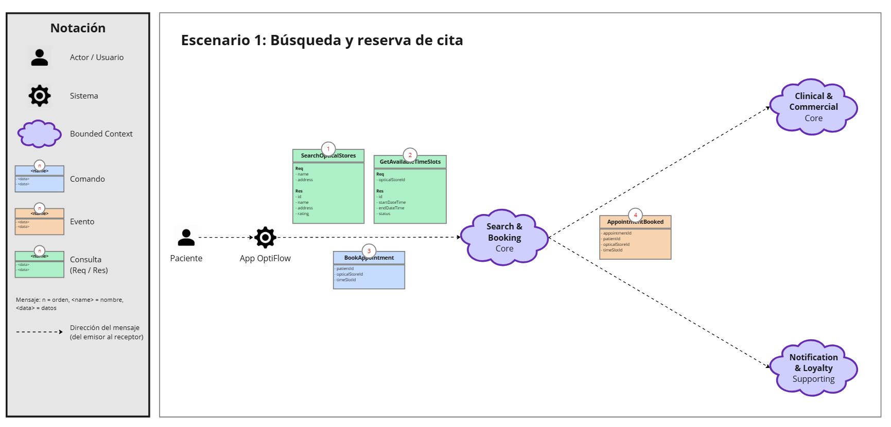

*Nota.* Elaboración propia.

**Escenario 2: Atención clínica del paciente**

El optómetra consulta los registros clínicos previos del paciente (`GetClinicalRecordsByPatientId`) y registra la atención (`RegisterClinicalRecord`). Para hacerlo, Clinical & Commercial consulta a Search & Booking la cita reservada (`GetAppointment`) y confirma a qué paciente pertenece y que no fue cancelada. Luego, el optómetra registra la historia médica y la receta óptica (`RecordMedicalHistory` y `GenerateOpticalPrescription`), como se muestra en la Figura 20.

**Figura 20**

*Domain Message Flow del escenario de atención clínica del paciente*

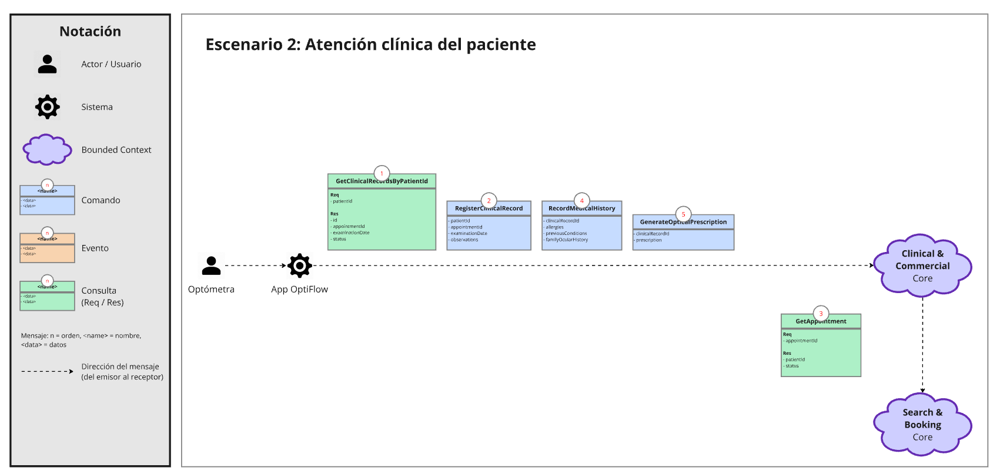

*Nota.* Elaboración propia.

**Escenario 3: Cotización y venta**

El asesor comercial genera la cotización a partir de la receta, la aprueba con el paciente y registra la venta (`GenerateQuotation`, `ApproveQuotation` y `RegisterSale`), que queda pendiente de pago. El paciente paga desde App OptiFlow: la aplicación solicita la preferencia de pago (`CreatePaymentPreference`), Clinical & Commercial la crea en la Pasarela de Pagos y devuelve el enlace de pago, y el paciente paga con tarjeta o Yape en la página de la pasarela. La pasarela notifica el resultado al backend (`PaymentNotification`); si el pago fue aprobado, Clinical & Commercial lo registra (`RecordPayment`) y publica `PaymentRecorded`. Luego, el asesor cierra la venta (`CloseSale`); solo una venta pagada puede cerrarse. El cierre publica el evento `SaleWasClosed` hacia Production & Tracking y Store Management & Inventory, como se muestra en la Figura 21. Al recibirlo, Production & Tracking genera la orden de trabajo de los lentes (`GenerateWorkOrder`) y Store Management & Inventory descuenta del stock los productos vendidos (`UpdateInventory`). Para preparar la orden, Production & Tracking consulta a Clinical & Commercial la venta cerrada (`GetClosedSale`) y obtiene las especificaciones de las lunas.

**Figura 21**

*Domain Message Flow del escenario de cotización y venta*

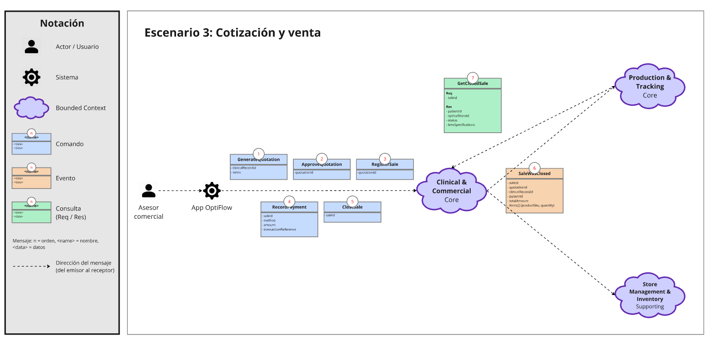

*Nota.* Elaboración propia.

**Escenario 4: Avance de la producción**

El técnico de laboratorio asigna la orden de trabajo, la envía al laboratorio y actualiza su estado a medida que avanza la fabricación (`AssignWorkOrderToTechnician`, `SendWorkOrderToLaboratory` y `UpdateWorkOrderStatus`). Cada cambio de estado publica el evento `WorkOrderStatusUpdated` hacia Notification & Loyalty, que registra el aviso de avance (`NotifyLensOrderProgress`) y lo envía como notificación push al dispositivo del paciente mediante Firebase Cloud Messaging (`SendPushNotification`). Luego, el paciente revisa sus avisos desde App OptiFlow mediante la consulta `GetNotificationsByPatient`, como se muestra en la Figura 22.

**Figura 22**

*Domain Message Flow del escenario de avance de la producción*

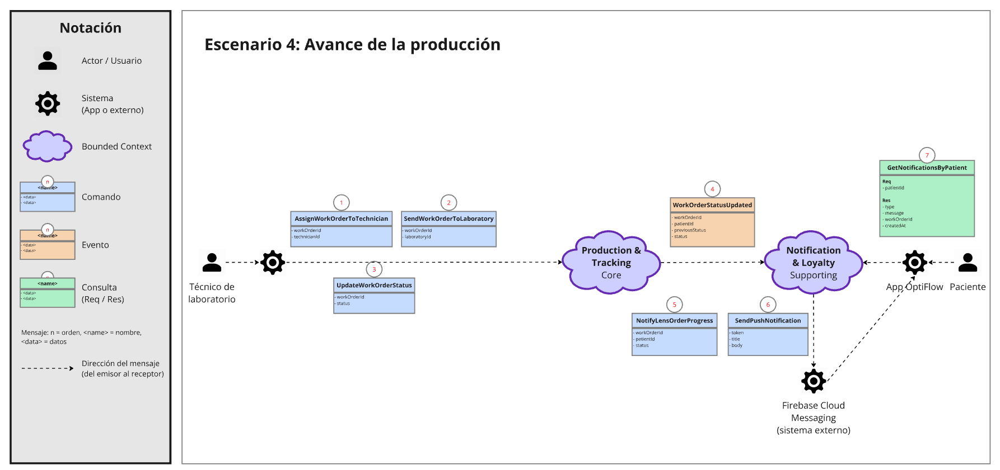

*Nota.* Elaboración propia.

**Escenario 5: Demora en la entrega**

Si la fabricación se retrasa, el técnico registra la demora con su motivo y la nueva fecha estimada de entrega (`NotifyDeliveryDelay`). Production & Tracking publica el evento `DeliveryDelayNotified` hacia Notification & Loyalty, que registra el aviso de demora (`SendDeliveryDelayNotification`) y lo envía como notificación push mediante Firebase Cloud Messaging (`SendPushNotification`). El paciente consulta ese aviso desde App OptiFlow mediante `GetNotificationsByPatient`, como se muestra en la Figura 23.

**Figura 23**

*Domain Message Flow del escenario de demora en la entrega*

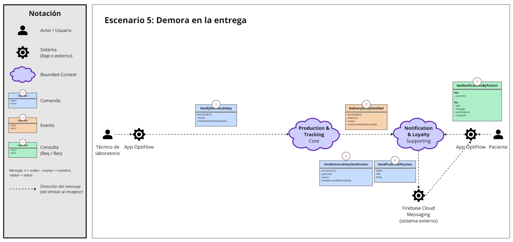

*Nota.* Elaboración propia.

**Escenario 6: Entrega del pedido y encuesta de satisfacción**

Cuando el paciente recoge sus lentes, el técnico marca la orden de trabajo como entregada (`MarkOrderAsDelivered`). Production & Tracking publica el evento `OrderWasMarkedAsDelivered` hacia Notification & Loyalty, que registra la encuesta de satisfacción (`SendSatisfactionSurvey`) y la envía como notificación push mediante Firebase Cloud Messaging (`SendPushNotification`). El paciente consulta la encuesta desde App OptiFlow mediante `GetNotificationsByPatient` y la responde con una calificación de 1 a 5 y un comentario opcional (`AnswerSatisfactionSurvey`), como se muestra en la Figura 24.

**Figura 24**

*Domain Message Flow del escenario de entrega del pedido y encuesta de satisfacción*

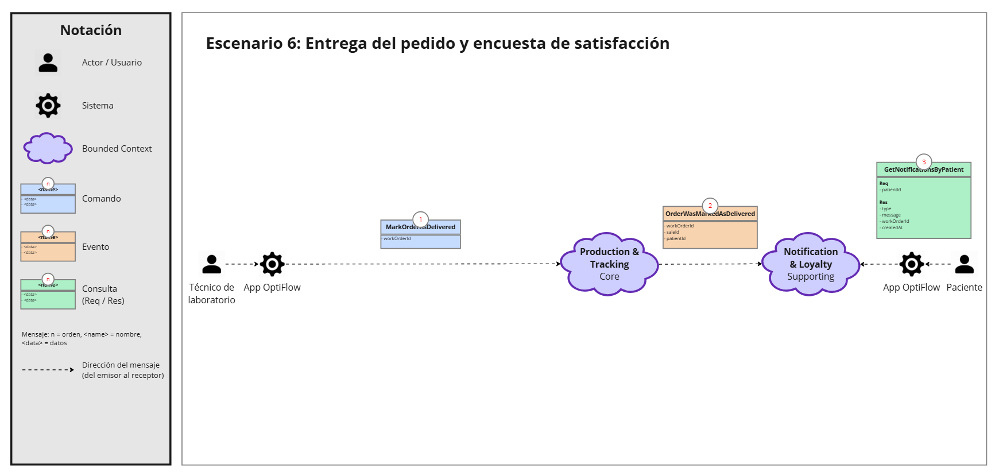

*Nota.* Elaboración propia.

#### 2.5.1.3. Bounded Context Canvases

En esta sección se formalizan los Bounded Context Canvases para cada uno de los contextos delimitados identificados en la solución **OptiFlow**, derivándolos directamente de la dinámica de EventStorming. Se estructuran las responsabilidades, clasificación estratégica, lenguaje ubicuo, así como las comunicaciones de entrada (*Commands*, eventos a los que se suscribe) y de salida (*Events* publicados).

**Canvas 1: Search & Booking Context**

El Bounded Context Canvas del Search & Booking Context se detalla en la Tabla 18.

**Tabla 18**

*Bounded Context Canvas del Search & Booking Context*

| Elemento | Descripción |
| :--- | :--- |
| **Name** | Search & Booking Context |
| **Strategic Classification** | Core Domain |
| **Domain Roles** | Gestión del proceso inicial del paciente y del acceso a la plataforma: registro e inicio de sesión de pacientes y personal con roles, descubrimiento de sucursales cercanas, ópticas favoritas y calificaciones, y reserva formal de citas según disponibilidad de horarios. |
| **Ubiquitous Language** | Patient, Staff Member, User Role, Time Slot, Optical Store, Store Location, Favorite Store, Store Rating, Appointment, Booking. |
| **Inbound Communication** | **Commands (vía API Gateway):** - `RegisterPatient` - `LogIn` - `RegisterStaffMember` - `AssignStaffRole` - `PublishAvailableTimeSlots` - `SaveFavoriteOpticalStore` - `RateOpticalStore` - `BookAppointment`  **Queries (vía API Gateway):** - `SearchOpticalStores` - `FilterOpticalStores` - `GetNearbyOpticalStores` - `GetAvailableTimeSlots` - `GetPatientAppointments` - `GetAppointment` - `GetStaffMembers`  **Queries (internas):** - `GetPatientsByBirthday` (Notification & Loyalty) |
| **Outbound Communication** | **Events (Publicados):** - `PatientRegistered` - `PatientLoggedIn` - `StaffMemberRegistered` - `StaffMemberRoleAssigned` - `OpticalStoresPublished` - `FavoriteOpticalStoreSaved` - `OpticalStoreRated` - `AppointmentBooked` |

**Canvas 2: Clinical & Commercial Context**

El Bounded Context Canvas del Clinical & Commercial Context se presenta en la Tabla 19.

**Tabla 19**

*Bounded Context Canvas del Clinical & Commercial Context*

| Elemento | Descripción |
| :--- | :--- |
| **Name** | Clinical & Commercial Context |
| **Strategic Classification** | Core Domain |
| **Domain Roles** | Control de la atención clínica presencial y conversión comercial: registro de refracción/receta optométrica, evaluación de cotizaciones, aplicación de descuentos o promociones y cobro de la venta mediante la Pasarela de Pagos externa (tarjeta o Yape, pagados por el paciente desde la aplicación) o en efectivo. |
| **Ubiquitous Language** | Patient, Medical History, Clinical Record, Optical Prescription, Quotation, Promotion, Discount, Payment, Sale, Electronic Receipt. |
| **Inbound Communication** | **Commands (vía API Gateway):** - `ExaminePatient` - `RecordMedicalHistory` - `RegisterClinicalRecord` - `GenerateOpticalPrescription` - `GenerateQuotation` - `ApplyPromotionOrDiscount` - `ApproveQuotation` - `RejectQuotation` - `RegisterSale` - `CreatePaymentPreference` (App del paciente) - `RecordPayment` - `CloseSale`  **Queries (vía API Gateway):** - `GetClosedSale` - `GetSalesMetrics`  **Events (Suscrito):** - `AppointmentBooked`  **Sistema externo:** - Notificación de pago de la Pasarela de Pagos (webhook) |
| **Outbound Communication** | **Events (Publicados):** - `PatientExamined` - `MedicalHistoryRecorded` - `ClinicalRecordRegistered` - `OpticalPrescriptionGenerated` - `PromotionOrDiscountApplied` - `QuotationApproved` - `QuotationRejected` - `PaymentRecorded` - `PaymentRejected` - `SaleWasClosed` - `ElectronicReceiptIssued`  **Sistema externo:** - Creación de la preferencia de pago en la Pasarela de Pagos |

**Canvas 3: Production & Tracking Context**

El Bounded Context Canvas del Production & Tracking Context se resume en la Tabla 20.

**Tabla 20**

*Bounded Context Canvas del Production & Tracking Context*

| Elemento | Descripción |
| :--- | :--- |
| **Name** | Production & Tracking Context |
| **Strategic Classification** | Core Domain |
| **Domain Roles** | Trazabilidad del proceso de fabricación de lentes y monturas: generación de órdenes de trabajo, asignación a técnicos de laboratorio, control del flujo de estado (Kanban logístico), cálculo de fechas estimadas, gestión de retrasos, seguimiento del pedido por el paciente y métricas de producción. |
| **Ubiquitous Language** | Work Order, Technician, Laboratory, Work Order Status, Lenses, Delivery Date, Delivery Delay. |
| **Inbound Communication** | **Commands (vía API Gateway):** - `GenerateWorkOrder` - `AssignWorkOrderToTechnician` - `SendWorkOrderToLaboratory` - `UpdateWorkOrderStatus` - `CompleteLenses` - `NotifyDeliveryDelay` - `MarkOrderAsDelivered`  **Queries (vía API Gateway):** - `GetWorkOrders` - `GetWorkOrderById` - `GetWorkOrdersByPatientId` - `GetProductionMetrics`  **Events (Suscrito):** - `SaleWasClosed`  **Consulta a otro contexto:** - `GetClosedSale` (Clinical & Commercial) |
| **Outbound Communication** | **Events (Publicados):** - `WorkOrderGenerated` - `WorkOrderAssigned` - `WorkOrderSentToLaboratory` - `WorkOrderStatusUpdated` - `LensesWereCompleted` - `EstimatedDeliveryDateCalculated` - `DeliveryDelayNotified` - `OrderWasMarkedAsDelivered` |

**Canvas 4: Notification & Loyalty Context**

El Bounded Context Canvas del Notification & Loyalty Context se detalla en la Tabla 21.

**Tabla 21**

*Bounded Context Canvas del Notification & Loyalty Context*

| Elemento | Descripción |
| :--- | :--- |
| **Name** | Notification & Loyalty Context |
| **Strategic Classification** | Supporting Domain |
| **Domain Roles** | Gestión proactiva de la relación con el paciente: notificaciones push automáticas del estado del pedido mediante Firebase Cloud Messaging, recordatorios de citas y de control anual, beneficio de cumpleaños en la cuenta de fidelización y envío y recolección de encuestas de satisfacción. |
| **Ubiquitous Language** | Notification, Appointment Reminder, Annual Check-up Reminder, Order Progress, Satisfaction Survey, Push Notification, Device Token, Loyalty Account, Loyalty Points, Birthday Discount. |
| **Inbound Communication** | **Commands (App del paciente, vía API Gateway):** - `RegisterDeviceToken` - `MarkNotificationAsRead` - `AnswerSatisfactionSurvey`  **Commands (internos, por evento o tarea programada):** - `ScheduleAppointmentReminder` - `NotifyLensOrderProgress` - `SendDeliveryDelayNotification` - `SendSatisfactionSurvey` - `GrantBirthdayDiscount` - `SendPushNotification`  **Queries (vía API Gateway):** - `GetNotificationsByPatient` - `GetNotificationById` - `GetLoyaltyAccountByPatient`  **Events (Suscrito):** - `AppointmentBooked` - `WorkOrderStatusUpdated` - `DeliveryDelayNotified` - `OrderWasMarkedAsDelivered` |
| **Outbound Communication** | **Events (Publicados):** - `BirthdayDiscountWasSent` - `AppointmentReminderScheduled` - `SatisfactionSurveyWasSent` - `SatisfactionSurveyCompleted` - `DeviceTokenRegistered` - `InAppNotificationSent` - `PushNotificationSent` - `LensOrderProgressNotified`  **Sistema externo:** - Notificación push a Firebase Cloud Messaging |

**Canvas 5: Store Management & Inventory Context**

El Bounded Context Canvas del Store Management & Inventory Context se presenta en la Tabla 22.

**Tabla 22**

*Bounded Context Canvas del Store Management & Inventory Context*

| Elemento | Descripción |
| :--- | :--- |
| **Name** | Store Management & Inventory Context |
| **Strategic Classification** | Supporting Domain |
| **Domain Roles** | Control de existencias físicas multitienda, administración del catálogo de modelos de monturas, actualización de precios, consulta por código escaneado, reabastecimiento, historial de movimientos, alertas de stock crítico, gestión de proveedores (Suppliers) y métricas de inventario. |
| **Ubiquitous Language** | Frame Model, SKU, Catalog, Price, Stock, Inventory, Stock Movement, Low Stock Alert, Supplier, Replenishment, Virtual Try-On. |
| **Inbound Communication** | **Commands (vía API Gateway):** - `AddNewFrameModel` - `UpdateFrameModelPrice` - `ReplenishStock` - `UpdateInventory` - `RegisterSupplier`  **Queries (vía API Gateway):** - `ConsultStock` - `GetFrameModelBySku` - `GetFrameCatalog` - `GetInventoryMovements` - `GetLowStockAlerts` - `GetInventoryMetrics`  **Events (Suscrito):** - `SaleWasClosed` |
| **Outbound Communication** | **Events (Publicados):** - `NewFrameModelAdded` - `FrameModelPriceUpdated` - `StockWasReplenished` - `LowStockAlertGenerated` - `InventoryWasUpdated` - `SupplierRegistered` |

##### Canvases de los bounded contexts

Los canvases muestran el diseño integral del dominio. Para el modelo físico vigente deben consultarse las migraciones del backend: cinco contextos sobre una base PostgreSQL compartida. Los conceptos funcionales de un canvas no se convierten automáticamente en tablas, colecciones o bases independientes.

Los siguientes canvases complementan las tablas anteriores con propósito, reglas de negocio, supuestos, criterios de verificación y decisiones pendientes. Se basan en [DDD Crew: Bounded Context Canvas](https://github.com/ddd-crew/bounded-context-canvas) (DDD Crew, s. f.-a). La comunicación se clasifica como consulta, comando o evento según su efecto. En particular, buscar, filtrar y explorar son consultas; no requieren publicar eventos de negocio solo por recuperar información.

**Search & Booking.** Facilitar que el paciente encuentre una óptica y reserve un horario disponible. Regla destacada: No duplicar reservas sobre la misma disponibilidad. Exigir datos válidos del paciente, sucursal y horario. Una consulta no crea una reserva (ver Figura 25).

**Figura 25**

*Bounded Context Canvas del Search & Booking Context*
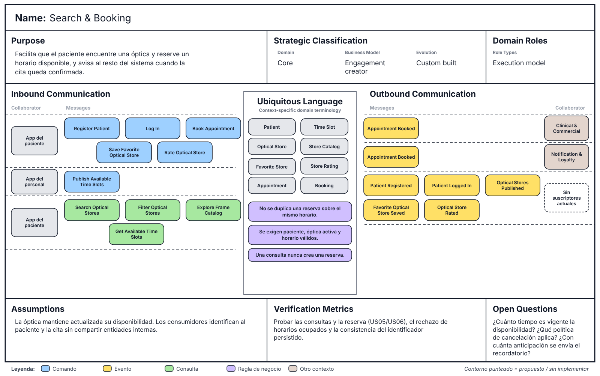

**Clinical & Commercial.** Organizar la evaluación visual y transformar una cotización aprobada en una venta trazable. Regla destacada: Solo una cotización aprobada genera una venta; máximo una venta por cotización. Registrar pago antes del cierre. Cada venta tiene como máximo un comprobante (ver Figura 26).

**Figura 26**

*Bounded Context Canvas del Clinical & Commercial Context*
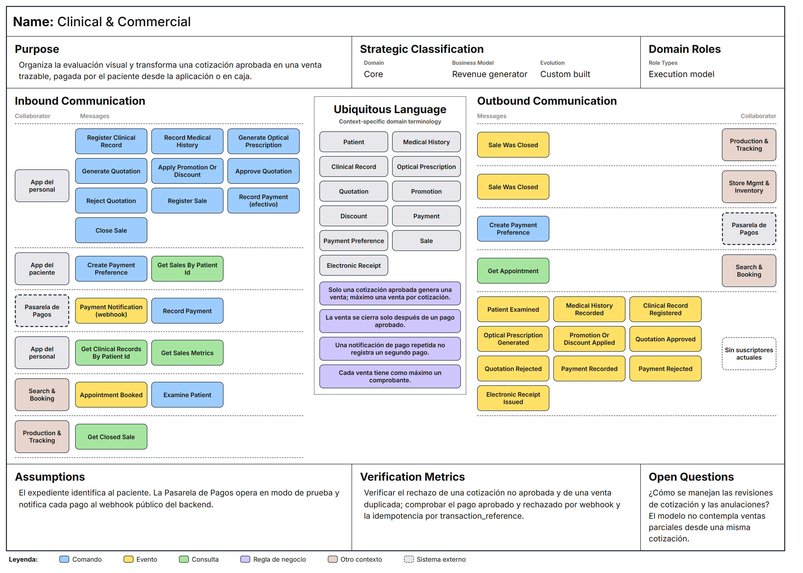

**Production & Tracking.** Coordinar la fabricación y facilitar el seguimiento de cada orden hasta su entrega. Regla destacada: Vincular la orden con una venta cerrada. Respetar las transiciones válidas. Comunicar cambios sin delegar a notificaciones la decisión del estado (ver Figura 27).

**Figura 27**

*Bounded Context Canvas del Production & Tracking Context*
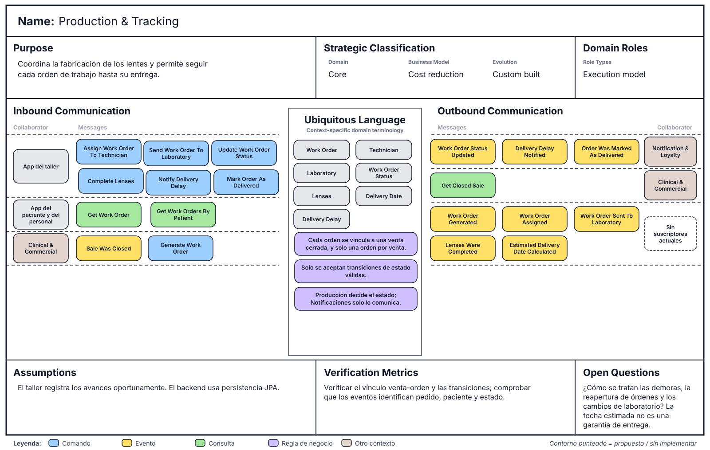

**Notification & Loyalty.** Comunicar hitos relevantes al paciente y apoyar el seguimiento posterior a la atención. Regla destacada: Respetar preferencias y permisos. Evitar duplicados. El estado de fabricación pertenece a producción; este contexto lo comunica (ver Figura 28).

**Figura 28**

*Bounded Context Canvas del Notification & Loyalty Context*
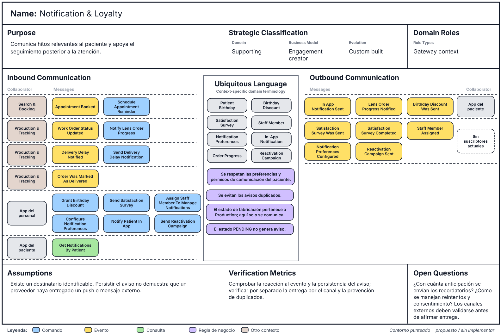

**Store Management & Inventory.** Mantener el catálogo, las existencias y la información operativa de la óptica. Regla destacada: Consultar stock no lo modifica. Registrar movimientos con producto y cantidad. Evitar existencias negativas y movimientos duplicados (ver Figura 29).

**Figura 29**

*Bounded Context Canvas del Store Management & Inventory Context*
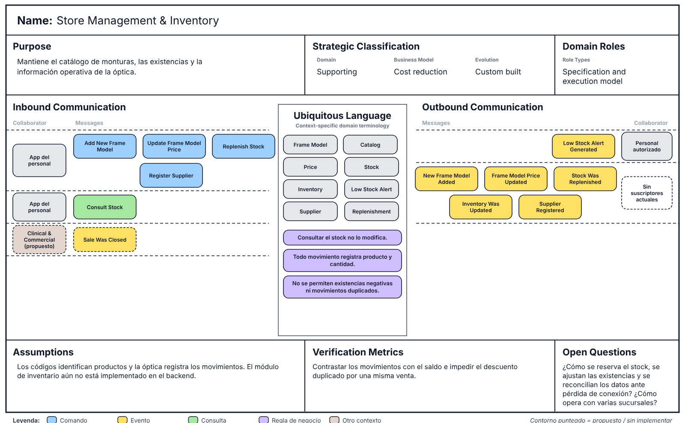

### 2.5.2. Context Mapping

El Context Mapping representa las relaciones estructurales entre los cinco Bounded Contexts de OptiFlow: qué contexto provee información (upstream), qué contexto la consume (downstream) y cómo se protege el modelo de cada uno durante la integración (DDD Crew, s. f.-b). El mapa se elaboró a partir de los resultados del EventStorming, de los eventos identificados en los Domain Message Flows de la sección 2.5.1.2 y de los Bounded Context Canvases de la sección 2.5.1.3.

En el mapa se emplean los siguientes patrones de Domain-Driven Design:

- **Customer / Supplier:** el contexto upstream (Supplier) considera las necesidades del contexto downstream (Customer) al definir la información que publica.
- **Conformist (CF):** el contexto downstream adopta el modelo del upstream tal como lo recibe, sin traducirlo.
- **Anti-Corruption Layer (ACL):** el contexto downstream traduce la información recibida a su propio modelo, de modo que los cambios del upstream no afectan sus reglas de negocio.
- **Open Host Service (OHS):** el contexto upstream ofrece un punto de integración estable, formado por sus eventos de dominio y sus servicios de consulta.
- **Published Language (PL):** los eventos de dominio tienen una estructura documentada y conocida por los contextos que los consumen.
- **Shared Kernel:** dos o más contextos comparten un subconjunto pequeño del modelo o del código, que solo cambia con el acuerdo de todos.

##### Análisis de alternativas

El primer diseño candidato incluía los cinco Bounded Contexts y dos sistemas externos: una pasarela de pagos (POS, tarjeta y billeteras móviles) conectada a Clinical & Commercial y una plataforma de mensajería (WhatsApp y Firebase Cloud Messaging) conectada a Notification & Loyalty. A partir de ese diseño, el equipo evaluó alternativas de diseño mediante preguntas sobre la ubicación de cada capacidad y la forma de integración entre contextos. Para cada alternativa se analizaron sus consecuencias y se tomó una decisión, como se resume en la Tabla 23.

**Tabla 23**

*Alternativas evaluadas para el Context Mapping de OptiFlow*

| # | Pregunta | Análisis | Decisión |
| :-: | :--- | :--- | :--- |
| 1 | ¿Qué pasaría si partimos Clinical & Commercial en un contexto clínico y otro comercial? | La cotización se genera a partir de la receta y del expediente de la misma atención. Separarlos obligaría a publicar eventos adicionales y a copiar el expediente en el contexto comercial para cada venta. | Se mantiene un solo contexto: la atención clínica y la venta forman parte de la misma visita del paciente. |
| 2 | ¿Qué pasaría si movemos el recordatorio de citas a Search & Booking? | Search & Booking tendría que gestionar mensajes y avisos, una capacidad que Notification & Loyalty ya cumple para el avance de los pedidos. Se duplicaría la lógica de notificaciones en dos contextos. | Notification & Loyalty programa el recordatorio; Search & Booking solo publica `AppointmentBooked`. |
| 3 | ¿Qué pasaría si incluimos la receta completa y la cotización dentro de `SaleWasClosed`? | El evento quedaría acoplado al modelo comercial: cualquier cambio en la cotización afectaría a Production & Tracking, que además recibiría precios y pagos que no necesita. | El evento lleva los identificadores de la venta. Production & Tracking obtiene las especificaciones de las lunas con la consulta `GetClosedSale`, mediante su ACL, que traduce la receta y descarta los datos comerciales. |
| 4 | ¿Qué pasaría si Store Management & Inventory consulta la venta en Clinical & Commercial para saber qué descontar? | Inventory dependería del modelo interno de la cotización y de la disponibilidad de otro contexto en el momento del descuento. | Clinical & Commercial, como Supplier, incluye en `SaleWasClosed` los productos vendidos (`productSku` y `quantity`). Inventory los traduce a movimientos de stock con `UpdateInventory`. |
| 5 | ¿Qué pasaría si creamos un Shared Kernel con el modelo del paciente para todos los contextos? | Un cambio en el paciente obligaría a coordinar los cinco contextos. Cada contexto solo necesita el identificador del paciente para relacionar su información. | Cada contexto guarda `patientId` como value object propio. El Shared Kernel se limita a contratos técnicos: `DomainEvent`, `DomainEventPublisher` y `DomainException`. |
| 6 | ¿Qué pasaría si aislamos las capacidades core y movemos notificaciones e inventario a contextos aparte? | Los contextos core (Search & Booking, Clinical & Commercial y Production & Tracking) concentran el flujo principal del paciente. Notificaciones e inventario apoyan ese flujo, pero no lo controlan. | Se adopta: los contextos supporting dependen de los eventos de los contextos core, y ningún contexto core depende de un contexto supporting. |
| 7 | ¿Qué pasaría si el asesor registra el pago a mano en lugar de integrar una pasarela de pagos? | El asesor tendría que validar cada pago fuera de OptiFlow y copiar su referencia, con riesgo de errores y de ventas cerradas sin un pago confirmado. Una pasarela cobra con tarjeta o Yape desde la aplicación del paciente y devuelve una referencia verificable, pero su modelo (preferencias, estados, notificaciones y comisiones) es ajeno al dominio comercial. | Se integra una Pasarela de Pagos externa (Mercado Pago Checkout Pro) como upstream. Clinical & Commercial la consume mediante una ACL (`PaymentGatewayAdapter`), que crea la preferencia de pago y traduce la notificación del proveedor a `Payment`; la venta solo se cierra con un pago aprobado. El pago en efectivo lo registra el asesor. |
| 8 | ¿Qué pasaría si Notification & Loyalty traduce los eventos con una ACL en lugar de adoptarlos como Conformist? | Notification & Loyalty solo usa identificadores y estados para redactar los avisos. Una capa de traducción no protegería ninguna regla de negocio propia. | Notification & Loyalty adopta los eventos tal como se publican (Conformist). |
| 9 | ¿Qué pasaría si los avisos se envían por WhatsApp además de las notificaciones push? | WhatsApp Cloud API exige una cuenta empresarial verificada en Meta y la aprobación previa de cada plantilla de mensaje. Firebase Cloud Messaging entrega notificaciones push a la aplicación Android sin costo y ya forma parte del proyecto de Firebase de OptiFlow. | Los avisos se envían solo como notificaciones push mediante Firebase Cloud Messaging. Notification & Loyalty lo consume mediante una ACL (`FirebaseMessagingAdapter`); el paciente también consulta sus avisos en la aplicación (`GetNotificationsByPatient`). |

##### Context map final

Como resultado del análisis, el context map final conserva los cinco Bounded Contexts y dos sistemas externos, la Pasarela de Pagos y Firebase Cloud Messaging, con siete relaciones: cinco basadas en eventos de dominio entre contextos y dos con los sistemas externos, como se muestra en la Figura 30. Los contextos core aparecen en azul, los contextos supporting en naranja y los sistemas externos en gris; en cada extremo de una relación se indica el rol upstream (U) o downstream (D) y los patrones que aplica.

**Figura 30**

*Context map final de OptiFlow*

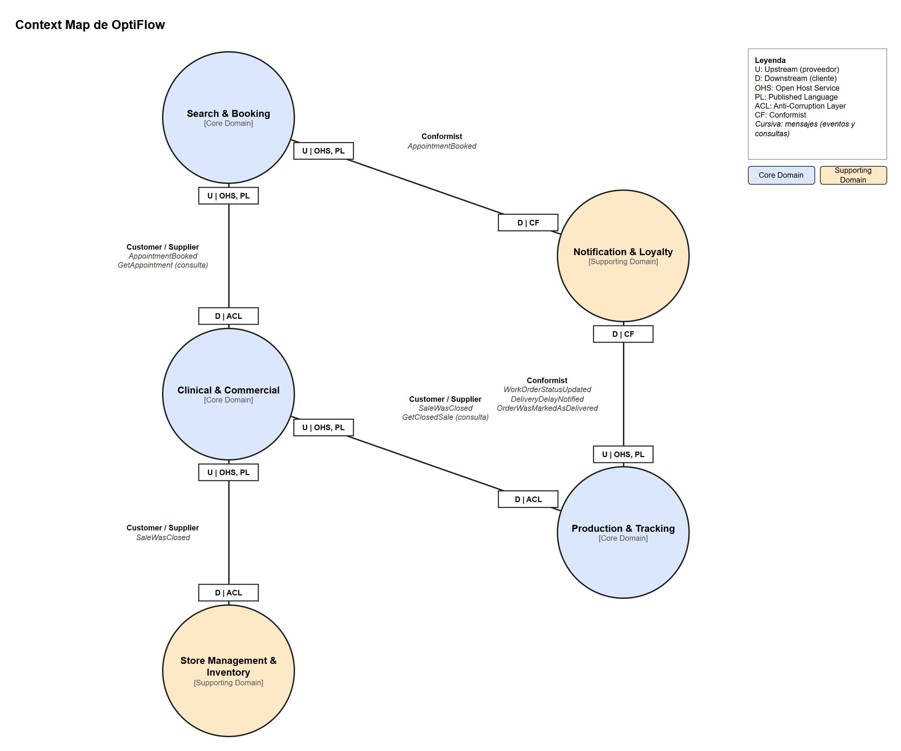

*Nota.* Elaboración propia.

La Tabla 24 resume cada relación del mapa final, los mensajes que la conectan (eventos, consultas y solicitudes a los sistemas externos) y el componente del backend que la implementa.

**Tabla 24**

*Relaciones del context map final de OptiFlow*

| Upstream | Downstream | Relación | Patrones | Mensajes | Comando ejecutado | Implementación en el backend |
| :--- | :--- | :--- | :--- | :--- | :--- | :--- |
| Search & Booking | Clinical & Commercial | Customer / Supplier | OHS, PL / ACL | `AppointmentBooked` (evento), `GetAppointment` (consulta) | `ExaminePatient` | `SearchBookingAppointmentAdapter` (ACL) |
| Search & Booking | Notification & Loyalty | Conformist | OHS, PL / CF | `AppointmentBooked` | `ScheduleAppointmentReminder` | `AppointmentBookedEventHandler` |
| Clinical & Commercial | Production & Tracking | Customer / Supplier | OHS, PL / ACL | `SaleWasClosed` (evento), `GetClosedSale` (consulta) | `GenerateWorkOrder` | `ClinicalCommercialSaleAdapter` (ACL) |
| Clinical & Commercial | Store Management & Inventory | Customer / Supplier | OHS, PL / ACL | `SaleWasClosed` | `UpdateInventory` | `SaleWasClosedEventHandler` (ACL) |
| Production & Tracking | Notification & Loyalty | Conformist | OHS, PL / CF | `WorkOrderStatusUpdated`, `DeliveryDelayNotified`, `OrderWasMarkedAsDelivered` | `NotifyLensOrderProgress`, `SendDeliveryDelayNotification`, `SendSatisfactionSurvey` | `WorkOrderStatusUpdatedEventHandler`, `ProductionDeliveryDelayNotifiedEventHandler`, `OrderWasMarkedAsDeliveredEventHandler` |
| Pasarela de Pagos (externo) | Clinical & Commercial | Anti-Corruption Layer | OHS / ACL | Preferencia de pago y notificación del resultado (aprobado o rechazado) | `CreatePaymentPreference`, `RecordPayment` | `PaymentGatewayAdapter` (ACL) |
| Firebase Cloud Messaging (externo) | Notification & Loyalty | Anti-Corruption Layer | OHS / ACL | Envío de notificación push al token del dispositivo del paciente | `NotifyLensOrderProgress`, `SendDeliveryDelayNotification`, `SendSatisfactionSurvey`, `ScheduleAppointmentReminder` | `FirebaseMessagingAdapter` (ACL) |

A continuación se detalla cada relación del mapa final.

##### Search & Booking → Clinical & Commercial

La relación entre Search & Booking y Clinical & Commercial se muestra en la Figura 31.

**Figura 31**

*Context map entre Search & Booking y Clinical & Commercial*

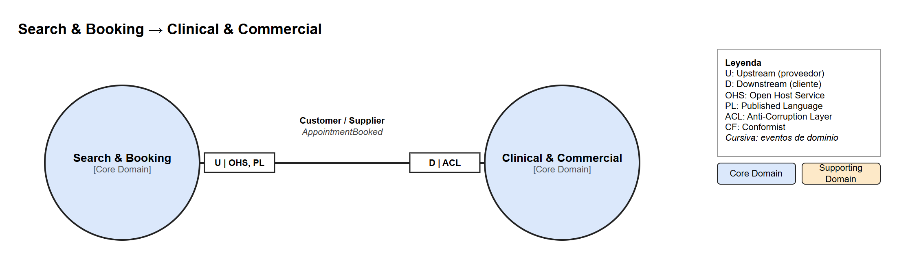

*Nota.* Elaboración propia.

**Patrón: Customer / Supplier, con Open Host Service y Published Language en el upstream y Anti-Corruption Layer en el downstream.**

- **Search & Booking como upstream:** registra la reserva y publica el evento `AppointmentBooked` con `appointmentId`, `patientId`, `opticalStoreId` y `timeSlotId`. También responde la consulta `GetAppointment`, que devuelve el paciente y el estado de una cita.
- **Clinical & Commercial como downstream:** al recibir el evento ejecuta `ExaminePatient` y abre el expediente clínico de la atención. Al registrar la atención, consulta la cita con `GetAppointment`; su ACL (`SearchBookingAppointmentAdapter`) traduce la respuesta al modelo clínico (`BookedAppointment`), con lo que los cambios en la agenda o en los estados de la reserva no alteran las reglas del expediente.

##### Search & Booking → Notification & Loyalty

La relación entre Search & Booking y Notification & Loyalty se muestra en la Figura 32.

**Figura 32**

*Context map entre Search & Booking y Notification & Loyalty*

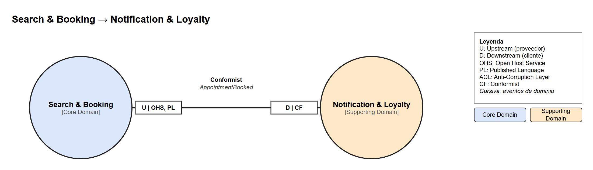

*Nota.* Elaboración propia.

**Patrón: Conformist, con Open Host Service y Published Language en el upstream.**

- **Search & Booking como upstream:** publica `AppointmentBooked` sin conocer cómo se redactan ni se muestran los avisos al paciente, y responde la consulta `GetPatientsByBirthday`, que devuelve los pacientes que cumplen años en una fecha.
- **Notification & Loyalty como downstream:** adopta el evento tal como se publica y usa `patientId` y `appointmentId` para ejecutar `ScheduleAppointmentReminder`, que programa el recordatorio de la cita y el de control anual. Su `BirthdayDiscountScheduler` usa cada día `GetPatientsByBirthday` para ejecutar `GrantBirthdayDiscount`.

##### Clinical & Commercial → Production & Tracking

La relación entre Clinical & Commercial y Production & Tracking se muestra en la Figura 33.

**Figura 33**

*Context map entre Clinical & Commercial y Production & Tracking*

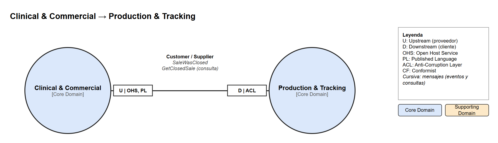

*Nota.* Elaboración propia.

**Patrón: Customer / Supplier, con Open Host Service y Published Language en el upstream y Anti-Corruption Layer en el downstream.**

- **Clinical & Commercial como upstream:** al cerrar la venta publica `SaleWasClosed` con `saleId`, `quotationId`, `clinicalRecordId`, `patientId`, `totalAmount` y los productos vendidos. También responde la consulta `GetClosedSale`, que reúne los datos de la venta, la cotización y el expediente clínico.
- **Production & Tracking como downstream:** al recibir el evento ejecuta `GenerateWorkOrder`. Su ACL (`ClinicalCommercialSaleAdapter`) consulta la venta con `GetClosedSale` y traduce la receta óptica en especificaciones de lunas (esfera, cilindro, eje, adición y tratamiento), descartando precios, pagos y datos de facturación que la fabricación no necesita.

##### Clinical & Commercial → Store Management & Inventory

La relación entre Clinical & Commercial y Store Management & Inventory se muestra en la Figura 34.

**Figura 34**

*Context map entre Clinical & Commercial y Store Management & Inventory*

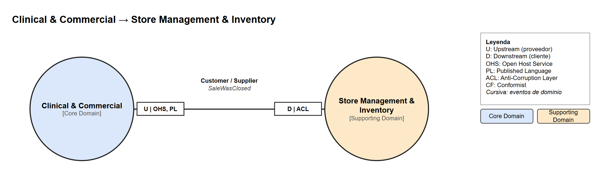

*Nota.* Elaboración propia.

**Patrón: Customer / Supplier, con Open Host Service y Published Language en el upstream y Anti-Corruption Layer en el downstream.**

- **Clinical & Commercial como upstream:** a pedido de Store Management & Inventory, incluye en `SaleWasClosed` la lista de productos vendidos con su `productSku` y `quantity`. Esta adaptación del contrato a las necesidades del cliente caracteriza la relación Customer / Supplier.
- **Store Management & Inventory como downstream:** al recibir el evento ejecuta `UpdateInventory`. Su ACL traduce cada producto vendido en un movimiento de salida de stock y descarta los productos que no controla, como los servicios. Luego verifica si alguna existencia llegó a su nivel mínimo para generar la alerta de reabastecimiento.

##### Production & Tracking → Notification & Loyalty

La relación entre Production & Tracking y Notification & Loyalty se muestra en la Figura 35.

**Figura 35**

*Context map entre Production & Tracking y Notification & Loyalty*

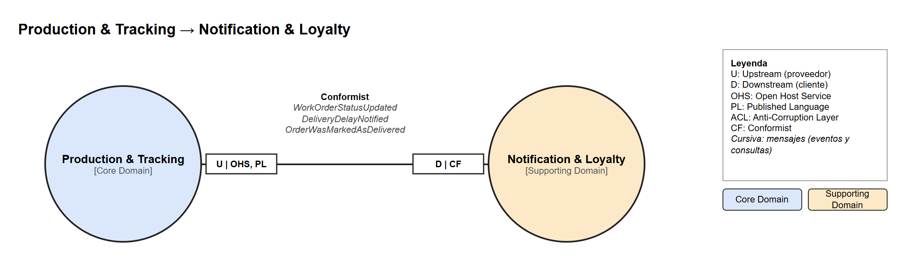

*Nota.* Elaboración propia.

**Patrón: Conformist, con Open Host Service y Published Language en el upstream.**

- **Production & Tracking como upstream:** es el único contexto que conoce el estado real de fabricación. Publica `WorkOrderStatusUpdated` en cada cambio de estado, `DeliveryDelayNotified` cuando se registra una demora y `OrderWasMarkedAsDelivered` cuando el paciente recibe sus lentes.
- **Notification & Loyalty como downstream:** adopta los eventos tal como se publican y ejecuta `NotifyLensOrderProgress`, `SendDeliveryDelayNotification` y `SendSatisfactionSurvey`, respectivamente. Cada aviso se envía como notificación push mediante Firebase Cloud Messaging y el paciente también lo consulta en la aplicación mediante `GetNotificationsByPatient`.

##### Pasarela de Pagos → Clinical & Commercial

La relación entre la Pasarela de Pagos y Clinical & Commercial se muestra en la Figura 36.

**Figura 36**

*Context map entre la Pasarela de Pagos y Clinical & Commercial*

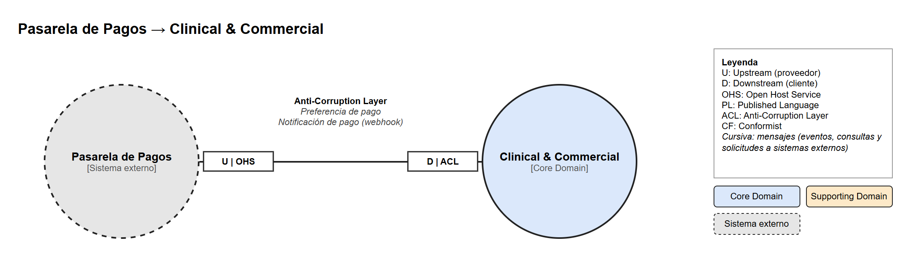

*Nota.* Elaboración propia.

**Patrón: Anti-Corruption Layer en el downstream, frente al servicio publicado por el proveedor.**

- **Pasarela de Pagos como upstream:** sistema externo (Mercado Pago Checkout Pro) que cobra con tarjeta o Yape en su propia página de pago. Publica su propia API y su propio modelo de preferencias, pagos, estados y notificaciones, que OptiFlow no puede modificar.
- **Clinical & Commercial como downstream:** cuando el paciente solicita pagar (`CreatePaymentPreference`), su ACL (`PaymentGatewayAdapter`) crea la preferencia de pago con el monto de la venta y devuelve el enlace que abre la aplicación. Cuando la pasarela notifica el resultado al webhook del backend, la ACL valida la firma de la notificación, consulta el pago al proveedor y lo traduce a `Payment`, con su método, monto, referencia de la transacción y estado. Si el pago es aprobado se ejecuta `RecordPayment`, se publica `PaymentRecorded` y la venta puede cerrarse; si es rechazado se publica `PaymentRejected` y la venta permanece pendiente. Un cambio de proveedor solo afecta al adaptador.

##### Firebase Cloud Messaging → Notification & Loyalty

La relación entre Firebase Cloud Messaging y Notification & Loyalty se muestra en la Figura 37.

**Figura 37**

*Context map entre Firebase Cloud Messaging y Notification & Loyalty*

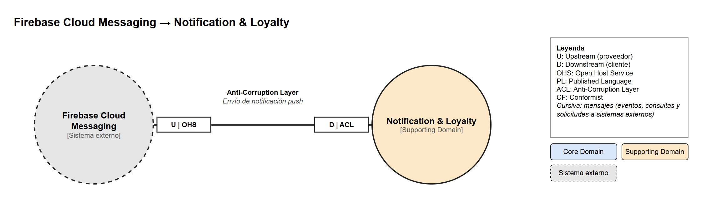

*Nota.* Elaboración propia.

**Patrón: Anti-Corruption Layer en el downstream, frente al servicio publicado por el proveedor.**

- **Firebase Cloud Messaging como upstream:** servicio externo de Google que entrega notificaciones push a los dispositivos Android a partir de un token de registro.
- **Notification & Loyalty como downstream:** registra cada aviso en su modelo (`Notification`) y su ACL (`FirebaseMessagingAdapter`) lo traduce al formato de mensaje de Firebase Cloud Messaging, con el token del dispositivo del paciente (`DeviceToken`). Si el envío falla, la notificación queda registrada y el paciente puede consultarla en la aplicación.

### 2.5.3. Software Architecture

#### 2.5.3.1. Software Architecture Context Level Diagrams

El diagrama de contexto, elaborado con Structurizr, ubica a OptiFlow frente a sus usuarios y a los cuatro sistemas externos con los que se integra: la **Pasarela de Pagos** (Mercado Pago Checkout Pro), en la que el paciente paga con tarjeta o Yape; **Firebase Cloud Messaging**, que entrega las notificaciones push al paciente; **Google Maps Platform**, que muestra las ópticas cercanas en un mapa; y el **servicio de filtros faciales AR**, que permite probar virtualmente las monturas. El [Anexo E](Anexos.md#anexo-e-arquitectura-de-software) reúne las vistas complementarias (ver Figura 38).

**Figura 38**

*Diagrama de contexto C4 de OptiFlow*

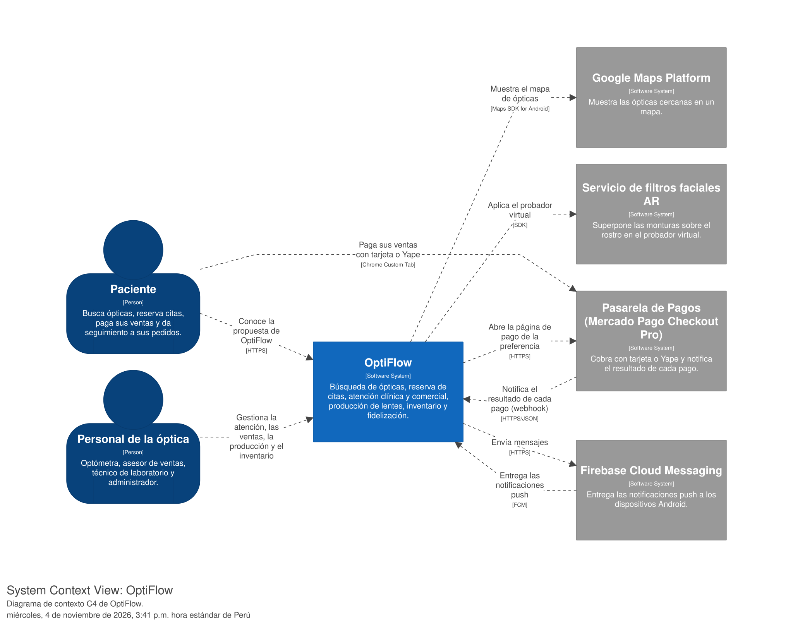

#### 2.5.3.2. Software Architecture Container Level Diagrams

El diagrama de contenedores, elaborado con Structurizr, muestra el backend como **un único contenedor de aplicación Spring Boot**, coherente con el código del repositorio: una aplicación, módulos por contexto y adaptadores de persistencia JPA. Los límites de DDD no equivalen a límites de despliegue. La aplicación móvil, su base de datos local, la Landing Page y la base de datos del backend se representan como contenedores distintos por sus responsabilidades y tecnologías, siguiendo el alcance del [diagrama de contenedores C4](https://c4model.com/diagrams/container) (Brown, s. f.) (ver Figura 39).

- **Aplicación móvil (Kotlin, Jetpack Compose):** consume la API REST del backend, guarda en la base de datos local la última información consultada para mostrarla sin conexión, usa la cámara del dispositivo (CameraX) en el escáner de monturas y en el probador virtual, muestra las ópticas cercanas con Google Maps SDK, aplica el probador virtual con el servicio de filtros faciales AR y recibe las notificaciones push de Firebase Cloud Messaging.
- **Base de datos local (Room, SQLite):** almacena en el dispositivo una copia de solo lectura de la última información consultada (citas, pedidos, avisos y catálogo) y la reemplaza con la respuesta del backend en cada consulta con conexión; las operaciones que modifican datos requieren conexión.
- **Backend OptiFlow (Java 21, Spring Boot):** crea las preferencias de pago en Mercado Pago Checkout Pro, recibe sus notificaciones de pago en una ruta pública (webhook), emite los tokens JWT de sesión y envía las notificaciones push mediante Firebase Cloud Messaging.
- **Base de datos (PostgreSQL 16):** persistencia relacional de los cinco módulos del backend.
- **Landing Page (HTML5, CSS3, JavaScript):** presenta la propuesta de valor e incluye el enlace de descarga de la aplicación desde Firebase App Distribution.

**Figura 39**

*Diagrama de contenedores C4 con un único backend*

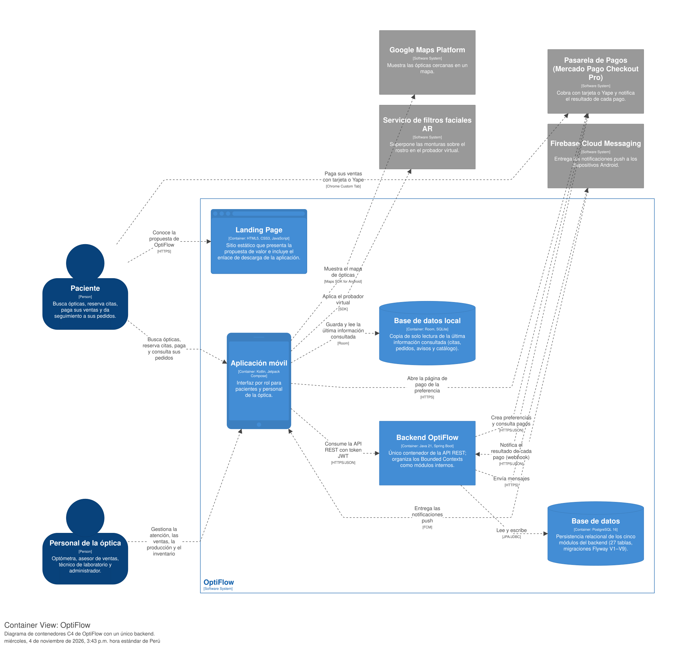

#### 2.5.3.3. Software Architecture Deployment Diagrams

El Deployment Diagram, elaborado con Structurizr, muestra dónde se ejecuta cada contenedor de OptiFlow en el entorno de validación académica (*Academic Validation Environment*) y con qué servicios externos se comunica:

- **Dispositivo del visitante:** el navegador web carga la Landing Page publicada como sitio estático en **GitHub Pages**, que incluye el enlace de descarga de la aplicación.
- **Firebase App Distribution:** distribuye el APK de la aplicación móvil a los dispositivos Android de prueba.
- **Dispositivo Android de prueba:** dentro del entorno de ejecución de la aplicación Kotlin se encuentran la aplicación Android, la base de datos local (SQLite/Room, caché de solo lectura) y la cámara del dispositivo (CameraX). La aplicación consume el servicio de filtros faciales AR para el probador virtual y Google Maps Platform para el mapa de ópticas.
- **Render:** ejecuta el backend en un contenedor Docker (Java 21), que accede a la base de datos **Render PostgreSQL** mediante JPA. El backend crea las preferencias de pago en la **Pasarela de Pagos** (Mercado Pago), que le notifica el resultado de cada pago en un webhook público, y envía las notificaciones push mediante **Firebase Cloud Messaging**, que las entrega al dispositivo Android.

La configuración de cada entorno se detalla en la sección 4.1.4 (ver Figura 40).

**Figura 40**

*Deployment Diagram de OptiFlow*

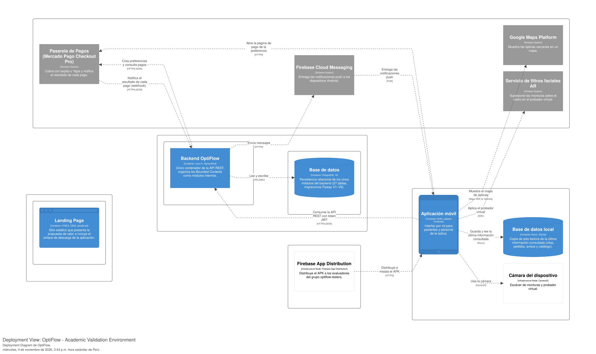

## 2.6. Tactical-Level Domain-Driven Design

Los cinco contextos de OptiFlow comparten una sola base de datos PostgreSQL. El backend accede a ella mediante JPA/Hibernate. La separación por Bounded Context organiza las responsabilidades y las reglas del negocio, sin crear una base de datos por contexto. Las migraciones V1 a V9 definen 27 tablas: siete de Search & Booking, siete de Clinical & Commercial, cinco de Production & Tracking, cinco de Store Management & Inventory y tres de Notification & Loyalty.

El perfil `postgres` valida el mapeo JPA y aplica las migraciones con Flyway. El perfil `local` utiliza H2 en memoria para desarrollo; ello no implica persistencia NoSQL. La app móvil consume contratos HTTP del backend y no define el esquema físico PostgreSQL.

El modelo de datos se basa en las migraciones `V1__search_booking_schema.sql`, `V2__clinical_commercial_schema.sql`, `V3__production_tracking_schema.sql`, `V4__notification_loyalty_schema.sql`, `V5__optical_store_location.sql`, `V6__store_inventory_schema.sql`, `V7__notification_push.sql`, `V8__staff_members.sql` y `V9__sale_checkout_payment.sql` del backend. Las secciones siguientes describen las tablas y restricciones de cada contexto.

Las relaciones físicas del modelo corresponden a las claves foráneas declaradas en las migraciones. Los identificadores que no tienen una restricción `FOREIGN KEY` se documentan como referencias lógicas. Los objetos de valor y las claves compuestas de JPA no implican que la información se almacene como documentos MongoDB.

Los diagramas de base de datos de las Figuras 43, 46, 49 y 55 se elaboraron directamente a partir de las migraciones V1–V9: muestran cada tabla con sus columnas, tipos, nulabilidad, claves primarias, claves foráneas y restricciones `UNIQUE`; los `CHECK` y los índices se describen en el texto de cada contexto. Los identificadores sin `FOREIGN KEY` no se dibujan como relaciones. La Figura 52 corresponde a Store Management & Inventory (migración V6).

### 2.6.1. Bounded Context: Search & Booking Context

#### 2.6.1.1. Domain Layer

La **Domain Layer** concentra el modelo de negocio del Bounded Context Search & Booking. En esta capa se definen los agregados, entidades, objetos de valor, enumeraciones, servicios de dominio, repositorios y eventos de dominio necesarios para representar las reglas del proceso de búsqueda y reserva de citas.

Esta capa no depende de frameworks, bases de datos ni servicios externos, permitiendo que las reglas principales del negocio permanezcan aisladas de los detalles técnicos de implementación.

##### Aggregate Root: `Appointment`

La entidad `Appointment` representa la reserva formal realizada por un paciente para recibir atención en una óptica dentro de un horario determinado. Se considera el **Aggregate Root** principal del proceso de reserva, debido a que concentra las reglas necesarias para mantener la consistencia de una cita.

Cuando un paciente selecciona una óptica y un horario disponible, el agregado valida la información correspondiente y permite crear la reserva. Asimismo, controla las operaciones relacionadas con la confirmación, cancelación y reprogramación de una cita (ver Tabla 25).

**Tabla 25**

*Atributos del aggregate root Appointment*

| Atributo | Tipo | Descripción |
|---|---|---|
| `id` | `AppointmentId` (VO) | Identificador único de la cita |
| `patientId` | `PatientId` (VO) | Identificador del paciente que realiza la reserva |
| `opticalStoreId` | `OpticalStoreId` (VO) | Identificador de la óptica seleccionada |
| `timeSlot` | `TimeSlot` (VO) | Fecha y horario seleccionado para la atención |
| `status` | `AppointmentStatus` (Enum) | Estado actual de la cita |
| `createdAt` | `DateTime` | Fecha y hora en que se creó la reserva |
| `updatedAt` | `DateTime` | Fecha y hora de la última actualización |

##### Métodos principales

Los métodos principales del aggregate root Appointment se presentan en la Tabla 26.

**Tabla 26**

*Métodos principales del aggregate root Appointment*

| Método | Visibilidad | Descripción |
|---|---|---|
| `book()` | public | Confirma la creación de una reserva cuando el horario seleccionado está disponible |
| `confirm()` | public | Cambia el estado de la cita a confirmada |
| `cancel()` | public | Cancela una cita previamente registrada |
| `reschedule(timeSlot: TimeSlot)` | public | Permite cambiar la fecha y horario de una cita |
| `isAvailable()` | public | Valida si el horario asociado puede ser utilizado para la reserva |

##### Entidad: `Patient`

La entidad `Patient` representa al paciente que utiliza OptiFlow para buscar ópticas, consultar disponibilidad y reservar citas. Dentro de este contexto, la información del paciente se utiliza principalmente para identificar al usuario y relacionarlo con sus reservas y preferencias (ver Tabla 27).

**Tabla 27**

*Atributos de la entidad Patient*

| Atributo | Tipo | Descripción |
|---|---|---|
| `id` | `PatientId` (VO) | Identificador único del paciente |
| `name` | `Name` (VO) | Nombre completo del paciente |
| `email` | `EmailAddress` (VO) | Correo electrónico del paciente |
| `phone` | `PhoneNumber` (VO) | Número telefónico del paciente |
| `passwordHash` | `String` | Hash BCrypt de la contraseña; nunca se expone en las respuestas |
| `birthDate` | `LocalDate` | Fecha de nacimiento del paciente (opcional); Notification & Loyalty la usa para el beneficio de cumpleaños |
| `createdAt` | `DateTime` | Fecha de registro del paciente |

##### Entidad: `StaffMember`

La entidad `StaffMember` representa a una persona del personal de la óptica que inicia sesión en la aplicación con un rol asignado por el administrador. Search & Booking la gestiona junto con `Patient` porque ambos comparten el inicio de sesión; los demás contextos solo reciben el identificador y el rol dentro del token de acceso (ver Tabla 28).

**Tabla 28**

*Atributos de la entidad StaffMember*

| Atributo | Tipo | Descripción |
|---|---|---|
| `id` | `StaffMemberId` (VO) | Identificador único del miembro del personal |
| `opticalStoreId` | `OpticalStoreId` (VO) | Óptica en la que trabaja |
| `name` | `Name` (VO) | Nombre completo |
| `email` | `EmailAddress` (VO) | Correo con el que inicia sesión; es único entre pacientes y personal |
| `passwordHash` | `String` | Hash BCrypt de la contraseña |
| `role` | `UserRole` (Enum) | Rol que define a qué operaciones puede acceder |
| `active` | `Boolean` | Indica si puede iniciar sesión |
| `createdAt` | `DateTime` | Fecha de registro |

##### Entidad: `OpticalStore`

La entidad `OpticalStore` representa una sucursal óptica disponible para ser encontrada por los pacientes dentro de la plataforma (ver Tabla 29).

**Tabla 29**

*Atributos de la entidad OpticalStore*

| Atributo | Tipo | Descripción |
|---|---|---|
| `id` | `OpticalStoreId` (VO) | Identificador único de la óptica |
| `name` | `StoreName` (VO) | Nombre de la óptica |
| `address` | `StoreAddress` (VO) | Dirección física de la sucursal |
| `phone` | `PhoneNumber` (VO) | Número telefónico de contacto |
| `location` | `GeoLocation` (VO) | Latitud y longitud de la sucursal, usadas para mostrarla en el mapa |
| `rating` | `StoreRating` (VO) | Valoración promedio de la óptica |
| `status` | `StoreStatus` (Enum) | Estado actual de la óptica |

##### Entidad: `TimeSlot`

`TimeSlot` representa un bloque de tiempo disponible para que el paciente pueda reservar una atención optométrica (ver Tabla 30).

**Tabla 30**

*Atributos de la entidad TimeSlot*

| Atributo | Tipo | Descripción |
|---|---|---|
| `id` | `TimeSlotId` (VO) | Identificador del horario |
| `opticalStoreId` | `OpticalStoreId` (VO) | Óptica a la que pertenece el horario |
| `startDateTime` | `DateTime` | Fecha y hora de inicio |
| `endDateTime` | `DateTime` | Fecha y hora de finalización |
| `status` | `TimeSlotStatus` (Enum) | Disponibilidad actual del horario |

##### Value Objects

Los Value Objects del Search & Booking Context se resumen en la Tabla 31.

**Tabla 31**

*Value Objects del Search & Booking Context*

| Value Object | Propósito |
|---|---|
| `AppointmentId` | Identificador único de una cita |
| `PatientId` | Identificador único del paciente |
| `OpticalStoreId` | Identificador único de una óptica |
| `TimeSlotId` | Identificador único de un horario |
| `StaffMemberId` | Identificador único de un miembro del personal |
| `Name` | Representa un nombre válido de paciente |
| `EmailAddress` | Encapsula y valida el correo electrónico |
| `PhoneNumber` | Encapsula el número telefónico |
| `StoreName` | Representa el nombre de una óptica |
| `StoreAddress` | Representa la dirección de una sucursal |
| `GeoLocation` | Encapsula y valida la latitud (−90 a 90) y la longitud (−180 a 180) de una sucursal y calcula la distancia a otra ubicación |
| `StoreRating` | Representa la valoración otorgada a una óptica |
| `TimeSlot` | Representa un intervalo de tiempo para una atención |

##### Enumerations

Las enumeraciones del Search & Booking Context se detallan en la Tabla 32.

**Tabla 32**

*Enumeraciones del Search & Booking Context*

| Enum | Valores | Propósito |
|---|---|---|
| `AppointmentStatus` | PENDING, CONFIRMED, CANCELLED, COMPLETED | Representa el estado de una cita |
| `TimeSlotStatus` | AVAILABLE, RESERVED, BLOCKED | Representa la disponibilidad de un horario |
| `StoreStatus` | ACTIVE, INACTIVE | Representa el estado operativo de una óptica |
| `UserRole` | PATIENT, OPTOMETRIST, SALES_ADVISOR, TECHNICIAN, ADMIN | Rol incluido en el token de acceso; `PATIENT` corresponde a `Patient` y los demás a `StaffMember` |

##### Domain Services

Los Domain Services del Search & Booking Context se presentan en la Tabla 33.

**Tabla 33**

*Domain Services del Search & Booking Context*

| Domain Service | Responsabilidad |
|---|---|
| `AppointmentAvailabilityService` | Verifica que un `TimeSlot` se encuentre disponible antes de realizar una reserva |
| `OpticalStoreSearchService` | Ejecuta las reglas de búsqueda y filtrado de ópticas |
| `StoreRatingService` | Gestiona las reglas asociadas a las valoraciones de las ópticas |

##### Repository Interfaces

Las interfaces de repositorio pertenecen al dominio y permiten abstraer la persistencia de las entidades (ver Tabla 34).

**Tabla 34**

*Repository Interfaces del Search & Booking Context*

| Interface | Operaciones principales |
|---|---|
| `AppointmentRepository` | `save()`, `findById()`, `findByPatientId()`, `findByTimeSlot()` |
| `PatientRepository` | `save()`, `findById()`, `findByEmail()`, `findByBirthday(month, day)` |
| `StaffMemberRepository` | `save()`, `findById()`, `findByEmail()`, `findByOpticalStoreId()` |
| `OpticalStoreRepository` | `findById()`, `search()`, `filter()` |
| `TimeSlotRepository` | `findById()`, `findAvailableByStore()`, `reserve()` |

##### Domain Events

Los eventos de dominio representan hechos relevantes ocurridos dentro del contexto (ver Tabla 35).

**Tabla 35**

*Domain Events del Search & Booking Context*

| Domain Event | Descripción |
|---|---|
| `PatientRegistered` | Se genera cuando un nuevo paciente completa su registro |
| `PatientLoggedIn` | Se genera cuando un paciente o un miembro del personal inicia sesión correctamente |
| `StaffMemberRegistered` | Se genera cuando el administrador registra a un miembro del personal |
| `StaffMemberRoleAssigned` | Se genera cuando el administrador cambia el rol de un miembro del personal |
| `OpticalStoresFiltered` | Se genera cuando un paciente filtra las ópticas según sus criterios |
| `OpticalStoresPublished` | Se genera cuando las ópticas disponibles son publicadas |
| `FavoriteOpticalStoreSaved` | Se genera cuando un paciente guarda una óptica como favorita |
| `OpticalStoreRated` | Se genera cuando un paciente registra una valoración |
| `AppointmentBooked` | Se genera cuando una cita es reservada correctamente |

Los eventos anteriores corresponden a los eventos publicados definidos para el **Search & Booking Context** en el diseño estratégico de OptiFlow.

##### Factories

Los Factories del Search & Booking Context se resumen en la Tabla 36.

**Tabla 36**

*Factories del Search & Booking Context*

| Factory | Propósito |
|---|---|
| `AppointmentFactory` | Centraliza la creación de nuevas instancias válidas de `Appointment` |
| `PatientFactory` | Centraliza la creación de nuevos pacientes cumpliendo las reglas del dominio |

#### 2.6.1.2. Interface Layer

La **Interface Layer** representa el punto de entrada al Bounded Context Search & Booking. Su responsabilidad es recibir las solicitudes provenientes de la aplicación cliente y traducirlas al modelo utilizado por la Application Layer.

Esta capa permite exponer las capacidades de búsqueda, consulta de disponibilidad, registro de pacientes, exploración de catálogos y reserva de citas sin exponer directamente las entidades internas del dominio.

##### Controllers

Los Controllers del Search & Booking Context se detallan en la Tabla 37.

**Tabla 37**

*Controllers del Search & Booking Context*

| Controller | Endpoints | Capabilities soportadas |
|---|---|---|
| `PatientController` | `POST /patients`, `POST /login`, `GET /patients/{id}/appointments` | Registro de pacientes, inicio de sesión de pacientes y personal (devuelve el token JWT y el rol) y consulta de las citas del paciente |
| `StaffMemberController` | `POST /staff-members`, `GET /staff-members`, `PATCH /staff-members/{id}/role` | Registro del personal, listado y asignación de rol; solo para `ADMIN` |
| `OpticalStoreController` | `GET /optical-stores`, `GET /optical-stores/{id}`, `GET /optical-stores/nearby` | Búsqueda y consulta de ópticas, y consulta de las ópticas cercanas a una ubicación |
| `OpticalStoreFilterController` | `GET /optical-stores/search` | Filtrado de ópticas según criterios del paciente |
| `TimeSlotController` | `GET /optical-stores/{id}/availability` | Consulta de horarios disponibles |
| `AppointmentController` | `POST /appointments`, `GET /appointments/{id}` | Creación y consulta de citas |
| `FavoriteStoreController` | `POST /patients/{id}/favorites` | Registro de ópticas favoritas |
| `StoreRatingController` | `POST /optical-stores/{id}/ratings` | Registro de valoraciones |

##### Resources / DTOs

Los Resources / DTOs del Search & Booking Context se presentan en la Tabla 38.

**Tabla 38**

*Resources / DTOs del Search & Booking Context*

| DTO | Tipo | Uso |
|---|---|---|
| `RegisterPatientRequest` | Input | Nombre, correo, teléfono, contraseña y fecha de nacimiento opcional del paciente |
| `LoginRequest` | Input | Correo y contraseña para iniciar sesión |
| `LoginResponse` | Output | Token de acceso JWT, fecha de expiración, identificador del usuario y rol |
| `RegisterStaffMemberRequest` | Input | Datos del miembro del personal, su óptica y su rol |
| `AssignStaffRoleRequest` | Input | Nuevo rol del miembro del personal |
| `StaffMemberResponse` | Output | Información pública del miembro del personal, sin la contraseña |
| `SearchOpticalStoreRequest` | Input | Parámetros utilizados para buscar ópticas |
| `FilterOpticalStoreRequest` | Input | Criterios utilizados para filtrar resultados |
| `BookAppointmentRequest` | Input | Datos necesarios para reservar una cita |
| `SaveFavoriteStoreRequest` | Input | Datos necesarios para guardar una óptica favorita |
| `RateOpticalStoreRequest` | Input | Datos de la valoración de una óptica |
| `PatientResponse` | Output | Información pública del paciente |
| `OpticalStoreResponse` | Output | Información de una óptica, incluida su latitud y longitud |
| `TimeSlotResponse` | Output | Información sobre un horario disponible |
| `AppointmentResponse` | Output | Información de una cita registrada |

##### Assemblers

Los Assemblers del Search & Booking Context se resumen en la Tabla 39.

**Tabla 39**

*Assemblers del Search & Booking Context*

| Assembler | Transformación |
|---|---|
| `FromRegisterPatientRequestAssembler` | `RegisterPatientRequest` → `RegisterPatientCommand` |
| `FromLoginRequestAssembler` | `LoginRequest` → `LoginCommand` |
| `FromSearchOpticalStoreRequestAssembler` | `SearchOpticalStoreRequest` → `SearchOpticalStoresQuery` |
| `FromFilterOpticalStoreRequestAssembler` | `FilterOpticalStoreRequest` → `FilterOpticalStoresQuery` |
| `FromBookAppointmentRequestAssembler` | `BookAppointmentRequest` → `BookAppointmentCommand` |
| `FromRateOpticalStoreRequestAssembler` | `RateOpticalStoreRequest` → `RateOpticalStoreCommand` |
| `FromRegisterStaffMemberRequestAssembler` | `RegisterStaffMemberRequest` → `RegisterStaffMemberCommand` |

#### 2.6.1.3. Application Layer

La **Application Layer** coordina los casos de uso del Bounded Context Search & Booking. Esta capa recibe commands y queries desde la Interface Layer, coordina los servicios y repositorios del dominio, controla la ejecución de las operaciones y publica los eventos generados por el dominio.

Se utiliza una separación entre **Commands**, orientados a modificar el estado del sistema, y **Queries**, orientadas a consultar información.

##### Command Handlers

Los Command Handlers del Search & Booking Context se detallan en la Tabla 40.

**Tabla 40**

*Command Handlers del Search & Booking Context*

| Command Handler | Command procesado | Flujo |
|---|---|---|
| `RegisterPatientCommandHandler` | `RegisterPatient` | Valida los datos, crea el paciente mediante `PatientFactory`, persiste mediante `PatientRepository` y publica `PatientRegistered` |
| `LoginCommandHandler` | `LogIn` | Busca el correo entre pacientes y personal activo, verifica la contraseña con BCrypt, emite el token JWT con el identificador y el rol mediante `JwtTokenService` y publica `PatientLoggedIn` |
| `RegisterStaffMemberCommandHandler` | `RegisterStaffMember` | Valida que el correo no exista, guarda el hash de la contraseña y el rol, y publica `StaffMemberRegistered` |
| `AssignStaffRoleCommandHandler` | `AssignStaffRole` | Cambia el rol de un miembro del personal y publica `StaffMemberRoleAssigned`; el cambio rige desde su siguiente inicio de sesión |
| `PublishAvailableTimeSlotsCommandHandler` | `PublishAvailableTimeSlots` | Registra o actualiza los horarios disponibles de una óptica y publica `OpticalStoresPublished` |
| `SaveFavoriteOpticalStoreCommandHandler` | `SaveFavoriteOpticalStore` | Registra una óptica como favorita del paciente y publica `FavoriteOpticalStoreSaved` |
| `RateOpticalStoreCommandHandler` | `RateOpticalStore` | Valida y registra la valoración realizada por el paciente y publica `OpticalStoreRated` |
| `BookAppointmentCommandHandler` | `BookAppointment` | Verifica la disponibilidad del horario, crea la cita mediante `AppointmentFactory`, persiste el agregado y publica `AppointmentBooked` |

##### Query Services

Los Query Services del Search & Booking Context se presentan en la Tabla 41.

**Tabla 41**

*Query Services del Search & Booking Context*

| Query Service | Query soportada | Retorno |
|---|---|---|
| `SearchOpticalStoresQueryService` | `SearchOpticalStoresQuery` | Lista de ópticas encontradas |
| `FilterOpticalStoresQueryService` | `FilterOpticalStoresQuery` | Lista de ópticas filtradas |
| `GetOpticalStoreQueryService` | `GetOpticalStoreQuery` | Información detallada de una óptica |
| `GetNearbyOpticalStoresQueryService` | `GetNearbyOpticalStoresQuery` | Lista de ópticas activas dentro de un radio, ordenadas por distancia a la ubicación del paciente |
| `GetAvailableTimeSlotsQueryService` | `GetAvailableTimeSlotsQuery` | Lista de horarios disponibles |
| `GetPatientAppointmentsQueryService` | `GetPatientAppointmentsQuery` | Lista de citas del paciente |
| `GetAppointmentQueryService` | `GetAppointmentQuery` | Detalle de una cita; también lo usa Clinical & Commercial para validar la atención (`GetAppointment`) |
| `GetStaffMembersQueryService` | `GetStaffMembersQuery` | Lista del personal de una óptica con su rol |
| `GetPatientsByBirthdayQueryService` | `GetPatientsByBirthdayQuery` | Identificadores de los pacientes cuyo día y mes de nacimiento coinciden con una fecha; lo usa Notification & Loyalty para el beneficio de cumpleaños |

##### Event Handlers

Los eventos generados por Search & Booking pueden ser publicados para que otros Bounded Contexts reaccionen sin compartir directamente el modelo interno (ver Tabla 42).

**Tabla 42**

*Event Handlers del Search & Booking Context*

| Event Handler | Evento | Acción |
|---|---|---|
| `AppointmentBookedEventHandler` | `AppointmentBooked` | Publica el evento para que **Clinical & Commercial** pueda iniciar el flujo de atención mediante `ExaminePatient` |
| `AppointmentBookedNotificationHandler` | `AppointmentBooked` | Publica el evento para que **Notification & Loyalty** pueda ejecutar `ScheduleAppointmentReminder` |

En el diseño estratégico, `AppointmentBooked` comunica la creación de una reserva y permite que los contextos clínico y de notificaciones reaccionen sin compartir el modelo interno de Search & Booking. La implementación concreta de los consumidores y su validación deben distinguirse de esta relación conceptual.

##### Application Services

Los Application Services del Search & Booking Context se resumen en la Tabla 43.

**Tabla 43**

*Application Services del Search & Booking Context*

| Application Service | Responsabilidad |
|---|---|
| `SearchBookingApplicationService` | Fachada principal del contexto que coordina los casos de uso de búsqueda, disponibilidad y reserva |
| `PatientApplicationService` | Coordina las operaciones relacionadas con el registro e identificación de pacientes |
| `AppointmentApplicationService` | Coordina las operaciones relacionadas con la creación, consulta, confirmación, cancelación y reprogramación de citas |
| `OpticalStoreApplicationService` | Coordina las operaciones de búsqueda, filtrado, ópticas cercanas, favoritos y valoración de ópticas |
| `StaffMemberApplicationService` | Coordina el registro del personal y la asignación de roles |

#### 2.6.1.4. Infrastructure Layer

La "Infrastructure Layer" proporciona las implementaciones concretas de las abstracciones definidas por el Domain Layer. Esta capa contiene los mecanismos de persistencia, comunicación y adaptación necesarios para conectar Search & Booking con los recursos externos.

La infraestructura se mantiene separada del dominio para evitar que las reglas de negocio dependan de una tecnología específica.

##### Repository Implementations

Los Repository Implementations del Search & Booking Context se detallan en la Tabla 44.

**Tabla 44**

*Repository Implementations del Search & Booking Context*

| Implementación | Interface que implementa | Responsabilidad |
|---|---|---|
| `AppointmentRepositoryImpl` | `AppointmentRepository` | Persistencia y consulta de citas |
| `PatientRepositoryImpl` | `PatientRepository` | Persistencia y consulta de pacientes |
| `OpticalStoreRepositoryImpl` | `OpticalStoreRepository` | Consulta y filtrado de ópticas |
| `TimeSlotRepositoryImpl` | `TimeSlotRepository` | Gestión de horarios disponibles y reservados |
| `FavoriteStoreRepositoryImpl` | `FavoriteStoreRepository` | Persistencia de las ópticas favoritas |
| `StoreRatingRepositoryImpl` | `StoreRatingRepository` | Persistencia de las valoraciones |
| `StaffMemberRepositoryImpl` | `StaffMemberRepository` | Persistencia y consulta del personal |

##### Persistence Entities

Los Persistence Entities del Search & Booking Context se presentan en la Tabla 45.

**Tabla 45**

*Persistence Entities del Search & Booking Context*

| Persistence Entity | Mapeo |
|---|---|
| `AppointmentEntity` | Representa la información persistida de una cita |
| `PatientEntity` | Representa la información persistida de un paciente |
| `OpticalStoreEntity` | Representa la información persistida de una óptica |
| `TimeSlotEntity` | Representa la información persistida de un horario |
| `FavoriteStoreEntity` | Representa la relación entre un paciente y una óptica favorita |
| `StoreRatingEntity` | Representa la valoración realizada por un paciente |
| `StaffMemberEntity` | Representa la información persistida de un miembro del personal |

##### Mappers

Los Mappers del Search & Booking Context se resumen en la Tabla 46.

**Tabla 46**

*Mappers del Search & Booking Context*

| Mapper | Transformación |
|---|---|
| `AppointmentMapper` | `Appointment` ↔ `AppointmentEntity` |
| `PatientMapper` | `Patient` ↔ `PatientEntity` |
| `OpticalStoreMapper` | `OpticalStore` ↔ `OpticalStoreEntity` |
| `TimeSlotMapper` | `TimeSlot` ↔ `TimeSlotEntity` |
| `FavoriteStoreMapper` | Modelo de dominio ↔ `FavoriteStoreEntity` |
| `StoreRatingMapper` | Modelo de dominio ↔ `StoreRatingEntity` |
| `StaffMemberMapper` | `StaffMember` ↔ `StaffMemberEntity` |

##### External Service Adapters

Los External Service Adapters del Search & Booking Context se detallan en la Tabla 47.

**Tabla 47**

*External Service Adapters del Search & Booking Context*

| Adapter | Servicio | Responsabilidad |
|---|---|---|
| `EventPublisherAdapter` | Sistema de eventos | Adaptador compartido (`shared`) que publica los eventos de dominio mediante `ApplicationEventPublisher` de Spring |
| `AuthenticationAdapter` | Servicio de autenticación | Genera y verifica los hash BCrypt de las contraseñas |
| `JwtTokenService` | JSON Web Token | Emite y valida los tokens de acceso firmados (HS256) con el identificador del usuario, su rol y su expiración; el secreto se lee de la variable de entorno `JWT_SECRET` |
| `JwtAuthenticationFilter` | Spring Security | Lee el encabezado `Authorization: Bearer`, valida el token y carga el usuario y su rol en el contexto de seguridad de cada solicitud |
| `NotificationIntegrationAdapter` | Servicio de notificaciones | Facilitar la integración con el contexto Notification & Loyalty cuando corresponda |

##### Configuration

Las clases de configuración del Search & Booking Context se presentan en la Tabla 48.

**Tabla 48**

*Clases de configuración del Search & Booking Context*

| Clase de configuración | Propósito |
|---|---|
| `SearchBookingConfiguration` | Registra los servicios de dominio y las implementaciones de repositorio del contexto |
| `SecurityConfiguration` | Configura Spring Security sin sesiones: rutas públicas, `JwtAuthenticationFilter` y la autorización por rol de cada ruta del backend |
| `CorsConfiguration` | Configuración compartida de CORS para la landing y la documentación de la API |
| `OpenApiConfiguration` | Documentación OpenAPI (Swagger UI) con el esquema de seguridad Bearer |

##### Autorización por rol

El backend aplica los permisos de la US16 en `SecurityConfiguration`: cada ruta exige uno o más roles del token. `POST /patients`, `POST /login`, las consultas de ópticas y horarios, y el webhook de la pasarela de pagos son públicos. Además, un paciente solo puede consultar o modificar sus propios datos (por ejemplo, sus citas, pedidos y notificaciones), y una ruta sin el rol requerido responde HTTP 403. Los permisos se resumen por módulo (ver Tabla 49).

**Tabla 49**

*Permisos por rol en el backend de OptiFlow*

| Rol | Operaciones permitidas |
|---|---|
| `PATIENT` | Consultar el catálogo de monturas y usar el probador virtual; reservar y consultar sus citas, favoritos y valoraciones; consultar sus registros clínicos, recetas y pedidos; pagar sus ventas; registrar su dispositivo y consultar sus notificaciones y su cuenta de fidelización |
| `OPTOMETRIST` | Registrar la atención clínica, la historia médica y la receta; consultar citas y registros clínicos |
| `SALES_ADVISOR` | Generar y aprobar cotizaciones, registrar ventas y pagos en efectivo, cerrar ventas y consultar el catálogo y el stock (escáner) |
| `TECHNICIAN` | Gestionar las órdenes de trabajo: asignación, envío al laboratorio, estados, demoras y entrega |
| `ADMIN` | Todo lo anterior, además del personal y sus roles, el catálogo, el stock, los proveedores, el historial de movimientos, las alertas, el dashboard y los reportes |

#### 2.6.1.5. Bounded Context Software Architecture Component Level Diagrams

El siguiente Component Diagram (C4 Model - Component Level) descompone el container **Search & Booking Service** en sus componentes internos estructurados bajo los principios de Domain-Driven Design (DDD) y Clean Architecture, organizados en cuatro capas:

* **Interface / Presentation Layer:** Agrupa los controladores REST (`SearchBookingController`, `PatientController`, `OpticalStoreController`, `TimeSlotController`) que reciben las solicitudes HTTP/JSON desde las aplicaciones móviles y web a través del API Gateway, así como los DTOs de entrada/salida y los Assemblers responsables de transformar los requests en comandos y queries internos.
* **Application Layer:** Contiene los Command Handlers (`BookAppointmentCommandHandler`, `LoginCommandHandler`, `PublishAvailableTimeSlotsCommandHandler`, `SaveFavoriteOpticalStoreCommandHandler`, `RateOpticalStoreCommandHandler`) encargados de orquestar las mutaciones de estado, los Query Services (`SearchOpticalStoresQueryService`, `GetAvailableTimeSlotsQueryService`, `GetPatientAppointmentsQueryService`, etc.) para consultas optimizadas, los Event Handlers (`AppointmentBookedEventHandler`, `AppointmentBookedNotificationHandler`) y los Application Services que actúan como fachada de coordinación.
* **Domain Layer:** Núcleo libre de dependencias de infraestructura que encapsula las entidades y agregados principales (`Appointment`, `Patient`, `OpticalStore`, `TimeSlot`, `FavoriteStore`, `StoreRating`), los Domain Services, Factories y las interfaces de repositorio (`AppointmentRepository`, `PatientRepository`, `OpticalStoreRepository`, `TimeSlotRepository`) junto con la definición de eventos de dominio (`AppointmentBooked`, etc.).
* **Infrastructure Layer:** Proporciona las implementaciones técnicas concretas, incluyendo los repositorios sobre PostgreSQL/JPA (`AppointmentRepositoryImpl`, `PatientRepositoryImpl`, etc.), las entidades de persistencia (`AppointmentEntity`, etc.), los Mappers, el `EventPublisherAdapter` para publicar eventos internos mediante `ApplicationEventPublisher` de Spring, y los adaptadores de integración externa (`AuthenticationAdapter`, `NotificationIntegrationAdapter`).

El diagrama de componentes del Search & Booking Context en Spring Boot se observa en la Figura 39.

**Figura 39**

*Diagrama de componentes del Search & Booking Context en Spring Boot*

  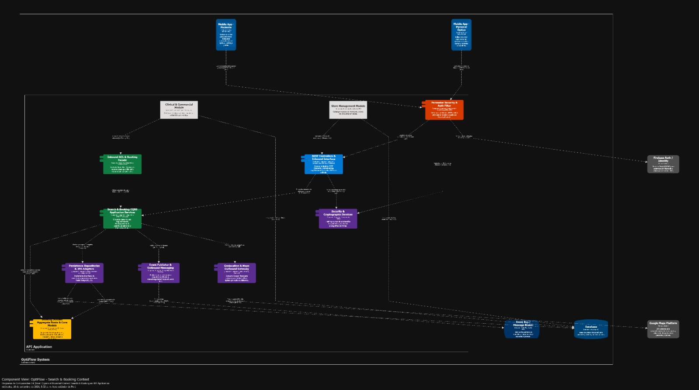

La organización propuesta busca reducir el acoplamiento y concentrar cada responsabilidad en su capa: los controladores reciben las solicitudes, los servicios de aplicación coordinan los casos de uso y el dominio aplica las reglas de negocio. La persistencia y las integraciones se resuelven mediante adaptadores de infraestructura. Los componentes dibujados representan el diseño previsto.

#### 2.6.1.6. Bounded Context Software Architecture Code Level Diagrams

##### 2.6.1.6.1. Bounded Context Domain Layer Class Diagrams
El siguiente UML Class Diagram representa la estructura del **Domain Layer** correspondiente al Bounded Context **Search & Booking**.

El modelo tiene como elemento principal al Aggregate Root `Appointment`, encargado de representar el proceso de reserva de una cita. Este se relaciona con las Entities `Patient`, `OpticalStore` y `TimeSlot`, las cuales representan respectivamente al paciente que realiza la reserva, la óptica seleccionada y el horario disponible para la atención.

El diagrama también incorpora los **Domain Services** relacionados con la disponibilidad de horarios, búsqueda de ópticas y valoración de establecimientos. Asimismo, se incluyen las **Repository Interfaces**, que abstraen las operaciones de persistencia de los principales elementos del dominio, y las **Factories**, responsables de centralizar la creación de objetos del dominio cuando corresponde (ver Figura 42).

**Figura 42**

*Diagrama de clases del Domain Layer del Search & Booking Context*

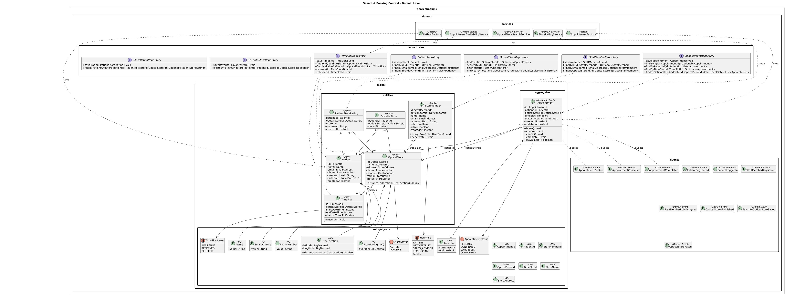

##### 2.6.1.6.2. Bounded Context Database Design Diagram

**Modelo físico implementado: PostgreSQL compartido, migraciones V1, V5 y V8.** Search & Booking utiliza siete tablas de la misma base del backend: `patients`, `optical_stores`, `time_slots`, `appointments`, `favorite_stores`, `store_ratings` y `staff_members`. No dispone de una base independiente.

`staff_members` (migración V8) contiene `id`, `optical_store_id` (FK hacia `optical_stores.id`), `full_name`, `email` (único), `password_hash`, `role` (`CHECK` con `OPTOMETRIST`, `SALES_ADVISOR`, `TECHNICIAN` y `ADMIN`), `active` y `created_at`. Una óptica puede tener cero o muchos miembros del personal.

`patients` contiene `id`, `full_name`, `email`, `phone`, `password_hash`, `birth_date` y `created_at`; el correo es único y `birth_date` (`DATE`, nullable) la agrega la migración V8. `optical_stores` contiene `id`, `name`, `address`, `phone`, `latitude`, `longitude`, `rating` y `status`; `latitude` y `longitude` son `NUMERIC(9,6)` y los agrega la migración V5. Las longitudes son, respectivamente, `VARCHAR(80)` para el nombre completo del paciente, `VARCHAR(120)` para su correo, `VARCHAR(20)` para su teléfono, `VARCHAR(100)` para el hash de contraseña, y `VARCHAR(120)`, `VARCHAR(200)` y `VARCHAR(20)` para nombre, dirección y teléfono de la óptica. El `rating` de la óptica es `NUMERIC(3,2)`.

`time_slots.optical_store_id` es una FK hacia `optical_stores.id`; una óptica puede tener cero o muchos horarios. `appointments` tiene FKs obligatorias hacia `patients`, `optical_stores` y `time_slots`. V1 no declara `UNIQUE` sobre `appointments.time_slot_id`: el diagrama físico no debe inventar una relación uno a uno o una restricción adicional de reserva única. Las validaciones de disponibilidad de la aplicación se distinguen de las restricciones SQL.

`favorite_stores` utiliza la PK compuesta (`patient_id`, `optical_store_id`), ambas columnas también FKs, y registra `saved_at`. `store_ratings` utiliza la misma combinación como PK y FKs, y contiene `score NUMERIC(3,2)`, `comment VARCHAR(280)` y `created_at`; su `CHECK` limita `score` al intervalo de 1 a 5.

Las fechas y horas de V1 se representan como `TIMESTAMP WITH TIME ZONE`. Los estados y sus valores admitidos, la obligatoriedad, los índices y las restricciones se consultan íntegramente en la migración V1. **La Figura 43 representa las siete tablas de V1, V5 y V8 con todos sus campos, tipos, nulabilidad, PK, FK y `UNIQUE`, tal como están declarados en las migraciones.**

**Figura 43**

*Diagrama de base de datos del Search & Booking Context*

  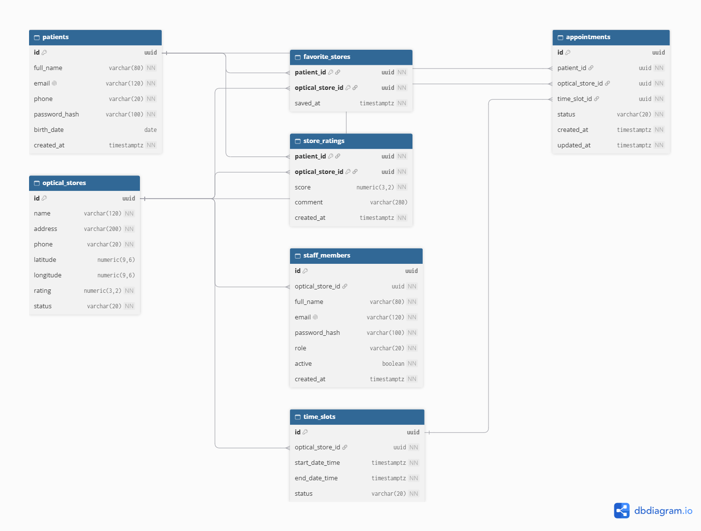

### 2.6.2. Bounded Context: Clinical & Commercial Context

#### 2.6.2.1. Domain Layer

El núcleo del dominio se organiza alrededor de tres agregados: `ClinicalRecord` (episodio de atención clínica), `Quotation` (propuesta comercial) y `Sale` (venta concretada), cada uno responsable de sus propias invariantes de negocio (ver Tabla 50).

**Tabla 50**

*Clases del Domain Layer del Clinical & Commercial Context*

| Clase | Estereotipo | Propósito | Atributos | Métodos |
| :--- | :--- | :--- | :--- | :--- |
| `ClinicalRecord` | Aggregate Root | Representa el expediente clínico de un episodio de atención optométrica. | `id: UUID`, `patientId: UUID`, `appointmentId: UUID`, `examinationDate: DateTime`, `status: ClinicalRecordStatus` | `+recordMedicalHistory(history)`, `+generatePrescription(data)`, `+close()` |
| `MedicalHistory` | Entity | Antecedentes clínicos y oculares del paciente asociados al expediente. | `allergies: String[]`, `previousConditions: String[]`, `familyOcularHistory: String`, `lastUpdated: DateTime` | `+update(data)` |
| `OpticalPrescription` | Value Object | Especificación técnica de la receta óptica emitida tras la evaluación. | `sphereOD/OS`, `cylinderOD/OS`, `axisOD/OS: Integer`, `addition: Decimal`, `treatment: String`, `recommendedFrameType: String` | `+isValid()` |
| `Quotation` | Aggregate Root | Propuesta comercial derivada de la receta, sujeta a aprobación del paciente. | `id`, `clinicalRecordId`, `discount: Discount`, `total: Money`, `status: QuotationStatus` | `+addItem(item)`, `+applyPromotionOrDiscount(d)`, `+approve()`, `+reject(reason)`, `+calculateTotal()` |
| `QuotationItem` | Entity | Línea de detalle de una cotización (producto o servicio cotizado). | `id`, `description: String`, `unitPrice: Money`, `quantity: Integer` | `+subtotal()` |
| `Discount` | Value Object | Encapsula una promoción o descuento aplicado a una cotización. | `type: DiscountType`, `value: Decimal`, `reason: String` | — |
| `Sale` | Aggregate Root | Venta concretada a partir de una cotización aprobada. | `id`, `quotationId`, `patientId`, `status: SaleStatus` (PENDING_PAYMENT, PAID, CLOSED), `paymentPreferenceId: String`, `closedAt: DateTime` | `+attachPaymentPreference(id)`, `+recordPayment(p)`, `+rejectPayment(reason)`, `+close()` |
| `Payment` | Value Object | Detalle del cobro asociado a la venta, aprobado por la Pasarela de Pagos o registrado en caja. | `method: PaymentMethod` (CARD, YAPE o CASH), `amount: Money`, `transactionReference: String` (id del pago en la pasarela), `status: PaymentStatus` (APPROVED o REJECTED), `paidAt: DateTime` | — |
| `ElectronicReceipt` | Entity | Comprobante electrónico emitido al cierre de la venta. | `id`, `receiptNumber`, `saleId`, `issueDate`, `taxAmount: Money`, `totalAmount: Money` | `+issue()` |
| `ClinicalRecordRepository` | Interface (Repository) | Abstracción de persistencia para `ClinicalRecord`. | — | `+save(record)`, `+findById(id)` |
| `QuotationRepository` | Interface (Repository) | Abstracción de persistencia para `Quotation`. | — | `+save(quotation)`, `+findById(id)` |
| `SaleRepository` | Interface (Repository) | Abstracción de persistencia para `Sale`. | — | `+save(sale)`, `+findById(id)` |

Relaciones principales: `ClinicalRecord` compone 1 `MedicalHistory` y 0..1 `OpticalPrescription`, y origina 0..* `Quotation`; `Quotation` compone 1..* `QuotationItem`, agrega 0..1 `Discount` y concreta 0..1 `Sale`; `Sale` compone 0..1 `Payment` y da lugar a 0..1 `ElectronicReceipt`. Una venta nace en `PENDING_PAYMENT`, pasa a `PAID` cuando se registra un pago aprobado y a `CLOSED` cuando el asesor la cierra; un pago rechazado no cambia su estado.

Eventos de dominio publicados por estos agregados: `PatientExamined`, `MedicalHistoryRecorded`, `ClinicalRecordRegistered`, `OpticalPrescriptionGenerated`, `PromotionOrDiscountApplied`, `QuotationApproved`, `QuotationRejected`, `PaymentRecorded`, `PaymentRejected`, `SaleWasClosed`, `ElectronicReceiptIssued`.

#### 2.6.2.2. Interface Layer

Las clases del Interface Layer del Clinical & Commercial Context se detallan en la Tabla 51.

**Tabla 51**

*Clases del Interface Layer del Clinical & Commercial Context*

| Clase | Tipo | Responsabilidad |
| :--- | :--- | :--- |
| `ClinicalRecordController` | REST Controller | `POST /clinical-records` (`RegisterClinicalRecord`), `GET /clinical-records/{id}`, `GET /patients/{patientId}/clinical-records`, `PUT /clinical-records/{id}/medical-history` (`RecordMedicalHistory`), `POST /clinical-records/{id}/prescription` (`GenerateOpticalPrescription`) y `GET /clinical-records/{id}/prescription`. |
| `QuotationController` | REST Controller | `POST /quotations` (`GenerateQuotation`), `GET /quotations/{id}`, `PATCH /quotations/{id}/discount` (`ApplyPromotionOrDiscount`), `PATCH /quotations/{id}/approve` (`ApproveQuotation`) y `PATCH /quotations/{id}/reject` (`RejectQuotation`). |
| `SaleController` | REST Controller | `POST /sales` (`RegisterSale`), `GET /sales/{id}` (estado de la venta y del pago; con la venta cerrada responde `GetClosedSale` para Production & Tracking), `GET /patients/{patientId}/sales` (ventas del paciente, incluidas las pendientes de pago), `POST /sales/{id}/payment-preference` (`CreatePaymentPreference`, solo el paciente dueño de la venta), `POST /sales/{id}/payments` (`RecordPayment` en efectivo) y `PATCH /sales/{id}/close` (`CloseSale`). |
| `PaymentWebhookController` | REST Controller | `POST /payments/webhook`: ruta pública que recibe las notificaciones de la Pasarela de Pagos, las entrega al `PaymentGatewayAdapter` para validar su firma y traducirlas, y ejecuta `RecordPayment`; responde HTTP 200 para que el proveedor no reintente. |
| `SalesReportController` | REST Controller | `GET /reports/sales?from&to` (`GetSalesMetrics`) y `GET /reports/sales/export?from&to` (CSV), solo para `ADMIN`. |
| `AppointmentBookedConsumer` | Event Consumer | Se suscribe al evento externo `AppointmentBooked` (proveniente de Search & Booking; en el backend actual se comunica mediante eventos de Spring) y lo traduce al comando interno `ExaminePatient`, actuando como puerto de entrada de la Anti-Corruption Layer documentada en el Context Mapping (2.5.2). |

#### 2.6.2.3. Application Layer

Las clases del Application Layer del Clinical & Commercial Context se presentan en la Tabla 52.

**Tabla 52**

*Clases del Application Layer del Clinical & Commercial Context*

| Clase | Tipo | Orquesta |
| :--- | :--- | :--- |
| `ExaminePatientHandler` | Command Handler | Crea el `ClinicalRecord` a partir de la cita reservada. |
| `RecordMedicalHistoryHandler` | Command Handler | Registra los antecedentes clínicos en el expediente. |
| `RegisterClinicalRecordHandler` | Command Handler | Persiste el expediente clínico registrado. |
| `GenerateOpticalPrescriptionHandler` | Command Handler | Genera la `OpticalPrescription` a partir de la evaluación. |
| `ApplyPromotionOrDiscountHandler` | Command Handler | Aplica un `Discount` a la cotización vigente. |
| `ApproveQuotationHandler` / `RejectQuotationHandler` | Command Handler | Resuelven el estado de la cotización. |
| `GenerateQuotationHandler` | Command Handler | Genera la `Quotation` a partir de la receta del expediente clínico. |
| `RegisterSaleHandler` | Command Handler | Registra la venta de una cotización aprobada. |
| `CreatePaymentPreferenceHandler` | Command Handler | Verifica que la venta pertenezca al paciente y esté pendiente de pago, crea la preferencia en la pasarela mediante `PaymentGatewayAdapter` y devuelve el enlace de pago. |
| `RecordPaymentHandler` | Command Handler | Registra el `Payment` de una venta pendiente. Lo invocan el webhook de la pasarela (pago aprobado: publica `PaymentRecorded`; rechazado: publica `PaymentRejected`) y el asesor para los pagos en efectivo. Ignora las notificaciones repetidas de un mismo pago. |
| `CloseSaleHandler` | Command Handler | Cierra una venta pagada, solicita la emisión del recibo y publica `SaleWasClosed`. |
| `ClinicalRecordQueryService` | Query Service | Resuelve `GetClinicalRecordById`, `GetClinicalRecordsByPatientId` y `GetOpticalPrescription`. |
| `QuotationQueryService` | Query Service | Resuelve `GetQuotationById`. |
| `SaleQueryService` | Query Service | Resuelve `GetSaleById`, `GetSalesByPatientId` y `GetClosedSale` (venta cerrada con el paciente, la óptica y las especificaciones de las lunas). |
| `SalesMetricsQueryService` | Query Service | Resuelve `GetSalesMetrics`: número de atenciones, cotizaciones aprobadas y rechazadas, ventas cerradas, monto total y ticket promedio del periodo, y genera su exportación en CSV. |
| `AppointmentBookedEventHandler` | Event Handler | Reacciona a la notificación entrante del `AppointmentBookedConsumer` invocando `ExaminePatientHandler`. |

#### 2.6.2.4. Infrastructure Layer

Las clases del Infrastructure Layer del Clinical & Commercial Context se resumen en la Tabla 53.

**Tabla 53**

*Clases del Infrastructure Layer del Clinical & Commercial Context*

| Clase | Tipo | Detalle técnico |
| :--- | :--- | :--- |
| `ClinicalRecordRepositoryImpl` | Repository (impl) | Implementa `ClinicalRecordRepository` sobre JPA/PostgreSQL. |
| `QuotationRepositoryImpl` | Repository (impl) | Implementa `QuotationRepository` sobre JPA/PostgreSQL. |
| `SaleRepositoryImpl` | Repository (impl) | Implementa `SaleRepository` sobre JPA/PostgreSQL. |
| `DomainEventPublisher` | Messaging | Publica los eventos de dominio mediante el adaptador compartido de eventos de Spring. |
| `PaymentGatewayAdapter` | Anti-Corruption Layer | Implementa la integración con Mercado Pago Checkout Pro: crea la preferencia de pago (monto, referencia externa `saleId`, URLs de retorno a la aplicación y URL del webhook), valida la firma de cada notificación, consulta el pago notificado y lo traduce al modelo interno de `Payment`, aislando al dominio de los estados y códigos del proveedor (relación documentada en 2.5.2). El token de acceso y el secreto del webhook se leen desde variables de entorno. |

#### 2.6.2.5. Bounded Context Software Architecture Component Level Diagrams

El siguiente Component Diagram (C4 Model - Component Level) descompone el container **Clinical & Commercial Service** en sus bloques estructurales principales, organizados según las cuatro capas arquitectónicas:

* **Interface Layer:** Expone los controladores REST (`ClinicalRecordController`, `QuotationController`, `SaleController`) para gestionar atenciones optométricas, cotizaciones y ventas, además del `AppointmentBookedConsumer`, que actúa como puerto de entrada para procesar eventos provenientes de Search & Booking.
* **Application Layer:** Orquesta los casos de uso clínicos y comerciales a través de Command Handlers especializados (`ExaminePatientHandler`, `RecordMedicalHistoryHandler`, `RegisterClinicalRecordHandler`, `GenerateOpticalPrescriptionHandler`, `ApplyPromotionOrDiscountHandler`, `ApproveQuotationHandler`, `RecordPaymentHandler`, `CloseSaleHandler`) y el `AppointmentBookedEventHandler`.
* **Domain Layer:** Encapsula la lógica de negocio y las invariantes de los agregados `ClinicalRecord`, `Quotation` y `Sale`, las entidades `MedicalHistory`, `QuotationItem` y `ElectronicReceipt`, los Value Objects (`OpticalPrescription`, `Discount`, `Payment`), y define las interfaces de persistencia (`ClinicalRecordRepository`, `QuotationRepository`, `SaleRepository`).
* **Infrastructure Layer:** Resuelve la persistencia de datos mediante `ClinicalRecordRepositoryImpl`, `QuotationRepositoryImpl` y `SaleRepositoryImpl` sobre PostgreSQL utilizando JPA/Hibernate, publica eventos internos de Spring mediante `DomainEventPublisher`, y provee la `PaymentGatewayAdapter` (Anti-Corruption Layer) para comunicarse de forma desacoplada con pasarelas de pago externas (POS, billeteras digitales).

El diagrama de componentes del Clinical & Commercial Context en Spring Boot se muestra en la Figura 42.

**Figura 42**

*Diagrama de componentes del Clinical & Commercial Context en Spring Boot*

  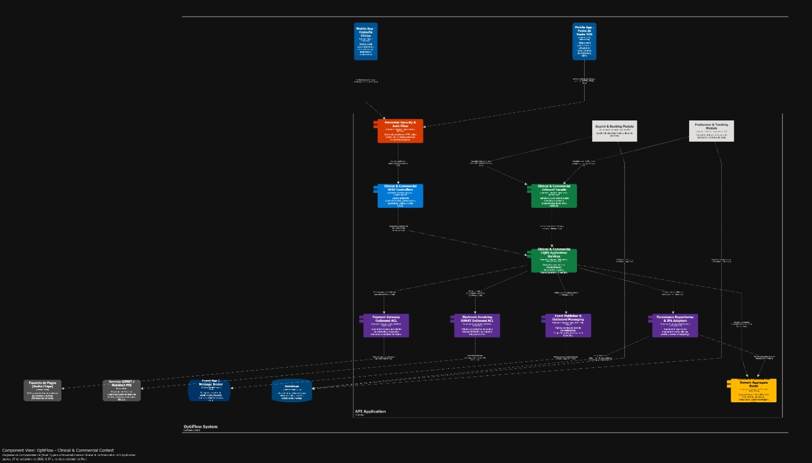

La estructura modular permite que el registro clínico, la prescripción optométrica, la cotización y la venta se ejecuten manteniendo la coherencia transaccional y la trazabilidad de eventos como `SaleWasClosed`, indispensable para desencadenar los flujos de producción e inventario.

#### 2.6.2.6. Bounded Context Software Architecture Code Level Diagrams

##### 2.6.2.6.1. Bounded Context Domain Layer Class Diagrams

El siguiente Class Diagram detalla las clases del Domain Layer descritas en 2.6.2.1, incluyendo atributos, métodos, visibilidad y multiplicidad de las relaciones (ver Figura 45).

**Figura 45**

*Diagrama de clases del Domain Layer del Clinical & Commercial Context*

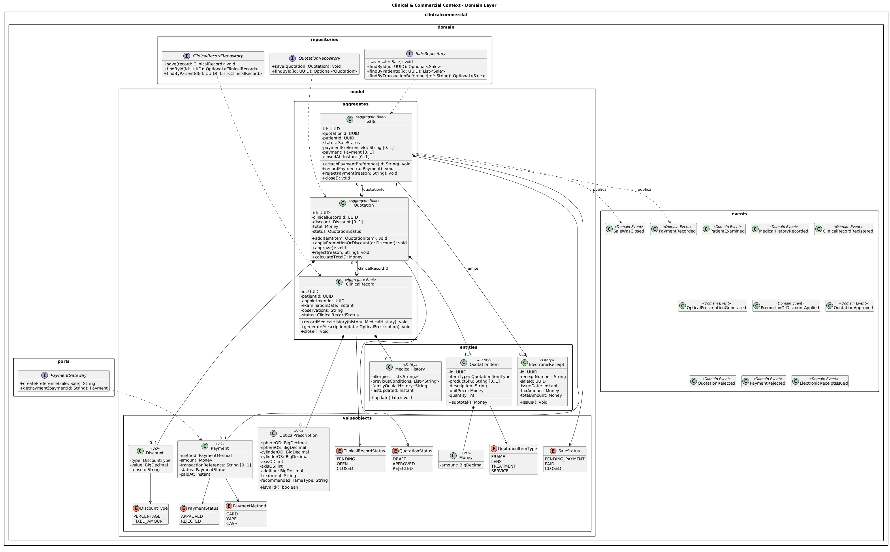

##### 2.6.2.6.2. Bounded Context Database Design Diagram

**Modelo físico implementado: PostgreSQL compartido, migraciones V2 y V9.** Clinical & Commercial comprende siete tablas: `clinical_records`, `medical_histories`, `optical_prescriptions`, `quotations`, `quotation_items`, `sales` y `electronic_receipts`.

`clinical_records` identifica la atención con `id`, `patient_id`, `appointment_id`, `examination_date`, `observations` y `status`. `appointment_id` es obligatorio y único; ni esa columna ni `patient_id` tienen una FK declarada en V2 hacia Search & Booking. Se representan como referencias lógicas a la cita y al paciente.

`medical_histories.clinical_record_id` y `optical_prescriptions.clinical_record_id` son, en cada tabla, PK y FK hacia `clinical_records.id`. Por ello, cada registro clínico puede tener cero o una historia y cero o una prescripción. La receta incluye medidas OD/OS, ejes, adición, tratamiento y tipo de montura recomendado; los ejes tienen un `CHECK` entre 0 y 180. Los tipos y la nulabilidad de cada campo se mantienen como en V2.

`quotations.clinical_record_id` es una FK obligatoria: un registro clínico puede tener varias cotizaciones. La cotización conserva tipo, valor y motivo del descuento, total, estado y `rejection_reason`. `quotation_items` tiene una FK obligatoria hacia la cotización, `line_number`, `item_type`, `product_sku`, descripción, precio unitario y cantidad. La pareja (`quotation_id`, `line_number`) es única; las validaciones de importes, cantidad y tipos de ítem son las declaradas en la migración.

Una cotización puede generar **cero o una venta**, y cada venta pertenece a exactamente una cotización: `sales.quotation_id` es `NOT NULL UNIQUE` y FK hacia `quotations.id`. `RegisterSaleHandler` exige una cotización aprobada y rechaza una venta duplicada con HTTP 409. Los datos de pago se almacenan en columnas de `sales`; no existe una tabla adicional de pagos. La migración V9 ajusta esas columnas al pago con Checkout Pro: `status` admite `PENDING_PAYMENT`, `PAID` y `CLOSED`; `payment_method` admite `CARD`, `YAPE` y `CASH`; agrega `payment_preference_id` y `payment_status` (`APPROVED` o `REJECTED`); y `transaction_reference`, única cuando no es nula, guarda el id del pago en la pasarela para ignorar notificaciones repetidas. `sales.patient_id` es una referencia lógica sin FK declarada.

Una venta puede tener cero o un comprobante: `electronic_receipts.sale_id` es `NOT NULL UNIQUE` y FK hacia `sales.id`. El número de comprobante también es único. **La Figura 46 representa las siete tablas de V2 y V9 con todas sus columnas, tipos, nulabilidad, PK, FK y `UNIQUE`. Las referencias lógicas sin FK (`patient_id` y `appointment_id` en `clinical_records`, `patient_id` en `sales`) no se dibujan como relaciones.**

**Figura 46**

*Diagrama de base de datos del Clinical & Commercial Context*

  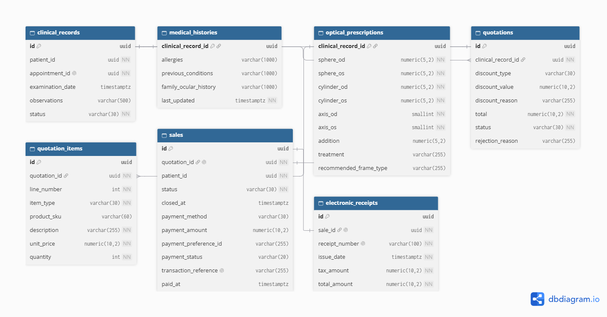

Las relaciones se establecen mediante Primary Keys, Foreign Keys y restricciones de unicidad para mantener la integridad de los agregados y sus entidades persistentes.

### 2.6.3. Bounded Context: Production & Tracking Context

#### 2.6.3.1. Domain Layer

La **Domain Layer** concentra las reglas de negocio relacionadas con la producción y trazabilidad de los pedidos ópticos. Esta capa representa los conceptos propios del contexto y mantiene las reglas del proceso de fabricación independientes de los mecanismos de persistencia, comunicación o infraestructura.

El modelo de dominio se estructura alrededor de los principales conceptos definidos en el lenguaje ubicuo del contexto:

Los conceptos del Domain Layer del Production & Tracking Context se presentan en la Tabla 54.

**Tabla 54**

*Conceptos del Domain Layer del Production & Tracking Context*

| Concepto | Tipo | Responsabilidad |
|---|---|---|
| `Work Order` | Aggregate / Entity | Representa la orden de trabajo asociada a la fabricación del pedido óptico y permite controlar su ciclo de vida. |
| `Technician` | Entity | Representa al técnico responsable de ejecutar las actividades asociadas a una orden de trabajo. |
| `Laboratory` | Entity | Representa el laboratorio donde se realiza el proceso de fabricación de las lentes y monturas. |
| `Lenses` | Entity | Representa las lentes que serán procesadas de acuerdo con las especificaciones técnicas del pedido. |
| `Work Order Status` | Value / Domain Concept | Representa la fase actual de la orden dentro del flujo Kanban. |
| `Delivery Date` | Value Object / Domain Concept | Representa la fecha estimada para la entrega del pedido terminado. |
| `Delivery Delay` | Domain Concept | Representa la situación en la que la orden presenta un retraso respecto a la fecha estimada de entrega. |

El flujo de estados definido para la `Work Order` utiliza las siguientes etapas:

Los estados de la orden de trabajo se resumen en la Tabla 55.

**Tabla 55**

*Estados de la orden de trabajo*

| Estado | Descripción |
|---|---|
| `Pendiente` | La orden ha sido generada y se encuentra pendiente de iniciar el proceso de producción. |
| `En Taller` | La orden se encuentra en proceso de fabricación en el taller o laboratorio. |
| `Control de Calidad` | Las lentes y monturas se encuentran en la etapa de revisión antes de la entrega. |
| `Listo para Entrega` | El proceso de fabricación y control ha finalizado y el pedido se encuentra preparado para ser entregado al paciente. |

##### Domain Commands

Los principales comandos definidos para el contexto son:

Los Domain Commands del Production & Tracking Context se detallan en la Tabla 56.

**Tabla 56**

*Domain Commands del Production & Tracking Context*

| Command | Responsabilidad |
|---|---|
| `GenerateWorkOrder` | Genera una nueva orden de trabajo a partir de una venta cerrada. |
| `AssignWorkOrderToTechnician` | Asigna una orden de trabajo a un técnico de laboratorio. |
| `SendWorkOrderToLaboratory` | Envía la orden de trabajo al laboratorio correspondiente. |
| `UpdateWorkOrderStatus` | Actualiza el estado de la orden dentro del flujo Kanban. |
| `CompleteLenses` | Registra la finalización del proceso de fabricación de las lentes. |
| `NotifyDeliveryDelay` | Gestiona la notificación asociada a un retraso en la entrega. |
| `MarkOrderAsDelivered` | Registra que la orden ha sido entregada al paciente. |

##### Domain Events

Los eventos publicados por este contexto son:

Los Domain Events del Production & Tracking Context se presentan en la Tabla 57.

**Tabla 57**

*Domain Events del Production & Tracking Context*

| Domain Event | Descripción |
|---|---|
| `WorkOrderGenerated` | Indica que una nueva orden de trabajo ha sido generada. |
| `WorkOrderAssigned` | Indica que una orden de trabajo ha sido asignada a un técnico. |
| `WorkOrderSentToLaboratory` | Indica que la orden ha sido enviada al laboratorio. |
| `WorkOrderStatusUpdated` | Indica que el estado de una orden de trabajo ha cambiado. |
| `LensesWereCompleted` | Indica que las lentes asociadas a la orden han finalizado su proceso. |
| `EstimatedDeliveryDateCalculated` | Indica que se ha calculado una fecha estimada de entrega. |
| `DeliveryDelayNotified` | Indica que se ha registrado y notificado un retraso en la entrega. |
| `OrderWasMarkedAsDelivered` | Indica que la orden ha sido marcada como entregada. |

##### Repository

El Repository del Production & Tracking Context se resume en la Tabla 58.

**Tabla 58**

*Repository del Production & Tracking Context*

| Repository | Responsabilidad |
|---|---|
| `WorkOrderRepository` | Abstrae el acceso y persistencia de las órdenes de trabajo del contexto. |
| `TechnicianRepository` | Abstrae la consulta del catálogo de técnicos. |
| `LaboratoryRepository` | Abstrae la consulta del catálogo de laboratorios. |

La interacción principal del dominio con otros contextos comienza cuando **Clinical & Commercial** publica el evento `SaleWasClosed`. Production & Tracking recibe este evento y ejecuta el comando `GenerateWorkOrder`, iniciando así el ciclo de producción de la orden.

#### 2.6.3.2. Interface Layer

La **Interface Layer** representa el punto de entrada mediante el cual Production & Tracking recibe comandos y eventos externos. Su función es traducir las solicitudes externas hacia las operaciones que serán procesadas por la Application Layer.

Los comandos definidos en el Bounded Context se exponen mediante la API Gateway, mientras que el evento `SaleWasClosed` es recibido desde el contexto **Clinical & Commercial**.

##### Controllers

Los Controllers del Production & Tracking Context se detallan en la Tabla 59.

**Tabla 59**

*Controllers del Production & Tracking Context*

| Controller | Tipo | Responsabilidad |
|---|---|---|
| `WorkOrderController` | REST Controller | `GET /work-orders` (tablero Kanban, filtrable por estado), `POST /work-orders` (`GenerateWorkOrder` manual), `GET /work-orders/{id}`, `GET /patients/{patientId}/work-orders` (seguimiento del paciente), `PATCH /work-orders/{id}/technician` (`AssignWorkOrderToTechnician`), `PATCH /work-orders/{id}/laboratory` (`SendWorkOrderToLaboratory`), `PATCH /work-orders/{id}/status` (`UpdateWorkOrderStatus`), `PATCH /work-orders/{id}/lenses/complete` (`CompleteLenses`), `POST /work-orders/{id}/delays` (`NotifyDeliveryDelay`) y `PATCH /work-orders/{id}/deliver` (`MarkOrderAsDelivered`). |
| `ProductionCatalogController` | REST Controller | `GET /technicians` y `GET /laboratories`, catálogos usados al asignar y enviar las órdenes. |
| `ProductionReportController` | REST Controller | `GET /reports/production?from&to` (`GetProductionMetrics`) y `GET /reports/production/export?from&to` (CSV), solo para `ADMIN`. |

##### Event Consumers

Los Event Consumers del Production & Tracking Context se presentan en la Tabla 60.

**Tabla 60**

*Event Consumers del Production & Tracking Context*

| Consumer | Tipo | Responsabilidad |
|---|---|---|
| `SaleWasClosedConsumer` | Event Consumer | Recibe el evento `SaleWasClosed` proveniente de Clinical & Commercial y permite iniciar la generación de una `Work Order`. |

##### Resources / DTOs

Los Resources / DTOs del Production & Tracking Context se resumen en la Tabla 61.

**Tabla 61**

*Resources / DTOs del Production & Tracking Context*

| DTO | Tipo | Uso |
|---|---|---|
| `GenerateWorkOrderRequest` | Input | Datos necesarios para generar una orden de trabajo. |
| `AssignWorkOrderToTechnicianRequest` | Input | Datos necesarios para asignar una orden a un técnico. |
| `SendWorkOrderToLaboratoryRequest` | Input | Datos necesarios para enviar una orden al laboratorio. |
| `UpdateWorkOrderStatusRequest` | Input | Datos necesarios para actualizar el estado de una orden. |
| `CompleteLensesRequest` | Input | Datos necesarios para registrar la finalización de las lentes. |
| `NotifyDeliveryDelayRequest` | Input | Datos asociados a la notificación de un retraso. |
| `MarkOrderAsDeliveredRequest` | Input | Datos necesarios para registrar la entrega de una orden. |
| `WorkOrderResponse` | Output | Información de una orden de trabajo. |
| `WorkOrderStatusResponse` | Output | Información relacionada con el estado actual de una orden. |

##### Assemblers

Los Assemblers del Production & Tracking Context se detallan en la Tabla 62.

**Tabla 62**

*Assemblers del Production & Tracking Context*

| Assembler | Transformación |
|---|---|
| `FromGenerateWorkOrderRequestAssembler` | `GenerateWorkOrderRequest` → `GenerateWorkOrderCommand` |
| `FromAssignWorkOrderToTechnicianRequestAssembler` | `AssignWorkOrderToTechnicianRequest` → `AssignWorkOrderToTechnicianCommand` |
| `FromSendWorkOrderToLaboratoryRequestAssembler` | `SendWorkOrderToLaboratoryRequest` → `SendWorkOrderToLaboratoryCommand` |
| `FromUpdateWorkOrderStatusRequestAssembler` | `UpdateWorkOrderStatusRequest` → `UpdateWorkOrderStatusCommand` |
| `FromCompleteLensesRequestAssembler` | `CompleteLensesRequest` → `CompleteLensesCommand` |
| `FromNotifyDeliveryDelayRequestAssembler` | `NotifyDeliveryDelayRequest` → `NotifyDeliveryDelayCommand` |
| `FromMarkOrderAsDeliveredRequestAssembler` | `MarkOrderAsDeliveredRequest` → `MarkOrderAsDeliveredCommand` |

#### 2.6.3.3. Application Layer

La **Application Layer** coordina los casos de uso definidos para Production & Tracking. Esta capa recibe los comandos provenientes de la Interface Layer y coordina su ejecución sobre el modelo de dominio.

Los casos de uso principales corresponden a las operaciones definidas en el Bounded Context Canvas.

##### Command Handlers

Los Command Handlers del Production & Tracking Context se presentan en la Tabla 63.

**Tabla 63**

*Command Handlers del Production & Tracking Context*

| Handler | Tipo | Orquesta |
|---|---|---|
| `GenerateWorkOrderHandler` | Command Handler | Genera una nueva `Work Order` a partir de la información recibida después del cierre de una venta. |
| `AssignWorkOrderToTechnicianHandler` | Command Handler | Coordina la asignación de una orden de trabajo a un técnico. |
| `SendWorkOrderToLaboratoryHandler` | Command Handler | Coordina el envío de la orden al laboratorio correspondiente. |
| `UpdateWorkOrderStatusHandler` | Command Handler | Gestiona la actualización del estado de la orden dentro del flujo Kanban. |
| `CompleteLensesHandler` | Command Handler | Gestiona la finalización del proceso de fabricación de las lentes. |
| `NotifyDeliveryDelayHandler` | Command Handler | Gestiona el registro y notificación de retrasos en la entrega. |
| `MarkOrderAsDeliveredHandler` | Command Handler | Coordina el registro de la entrega final de la orden. |
| `WorkOrderQueryService` | Query Service | Resuelve `GetWorkOrders`, `GetWorkOrderById` y `GetWorkOrdersByPatientId`. |
| `ProductionCatalogQueryService` | Query Service | Devuelve los técnicos y laboratorios disponibles. |
| `ProductionMetricsQueryService` | Query Service | Resuelve `GetProductionMetrics`: órdenes por estado, órdenes entregadas, tiempo promedio de fabricación y demoras del periodo, y genera su exportación en CSV. |

##### Event Handler

El Event Handler del Production & Tracking Context se resume en la Tabla 64.

**Tabla 64**

*Event Handler del Production & Tracking Context*

| Handler | Tipo | Responsabilidad |
|---|---|---|
| `SaleWasClosedEventHandler` | Event Handler | Reacciona al evento `SaleWasClosed` y desencadena el proceso de generación de una orden de trabajo mediante `GenerateWorkOrder`. |

##### Application Services

Los Application Services del Production & Tracking Context se detallan en la Tabla 65.

**Tabla 65**

*Application Services del Production & Tracking Context*

| Application Service | Responsabilidad |
|---|---|
| `WorkOrderApplicationService` | Coordina los casos de uso relacionados con la generación, asignación, envío, seguimiento y entrega de órdenes de trabajo. |

La Application Layer permite mantener separados los casos de uso del sistema respecto de las reglas internas del dominio y de los mecanismos utilizados para persistir o comunicar información.

#### 2.6.3.4. Infrastructure Layer

La **Infrastructure Layer** contiene las implementaciones técnicas necesarias para conectar el dominio de Production & Tracking con los mecanismos externos de persistencia y comunicación.

Esta capa implementa las abstracciones definidas en el dominio y permite que las reglas de negocio permanezcan independientes de tecnologías específicas.

##### Repositories

Los Repositories del Production & Tracking Context se presentan en la Tabla 66.

**Tabla 66**

*Repositories del Production & Tracking Context*

| Clase | Responsabilidad |
|---|---|
| `WorkOrderRepositoryImpl` | Persiste y reconstruye órdenes con sus lentes e historial mediante repositorios JPA. |
| `TechnicianRepositoryImpl` | Consulta y persiste el catálogo de técnicos en PostgreSQL. |
| `LaboratoryRepositoryImpl` | Consulta y persiste el catálogo de laboratorios en PostgreSQL. |

##### Persistence

Los componentes de persistencia del Production & Tracking Context se resumen en la Tabla 67.

**Tabla 67**

*Componentes de persistencia del Production & Tracking Context*

| Componente | Responsabilidad |
|---|---|
| `WorkOrderEntity` | Mapea `work_orders`, incluidos los datos copiados de la asignación y las columnas de demora. |
| `WorkOrderLensEntity` | Mapea las filas de `work_order_lenses`. |
| `WorkOrderStatusChangeEntity` y `WorkOrderStatusChangeKey` | Mapean `work_order_status_history` y su PK compuesta; `@Embeddable` representa una clave JPA, no un documento NoSQL. |
| `TechnicianEntity` y `LaboratoryEntity` | Mapean los catálogos `technicians` y `laboratories`. |
| `WorkOrderMapper` y `ProductionCatalogMapper` | Transforman las entidades JPA y los modelos del dominio. |

##### Messaging

Los componentes de mensajería del Production & Tracking Context se detallan en la Tabla 68.

**Tabla 68**

*Componentes de mensajería del Production & Tracking Context*

| Componente | Responsabilidad |
|---|---|
| `DomainEventPublisher` | Publica los eventos de producción mediante el publicador interno de Spring. |
| `SaleWasClosedConsumer` | Consume el evento `SaleWasClosed` proveniente de Clinical & Commercial. |

La comunicación mediante eventos permite desacoplar Production & Tracking de los demás Bounded Contexts. En particular, el contexto recibe `SaleWasClosed` desde **Clinical & Commercial** y publica eventos como `WorkOrderStatusUpdated` y `OrderWasMarkedAsDelivered`, que son consumidos por **Notification & Loyalty**.

##### Anti-Corruption Layer

Production & Tracking utiliza una **Anti-Corruption Layer (ACL)** en su relación con **Clinical & Commercial**. Esta capa permite traducir la información recibida mediante `SaleWasClosed` hacia el modelo propio de producción, evitando que los conceptos comerciales y de facturación del contexto upstream se incorporen directamente al modelo de fabricación.

La relación se encuentra definida en el Context Mapping de la sección 2.5.2 mediante el patrón **Customer / Supplier**, donde **Clinical & Commercial** actúa como upstream y **Production & Tracking** como downstream.

#### 2.6.3.5. Bounded Context Software Architecture Component Level Diagrams

El siguiente Component Diagram (C4 Model - Component Level) descompone el container **Production & Tracking Service** en sus componentes de software estructurados por capas:

* **Interface Layer:** Provee el `WorkOrderController` para la interacción síncrona vía REST (generación, asignación a técnicos, envío a laboratorio, actualización de estados Kanban y entrega), el `SaleWasClosedConsumer` para la recepción de eventos de venta desde Clinical & Commercial, además de los DTOs de solicitud/respuesta y sus respectivos Assemblers.
* **Application Layer:** Coordina el flujo de fabricación óptica mediante los Command Handlers (`GenerateWorkOrderHandler`, `AssignWorkOrderToTechnicianHandler`, `SendWorkOrderToLaboratoryHandler`, `UpdateWorkOrderStatusHandler`, `CompleteLensesHandler`, `NotifyDeliveryDelayHandler`, `MarkOrderAsDeliveredHandler`), el `SaleWasClosedEventHandler` y el servicio de aplicación `WorkOrderApplicationService`.
* **Domain Layer:** Contiene el Aggregate Root `WorkOrder` que modela el ciclo de vida de la orden, las entidades `Technician`, `Laboratory` y `Lenses`, los Value Objects (`WorkOrderStatus`, `DeliveryDate`, `DeliveryDelay`), las interfaces `WorkOrderRepository` y los eventos de dominio (`WorkOrderStatusUpdated`, `OrderWasMarkedAsDelivered`, etc.).
* **Infrastructure Layer:** Implementa la persistencia relacional de Production & Tracking con JPA/PostgreSQL. `WorkOrderRepositoryImpl` coordina la orden, sus lentes y su historial; `TechnicianRepositoryImpl` y `LaboratoryRepositoryImpl` acceden a los catálogos. Los mappers reconstruyen el agregado desde las filas SQL. Los eventos se comunican mediante el publicador de Spring y manejadores internos; no se requiere un broker externo para esta implementación.

El diagrama de componentes del Production & Tracking Context en Spring Boot se presenta en la Figura 45.

**Figura 45**

*Diagrama de componentes del Production & Tracking Context en Spring Boot*

  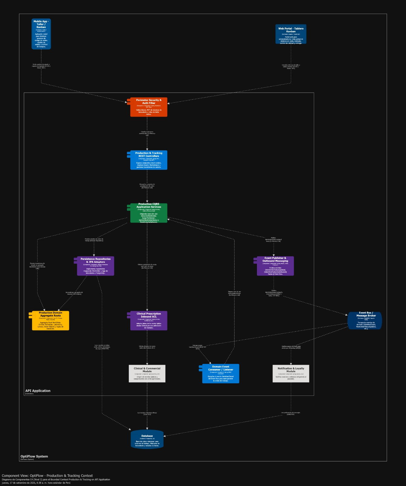

Este diseño por componentes asegura que cada transición del estado de fabricación de las lentes (pendiente, taller, control de calidad, entrega) se registre de forma consistente y notifique en tiempo real a los contextos interesados sin generar dependencias directas con las interfaces de usuario.

#### 2.6.3.6. Bounded Context Software Architecture Code Level Diagrams

##### 2.6.3.6.1. Bounded Context Domain Layer Class Diagrams

El siguiente UML Class Diagram representa la estructura del Domain Layer correspondiente al Bounded Context **Production & Tracking**.

El modelo se organiza alrededor de `WorkOrder`, que representa el Aggregate Root encargado de controlar el ciclo de vida de una orden de trabajo desde su generación hasta la entrega final del pedido. La orden puede ser asignada a un `Technician`, enviada a un `Laboratory` y contiene las `Lenses` que forman parte del proceso de fabricación.

El estado actual de la orden es representado mediante `WorkOrderStatus`, el cual permite identificar las diferentes etapas del flujo de producción: pendiente, en taller, control de calidad y listo para entrega. Asimismo, `DeliveryDate` representa la fecha estimada de entrega del pedido, mientras que `DeliveryDelay` permite representar situaciones relacionadas con retrasos durante el proceso de fabricación.

El Domain Layer también incluye `WorkOrderRepository`, que abstrae la persistencia del agregado, y los Domain Events generados durante las distintas operaciones realizadas sobre la orden de trabajo (ver Figura 48).

**Figura 48**

*Diagrama de clases del Domain Layer del Production & Tracking Context*

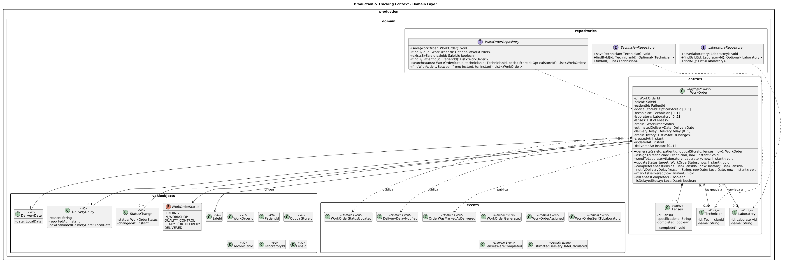

##### 2.6.3.6.2. Bounded Context Database Design Diagram

**Modelo físico implementado: PostgreSQL compartido, migración V3.** Production & Tracking utiliza cinco tablas relacionales: `work_orders`, `work_order_lenses`, `work_order_status_history`, `technicians` y `laboratories`. No utiliza MongoDB ni una colección de documentos.

`work_orders` concentra el identificador de la orden, `sale_id`, `patient_id`, `optical_store_id`, el estado, la fecha estimada de entrega, las marcas de creación/actualización/entrega y los campos de demora. `sale_id` es obligatorio y único, pero no tiene FK declarada hacia `sales`. Los identificadores del paciente y la óptica también se conservan como referencias lógicas, sin FKs hacia otros contextos.

`technicians` y `laboratories` son tablas de catálogo con `id UUID` como PK y `name VARCHAR(120) NOT NULL`. La orden guarda `technician_id`, `technician_name`, `laboratory_id` y `laboratory_name` como una copia de los datos de la asignación. V3 no declara FKs desde esos campos hacia los catálogos; el diagrama no debe dibujarlas como relaciones físicas.

`work_order_lenses` almacena las lentes de la orden, con `id` como PK, `work_order_id` como FK obligatoria, `line_number`, `specifications` y `completed`. La pareja (`work_order_id`, `line_number`) es única. `work_order_status_history` almacena los cambios de estado; su PK es (`work_order_id`, `sequence_number`) y `work_order_id` es también FK hacia `work_orders.id`. Ambas tablas pueden contener varias filas por orden.

Las fechas estimadas usan `DATE`, mientras que los momentos de creación, cambio, demora y entrega usan `TIMESTAMP WITH TIME ZONE`. La demora se almacena en las columnas `delay_reason`, `delay_reported_at` y `delay_new_estimated_date`; no es un documento ni una tabla separada. `WorkOrderRepositoryImpl` reconstruye el agregado a partir de las filas de orden, lentes e historial.

**La Figura 49 representa las cinco tablas relacionales de V3. Los identificadores `sale_id`, `patient_id`, `optical_store_id`, `technician_id` y `laboratory_id` de `work_orders` se marcan como `REF` (referencias lógicas sin FK); `technicians` y `laboratories` aparecen sin relación física con la orden.**

**Figura 49**

*Diagrama de base de datos del Production & Tracking Context*

  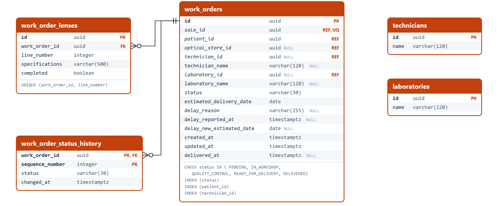

### 2.6.4. Bounded Context: Store Management & Inventory Context

Store Management & Inventory se implementa como un módulo del backend, con persistencia en la base PostgreSQL compartida mediante la migración V6. Recibe `SaleWasClosed` para descontar del stock los productos vendidos y genera las alertas de stock crítico.

#### 2.6.4.1. Domain Layer

La **Domain Layer** concentra las reglas de negocio relacionadas con la gestión del catálogo, inventario y abastecimiento de productos físicos de la óptica.

El modelo de dominio se organiza alrededor de los conceptos definidos en el lenguaje ubicuo del contexto.

##### Domain Concepts

Los Domain Concepts del Store Management & Inventory Context se resumen en la Tabla 69.

**Tabla 69**

*Domain Concepts del Store Management & Inventory Context*

| Concepto | Tipo | Responsabilidad |
|---|---|---|
| `Frame Model` | Entity | Representa un modelo físico de montura disponible en el catálogo, identificado por su `sku` (el código de barras que lee el escáner), con la referencia a su modelo de prueba virtual cuando lo tiene. |
| `Catalog` | Aggregate / Domain Concept | Representa el conjunto de modelos de monturas disponibles para la óptica. |
| `Price` | Value Object / Domain Concept | Representa el precio asociado a un modelo de montura. |
| `Stock` | Entity / Domain Concept | Representa la cantidad disponible de un producto físico. |
| `Inventory` | Aggregate / Domain Concept | Gestiona las existencias físicas de productos dentro de la óptica. |
| `Low Stock Alert` | Domain Concept | Representa la alerta generada cuando las existencias de un producto alcanzan un nivel crítico. |
| `Supplier` | Entity | Representa al proveedor encargado del abastecimiento de productos. |
| `Stock Movement` | Entity | Registra cada entrada (reposición) o salida (venta) de un producto, con su cantidad, motivo, fecha y usuario; forma el historial de movimientos. |
| `Replenishment` | Domain Concept | Representa el proceso de reposición de existencias, que se registra como un movimiento de entrada. |

##### Domain Commands

Los comandos definidos para el contexto son:

Los Domain Commands del Store Management & Inventory Context se detallan en la Tabla 70.

**Tabla 70**

*Domain Commands del Store Management & Inventory Context*

| Command | Responsabilidad |
|---|---|
| `AddNewFrameModel` | Registra un nuevo modelo de montura dentro del catálogo. |
| `UpdateFrameModelPrice` | Actualiza el precio asociado a un modelo de montura. |
| `ReplenishStock` | Gestiona el reabastecimiento de las existencias. |
| `UpdateInventory` | Registra la salida de stock de los productos vendidos al recibir `SaleWasClosed`, como un movimiento de salida por venta. |
| `RegisterSupplier` | Registra un nuevo proveedor para las operaciones de abastecimiento. |

La consulta de existencias (`ConsultStock`) no modifica el estado del inventario, por lo que se modela como una consulta (`ConsultStockQuery`) y no como un comando. Lo mismo ocurre con la búsqueda de una montura por su código escaneado (`GetFrameModelBySku`), el catálogo (`GetFrameCatalog`), el historial de movimientos (`GetInventoryMovements`), las alertas de stock crítico vigentes (`GetLowStockAlerts`) y las métricas de inventario (`GetInventoryMetrics`).

##### Domain Events

Los principales eventos publicados por el contexto son:

Los Domain Events del Store Management & Inventory Context se presentan en la Tabla 71.

**Tabla 71**

*Domain Events del Store Management & Inventory Context*

| Domain Event | Descripción |
|---|---|
| `NewFrameModelAdded` | Indica que un nuevo modelo de montura fue agregado al catálogo. |
| `FrameModelPriceUpdated` | Indica que el precio de un modelo de montura fue actualizado. |
| `StockWasReplenished` | Indica que las existencias fueron reabastecidas. |
| `LowStockAlertGenerated` | Indica que se generó una alerta debido a un nivel bajo de stock. |
| `InventoryWasUpdated` | Indica que la información del inventario fue actualizada. |
| `SupplierRegistered` | Indica que un nuevo proveedor fue registrado. |

##### Repository

El Repository del Store Management & Inventory Context se resume en la Tabla 72.

**Tabla 72**

*Repository del Store Management & Inventory Context*

| Repository | Responsabilidad |
|---|---|
| `InventoryRepository` | Abstrae el acceso y persistencia de la información relacionada con el inventario. |
| `FrameModelRepository` | Abstrae el acceso y persistencia de los modelos de monturas registrados en el catálogo. |
| `SupplierRepository` | Abstrae el acceso y persistencia de los proveedores registrados. |
| `StockMovementRepository` | Abstrae el registro y la consulta del historial de movimientos de stock. |

#### 2.6.4.2. Interface Layer

La **Interface Layer** representa el punto de entrada para las operaciones relacionadas con el catálogo, precios, stock, reabastecimiento y proveedores.

Las solicitudes externas son recibidas mediante la API Gateway y posteriormente transformadas en comandos de aplicación.

##### Controllers

Los Controllers del Store Management & Inventory Context se detallan en la Tabla 73.

**Tabla 73**

*Controllers del Store Management & Inventory Context*

| Controller | Tipo | Responsabilidad |
|---|---|---|
| `FrameModelController` | REST Controller | `GET /inventory/frames` (`GetFrameCatalog`, también para el probador virtual), `GET /inventory/frames/{sku}` (`GetFrameModelBySku`: datos, precio y stock de la montura escaneada; HTTP 404 si el código no existe), `POST /inventory/frames` (`AddNewFrameModel`) y `PATCH /inventory/frames/{sku}/price` (`UpdateFrameModelPrice`). |
| `InventoryController` | REST Controller | `GET /inventory/stock` (`ConsultStock`), `POST /inventory/replenishments` (`ReplenishStock`), `GET /inventory/movements?from&to&sku` (`GetInventoryMovements`) y `GET /inventory/alerts` (`GetLowStockAlerts`). |
| `SupplierController` | REST Controller | `POST /suppliers` (`RegisterSupplier`) y `GET /suppliers`. |
| `InventoryReportController` | REST Controller | `GET /reports/inventory` (`GetInventoryMetrics`) y `GET /reports/inventory/export` (CSV), solo para `ADMIN`. |

##### Event Consumers

Los Event Consumers del Store Management & Inventory Context se presentan en la Tabla 74.

**Tabla 74**

*Event Consumers del Store Management & Inventory Context*

| Consumer | Tipo | Responsabilidad |
|---|---|---|
| `SaleWasClosedConsumer` | Event Consumer | Recibe el evento `SaleWasClosed` proveniente de Clinical & Commercial para evaluar el stock consumido por la venta. |

La recepción de `SaleWasClosed` forma parte del flujo de integración definido entre **Clinical & Commercial** y **Store Management & Inventory**.

##### Resources / DTOs

Los Resources / DTOs del Store Management & Inventory Context se resumen en la Tabla 75.

**Tabla 75**

*Resources / DTOs del Store Management & Inventory Context*

| DTO | Tipo | Uso |
|---|---|---|
| `AddNewFrameModelRequest` | Input | Datos necesarios para registrar un nuevo modelo de montura. |
| `UpdateFrameModelPriceRequest` | Input | Datos necesarios para actualizar el precio de un modelo de montura. |
| `ConsultStockRequest` | Input | Parámetros utilizados para consultar las existencias. |
| `ReplenishStockRequest` | Input | Datos necesarios para gestionar el reabastecimiento del stock. |
| `RegisterSupplierRequest` | Input | Datos necesarios para registrar un proveedor. |
| `FrameModelResponse` | Output | Información de un modelo de montura registrado. |
| `StockResponse` | Output | Información sobre las existencias disponibles. |
| `SupplierResponse` | Output | Información de un proveedor registrado. |
| `InventoryResponse` | Output | Información relacionada con el inventario. |
| `StockMovementResponse` | Output | Fecha, producto, tipo (entrada o salida), cantidad, motivo y usuario de un movimiento. |
| `LowStockAlertResponse` | Output | Producto, cantidad disponible y stock mínimo de una alerta vigente. |

##### Assemblers

Los Assemblers del Store Management & Inventory Context se detallan en la Tabla 76.

**Tabla 76**

*Assemblers del Store Management & Inventory Context*

| Assembler | Transformación |
|---|---|
| `FromAddNewFrameModelRequestAssembler` | `AddNewFrameModelRequest` → `AddNewFrameModelCommand` |
| `FromUpdateFrameModelPriceRequestAssembler` | `UpdateFrameModelPriceRequest` → `UpdateFrameModelPriceCommand` |
| `FromConsultStockRequestAssembler` | `ConsultStockRequest` → `ConsultStockQuery` |
| `FromReplenishStockRequestAssembler` | `ReplenishStockRequest` → `ReplenishStockCommand` |
| `FromRegisterSupplierRequestAssembler` | `RegisterSupplierRequest` → `RegisterSupplierCommand` |

#### 2.6.4.3. Application Layer

La **Application Layer** coordina los casos de uso relacionados con la administración del catálogo, actualización de precios, consulta de stock, reabastecimiento y gestión de proveedores.

Los casos de uso se ejecutan mediante handlers que reciben los comandos provenientes de la Interface Layer y coordinan las operaciones correspondientes sobre el modelo de dominio.

##### Command Handlers

Los Command Handlers del Store Management & Inventory Context se presentan en la Tabla 77.

**Tabla 77**

*Command Handlers del Store Management & Inventory Context*

| Handler | Tipo | Orquesta |
|---|---|---|
| `AddNewFrameModelHandler` | Command Handler | Coordina el registro de un nuevo modelo de montura en el catálogo. |
| `UpdateFrameModelPriceHandler` | Command Handler | Coordina la actualización del precio de un modelo de montura. |
| `ReplenishStockHandler` | Command Handler | Coordina el proceso de reabastecimiento del inventario. |
| `RegisterSupplierHandler` | Command Handler | Coordina el registro de un nuevo proveedor. |
| `UpdateInventoryHandler` | Command Handler | Descuenta del stock los productos vendidos, registra un movimiento de salida por cada uno y verifica si alguno llegó a su nivel mínimo para publicar `LowStockAlertGenerated`. |
| `ConsultStockQueryService` | Query Service | Resuelve `ConsultStock` y `GetFrameModelBySku` (existencias y datos de un producto, incluido el escaneo). |
| `FrameCatalogQueryService` | Query Service | Resuelve `GetFrameCatalog`. |
| `InventoryMovementQueryService` | Query Service | Resuelve `GetInventoryMovements` y `GetLowStockAlerts` (productos con cantidad igual o menor a su stock mínimo). |
| `InventoryMetricsQueryService` | Query Service | Resuelve `GetInventoryMetrics` (productos con stock crítico, entradas y salidas del periodo) y genera su exportación en CSV. |

##### Event Handler

El Event Handler del Store Management & Inventory Context se resume en la Tabla 78.

**Tabla 78**

*Event Handler del Store Management & Inventory Context*

| Handler | Tipo | Responsabilidad |
|---|---|---|
| `SaleWasClosedEventHandler` | Event Handler | Reacciona al evento `SaleWasClosed`; su ACL traduce cada producto vendido (`productSku` y `quantity`) en un movimiento de salida y ejecuta `UpdateInventory`. |

##### Application Services

Los Application Services del Store Management & Inventory Context se detallan en la Tabla 79.

**Tabla 79**

*Application Services del Store Management & Inventory Context*

| Application Service | Responsabilidad |
|---|---|
| `InventoryApplicationService` | Coordina los casos de uso relacionados con la consulta, actualización y reabastecimiento del inventario. |
| `FrameModelApplicationService` | Coordina los casos de uso relacionados con la administración de modelos de monturas y sus precios. |
| `SupplierApplicationService` | Coordina las operaciones relacionadas con el registro y gestión de proveedores. |

La Application Layer permite mantener separados los casos de uso de las reglas de negocio del dominio y de los mecanismos utilizados para persistir la información o comunicarse con otros contextos.

#### 2.6.4.4. Infrastructure Layer

La **Infrastructure Layer** contiene las implementaciones técnicas necesarias para persistir la información del catálogo, inventario y proveedores, así como para publicar y consumir eventos.

##### Repositories

Los Repositories del Store Management & Inventory Context se presentan en la Tabla 80.

**Tabla 80**

*Repositories del Store Management & Inventory Context*

| Clase | Tipo | Responsabilidad |
|---|---|---|
| `InventoryRepositoryImpl` | Repository Implementation | Implementa `InventoryRepository` para gestionar la persistencia del inventario. |
| `FrameModelRepositoryImpl` | Repository Implementation | Implementa `FrameModelRepository` para gestionar la persistencia de los modelos de monturas. |
| `SupplierRepositoryImpl` | Repository Implementation | Implementa `SupplierRepository` para gestionar la persistencia de los proveedores. |
| `StockMovementRepositoryImpl` | Repository Implementation | Implementa `StockMovementRepository` sobre la tabla `stock_movements`. |

##### Persistence

Los componentes de persistencia del Store Management & Inventory Context se resumen en la Tabla 81.

**Tabla 81**

*Componentes de persistencia del Store Management & Inventory Context*

| Componente | Responsabilidad |
|---|---|
| `InventoryEntity` | Representa la persistencia de la información del inventario. |
| `FrameModelEntity` | Representa la persistencia de los modelos de monturas. |
| `SupplierEntity` | Representa la persistencia de los proveedores. |
| `StockMovementEntity` | Representa la persistencia de un movimiento de stock. |
| `InventoryMapper` | Transforma la información de persistencia del inventario hacia el modelo utilizado por el dominio y viceversa. |
| `FrameModelMapper` | Transforma la información de persistencia de los modelos de monturas hacia el modelo utilizado por el dominio y viceversa. |
| `SupplierMapper` | Transforma la información de persistencia de los proveedores hacia el modelo utilizado por el dominio y viceversa. |

##### Messaging

Los componentes de mensajería del Store Management & Inventory Context se detallan en la Tabla 82.

**Tabla 82**

*Componentes de mensajería del Store Management & Inventory Context*

| Componente | Responsabilidad |
|---|---|
| `DomainEventPublisher` | Publica los eventos generados por Store Management & Inventory hacia el Event Bus. |
| `SaleWasClosedConsumer` | Consume el evento `SaleWasClosed` proveniente de Clinical & Commercial. |

El evento `SaleWasClosed` permite que Store Management & Inventory reaccione al cierre de una venta y evalúe el stock consumido. Esta interacción forma parte del flujo de mensajes definido en el modelo estratégico.

#### 2.6.4.5. Bounded Context Software Architecture Component Level Diagrams

El siguiente Component Diagram (C4 Model - Component Level) descompone el container **Store Management & Inventory Service** en sus componentes internos organizados en las cuatro capas del diseño guiado por el dominio:

* **Interface Layer:** Proporciona los controladores REST (`InventoryController`, `FrameModelController`, `SupplierController`) expuestos a través del API Gateway para la administración del catálogo, stock y proveedores, el consumidor `SaleWasClosedConsumer` que procesa las deducciones de existencias originadas por ventas, y los DTOs y Assemblers correspondientes.
* **Application Layer:** Coordina la lógica de aplicación mediante Command Handlers (`AddNewFrameModelHandler`, `UpdateFrameModelPriceHandler`, `ReplenishStockHandler`, `RegisterSupplierHandler`), el `SaleWasClosedEventHandler`, servicios de consulta y los servicios de aplicación `InventoryApplicationService`, `FrameModelApplicationService` y `SupplierApplicationService`.
* **Domain Layer:** Concentra el modelo de negocio con los agregados y entidades `Inventory`, `FrameModel`, `Stock`, `Supplier` y `Catalog`, los Value Objects `Price`, `LowStockAlert` y `Replenishment`, las interfaces de repositorio (`InventoryRepository`, `FrameModelRepository`, `SupplierRepository`) y los eventos de dominio (`FrameModelAdded`, `StockReplenished`, `LowStockAlertTriggered`).
* **Infrastructure Layer (propuesta):** Plantea adaptadores JPA/PostgreSQL para inventario, monturas y proveedores dentro de la base compartida. No hay entidades, repositorios o migraciones implementados para este contexto en la versión revisada; las clases y comunicaciones del diagrama son elementos de diseño.

El diagrama de componentes del Store Management & Inventory Context en Spring Boot se presenta en la Figura 48.

**Figura 48**

*Diagrama de componentes del Store Management & Inventory Context en Spring Boot*

  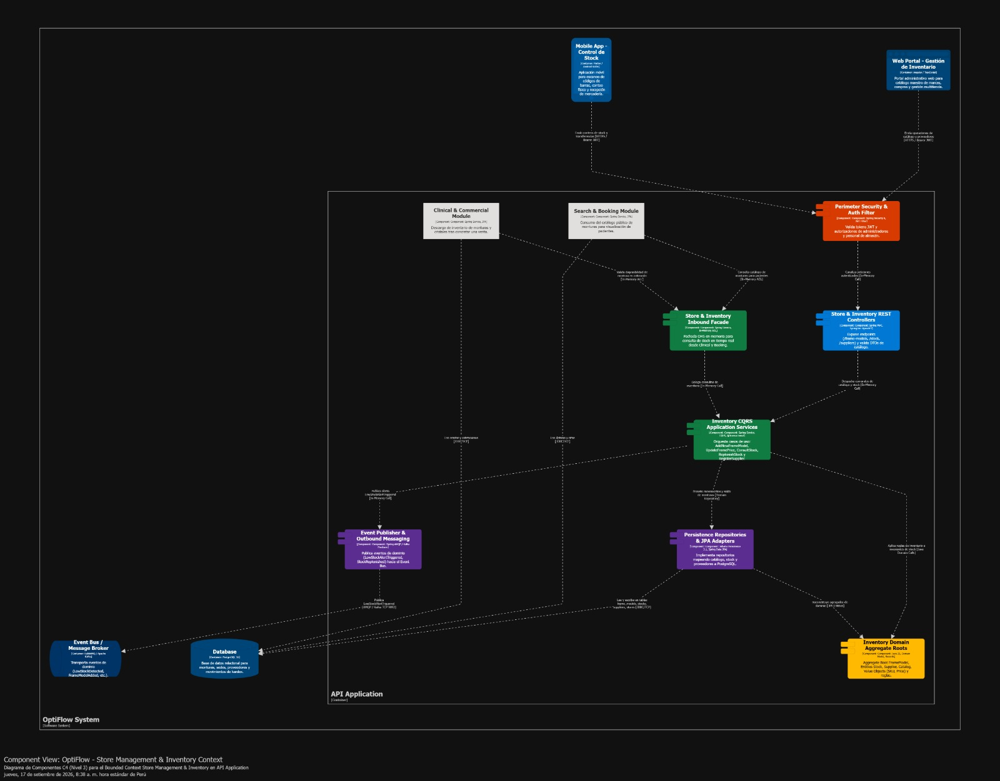

La propuesta busca organizar el control de inventario, las alertas y los movimientos de stock. Estos beneficios son objetivos del diseño: el contexto aún no tiene implementación de persistencia ni integración operativa con ventas.

#### 2.6.4.6. Bounded Context Software Architecture Code Level Diagrams

##### 2.6.4.6.1. Bounded Context Domain Layer Class Diagrams

El siguiente UML Class Diagram representa la estructura del Domain Layer correspondiente al Bounded Context **Store Management & Inventory**.

El modelo se organiza principalmente alrededor de `FrameModel` e `Inventory`. `FrameModel` representa los modelos de monturas disponibles para la óptica y mantiene información relacionada con sus características y precio. Por su parte, `Inventory` controla las existencias físicas de los productos y concentra las operaciones de consulta, incremento, reducción y reabastecimiento de stock.

`Catalog` representa el conjunto de modelos de monturas disponibles, mientras que `Price` se modela como un Value Object asociado a `FrameModel`. La entidad `Stock` mantiene la cantidad disponible y el nivel mínimo definido para cada modelo de montura, permitiendo determinar cuándo las existencias han alcanzado un nivel crítico.

El proceso de abastecimiento se representa mediante `Replenishment`, el cual relaciona el inventario, el producto y el `Supplier` responsable del suministro. Cada reposición y cada salida por venta se registran como un `StockMovement`, que conserva el tipo, el motivo, la cantidad, la fecha y el usuario, y forma el historial de movimientos. Asimismo, `LowStockAlert` representa la información generada cuando la cantidad disponible de un producto alcanza o se encuentra por debajo del nivel mínimo establecido.

El Domain Layer también incluye las interfaces `FrameModelRepository`, `InventoryRepository`, `SupplierRepository` y `StockMovementRepository`, responsables de abstraer la persistencia de los principales elementos del dominio. Finalmente, los Domain Events representan los acontecimientos relevantes producidos durante la gestión del catálogo, inventario, stock y proveedores (ver Figura 51).

**Figura 51**

*Diagrama de clases del Domain Layer del Store Management & Inventory Context*

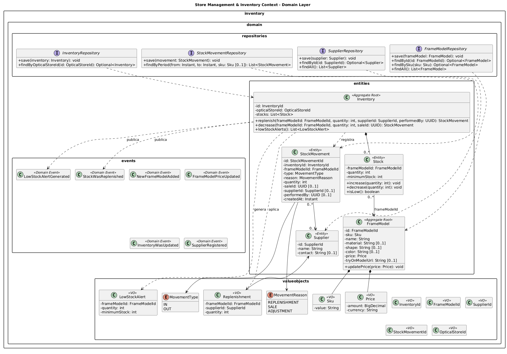

##### 2.6.4.6.2. Bounded Context Database Design Diagram

**Modelo físico: PostgreSQL compartido, migración V6.** Store Management & Inventory comprende cinco tablas en la misma base del backend.

Las tablas son `frame_models`, `inventories`, `inventory_stocks`, `suppliers` y `stock_movements`, que organizan el catálogo, las existencias y su historial. `frame_models` contiene `id`, `sku` (único; corresponde al código de barras que lee el escáner), `name`, `material`, `shape`, `color`, `price_amount NUMERIC(10,2)`, `price_currency` y `try_on_model_url` (referencia opcional al modelo del probador virtual). `inventories` contiene `id` y `optical_store_id` (FK hacia `optical_stores.id`, único), de modo que cada óptica tiene un inventario. `suppliers` contiene `id`, `name` y `contact`. `inventory_stocks` usa una clave compuesta por `inventory_id` y `frame_model_id` (FK hacia sus tablas) y guarda `quantity` y `minimum_stock`, ambos mayores o iguales a cero. `stock_movements` contiene `id`, `inventory_id` y `frame_model_id` (FK) y registra cada entrada o salida con `type` (`IN` u `OUT`), `reason` (`REPLENISHMENT`, `SALE` o `ADJUSTMENT`), cantidad, `sale_id` o `supplier_id` según el motivo, el usuario que lo registró (`performed_by`) y `created_at`.

**La Figura 52 representa las cinco tablas de la migración V6 con sus columnas, tipos, PK y FK.**

**Figura 52**

*Diagrama de base de datos del Store Management & Inventory Context*

  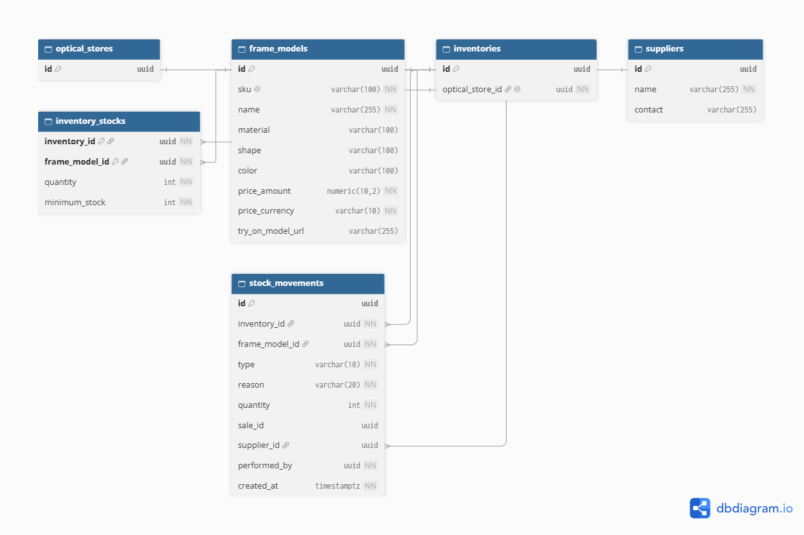

### 2.6.5. Bounded Context: Notification & Loyalty Context

Notification & Loyalty registra cada aviso en su modelo (`Notification`), lo envía como notificación push mediante Firebase Cloud Messaging al dispositivo del paciente (`DeviceToken`) y gestiona los beneficios de fidelización (`LoyaltyAccount`). La persistencia se documenta en 2.6.5.4 y 2.6.5.6.2.

#### 2.6.5.1. Domain Layer

La capa de dominio del **Notification & Loyalty Context** concentra las reglas relacionadas con la comunicación y fidelización del paciente. Este contexto registra los avisos del paciente (recordatorios de cita y de control anual, avance y demora del pedido, encuesta de satisfacción y beneficio de cumpleaños), los envía como notificaciones push y gestiona su cuenta de fidelización.

##### Domain Concepts

Los Domain Concepts del Notification & Loyalty Context se resumen en la Tabla 83.

**Tabla 83**

*Domain Concepts del Notification & Loyalty Context*

| Concepto | Tipo | Descripción |
|---|---|---|
| `Notification` | Aggregate Root | Aviso registrado para un paciente, con su tipo, título, mensaje, estado de lectura (`UNREAD` o `READ`), estado de envío push (`PENDING`, `SENT` o `FAILED`) y, si corresponde, la fecha programada de envío (`scheduledAt`). |
| `Notification Type` | Value Object | Tipo de aviso: `APPOINTMENT_REMINDER`, `ANNUAL_CHECKUP_REMINDER`, `LENS_ORDER_PROGRESS`, `DELIVERY_DELAY`, `SATISFACTION_SURVEY` o `BIRTHDAY_DISCOUNT`. |
| `Appointment Reminder` | Domain Concept | Recordatorio programado 24 horas antes de una cita reservada. |
| `Annual Check-up Reminder` | Domain Concept | Recordatorio programado 12 meses después de la cita, para incentivar un nuevo control visual. |
| `Order Progress` | Domain Concept | Información del avance del pedido de lentes comunicada por Production & Tracking. |
| `Satisfaction Survey` | Domain Concept | Aviso enviado al entregar el pedido, que el paciente responde una sola vez con una calificación de 1 a 5 y un comentario opcional. |
| `Device Token` | Entity | Token de registro de Firebase Cloud Messaging del dispositivo Android del paciente. |
| `Loyalty Account` | Aggregate Root | Cuenta de fidelización del paciente, con su saldo de puntos y el año del último beneficio de cumpleaños. |
| `Loyalty Points` | Value Object | Cantidad de puntos de fidelización; no puede ser negativa. |
| `Birthday Discount` | Domain Concept | Beneficio de puntos que se otorga una vez por año en la fecha de cumpleaños del paciente. |

##### Commands

Los Commands del Notification & Loyalty Context se detallan en la Tabla 84.

**Tabla 84**

*Commands del Notification & Loyalty Context*

| Command | Descripción |
|---|---|
| `ScheduleAppointmentReminder` | Registra, a partir de `AppointmentBooked`, el recordatorio de la cita (24 horas antes) y el recordatorio de control anual (12 meses después). |
| `NotifyLensOrderProgress` | Registra el aviso del avance del pedido al recibir `WorkOrderStatusUpdated`. |
| `SendDeliveryDelayNotification` | Registra el aviso de demora con la nueva fecha estimada al recibir `DeliveryDelayNotified`. |
| `SendSatisfactionSurvey` | Registra la encuesta de satisfacción al recibir `OrderWasMarkedAsDelivered`. |
| `AnswerSatisfactionSurvey` | Guarda la calificación y el comentario del paciente en su encuesta. |
| `GrantBirthdayDiscount` | Suma el beneficio de cumpleaños a la cuenta de fidelización del paciente, una vez por año, y registra el aviso. |
| `SendPushNotification` | Envía un aviso registrado como notificación push a los dispositivos del paciente y actualiza su estado de envío. |
| `RegisterDeviceToken` | Registra o actualiza el token de Firebase Cloud Messaging del dispositivo del paciente. |
| `MarkNotificationAsRead` | Marca un aviso como leído por el paciente. |

Las lecturas se modelan como consultas: `GetNotificationsByPatient` (avisos del paciente cuya fecha programada ya llegó, del más reciente al más antiguo), `GetNotificationById` y `GetLoyaltyAccountByPatient`.

##### Domain Events

Los Domain Events del Notification & Loyalty Context se presentan en la Tabla 85.

**Tabla 85**

*Domain Events del Notification & Loyalty Context*

| Evento | Descripción |
|---|---|
| `InAppNotificationSent` | Indica que se registró un aviso para el paciente y quedó disponible en la aplicación. |
| `AppointmentReminderScheduled` | Indica que se programaron los recordatorios de una cita. |
| `LensOrderProgressNotified` | Indica que se comunicó al paciente el avance de su pedido. |
| `SatisfactionSurveyWasSent` | Indica que una encuesta de satisfacción fue enviada. |
| `SatisfactionSurveyCompleted` | Indica que el paciente respondió la encuesta de satisfacción. |
| `BirthdayDiscountWasSent` | Indica que el beneficio de cumpleaños fue otorgado y avisado. |
| `PushNotificationSent` | Indica que el aviso se entregó a Firebase Cloud Messaging. |
| `DeviceTokenRegistered` | Indica que se registró el token del dispositivo del paciente. |

El contexto también consume eventos provenientes de otros Bounded Contexts. `AppointmentBooked` activa los recordatorios de la cita y del control anual, `WorkOrderStatusUpdated` permite notificar el avance del pedido, `DeliveryDelayNotified` permite avisar la demora de la entrega y `OrderWasMarkedAsDelivered` inicia el envío de la encuesta de satisfacción.

#### 2.6.5.2. Interface Layer

La Interface Layer expone los puntos de entrada que usa la aplicación del paciente: la consulta y lectura de avisos, la respuesta de la encuesta, el registro del token del dispositivo y la consulta de la cuenta de fidelización. Cada ruta exige el rol `PATIENT` y solo permite operar sobre los datos del propio paciente (HTTP 403 en otro caso). Los avisos se generan a partir de eventos internos y de tareas programadas, por lo que no existen rutas para crearlos.

##### Resources / DTOs

Los Resources / DTOs del Notification & Loyalty Context se resumen en la Tabla 86.

**Tabla 86**

*Resources / DTOs del Notification & Loyalty Context*

| DTO | Tipo | Uso |
|---|---|---|
| `RegisterDeviceTokenRequest` | Input | Token de Firebase Cloud Messaging y plataforma del dispositivo del paciente. |
| `AnswerSatisfactionSurveyRequest` | Input | Calificación de 1 a 5 y comentario opcional de la encuesta. |
| `NotificationResponse` | Output | Identificador, tipo, título, mensaje, estado de lectura, fecha y, si corresponde, la cita, la orden o la respuesta de la encuesta. |
| `LoyaltyAccountResponse` | Output | Saldo de puntos del paciente y año del último beneficio de cumpleaños. |
| `DeviceTokenResponse` | Output | Identificador, plataforma y fecha de actualización del token registrado. |

##### Controllers

Los Controllers del Notification & Loyalty Context se detallan en la Tabla 87.

**Tabla 87**

*Controllers del Notification & Loyalty Context*

| Controller | Responsabilidad |
|---|---|
| `NotificationController` | `GET /patients/{patientId}/notifications` (`GetNotificationsByPatient`), `GET /notifications/{id}` (`GetNotificationById`), `PATCH /notifications/{id}/read` (`MarkNotificationAsRead`) y `POST /notifications/{id}/survey-response` (`AnswerSatisfactionSurvey`; HTTP 409 si la encuesta ya fue respondida). |
| `DeviceTokenController` | `POST /patients/{patientId}/device-tokens` (`RegisterDeviceToken`); si el token ya existe, actualiza su paciente y fecha. |
| `LoyaltyAccountController` | `GET /patients/{patientId}/loyalty-account` (`GetLoyaltyAccountByPatient`; HTTP 404 si el paciente aún no tiene cuenta). |

##### Assemblers

Los Assemblers del Notification & Loyalty Context se presentan en la Tabla 88.

**Tabla 88**

*Assemblers del Notification & Loyalty Context*

| Assembler | Transformación |
|---|---|
| `FromRegisterDeviceTokenRequestAssembler` | `RegisterDeviceTokenRequest` → `RegisterDeviceTokenCommand` |
| `FromAnswerSatisfactionSurveyRequestAssembler` | `AnswerSatisfactionSurveyRequest` → `AnswerSatisfactionSurveyCommand` |
| `NotificationResourceAssembler` | `Notification` → `NotificationResponse` |
| `LoyaltyAccountResourceAssembler` | `LoyaltyAccount` → `LoyaltyAccountResponse` |

#### 2.6.5.3. Application Layer

La Application Layer coordina los casos de uso definidos para el contexto de notificaciones y fidelización. Su responsabilidad es recibir los comandos, ejecutar los servicios correspondientes y publicar los eventos resultantes sin incorporar reglas propias del dominio.

##### Command Handlers

Los Command Handlers del Notification & Loyalty Context se resumen en la Tabla 89.

**Tabla 89**

*Command Handlers del Notification & Loyalty Context*

| Command Handler | Command |
|---|---|
| `ScheduleAppointmentReminderHandler` | `ScheduleAppointmentReminderCommand` |
| `NotifyLensOrderProgressHandler` | `NotifyLensOrderProgressCommand` |
| `SendDeliveryDelayNotificationHandler` | `SendDeliveryDelayNotificationCommand` |
| `SendSatisfactionSurveyHandler` | `SendSatisfactionSurveyCommand` |
| `AnswerSatisfactionSurveyHandler` | `AnswerSatisfactionSurveyCommand` |
| `GrantBirthdayDiscountHandler` | `GrantBirthdayDiscountCommand` |
| `SendPushNotificationHandler` | `SendPushNotificationCommand` |
| `RegisterDeviceTokenHandler` | `RegisterDeviceTokenCommand` |
| `MarkNotificationAsReadHandler` | `MarkNotificationAsReadCommand` |

Las consultas se resuelven con `GetNotificationsByPatientQueryService`, `GetNotificationByIdQueryService` y `GetLoyaltyAccountByPatientQueryService`.

##### Event Handlers y tareas programadas

Los Event Handlers y las tareas programadas del Notification & Loyalty Context se detallan en la Tabla 90.

**Tabla 90**

*Event Handlers y tareas programadas del Notification & Loyalty Context*

| Componente | Disparador | Acción |
|---|---|---|
| `AppointmentBookedEventHandler` | `AppointmentBooked` | Ejecuta `ScheduleAppointmentReminder`. |
| `WorkOrderStatusUpdatedEventHandler` | `WorkOrderStatusUpdated` | Ejecuta `NotifyLensOrderProgress`. |
| `ProductionDeliveryDelayNotifiedEventHandler` | `DeliveryDelayNotified` | Ejecuta `SendDeliveryDelayNotification`. |
| `OrderWasMarkedAsDeliveredEventHandler` | `OrderWasMarkedAsDelivered` | Ejecuta `SendSatisfactionSurvey`. |
| `InAppNotificationSentEventHandler` | `InAppNotificationSent` | Ejecuta `SendPushNotification` para los avisos sin fecha programada. |
| `ScheduledNotificationDispatcher` | Tarea programada cada 5 minutos | Ejecuta `SendPushNotification` para los avisos `PENDING` cuya fecha programada ya llegó. |
| `BirthdayDiscountScheduler` | Tarea programada diaria (08:00, hora de Lima) | Obtiene de Search & Booking los pacientes que cumplen años ese día y ejecuta `GrantBirthdayDiscount` para cada uno. |

##### Application Services

Los Application Services del Notification & Loyalty Context se presentan en la Tabla 91.

**Tabla 91**

*Application Services del Notification & Loyalty Context*

| Application Service | Responsabilidad |
|---|---|
| `NotificationApplicationService` | Expone a la Interface Layer los casos de uso de avisos: consulta, lectura, respuesta de encuesta y registro del token del dispositivo. |
| `LoyaltyApplicationService` | Expone a la Interface Layer la consulta de la cuenta de fidelización. |

#### 2.6.5.4. Infrastructure Layer

La Infrastructure Layer persiste notificaciones, tokens de dispositivos y cuentas de fidelización mediante JPA/PostgreSQL, y envía las notificaciones push mediante Firebase Cloud Messaging.

##### Repositories

Los Repositories del Notification & Loyalty Context se resumen en la Tabla 92.

**Tabla 92**

*Repositories del Notification & Loyalty Context*

| Repository | Responsabilidad |
|---|---|
| `NotificationRepository` / `NotificationRepositoryImpl` | Abstracción del dominio y adaptador JPA para las filas de `notifications`, incluida la búsqueda de avisos pendientes por fecha programada. |
| `LoyaltyAccountRepository` / `LoyaltyAccountRepositoryImpl` | Abstracción del dominio y adaptador JPA para `loyalty_accounts`. |
| `DeviceTokenRepository` / `DeviceTokenRepositoryImpl` | Abstracción del dominio y adaptador JPA para `device_tokens`. |

##### Persistence

Los componentes de persistencia del Notification & Loyalty Context se detallan en la Tabla 93.

**Tabla 93**

*Componentes de persistencia del Notification & Loyalty Context*

| Componente | Responsabilidad |
|---|---|
| `NotificationEntity` | Mapea la tabla relacional `notifications`. |
| `LoyaltyAccountEntity` | Mapea `loyalty_accounts`, identificada por `patient_id`. |
| `DeviceTokenEntity` | Mapea `device_tokens`. |
| `NotificationMapper`, `LoyaltyAccountMapper` y `DeviceTokenMapper` | Convierten entidades JPA en objetos de dominio y viceversa. |
| `NotificationJpaRepository`, `LoyaltyAccountJpaRepository` y `DeviceTokenJpaRepository` | Ejecutan el acceso a persistencia mediante Spring Data JPA. |

##### Messaging

Los componentes de mensajería del Notification & Loyalty Context se presentan en la Tabla 94.

**Tabla 94**

*Componentes de mensajería del Notification & Loyalty Context*

| Componente | Responsabilidad |
|---|---|
| `EventPublisherAdapter` | Adaptador compartido de `DomainEventPublisher` sobre `ApplicationEventPublisher`, sin broker externo. |
| `NotificationSchedulingConfiguration` | Habilita las tareas programadas de Spring (`@EnableScheduling`) y define la zona horaria `America/Lima`. |
| `PatientDirectoryAdapter` | Consulta a Search & Booking los pacientes que cumplen años en una fecha, sin exponer su modelo de `Patient` al contexto. |

##### External Messaging / ACL

Los componentes de mensajería externa y ACL del Notification & Loyalty Context se resumen en la Tabla 95.

**Tabla 95**

*Componentes de mensajería externa y ACL del Notification & Loyalty Context*

| Componente | Responsabilidad |
|---|---|
| `FirebaseMessagingAdapter` | Envía cada aviso como notificación push mediante Firebase Admin SDK a los tokens registrados del paciente; elimina los tokens que el proveedor reporta como no válidos. |
| `MessagingAntiCorruptionLayer` | Aísla el modelo de notificaciones de OptiFlow de los formatos externos de mensajería. |

La integración con **Firebase Cloud Messaging** sigue el patrón **Anti-Corruption Layer** documentado en 2.5.2: el modelo de avisos de OptiFlow no depende del formato de mensajes del proveedor. Si el envío falla o el paciente no tiene un token registrado, el aviso queda con estado de envío `FAILED` y el paciente puede consultarlo igualmente en la aplicación.

#### 2.6.5.5. Bounded Context Software Architecture Component Level Diagrams

El siguiente Component Diagram representa el diseño ampliado del módulo **Notification & Loyalty** dentro del único backend. La persistencia de referencia es JPA/PostgreSQL; las operaciones de preferencias, encuestas, campañas y canales externos dibujadas requieren implementación y validación adicionales.

* **Interface Layer:** Expone los controladores REST (`BirthdayNotificationController`, `SatisfactionSurveyController`, `NotificationController`, `NotificationPreferencesController`, `OrderProgressNotificationController`, `ReactivationCampaignController`), los consumidores de eventos entrantes (`AppointmentBookedConsumer`, `WorkOrderStatusUpdatedConsumer`, `OrderWasMarkedAsDeliveredConsumer`), además de los DTOs y Assemblers para el mapeo de peticiones.
* **Application Layer:** Orquesta los casos de uso de comunicación y fidelización mediante Command Handlers (`DetectPatientBirthdayCommandHandler`, `SendBirthdayDiscountCommandHandler`, `SendSatisfactionSurveyCommandHandler`, `AssignStaffMemberToManageNotificationsCommandHandler`, `ConfigureNotificationPreferencesCommandHandler`, `NotifyPatientInAppCommandHandler`, `NotifyLensOrderProgressCommandHandler`, `SendReactivationCampaignCommandHandler`) y los servicios de aplicación (`BirthdayNotificationService`, `SatisfactionSurveyService`, `NotificationService`, `NotificationPreferenceService`, `OrderProgressNotificationService`, `ReactivationCampaignService`).
* **Domain Layer:** Encapsula las reglas y modelos de fidelización: `NotificationPreferences`, `PatientBirthday`, `BirthdayDiscount`, `SatisfactionSurvey`, `InAppNotification`, `OrderProgress`, `ReactivationCampaign`, `StaffMember`, junto con las interfaces de repositorio (`NotificationRepository`, `NotificationPreferencesRepository`, `SatisfactionSurveyRepository`, `StaffMemberRepository`, `ReactivationCampaignRepository`) y los eventos de dominio.
* **Infrastructure Layer:** Implementa `NotificationRepositoryImpl` y `LoyaltyAccountRepositoryImpl` sobre JPA/PostgreSQL, mediante `NotificationEntity`, `LoyaltyAccountEntity` y sus mappers. Recibe eventos internos de la aplicación Spring para generar notificaciones persistidas. Los adaptadores de WhatsApp y Firebase del diseño son propuestas de integración y no describen la persistencia ni una entrega externa verificada.

El diagrama de componentes del Notification & Loyalty Context en Spring Boot se muestra en la Figura 51.

**Figura 51**

*Diagrama de componentes del Notification & Loyalty Context en Spring Boot*

  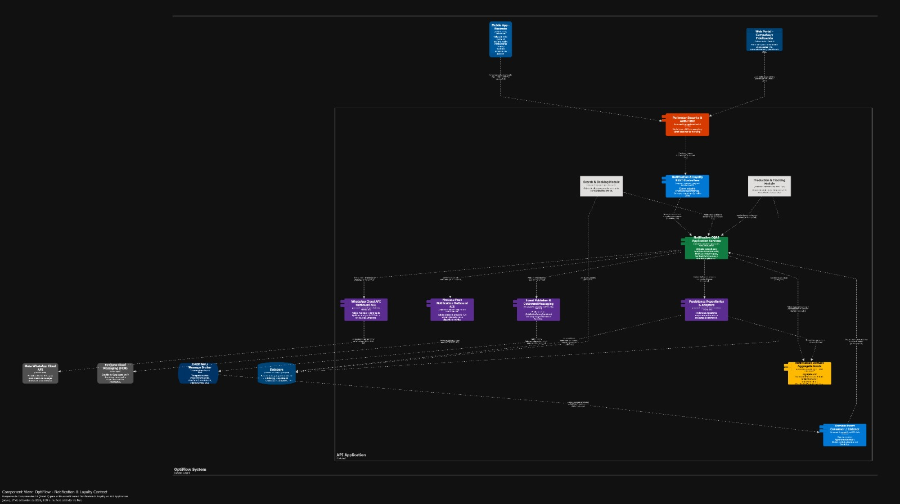

La implementación persiste avisos y cuentas de fidelización en PostgreSQL y reacciona a eventos de reservas y producción. Las notificaciones multicanal, encuestas y campañas representadas en la vista de componentes forman parte del diseño ampliado; su representación no demuestra que estén implementadas.

#### 2.6.5.6. Bounded Context Software Architecture Code Level Diagrams

##### 2.6.5.6.1. Bounded Context Domain Layer Class Diagrams

El siguiente UML Class Diagram representa la estructura del Domain Layer correspondiente al Bounded Context **Notification & Loyalty**.

El modelo se organiza alrededor de dos agregados. `Notification` representa cada aviso del paciente: conoce su tipo (`NotificationType`), su mensaje (`NotificationMessage`), su estado de lectura (`NotificationStatus`), su estado de envío push y, cuando es un recordatorio, la fecha programada de envío. Sus métodos de creación (`scheduleAppointmentReminder`, `scheduleAnnualCheckupReminder`, `notifyLensOrderProgress`, `notifyDeliveryDelay`, `sendSatisfactionSurvey` y `sendBirthdayDiscount`) fijan el tipo y las referencias opcionales a la cita (`AppointmentId`) o a la orden de trabajo (`WorkOrderId`). Sus métodos `markAsRead`, `answerSurvey`, `markPushSent` y `markPushFailed` aplican las reglas de lectura, de respuesta única a la encuesta y de envío.

`LoyaltyAccount` representa la cuenta de fidelización del paciente y conserva su saldo (`LoyaltyPoints`) y el año del último beneficio de cumpleaños; `grantBirthdayDiscount` rechaza un segundo beneficio en el mismo año. `DeviceToken` registra los dispositivos del paciente que reciben las notificaciones push.

El Domain Layer incluye también las interfaces `NotificationRepository`, `LoyaltyAccountRepository` y `DeviceTokenRepository`, que abstraen la persistencia de avisos, cuentas y tokens. Finalmente, los Domain Events representan los acontecimientos relevantes producidos durante las operaciones de notificación y fidelización (ver Figura 54).

**Figura 54**

*Diagrama de clases del Domain Layer del Notification & Loyalty Context*

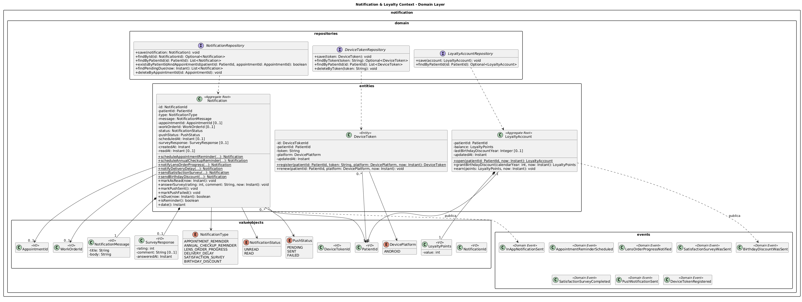

##### 2.6.5.6.2. Bounded Context Database Design Diagram

**Modelo físico: PostgreSQL compartido, migraciones V4 y V7.** V4 crea `loyalty_accounts` y `notifications`; V7 crea `device_tokens` y agrega a `notifications` las columnas de envío push, programación y encuesta. Notification & Loyalty persiste tres tablas: `notifications`, `loyalty_accounts` y `device_tokens`.

`loyalty_accounts` utiliza `patient_id UUID` como PK y FK hacia `patients.id`, y conserva `balance INT NOT NULL`, `last_birthday_discount_year INT` y `updated_at TIMESTAMP WITH TIME ZONE NOT NULL`. Un paciente puede tener cero o una cuenta; el saldo no puede ser negativo. La cuenta registra el saldo de puntos y el año del último beneficio de cumpleaños.

`device_tokens` contiene `id`, `patient_id` (FK hacia `patients.id`), `token` (único), `platform` y `updated_at`; un paciente puede tener varios dispositivos.

`notifications` contiene `id`, `patient_id`, `type`, `title`, `body`, `appointment_id`, `work_order_id`, `status`, `push_status`, `scheduled_at`, `survey_rating`, `survey_comment`, `answered_at`, `created_at` y `read_at`. `push_status` (`PENDING`, `SENT` o `FAILED`) registra el resultado del envío por Firebase Cloud Messaging; `scheduled_at` es la fecha programada de los recordatorios (nula para los avisos inmediatos); `survey_rating` (`CHECK` entre 1 y 5), `survey_comment` y `answered_at` guardan la respuesta de la encuesta. Su PK es `id` y su única FK es `patient_id` hacia `patients.id`. Un paciente puede tener varias notificaciones. Los identificadores de cita y orden son opcionales y no tienen FKs declaradas en V4; no se representan como relaciones físicas con sus tablas.

Los tipos permitidos son `APPOINTMENT_REMINDER`, `ANNUAL_CHECKUP_REMINDER`, `LENS_ORDER_PROGRESS`, `BIRTHDAY_DISCOUNT`, `DELIVERY_DELAY` y `SATISFACTION_SURVEY` (V7 amplía el `CHECK` de V4); los estados admitidos son `UNREAD` y `READ`. V7 reemplaza el índice único parcial de V4 por uno sobre (`patient_id`, `appointment_id`, `type`) cuando `appointment_id IS NOT NULL`, para que una cita tenga un solo recordatorio de cada tipo, y crea un índice sobre (`push_status`, `scheduled_at`) para la búsqueda de avisos pendientes. Esta regla se documenta junto al diagrama, aunque el importador gráfico no represente índices parciales.

`NotificationEntity`, `LoyaltyAccountEntity` y `DeviceTokenEntity` son las entidades JPA de estas tablas; sus repositorios y mappers convierten filas relacionales en objetos del dominio. **La Figura 55 muestra las tres tablas y sus FKs hacia `patients`, tabla de V1 que se incluye como referencia. `appointment_id` y `work_order_id` de `notifications` son referencias lógicas sin FK y no se dibujan como relaciones.**

**Figura 55**

*Diagrama de base de datos del Notification & Loyalty Context*

  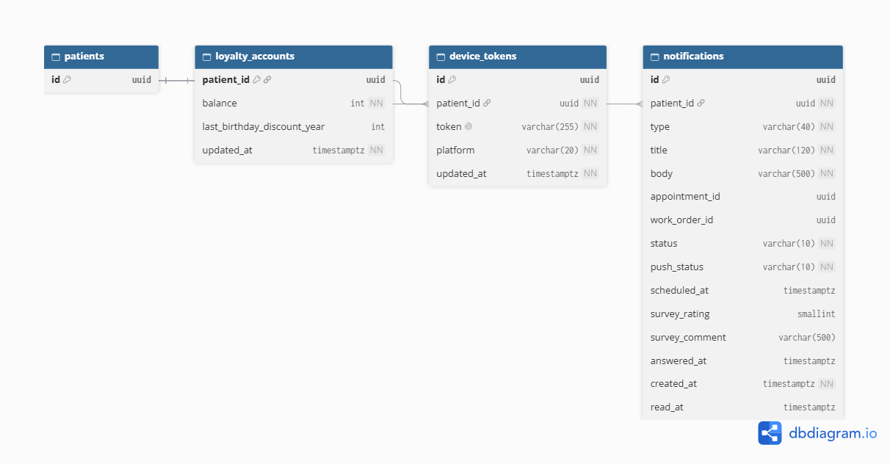

