<div style="break-before: page; page-break-before: always;"></div>

# Capítulo IV: Product Implementation & Validation

## 4. Product Implementation & Validation

Este capítulo presenta la configuración de trabajo, los incrementos de implementación y la validación de OptiFlow. El Sprint 1 conserva las evidencias de la aplicación Android y de la primera integración de búsqueda y reserva. El Sprint 2 documenta los avances de AV2: contrato REST versionado, seguridad, ubicación de ópticas, ajustes de la Landing Page y publicación del cliente Flutter.

Las evidencias indican su revisión y entorno. Las comprobaciones locales se distinguen del despliegue público y las pantallas de demostración se distinguen de los flujos integrados. Los campos señalados **por completar** y los comentarios `EQUIPO` corresponden a registros que debe confirmar el grupo, como reuniones, tablero, video y distribución de la versión Flutter.

**Recorrido del capítulo:** [configuración](#41-software-configuration-management), [Sprint 1](#421-sprint-1), [Sprint 2](#422-sprint-2) y [validación](#43-validation-interviews).

### 4.1. Software Configuration Management

#### 4.1.1. Software Development Environment Configuration

Esta sección describe las herramientas del entorno de trabajo y su función en el diseño, desarrollo, documentación y validación de OptiFlow.

##### Figma


El logo de Figma se presenta en la Figura 115.

<a id="figura-115"></a>

**Figura 115**

*Logo de Figma*


Se utiliza para definir el diseño de la Landing Page y de la aplicación móvil: wireframes, mock-ups y prototipo interactivo con la simulación de navegación entre pantallas (Figma, s. f.).

Ruta de referencia: https://www.figma.com

##### Android Studio


El logo de Android Studio se observa en la Figura 116.

<a id="figura-116"></a>

**Figura 116**

*Logo de Android Studio*


Es el entorno de desarrollo integrado (IDE) para la programación de la aplicación móvil. Además, se emplean el Android SDK, Gradle para la gestión de dependencias y la compilación, el Android Emulator para pruebas durante el desarrollo y un dispositivo físico con depuración USB para validar el funcionamiento real de la aplicación. La aplicación se desarrolla en Kotlin, cuya adopción en proyectos Android resulta costo-efectiva frente a Java sin afectar la calidad percibida por los usuarios (Coppola et al., 2025), y su interfaz se construye con Jetpack Compose (Google, s. f.-d). El proyecto fija una versión mínima del SDK (API 26), porque la evolución de la API de Android genera problemas de compatibilidad que deben controlarse durante el desarrollo (Mahmud et al., 2024).

Ruta de descarga: https://developer.android.com/studio

##### Docker


El logo de Docker se muestra en la Figura 117.

<a id="figura-117"></a>

**Figura 117**

*Logo de Docker*


Se utiliza para empaquetar el backend (Web Services) en una imagen construida a partir de un `Dockerfile` de dos etapas, de modo que el despliegue sea reproducible y no dependa de la configuración de cada equipo (Docker, s. f.).

Ruta de descarga: https://www.docker.com/products/docker-desktop

##### Structurizr


El logo de Structurizr se presenta en la Figura 118.

<a id="figura-118"></a>

**Figura 118**

*Logo de Structurizr*


Se utiliza para elaborar los diagramas de arquitectura de software del Modelo C4 (Context, Container, Component y Deployment).

Ruta de referencia: https://structurizr.com

##### Miro


El logo de Miro se observa en la Figura 119.

<a id="figura-119"></a>

**Figura 119**

*Logo de Miro*


Se utiliza como pizarra colaborativa para las sesiones de EventStorming: Big Picture, Candidate Context Discovery y modelado de Domain Message Flows.

Ruta de referencia: https://miro.com

##### Flutter y Dart

Para AV2 se incorpora [Logix-OptiFlow-Flutter](https://github.com/BL-App-Movil-1ACC0238-2620-4951/Logix-OptiFlow-Flutter). La revisión `0344413` define la versión `1.0.0+1` y exige Dart `>=3.5.0 <4.0.0`. Utiliza `go_router` para las rutas, `provider` para el estado, `http` para las solicitudes y `shared_preferences` para datos locales de sesión y preferencias. Estas dependencias se verificaron en `pubspec.yaml`; no se presentan como integración de Room, Maps, CameraX o Firebase en el cliente Flutter.

La configuración y los comandos de Flutter se documentan por separado de Gradle y Android Studio, utilizados por el cliente Kotlin del Sprint 1. **Versión de Flutter empleada para el APK de AV2:** ____________________.

#### 4.1.2. Source Code Management

El equipo utiliza **Git** para el control de versiones y **GitHub** para alojar los repositorios y colaborar sobre el código y la documentación (GitHub, s. f.). Los productos se agrupan en la organización [BL-App-Movil-1ACC0238-2620-4951](https://github.com/BL-App-Movil-1ACC0238-2620-4951). Los historiales de commits permiten relacionar los cambios registrados con sus autores y fechas.

##### Repositorios del proyecto


Los repositorios del proyecto se detallan en la Tabla 106.

<a id="tabla-106"></a>

**Tabla 106**

*Repositorios del proyecto*


| Producto | Repositorio |
|---|---|
| Informe del proyecto | [Logix-OptiFlow-Report](https://github.com/BL-App-Movil-1ACC0238-2620-4951/Logix-OptiFlow-Report) |
| Landing Page | [Logix-OptiFlow-landing-page](https://github.com/BL-App-Movil-1ACC0238-2620-4951/Logix-OptiFlow-landing-page) |
| Web Services | [Logix-OptiFlow-Back-End](https://github.com/BL-App-Movil-1ACC0238-2620-4951/Logix-OptiFlow-Back-End) |
| Aplicación Android del Sprint 1 | [Logix-OptiFlow-Mobile](https://github.com/BL-App-Movil-1ACC0238-2620-4951/Logix-OptiFlow-Mobile) |
| Cliente Flutter incorporado en AV2 | [Logix-OptiFlow-Flutter](https://github.com/BL-App-Movil-1ACC0238-2620-4951/Logix-OptiFlow-Flutter) |

El informe utiliza ramas por alcance y Pull Requests hacia `develop`. La revisión del Sprint 2 identifica también los repositorios que publican directamente en `main`, como Flutter y la Landing Page, sin atribuirles un flujo de integración que no consta en el historial.

##### Flujo de trabajo con GitFlow

Se adoptó **GitFlow** como flujo de trabajo para organizar el desarrollo en ramas con responsabilidades definidas:


Las ramas del flujo de trabajo GitFlow se presentan en la Tabla 107.

<a id="tabla-107"></a>

**Tabla 107**

*Ramas del flujo de trabajo GitFlow*


| Rama | Propósito | Convención de nombre |
|---|---|---|
| `main` | Contiene las versiones estables y publicadas del producto. | `main` |
| `develop` | Rama de integración donde se reúnen las funcionalidades terminadas. | `develop` |
| `feature/*` | Desarrollo de cada funcionalidad o User Story en su propia rama. | `feature/<descripcion-en-ingles>`, por ejemplo `feature/login-screen` |
| `release/*` | Preparación de una nueva versión antes de publicarla. | `release/<version>`, por ejemplo `release/1.0.0` |
| `hotfix/*` | Corrección urgente de errores detectados en `main`. | `hotfix/<descripcion-en-ingles>`, por ejemplo `hotfix/fix-token-validation` |

Los cambios se integran mediante **Pull Requests** hacia la rama `develop`, de modo que cada modificación sea revisada por otro integrante antes de incorporarse.

La convención propuesta para los mensajes utiliza un tipo y una descripción breve, de modo que el historial permita reconocer el propósito de cada cambio. El cuerpo del mensaje puede explicar en español el comportamiento incorporado, la corrección realizada o la documentación actualizada. Los tipos principales son:

- `feat/feature`: nueva funcionalidad.
- `fix`: corrección de un error.
- `docs`: cambios en la documentación.

#### 4.1.3. Source Code Style Guide & Conventions

Las guías de estilo buscan mantener el código legible y consistente entre los integrantes, lo que favorece la mantenibilidad, una de las características de calidad del producto de software (International Organization for Standardization, 2023). Los identificadores de clases, funciones, variables, archivos y ramas se definen en **inglés**. La documentación y la explicación del cuerpo de los commits pueden redactarse en español para describir con claridad el propósito del cambio.

##### Guías de estilo por lenguaje


Las guías de estilo por lenguaje se resumen en la Tabla 108.

<a id="tabla-108"></a>

**Tabla 108**

*Guías de estilo por lenguaje*


| Lenguaje | Producto | Guía adoptada |
|---|---|---|
| Dart | Cliente Flutter | [Effective Dart: Style](https://dart.dev/effective-dart/style) |
| Kotlin | Aplicación Android | [Kotlin Coding Conventions](https://kotlinlang.org/docs/coding-conventions.html) |
| Java | Web Services | [Google Java Style Guide](https://google.github.io/styleguide/javaguide.html) |
| HTML, CSS y JavaScript | Landing Page | [Google HTML/CSS Style Guide](https://google.github.io/styleguide/htmlcssguide.html) |
| Gherkin | Archivos `.feature` de pruebas de aceptación | [Gherkin Conventions for Readable Specifications](https://specflow.org/gherkin/gherkin-conventions-for-readablespecifications/) |

##### Convenciones de nomenclatura


Las convenciones de nomenclatura se detallan en la Tabla 109.

<a id="tabla-109"></a>

**Tabla 109**

*Convenciones de nomenclatura*


| Elemento | Convención | Ejemplo |
|---|---|---|
| Clases, interfaces y enumeraciones | `PascalCase` | `AppointmentRepository` |
| Funciones, métodos y variables | `camelCase` | `getUpcomingAppointments` |
| Constantes | `UPPER_SNAKE_CASE` | `MAX_RETRY_COUNT` |
| Paquetes | minúsculas, sin guiones bajos | `com.optiflow.booking` |
| Archivos CSS y de la Landing Page | `kebab-case` | `main-header.css` |
| Archivos `.feature` | `snake_case` o `kebab-case` en inglés | `book-appointment.feature` |

En Flutter se emplean archivos en `snake_case`, clases en `UpperCamelCase` y miembros en `lowerCamelCase`. La revisión separa los modelos, el cliente HTTP, el controlador de estado, las pantallas y los componentes visuales. El cliente debe diferenciar datos de demostración y respuestas de servicio, comunicar errores y adjuntar el token cuando una operación lo requiere. Estas reglas se comprueban con `flutter analyze` y pruebas; su definición no implica que esos comandos hayan pasado en esta revisión.

##### Organización del código

El backend se organiza en Domain, Application, Interface e Infrastructure por contexto, como se describe en el capítulo II. Los clientes móviles conservan su propia estructura: Kotlin para el primer incremento y `lib/models`, `lib/data`, `lib/state`, `lib/screens` y `lib/widgets` en Flutter. No se atribuyen automáticamente a Flutter los paquetes o componentes específicos del backend.

#### 4.1.4. Software Deployment Configuration

La configuración diferencia la Landing Page, el backend y los clientes móviles. GitHub Pages y Render conservan las URL del proyecto; Firebase App Distribution se utilizó para la distribución Android del Sprint 1. La versión que se distribuye en AV2 debe identificarse con su APK y su commit. El código público del corte revisado no acredita por sí solo un despliegue completo de todas las integraciones dibujadas en la arquitectura.

##### Landing Page

La revisión `ef1c032` contiene ajustes de accesibilidad, estilos y el workflow de publicación. La configuración de GitHub Pages se revisa en el repositorio [Logix-OptiFlow-landing-page](https://github.com/BL-App-Movil-1ACC0238-2620-4951/Logix-OptiFlow-landing-page). La URL registrada es [Landing Page de OptiFlow](https://bl-app-movil-1acc0238-2620-4951.github.io/Logix-OptiFlow-landing-page/). Para AV2 se debe conservar la captura de la ejecución del workflow y comprobar que la descarga del APK corresponde a la versión que se presenta, en lugar de asumir que los enlaces anteriores ya fueron actualizados.

##### Web Services

El backend se construye con Maven y Java 21 y se empaqueta mediante el `Dockerfile`. El perfil `postgres` obtiene la conexión de `SPRING_DATASOURCE_URL`, `SPRING_DATASOURCE_USERNAME` y `SPRING_DATASOURCE_PASSWORD`; Flyway aplica las migraciones y JPA valida el esquema. Los valores de credenciales se configuran en el entorno y no se incluyen en las evidencias.

La revisión `4a1364e` publica las rutas de negocio bajo `/api/v1`. El registro de pacientes y la creación de tokens son públicos; las operaciones protegidas requieren un token y las de personal exigen el rol administrativo. La documentación se genera en `/v3/api-docs` y se visualiza en `/swagger-ui/index.html`. El perfil local utiliza H2; las capturas de 4.2.2 se tomaron en una instancia aislada, distinta de Render.

Los servicios de pagos externos y notificaciones push del diseño general no se consideran comprobados por esta revisión. En el código descargado se identifican las migraciones V1, V2, V3, V4, V5 y V8; no se usa el diseño ampliado del informe como sustituto de la evidencia de código o despliegue.

##### Aplicaciones móviles

El cliente Android/Kotlin del Sprint 1 utiliza variantes Gradle y se distribuyó con Firebase App Distribution. Esas capturas e instrucciones se conservan como antecedentes de ese incremento.

El cliente Flutter de AV2 se configura mediante `--dart-define=API_BASE_URL=...`. Antes de construir el APK, se deben adaptar y comprobar las subrutas, el formato de sesión y el encabezado Bearer descritos en 4.2.2.4. Después se ejecutan el análisis y las pruebas, se genera la versión elegida y se instala en un dispositivo para verificar el flujo. La versión y el enlace de distribución se registran en 4.2.2.8. El proyecto publicado utiliza `shared_preferences`; no se afirma que incluya Room o que sus vistas de demostración estén conectadas a todos los módulos del backend.

##### Deployment Diagram

El Deployment Diagram representa la distribución prevista de OptiFlow y sus servicios externos. Se conserva como vista de arquitectura del capítulo II. La revisión del Sprint 2 identifica por separado qué artefactos y operaciones se comprobaron, y no utiliza el diagrama para dar por desplegadas las integraciones de pagos, mapas, cámara o notificaciones (ver Figura 120).


<a id="figura-120"></a>

**Figura 120**

*Deployment Diagram de OptiFlow*

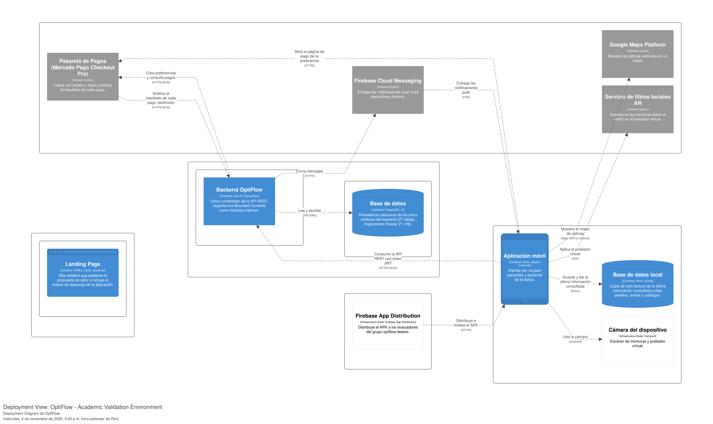


## 4.2. Landing Page & Mobile Application Implementation
### 4.2.1. Sprint 1
Durante el Sprint 1, el equipo inició la implementación de OptiFlow con dos prioridades: publicar la Landing Page y desarrollar el flujo del paciente para buscar ópticas y reservar una cita de atención optométrica. Este incremento establece una primera integración entre la aplicación móvil y los Web Services, cuyo comportamiento se documenta mediante evidencias de desarrollo, pruebas y ejecución.

Siguiendo el marco de trabajo Scrum (Schwaber & Sutherland, 2020), el trabajo del Sprint se organiza mediante reuniones virtuales realizadas a través de Discord, seguimiento de actividades mediante el Sprint Backlog y control de versiones a través de los repositorios de GitHub de la organización del equipo.

El alcance funcional comprometido en el Sprint 1 se concentra en las User Stories US05 y US06.
#### 4.2.1.1. Sprint Planning 1
El Sprint Planning 1 tuvo como finalidad establecer el objetivo de la primera iteración, seleccionar las User Stories que contribuyen directamente a dicho objetivo, determinar la capacidad inicial del equipo y distribuir las principales responsabilidades de implementación.

La reunión se realizó de manera virtual mediante Discord y fue preparada por Celis Berrospi, Eslander. Debido a que Sprint 1 representa la primera iteración de implementación de la solución, no existe un Sprint anterior sobre el cual realizar un Sprint Review o Sprint Retrospective formal (ver Tabla 110).


<a id="tabla-110"></a>

**Tabla 110**

*Sprint Planning 1*


| Sprint # | Sprint 1 |
| :--- | :--- |
| **Sprint Planning Background** | |
| **Date** | 2026-09-28 |
| **Time** | 07:00 PM |
| **Location** | Discord |
| **Prepared By** | Celis Berrospi, Eslander |
| **Attendees (to planning meeting)** | Atoche Gonzales, Nicolas Fernando / Becerra Ttito, Felix Orlando / Celis Berrospi, Eslander / Morocho Pinedo, Mariana / Quispe Llacsahuanga, César Augusto |
| **Sprint 0 Review Summary** | No aplica, debido a que Sprint 1 corresponde a la primera iteración de implementación de OptiFlow. Antes del inicio de este Sprint, el equipo desarrolló las actividades de investigación, análisis de los segmentos objetivo, especificación de requisitos, Domain-Driven Design, arquitectura de software y diseño UX/UI que sirven como base para la implementación del producto. |
| **Sprint 0 Retrospective Summary** | No se realizó una retrospectiva formal debido a que no existió un Sprint de implementación anterior. Sin embargo, a partir del trabajo realizado durante las etapas previas, el equipo identificó la necesidad de distribuir claramente las responsabilidades, dividir el trabajo en tareas de corta duración, mantener una comunicación constante mediante Discord y conservar la trazabilidad del desarrollo mediante GitHub. |
| **Sprint Goal & User Stories** | |
| **Sprint 1 Goal** | Nuestro enfoque consiste en ofrecer a los pacientes una primera experiencia integrada para encontrar ópticas y programar una atención optométrica, junto con una Landing Page que comunique la propuesta de valor de OptiFlow. Consideramos que este incremento facilitará la consulta de establecimientos y la organización de citas. El cumplimiento se verificará cuando un paciente pueda consultar ópticas, seleccionar un horario disponible y obtener la confirmación de su reserva desde la aplicación móvil; cuando el servicio rechace una segunda reserva del mismo horario; y cuando las secciones y la navegación de la Landing Page puedan demostrarse en escritorio y móvil. |
| **Sprint 1 Velocity** | 13 Story Points de capacidad planificada, según el registro inicial del equipo. |
| **Sum of Story Points** | 13 Story Points: US05 (5) y US06 (8), según el Product Backlog del Capítulo II. |

El alcance estimado en Story Points corresponde a US05 y US06. Las actividades de la Landing Page se incluyen como tareas adicionales. El registro e inicio de sesión del paciente permiten ejecutar la reserva; se documentan como soporte a este flujo y se distinguen de US01, cuyo actor en el Product Backlog es el personal de la óptica.

#### 4.2.1.2. Aspect Leaders and Collaborators
Para organizar las responsabilidades del Sprint se establece una Leadership-and-Collaboration Matrix (LACX). La matriz identifica al integrante responsable de liderar cada aspecto y a los integrantes que participan como colaboradores.

Los principales aspectos considerados durante Sprint 1 son la implementación del Landing Page, la experiencia móvil de búsqueda de ópticas, el flujo móvil de reserva de citas, los servicios asociados a Search & Booking y la integración y coordinación general del Sprint (ver Tabla 111).


<a id="tabla-111"></a>

**Tabla 111**

*Aspect leaders y colaboradores del Sprint 1*


| Team Member | GitHub Username | Landing Page | Optical Store Search | Appointment Booking | Search & Booking Services | Integration & Sprint Coordination |
| :--- | :--- | :---: | :---: | :---: | :---: | :---: |
| Atoche Gonzales, Nicolas Fernando | `THECOMAX` | C | **L** | C | C | C |
| Becerra Ttito, Felix Orlando | `Felixb14` | C | C | C | **L** | C |
| Celis Berrospi, Eslander | `Eslander-Celis` | C | C | C | C | **L** |
| Morocho Pinedo, Mariana | `Patto04` | C | C | **L** | C | C |
| Quispe Llacsahuanga, César Augusto | `user20-bit` | **L** | C | C | C | C |

**L:** Leader  
**C:** Collaborator

Cada aspecto cuenta con un líder y colaboradores. La matriz expresa la distribución de responsabilidades del Sprint; las contribuciones de implementación se presentan mediante los commits de la sección 4.2.1.4.

#### 4.2.1.3. Sprint Backlog 1

El Sprint Backlog reúne las tareas de búsqueda de ópticas y reserva de citas correspondientes a US05 y US06, junto con las actividades adicionales de la Landing Page. La tabla conserva las estimaciones y responsabilidades del registro de planificación. Las 13 tareas se encuentran en estado Done, ya que la Landing Page está publicada y la búsqueda de ópticas y la reserva de citas funcionan en la aplicación móvil y en los Web Services, como se evidencia en las secciones 4.2.1.6 a 4.2.1.8.

**Board del Sprint:** [Tablero del Sprint 1 en GitHub](https://github.com/BL-App-Movil-1ACC0238-2620-4951/Logix-OptiFlow-Report/blob/develop/assets/cap4/sprint1/sprint-board.md) · [Vista del tablero local](assets/cap4/sprint1/sprint-board.html). El tablero adjunto se elaboró para esta revisión a partir de las tareas del informe y sus evidencias (ver Figura 121).


<a id="figura-121"></a>

**Figura 121**

*Tablero de revisión del Sprint 1*


El Sprint Backlog 1 se presenta en la Tabla 112.

<a id="tabla-112"></a>

**Tabla 112**

*Sprint Backlog 1*


| Sprint # | User Story | User Story Title | Task ID | Task Title | Description | Estimation (Hours) | Assigned To | Status |
| :---: | :---: | :--- | :---: | :--- | :--- | :---: | :--- | :---: |
| 1 | — | Actividad adicional: Landing Page | T01 | Create initial project structure | Crear la estructura inicial del proyecto del Landing Page y organizar los archivos necesarios para iniciar su implementación. | 4 | Quispe Llacsahuanga, César Augusto | Done |
| 1 | — | Actividad adicional: Landing Page | T02 | Implement base styles | Implementar los estilos base y la identidad visual inicial del Landing Page de acuerdo con los lineamientos definidos para OptiFlow. | 6 | Quispe Llacsahuanga, César Augusto | Done |
| 1 | — | Actividad adicional: Landing Page | T03 | Configure Three.js environment | Configurar Three.js y los recursos necesarios para los elementos visuales e interactivos del Landing Page. | 4 | Quispe Llacsahuanga, César Augusto | Done |
| 1 | — | Actividad adicional: Landing Page | T04 | Implement Landing Page sections | Implementar las principales secciones informativas del Landing Page, incluyendo la presentación de OptiFlow, propuesta de valor y principales características. | 8 | Quispe Llacsahuanga, César Augusto | Done |
| 1 | — | Actividad adicional: Landing Page | T05 | Implement responsive navigation | Implementar la navegación del Landing Page y adaptar su visualización para dispositivos móviles y equipos de escritorio. | 6 | Quispe Llacsahuanga, César Augusto | Done |
| 1 | US05 | Búsqueda de ópticas y disponibilidad de atención | T06 | Implement optical store search screen | Implementar la interfaz móvil que permita al paciente iniciar la búsqueda de ópticas disponibles. | 6 | Atoche Gonzales, Nicolas Fernando | Done |
| 1 | US05 | Búsqueda de ópticas y disponibilidad de atención | T07 | Implement optical store results | Implementar la visualización de los establecimientos disponibles, incluyendo sucursales, direcciones y horarios de atención. | 6 | Atoche Gonzales, Nicolas Fernando | Done |
| 1 | US05 | Búsqueda de ópticas y disponibilidad de atención | T08 | Implement optical store search service | Implementar las operaciones del servicio RESTful necesarias para consultar ópticas y su disponibilidad. | 8 | Becerra Ttito, Felix Orlando | Done |
| 1 | US05 | Búsqueda de ópticas y disponibilidad de atención | T09 | Integrate optical store search | Integrar la aplicación móvil con el servicio de búsqueda de ópticas y gestionar los estados de carga, resultados y ausencia de establecimientos. | 6 | Celis Berrospi, Eslander | Done |
| 1 | US06 | Reserva de cita para atención optométrica | T10 | Implement appointment selection screen | Implementar la interfaz para seleccionar sucursal, fecha y horario disponible para una cita optométrica. | 6 | Morocho Pinedo, Mariana | Done |
| 1 | US06 | Reserva de cita para atención optométrica | T11 | Implement appointment booking service | Implementar el servicio RESTful encargado de registrar las reservas de citas realizadas por los pacientes. | 8 | Becerra Ttito, Felix Orlando | Done |
| 1 | US06 | Reserva de cita para atención optométrica | T12 | Implement availability validation | Implementar la validación de disponibilidad del horario antes de confirmar una reserva. | 4 | Becerra Ttito, Felix Orlando | Done |
| 1 | US06 | Reserva de cita para atención optométrica | T13 | Integrate appointment confirmation | Integrar el flujo móvil de reserva con el servicio correspondiente y mostrar al paciente el resultado de la operación. | 6 | Celis Berrospi, Eslander | Done |

#### 4.2.1.4. Development Evidence for Sprint Review

Durante el Sprint 1 se registraron avances en los tres productos principales de OptiFlow. La Landing Page incorpora secciones informativas, ajustes visuales, navegación y validaciones del formulario. El backend incluye operaciones de búsqueda de ópticas, disponibilidad y reserva de citas, además de validaciones de entrada y manejo de errores. La aplicación móvil incorpora el cliente de comunicación con el backend, el registro e inicio de sesión del paciente, la consulta de establecimientos y la selección de horarios para realizar reservas.

La siguiente tabla presenta commits representativos del alcance documentado, obtenidos de los historiales de las clonaciones locales revisadas el 2026-10-07 (ver Tabla 113).


<a id="tabla-113"></a>

**Tabla 113**

*Commits de desarrollo del Sprint 1*


| Repository | Branch | Commit Id | Commit Message | Commit Message Body | Committed on (Date) |
|---|---|---|---|---|---|
| `Logix-OptiFlow-landing-page` | `main` | [52a57c6](https://github.com/BL-App-Movil-1ACC0238-2620-4951/Logix-OptiFlow-landing-page/commit/52a57c6) | `feat: add initial project structure, base styles, and Three.js setup` | Descripción en español: Crea la estructura inicial, los estilos base y la configuración de Three.js. | 2026-10-03 |
| `Logix-OptiFlow-landing-page` | `main` | [8091504](https://github.com/BL-App-Movil-1ACC0238-2620-4951/Logix-OptiFlow-landing-page/commit/8091504) | `Refresh landing page visuals and intro animation` | Descripción en español: Actualiza la apariencia de la Landing Page y la animación introductoria. | 2026-10-06 |
| `Logix-OptiFlow-landing-page` | `main` | [8bf76ec](https://github.com/BL-App-Movil-1ACC0238-2620-4951/Logix-OptiFlow-landing-page/commit/8bf76ec) | `fix: set footer` | Descripción en español: Ajusta el pie de página. | 2026-10-06 |
| `Logix-OptiFlow-landing-page` | `main` | [e5f8254](https://github.com/BL-App-Movil-1ACC0238-2620-4951/Logix-OptiFlow-landing-page/commit/e5f8254) | `style: fix plans and avatars` | Descripción en español: Ajusta la presentación de planes y avatares. | 2026-10-06 |
| `Logix-OptiFlow-landing-page` | `main` | [5a9ff47](https://github.com/BL-App-Movil-1ACC0238-2620-4951/Logix-OptiFlow-landing-page/commit/5a9ff47) | `fix: update navbar` | Descripción en español: Actualiza la barra de navegación. | 2026-10-06 |
| `Logix-OptiFlow-landing-page` | `main` | [774f144](https://github.com/BL-App-Movil-1ACC0238-2620-4951/Logix-OptiFlow-landing-page/commit/774f144) | `style: fix benefits section` | Descripción en español: Ajusta los estilos de beneficios. | 2026-10-06 |
| `Logix-OptiFlow-landing-page` | `main` | [52716d7](https://github.com/BL-App-Movil-1ACC0238-2620-4951/Logix-OptiFlow-landing-page/commit/52716d7) | `feat: highlight active navigation section and fix mobile menu state` | Descripción en español: Resalta la sección activa y corrige el estado del menú móvil. | 2026-10-07 |
| `Logix-OptiFlow-landing-page` | `main` | [1cd0a27](https://github.com/BL-App-Movil-1ACC0238-2620-4951/Logix-OptiFlow-landing-page/commit/1cd0a27) | `feat: add demo form guidance and inline validation` | Descripción en español: Añade instrucciones y validaciones al formulario de demostración. | 2026-10-07 |
| `Logix-OptiFlow-landing-page` | `main` | [4c779f9](https://github.com/BL-App-Movil-1ACC0238-2620-4951/Logix-OptiFlow-landing-page/commit/4c779f9) | `feat: improve active navigation style and smooth scroll tracking` | Descripción en español: Mejora el estilo de navegación activa y el seguimiento del desplazamiento. | 2026-10-07 |
| `Logix-OptiFlow-Back-End` | `develop` | [543aaf2](https://github.com/BL-App-Movil-1ACC0238-2620-4951/Logix-OptiFlow-Back-End/commit/543aaf2) | `Add OptiFlow booking backend` | Descripción en español: Incorpora el backend de búsqueda y reserva de OptiFlow y sus pruebas iniciales. | 2026-10-06 |
| `Logix-OptiFlow-Back-End` | `develop` | [2f3f43f](https://github.com/BL-App-Movil-1ACC0238-2620-4951/Logix-OptiFlow-Back-End/commit/2f3f43f) | `Add local/postgres Spring profiles` | Descripción en español: Añade perfiles de configuración local y PostgreSQL y modifica la configuración de pruebas. | 2026-10-06 |
| `Logix-OptiFlow-Back-End` | `develop` | [ac63183](https://github.com/BL-App-Movil-1ACC0238-2620-4951/Logix-OptiFlow-Back-End/commit/ac63183) | `fix: reject invalid characters in patient phone numbers` | Descripción en español: Rechaza caracteres inválidos en teléfonos e incorpora pruebas de validación. | 2026-10-07 |
| `Logix-OptiFlow-Back-End` | `develop` | [25c3003](https://github.com/BL-App-Movil-1ACC0238-2620-4951/Logix-OptiFlow-Back-End/commit/25c3003) | `feat: standardize malformed request error responses` | Descripción en español: Unifica respuestas a solicitudes mal formadas e incorpora pruebas de errores. | 2026-10-07 |
| `Logix-OptiFlow-Movile` | `develop` | [067fd5d](https://github.com/BL-App-Movil-1ACC0238-2620-4951/Logix-OptiFlow-Movile/commit/067fd5d) | `chore(mobile): configure api base url for local and production` | Descripción en español: Configura las URL del backend para los entornos local y de producción. | 2026-10-07 |
| `Logix-OptiFlow-Movile` | `develop` | [27fef3d](https://github.com/BL-App-Movil-1ACC0238-2620-4951/Logix-OptiFlow-Movile/commit/27fef3d) | `feat: add retrofit client with timeouts and logging` | Descripción en español: Añade el cliente Retrofit con tiempos de espera y registro de comunicaciones. | 2026-10-07 |
| `Logix-OptiFlow-Movile` | `develop` | [484564d](https://github.com/BL-App-Movil-1ACC0238-2620-4951/Logix-OptiFlow-Movile/commit/484564d) | `feat: Add remote booking and search API layer` | Descripción en español: Añade la capa de API remota para búsqueda y reserva. | 2026-10-07 |
| `Logix-OptiFlow-Movile` | `develop` | [8f950a3](https://github.com/BL-App-Movil-1ACC0238-2620-4951/Logix-OptiFlow-Movile/commit/8f950a3) | `feat: load optical stores from backend` | Descripción en español: Carga los establecimientos ópticos desde el backend. | 2026-10-07 |
| `Logix-OptiFlow-Movile` | `develop` | [3e6f97c](https://github.com/BL-App-Movil-1ACC0238-2620-4951/Logix-OptiFlow-Movile/commit/3e6f97c) | `feat: register patient and login against api` | Descripción en español: Integra el registro y el inicio de sesión del paciente con la API. | 2026-10-07 |
| `Logix-OptiFlow-Movile` | `develop` | [024cd92](https://github.com/BL-App-Movil-1ACC0238-2620-4951/Logix-OptiFlow-Movile/commit/024cd92) | `feat: fetch availability and book appointment` | Descripción en español: Consulta horarios disponibles y solicita reservas de citas. | 2026-10-07 |
| `Logix-OptiFlow-Movile` | `develop` | [557a47c](https://github.com/BL-App-Movil-1ACC0238-2620-4951/Logix-OptiFlow-Movile/commit/557a47c) | `feat: wire sprint 1 screens to search booking repository` | Descripción en español: Conecta las pantallas del Sprint 1 con los repositorios de búsqueda y reserva. | 2026-10-07 |
| `Logix-OptiFlow-Movile` | `develop` | [a5f5062](https://github.com/BL-App-Movil-1ACC0238-2620-4951/Logix-OptiFlow-Movile/commit/a5f5062) | `feat: add store search filter by minimum rating` | Descripción en español: Añade un filtro de búsqueda por valoración mínima. | 2026-10-07 |
| `Logix-OptiFlow-Movile` | `develop` | [e097ffd](https://github.com/BL-App-Movil-1ACC0238-2620-4951/Logix-OptiFlow-Movile/commit/e097ffd) | `feat: Redesign auth flow and fix store rating types` | Descripción en español: Rediseña el flujo de acceso y corrige los tipos de las valoraciones. | 2026-10-07 |
| `Logix-OptiFlow-Movile` | `develop` | [f09d228](https://github.com/BL-App-Movil-1ACC0238-2620-4951/Logix-OptiFlow-Movile/commit/f09d228) | `feat: Add home dashboard and patient appointment flow` | Descripción en español: Añade la pantalla de inicio y el flujo de citas del paciente. | 2026-10-07 |
| `Logix-OptiFlow-Movile` | `develop` | [861628c](https://github.com/BL-App-Movil-1ACC0238-2620-4951/Logix-OptiFlow-Movile/commit/861628c) | `feat: Add notifications and backend setup docs` | Descripción en español: Añade notificaciones y documentación para configurar el backend. | 2026-10-07 |

**Nota:** los commits seleccionados no contienen un cuerpo adicional en Git. La columna Commit Message Body presenta una descripción explicativa en español, no una transcripción de un cuerpo original. Branch identifica la rama revisada que contiene el commit, no necesariamente su rama de creación.

**Repositorios:** [Landing Page](https://github.com/BL-App-Movil-1ACC0238-2620-4951/Logix-OptiFlow-landing-page), [Web Services](https://github.com/BL-App-Movil-1ACC0238-2620-4951/Logix-OptiFlow-Back-End) y [aplicación móvil](https://github.com/BL-App-Movil-1ACC0238-2620-4951/Logix-OptiFlow-Movile).

#### 4.2.1.5. Testing Suite Evidence for Sprint Review

La verificación de Web Services comprende pruebas unitarias, pruebas de integración y pruebas de aceptación automatizadas bajo BDD. JUnit valida las reglas del dominio; Spring Boot Test y MockMvc comprueban las operaciones de la API; Cucumber ejecuta los escenarios Gherkin de US05 y US06 mediante Steps en Java (ver Tabla 114).


<a id="tabla-114"></a>

**Tabla 114**

*Escenarios de prueba del Sprint 1*


| Test Suite | Tipo | Clases y comportamientos relacionados | Relación con el Sprint |
|---|---|---|---|
| `AppointmentBookingRulesTest` | Unit Tests | `AppointmentAvailabilityService`, `AppointmentFactory`, `TimeSlot` y `Appointment`: confirmación de una cita disponible y rechazo de un horario reservado. | US06 |
| `SearchAndBookingApiTest` | Integration Tests | Consulta de ópticas y disponibilidad, reserva confirmada, rechazo de doble reserva, búsqueda sin resultados, credenciales inválidas y validación de teléfonos. | US05, US06 y soporte al paciente |
| `PhoneNumberTest` | Unit Tests | `PhoneNumber`: normalización de formatos admitidos y rechazo de caracteres, formatos y longitudes inválidos. | Soporte al registro |
| `ApiRequestErrorsTest` | Integration Tests | Respuestas HTTP 400 ante UUID inválidos, cuerpos vacíos, JSON mal formado, tipos incorrectos y campos obligatorios ausentes. | Soporte a los servicios |
| `SearchBookingAcceptanceTest` | Acceptance Tests / BDD | Cuatro escenarios de consulta de establecimientos y disponibilidad, búsqueda sin coincidencias, reserva exitosa y rechazo de un horario reservado por otro paciente. | US05 y US06 |

##### Resultados de ejecución

El 2026-10-07 a las 23:09:57 (America/Lima) se ejecutó `mvn test` sobre el backend con la suite BDD incorporada localmente. Maven finalizó con **BUILD SUCCESS: 53 tests, 0 failures, 0 errors y 0 skipped**. Las suites relacionadas con Search & Booking y soporte suman 38 ejecuciones, incluidos cuatro escenarios de aceptación. Las 15 ejecuciones restantes corresponden a Clinical & Commercial y Production & Tracking (ver Tabla 115).


<a id="tabla-115"></a>

**Tabla 115**

*Resultados de ejecución de la suite de pruebas*


| Test Suite | Tests | Failures | Errors | Skipped |
|---|---:|---:|---:|---:|
| `AppointmentBookingRulesTest` | 2 | 0 | 0 | 0 |
| `SearchAndBookingApiTest` | 4 | 0 | 0 | 0 |
| `PhoneNumberTest` | 20 | 0 | 0 | 0 |
| `ApiRequestErrorsTest` | 8 | 0 | 0 | 0 |
| `SearchBookingAcceptanceTest` | 4 | 0 | 0 | 0 |
| **Subtotal del alcance y soporte** | **38** | **0** | **0** | **0** |
| Clinical & Commercial y Production & Tracking | 15 | 0 | 0 | 0 |
| **Total ejecutado** | **53** | **0** | **0** | **0** |

Los casos parametrizados se contabilizan como ejecuciones individuales. La ejecución utilizó Java 25.0.3 con release 21 configurado en Maven. Las pruebas BDD emplean una base H2 independiente (`optiflow_bdd`), pacientes con correos únicos y horarios nuevos para los escenarios de reserva, sin acceder a datos de producción.

**Evidencias:** [resumen de Maven Surefire](assets/cap4/sprint1/test-results.txt), [reporte HTML de Cucumber](assets/cap4/sprint1/testing/cucumber.html) y [resultados JSON](assets/cap4/sprint1/testing/cucumber.json) (ver Figura 122).


<a id="figura-122"></a>

**Figura 122**

*Resultado de los escenarios de aceptación en Cucumber*


##### Verificación posterior a la integración

Antes de publicar se integraron los tres commits nuevos de Notification & Loyalty existentes en develop remoto (`6c388bc`). Sobre esa base, los cuatro escenarios BDD se ejecutaron sin fallos. La suite general registró 61 ejecuciones con 2 fallos y 4 errores; la base remota sin BDD registró 57 ejecuciones con los mismos 2 fallos y 4 errores. Se reprodujeron los mismos problemas en una copia independiente del código remoto, sin las modificaciones de aceptación.

Los errores de contexto se deben al índice parcial con WHERE de la migración V4, que H2 no admite. Los otros dos fallos corresponden a expectativas de NotificationPersistenceIntegrationTest y SearchAndBookingApiTest. Esta verificación distingue el resultado exitoso de la ejecución inicial de 53 pruebas de los problemas incorporados por la revisión remota posterior. El detalle se conserva en [validación de publicación](assets/cap4/sprint1/publish-validation.txt).

##### Evidencia de control de versiones


Los commits de la suite de pruebas se resumen en la Tabla 116.

<a id="tabla-116"></a>

**Tabla 116**

*Commits de la suite de pruebas*


| Repository | Branch | Commit Id | Commit Message | Commit Message Body | Committed on (Date) |
|---|---|---|---|---|---|
| `Logix-OptiFlow-Back-End` | `develop` | [543aaf2](https://github.com/BL-App-Movil-1ACC0238-2620-4951/Logix-OptiFlow-Back-End/commit/543aaf2) | `Add OptiFlow booking backend` | Descripción en español: Incorpora el backend de búsqueda y reserva de OptiFlow y sus pruebas iniciales. | 2026-10-06 |
| `Logix-OptiFlow-Back-End` | `develop` | [2f3f43f](https://github.com/BL-App-Movil-1ACC0238-2620-4951/Logix-OptiFlow-Back-End/commit/2f3f43f) | `Add local/postgres Spring profiles` | Descripción en español: Añade perfiles de configuración local y PostgreSQL y modifica la configuración de pruebas. | 2026-10-06 |
| `Logix-OptiFlow-Back-End` | `develop` | [ac63183](https://github.com/BL-App-Movil-1ACC0238-2620-4951/Logix-OptiFlow-Back-End/commit/ac63183) | `fix: reject invalid characters in patient phone numbers` | Descripción en español: Rechaza caracteres inválidos en teléfonos e incorpora pruebas de validación. | 2026-10-07 |
| `Logix-OptiFlow-Back-End` | `develop` | [25c3003](https://github.com/BL-App-Movil-1ACC0238-2620-4951/Logix-OptiFlow-Back-End/commit/25c3003) | `feat: standardize malformed request error responses` | Descripción en español: Unifica respuestas a solicitudes mal formadas e incorpora pruebas de errores. | 2026-10-07 |
| `Logix-OptiFlow-Back-End` | `develop` | [706ada9](https://github.com/BL-App-Movil-1ACC0238-2620-4951/Logix-OptiFlow-Back-End/commit/706ada927d4fd49807035e79d4313fbe463e9e54) | `test: add Gherkin acceptance suite for search and booking` | Descripción en español: Implementa cuatro escenarios Gherkin de US05 y US06, Steps con MockMvc y configuración de Cucumber y Surefire. | 2026-10-07 |

Los commits indicados incluyen cambios en `src/test`. Las suites y recursos pueden consultarse en [src/test del backend](https://github.com/BL-App-Movil-1ACC0238-2620-4951/Logix-OptiFlow-Back-End/tree/develop/src/test).

La suite BDD se encuentra registrada en el commit [706ada9](https://github.com/BL-App-Movil-1ACC0238-2620-4951/Logix-OptiFlow-Back-End/commit/706ada927d4fd49807035e79d4313fbe463e9e54) del backend. Los archivos Gherkin, Steps y configuración de ejecución forman parte de ese commit.

##### Archivos de pruebas de aceptación


Los archivos de pruebas de aceptación se detallan en la Tabla 117.

<a id="tabla-117"></a>

**Tabla 117**

*Archivos de pruebas de aceptación*


| Archivo en el backend | Responsabilidad | Copia de evidencia |
|---|---|---|
| `src/test/resources/features/optical-store-search.feature` | Escenarios de US05. | [Gherkin de búsqueda](assets/cap4/sprint1/testing/optical-store-search.feature) |
| `src/test/resources/features/appointment-booking.feature` | Escenarios de US06. | [Gherkin de reserva](assets/cap4/sprint1/testing/appointment-booking.feature) |
| `src/test/java/com/optiflow/platform/searchbooking/acceptance/SearchBookingSteps.java` | Steps que realizan solicitudes MockMvc y verifican códigos, datos, disponibilidad y persistencia de las citas. | [Steps en Java](assets/cap4/sprint1/testing/SearchBookingSteps.java) |
| `src/test/java/com/optiflow/platform/searchbooking/acceptance/CucumberSpringConfiguration.java` | Contexto Spring, MockMvc y base H2 de aceptación. | [Configuración Spring](assets/cap4/sprint1/testing/CucumberSpringConfiguration.java) |
| `src/test/java/com/optiflow/platform/searchbooking/acceptance/SearchBookingAcceptanceTest.java` | Suite JUnit Platform que descubre features, Steps y genera los reportes HTML y JSON. | [Suite de aceptación](assets/cap4/sprint1/testing/SearchBookingAcceptanceTest.java) |

##### Escenarios Gherkin ejecutados

```gherkin
# language: es
@US05
Característica: Búsqueda de ópticas y disponibilidad de atención
  Como paciente
  Quiero consultar las ópticas y sus horarios disponibles
  Para elegir dónde recibir atención optométrica

  Escenario: Consulta de establecimientos y disponibilidad
    Dado que existen ópticas y sucursales registradas
    Cuando el paciente consulta los establecimientos disponibles
    Entonces obtiene la información y las direcciones de los establecimientos
    Y puede consultar los horarios disponibles de una óptica

  Escenario: Búsqueda sin establecimientos coincidentes
    Dado que ninguna óptica coincide con los criterios de búsqueda
    Cuando el paciente realiza la búsqueda
    Entonces obtiene una lista vacía y un mensaje informativo
```

```gherkin
# language: es
@US06
Característica: Reserva de cita para atención optométrica
  Como paciente
  Quiero seleccionar un horario disponible y reservar una cita
  Para programar mi atención de manera organizada

  Escenario: Reserva exitosa de un horario disponible
    Dado que existe un paciente registrado
    Y existe un horario disponible en una óptica
    Cuando el paciente confirma la reserva de ese horario
    Entonces el servicio responde con código 201
    Y la cita queda en estado "CONFIRMED"
    Y la cita registrada puede consultarse
    Y el horario deja de estar disponible

  Escenario: Rechazo de un horario reservado por otro paciente
    Dado que existe un paciente registrado
    Y existe un horario reservado por otro paciente
    Cuando el paciente confirma la reserva de ese horario
    Entonces el servicio responde con código 409
    Y informa que el horario ya no está disponible
```

##### Reproducción

Desde la raíz del backend, ejecutar `mvn test`, o seleccionar Maven → Lifecycle → test en IntelliJ IDEA. Para ejecutar únicamente BDD, utilizar:

```powershell
mvn test "-Dtest=SearchBookingAcceptanceTest"
```

Los reportes se generan en `target/surefire-reports` y `target/cucumber`. La configuración incorpora Cucumber 7.23.0, el motor JUnit Platform, integración con Spring y Maven Surefire 3.5.4. El backend de producción no necesita estar iniciado para estas pruebas.

#### 4.2.1.6. Execution Evidence for Sprint Review

La ejecución del incremento permitió visualizar la Landing Page en escritorio y móvil, interactuar con los Web Services mediante Swagger y completar el flujo del paciente desde el inicio de sesión hasta la confirmación de una reserva. La demostración utilizó datos ficticios en el backend local con el perfil local y una base H2. La reserva creada desde la aplicación se consultó posteriormente en Swagger para verificar su persistencia y estado CONFIRMED.

##### Landing Page

La Landing Page presenta la propuesta de valor de OptiFlow y permite navegar entre sus secciones informativas. Las capturas se obtuvieron desde la clonación local en Chrome, con viewports de 1440 × 1000 píxeles para escritorio y 390 × 844 píxeles para móvil. Se utilizó el control Saltar para finalizar la introducción y acceder a la vista principal.

**Landing Page en escritorio.** Se visualizan la identidad de OptiFlow, la propuesta de valor y los accesos de navegación (ver Figura 123).


<a id="figura-123"></a>

**Figura 123**

*Landing Page en escritorio*


**Landing Page en móvil.** La presentación se adapta a una distribución vertical y la navegación utiliza un menú compacto (ver Figura 124).


<a id="figura-124"></a>

**Figura 124**

*Landing Page en móvil*


**Menú y navegación móvil.** Se abrió el menú y se seleccionó Beneficios para comprobar el acceso a la sección correspondiente (ver Figura 125).


<a id="figura-125"></a>

**Figura 125**

*Menú móvil de la Landing Page*


El navegación móvil a Beneficios se presenta en la Figura 126.

<a id="figura-126"></a>

**Figura 126**

*Navegación móvil a Beneficios*


##### Web Services: Swagger UI

Los Web Services se ejecutaron en `http://127.0.0.1:8080` con el perfil local. La documentación OpenAPI se visualizó en [Swagger UI local](http://localhost:8080/swagger-ui/index.html), que permitió ejecutar consultas y solicitudes con datos de demostración. El README de la aplicación también referencia [Swagger del backend desplegado](https://logix-optiflow-back-end.onrender.com/swagger-ui/index.html); las evidencias de esta revisión corresponden al entorno local.

**Vista general de Swagger.** La documentación organiza las operaciones de pacientes, ópticas, disponibilidad y citas dentro de Search & Booking (ver Figura 127).


<a id="figura-127"></a>

**Figura 127**

*Swagger UI de OptiFlow*


**Consulta de ópticas.** La ejecución de GET /optical-stores devuelve HTTP 200 y la información de las sucursales de Miraflores y San Isidro, incluyendo dirección, teléfono, valoración y estado (ver Figura 128).


<a id="figura-128"></a>

**Figura 128**

*Consulta de ópticas en Swagger*


**Reserva confirmada.** POST /appointments registra una cita con datos de prueba y devuelve HTTP 201 con estado CONFIRMED (ver Figura 129).


<a id="figura-129"></a>

**Figura 129**

*Reserva confirmada en Swagger*


**Prevención de doble reserva.** Al repetir la solicitud sobre el mismo horario, el servicio devuelve HTTP 409 e informa que el horario seleccionado ya no está disponible (ver Figura 130).


<a id="figura-130"></a>

**Figura 130**

*Rechazo de doble reserva en Swagger*


##### Aplicación móvil

La aplicación se compiló desde la rama develop mediante assembleLocalDebug y Gradle finalizó con BUILD SUCCESSFUL. El APK generado se instaló en el emulador Pixel 10 Pro XL. Para conectar la demostración con el backend de la PC se utilizó `adb reverse tcp:8080 tcp:8080` y una URL temporal de compilación `http://127.0.0.1:8080/`, sin modificar el código de producción de la app.

El recorrido utilizó el paciente ficticio Paciente Demo Informe. Tras el inicio de sesión se consultaron las ópticas disponibles, se abrió la sucursal de Miraflores, se solicitaron sus horarios y se confirmó una reserva. Las fechas y horas visibles corresponden a la zona horaria del emulador, configurado en UTC durante esta demostración.

**Acceso del paciente.** Inicio de sesión con una cuenta ficticia del backend local (ver Figura 131).


<a id="figura-131"></a>

**Figura 131**

*Acceso del paciente de demostración*


**Búsqueda de ópticas (US05).** La app muestra establecimientos obtenidos del backend, con sus direcciones, teléfonos, valoraciones y controles de búsqueda (ver Figura 132).


<a id="figura-132"></a>

**Figura 132**

*Búsqueda de ópticas en la aplicación*


**Disponibilidad de atención.** Se consultan los horarios disponibles de la sucursal de Miraflores antes de solicitar la reserva (ver Figura 133).


<a id="figura-133"></a>

**Figura 133**

*Disponibilidad de horarios en la aplicación*


**Reserva confirmada (US06).** La app muestra el identificador de la cita creada y su estado CONFIRMED (ver Figura 134).


<a id="figura-134"></a>

**Figura 134**

*Confirmación de la reserva desde la aplicación*


**Verificación de la cita móvil en el backend.** GET /appointments/{id} devuelve HTTP 200 para el mismo identificador mostrado en la app, confirmando que la operación se registró en el backend (ver Figura 135).


<a id="figura-135"></a>

**Figura 135**

*Consulta en Swagger de la cita creada desde la app*


La respuesta de esta consulta se conserva como [evidencia JSON de la reserva móvil](assets/cap4/sprint1/mobile-booking-response.json). El identificador verificado es `537787f8-d78f-4181-9d0e-e51c2266f02f`, con estado CONFIRMED. Al tratarse de una base de demostración en memoria, las capturas y la respuesta adjunta conservan la evidencia de esta ejecución.

#### 4.2.1.7. Services Documentation Evidence for Sprint Review

Los Web Services de **OptiFlow** se documentan mediante **OpenAPI 3.1**. El backend utiliza **Java 21 y Spring Boot**, y **springdoc-openapi** genera la especificación y la interfaz **Swagger UI** a partir de los controladores. La configuración ubicada en `shared/documentation/openapi/configuration` define los datos generales de la API y las etiquetas que agrupan las operaciones por contexto. Esta documentación permite consultar contratos y ejecutar solicitudes para revisar el comportamiento del servicio.

La documentación cubre los tres bounded contexts del **Core Domain** definidos en el Capítulo II: **Search & Booking** (registro e inicio de sesión del paciente, búsqueda de ópticas, disponibilidad y reserva de citas), **Clinical & Commercial** (expediente clínico, receta, cotización y venta) y **Production & Tracking** (órdenes de trabajo y seguimiento del pedido). En total, la versión desplegada expone **37 operaciones**. El contexto de Notification & Loyalty ya cuenta con su dominio, sus manejadores de eventos y su persistencia, pero todavía no expone endpoints REST, por lo que no aparece en Swagger UI. Store Management & Inventory se documentará cuando se implemente.

**Datos generales de la documentación**


Los datos generales de la documentación de los Web Services se resumen en la Tabla 118.

<a id="tabla-118"></a>

**Tabla 118**

*Datos generales de la documentación de los Web Services*


| Elemento | Valor |
| :--- | :--- |
| Repositorio de Web Services | [Logix-OptiFlow-Back-End](https://github.com/BL-App-Movil-1ACC0238-2620-4951/Logix-OptiFlow-Back-End) |
| Documentación desplegada (Swagger UI) | [https://logix-optiflow-back-end.onrender.com/swagger-ui/index.html](https://logix-optiflow-back-end.onrender.com/swagger-ui/index.html) |
| Especificación OpenAPI desplegada (JSON) | [https://logix-optiflow-back-end.onrender.com/v3/api-docs](https://logix-optiflow-back-end.onrender.com/v3/api-docs) |
| Documentación local (Swagger UI) | `http://localhost:8080/swagger-ui/index.html` |
| URL base de la API | `https://logix-optiflow-back-end.onrender.com` (sin prefijo de versión) |
| Formato de intercambio | JSON (`application/json`) |
| Identificadores | UUID en todos los recursos |
| Autenticación | `POST /login` devuelve un token para el paciente. En esta versión los endpoints aún no exigen el token; la protección por roles (US16) se incorporará en un siguiente Sprint. |

Las respuestas siguen los códigos de estado HTTP estándar: `200 OK` (consulta o actualización exitosa), `201 Created` (recurso creado), `400 Bad Request` (datos inválidos o regla de dominio incumplida), `401 Unauthorized` (credenciales inválidas en `/login`), `404 Not Found` (recurso inexistente) y `409 Conflict` (conflicto de negocio, por ejemplo un horario que ya fue reservado). Los errores se devuelven con una estructura uniforme que incluye `status`, `error` y `message`.

##### Search & Booking Context


Los Endpoints del Search & Booking Context se detallan en la Tabla 119.

<a id="tabla-119"></a>

**Tabla 119**

*Endpoints del Search & Booking Context*


| Endpoint | Acción | Verbo HTTP | Sintaxis de llamada | Parámetros | Response (ejemplo y explicación) | User Story |
| :--- | :--- | :---: | :--- | :--- | :--- | :---: |
| `/patients` | Registrar un paciente | POST | `POST /patients` | Body: `name`, `email`, `phone`, `password` (mínimo 8 caracteres) | `201` `{ "id": "dc0315b5-...", "name": "Demo Paciente OptiFlow", "email": "demo.paciente@optiflow.pe", "phone": "999888777" }`: devuelve el paciente creado sin la contraseña. | Soporte a US05 y US06 |
| `/login` | Iniciar sesión del paciente | POST | `POST /login` | Body: `email`, `password` | `200` `{ "token": "...", "patient": { "id": "...", "name": "..." } }`. Si las credenciales no son válidas, responde `401` con el mensaje "The credentials are invalid." | Soporte a US05 y US06 |
| `/optical-stores` | Listar ópticas | GET | `GET /optical-stores?name=Miraflores` | Query (opcionales): `name`, `address` | `200` `{ "opticalStores": [{ "id": "11111111-...", "name": "OptiFlow Miraflores", "address": "Av. Larco 123, Miraflores, Lima", "rating": 4.60, "status": "ACTIVE" }] }` | US05 |
| `/optical-stores/search` | Búsqueda avanzada de ópticas | GET | `GET /optical-stores/search?minRating=4.5` | Query (opcionales): `name`, `address`, `minRating` | `200` lista filtrada y `message` cuando no hay resultados. | US05 |
| `/optical-stores/{id}` | Obtener el detalle de una óptica | GET | `GET /optical-stores/11111111-1111-1111-1111-111111111111` | Path: `id` | `200` datos de la sucursal. | US05 |
| `/optical-stores/{id}/availability` | Consultar horarios disponibles | GET | `GET /optical-stores/{id}/availability` | Path: `id` | `200` `{ "timeSlots": [{ "id": "4bd5f6be-...", "startDateTime": "2026-10-08T14:00:00Z", "endDateTime": "2026-10-08T14:30:00Z", "status": "AVAILABLE" }] }` | US05, US06 |
| `/optical-stores/{id}/ratings` | Calificar una óptica | POST | `POST /optical-stores/{id}/ratings` | Path: `id`. Body: `patientId`, `score` (1 a 5), `comment` | `201` calificación registrada. | US05 |
| `/patients/{id}/favorites` | Guardar una óptica favorita | POST | `POST /patients/{id}/favorites` | Path: `id`. Body: `opticalStoreId` | `201` favorito registrado. | US05 |
| `/appointments` | Reservar una cita | POST | `POST /appointments` | Body: `patientId`, `opticalStoreId`, `timeSlotId` | `201` cita con estado `CONFIRMED`. Si el horario ya fue tomado, responde `409 Conflict`. | US06 |
| `/appointments/{id}` | Consultar una cita | GET | `GET /appointments/{id}` | Path: `id` | `200` detalle de la cita. | US06 |
| `/patients/{id}/appointments` | Listar las citas de un paciente | GET | `GET /patients/{id}/appointments` | Path: `id` | `200` lista de citas del paciente. | US06 |

Ejemplo de interacción, reserva de una cita:

```http
POST /appointments
Content-Type: application/json

{
  "patientId": "016ece44-feba-4640-b503-1e66860b3eb2",
  "opticalStoreId": "11111111-1111-1111-1111-111111111111",
  "timeSlotId": "bc6b367c-4efa-4510-8652-f9e490f80639"
}
```

```json
HTTP/1.1 201 Created
{
  "id": "537787f8-d78f-4181-9d0e-e51c2266f02f",
  "patientId": "016ece44-feba-4640-b503-1e66860b3eb2",
  "opticalStoreId": "11111111-1111-1111-1111-111111111111",
  "timeSlotId": "bc6b367c-4efa-4510-8652-f9e490f80639",
  "status": "CONFIRMED",
  "startDateTime": "2026-10-08T15:00:00Z",
  "endDateTime": "2026-10-08T15:30:00Z"
}
```

La respuesta confirma la creación de la reserva y devuelve su identificador. El ejemplo corresponde a la cita registrada desde la aplicación móvil y contrastada con el backend en la sección 4.2.1.6, lo que permite relacionar la acción del usuario con el recurso persistido.

##### Clinical & Commercial Context


Los Endpoints del Clinical & Commercial Context se presentan en la Tabla 120.

<a id="tabla-120"></a>

**Tabla 120**

*Endpoints del Clinical & Commercial Context*


| Endpoint | Acción | Verbo HTTP | Sintaxis de llamada | Parámetros | Response (ejemplo y explicación) | User Story |
| :--- | :--- | :---: | :--- | :--- | :--- | :---: |
| `/clinical-records` | Registrar la atención clínica | POST | `POST /clinical-records` | Body: `patientId`, `appointmentId`, `examinationDate`, `observations` | `201` expediente clínico creado. | US03 |
| `/clinical-records/{id}` | Consultar un expediente | GET | `GET /clinical-records/{id}` | Path: `id` | `200` expediente con historia clínica y receta. | US04 |
| `/patients/{patientId}/clinical-records` | Consultar el historial clínico del paciente | GET | `GET /patients/{patientId}/clinical-records` | Path: `patientId` | `200` lista de atenciones; lista vacía si no hay registros. | US04 |
| `/clinical-records/{id}/medical-history` | Registrar la historia clínica | PUT | `PUT /clinical-records/{id}/medical-history` | Path: `id`. Body: `allergies[]`, `previousConditions[]`, `familyOcularHistory` | `200` expediente actualizado. | US03 |
| `/clinical-records/{id}/prescription` | Generar la receta óptica | POST | `POST /clinical-records/{id}/prescription` | Path: `id`. Body: `sphereOD`, `cylinderOD`, `axisOD`, `sphereOS`, `cylinderOS`, `axisOS`, `addition`, `treatment`, `recommendedFrameType` | `201` receta generada. | US03 |
| `/clinical-records/{id}/prescription` | Consultar la receta óptica | GET | `GET /clinical-records/{id}/prescription` | Path: `id` | `200` parámetros de la receta. | US04 |
| `/quotations` | Generar una cotización | POST | `POST /quotations` | Body: `clinicalRecordId`, `items[]` (`itemType`, `productSku`, `description`, `unitPrice`, `quantity`) | `201` cotización con subtotales y total calculado. | US08 |
| `/quotations/{id}` | Consultar una cotización | GET | `GET /quotations/{id}` | Path: `id` | `200` detalle de la cotización. | US08 |
| `/quotations/{id}/discount` | Aplicar un descuento o promoción | PATCH | `PATCH /quotations/{id}/discount` | Path: `id`. Body: `type`, `value`, `reason` | `200` cotización con el total recalculado. | US08 |
| `/quotations/{id}/approve` | Aprobar la cotización | PATCH | `PATCH /quotations/{id}/approve` | Path: `id` | `200` cotización aprobada. | US08 |
| `/quotations/{id}/reject` | Rechazar la cotización | PATCH | `PATCH /quotations/{id}/reject` | Path: `id`. Body: `reason` | `200` cotización rechazada. | US08 |
| `/sales` | Registrar una venta | POST | `POST /sales` | Body: `quotationId` | `201` venta asociada a la cotización aprobada. | US17 |
| `/sales/{id}` | Consultar una venta | GET | `GET /sales/{id}` | Path: `id` | `200` detalle de la venta y sus pagos. | US17 |
| `/sales/{id}/payments` | Registrar un pago | POST | `POST /sales/{id}/payments` | Path: `id`. Body: `method`, `amount`, `transactionReference` | `201` venta con el pago registrado. | US17 |
| `/sales/{id}/close` | Cerrar la venta | PATCH | `PATCH /sales/{id}/close` | Path: `id` | `200` venta cerrada y comprobante generado. | US17 |

Ejemplo de interacción, generación de una cotización:

```http
POST /quotations
Content-Type: application/json

{
  "clinicalRecordId": "<id del expediente clínico>",
  "items": [
    { "itemType": "FRAME", "productSku": "RB-5154-51-21", "description": "Montura Ray-Ban Clubmaster", "unitPrice": 320.00, "quantity": 1 },
    { "itemType": "LENS", "description": "Lunas monofocales con antirreflejo", "unitPrice": 169.00, "quantity": 1 }
  ]
}
```

La respuesta devuelve la cotización con el subtotal de cada ítem y el total calculado por el dominio. El asesor puede aplicar un descuento antes de que el paciente la apruebe y, una vez aprobada, registrar la venta.

##### Production & Tracking Context


Los Endpoints del Production & Tracking Context se resumen en la Tabla 121.

<a id="tabla-121"></a>

**Tabla 121**

*Endpoints del Production & Tracking Context*


| Endpoint | Acción | Verbo HTTP | Sintaxis de llamada | Parámetros | Response (ejemplo y explicación) | User Story |
| :--- | :--- | :---: | :--- | :--- | :--- | :---: |
| `/work-orders` | Listar órdenes de trabajo para el tablero Kanban | GET | `GET /work-orders?status=IN_WORKSHOP` | Query (opcionales): `status`, `technicianId`, `opticalStoreId` | `200` lista de órdenes con estado y fecha estimada. | US10 |
| `/work-orders` | Generar una orden de trabajo | POST | `POST /work-orders` | Body: `saleId` | `201` orden creada en estado `PENDING`. | US10 |
| `/work-orders/{id}` | Obtener una orden de trabajo | GET | `GET /work-orders/{id}` | Path: `id` | `200` detalle técnico e historial de estados. | US10, US11 |
| `/patients/{patientId}/work-orders` | Consultar los pedidos de un paciente | GET | `GET /patients/{patientId}/work-orders` | Path: `patientId` | `200` pedidos del paciente con su estado actual. | US11 |
| `/work-orders/{id}/technician` | Asignar un técnico | PATCH | `PATCH /work-orders/{id}/technician` | Path: `id`. Body: `technicianId` | `200` orden con técnico asignado. | US10 |
| `/work-orders/{id}/laboratory` | Enviar a laboratorio | PATCH | `PATCH /work-orders/{id}/laboratory` | Path: `id`. Body: `laboratoryId` | `200` orden enviada al laboratorio. | US10 |
| `/work-orders/{id}/status` | Actualizar el estado | PATCH | `PATCH /work-orders/{id}/status` | Path: `id`. Body: `status` (`PENDING`, `IN_WORKSHOP`, `QUALITY_CONTROL`, `READY_FOR_DELIVERY`, `DELIVERED`) | `200` orden con el nuevo estado y su registro en el historial. | US10, US11 |
| `/work-orders/{id}/lenses/complete` | Marcar lentes terminados | PATCH | `PATCH /work-orders/{id}/lenses/complete` | Path: `id`. Body: `lensIds[]` | `200` orden con los lentes completados. | US10 |
| `/work-orders/{id}/delays` | Notificar un retraso | POST | `POST /work-orders/{id}/delays` | Path: `id`. Body: `reason`, `newEstimatedDeliveryDate` | `201` retraso registrado con la nueva fecha estimada. | US11, US12 |
| `/work-orders/{id}/deliver` | Marcar el pedido como entregado | PATCH | `PATCH /work-orders/{id}/deliver` | Path: `id` | `200` orden en estado `DELIVERED`. | US11 |
| `/technicians` | Listar técnicos | GET | `GET /technicians` | — | `200` `[{ "id": "33333333-...", "name": "Jorge Salas" }, { "id": "44444444-...", "name": "María Quispe" }]` | US10 |
| `/laboratories` | Listar laboratorios | GET | `GET /laboratories` | — | `200` laboratorios disponibles para enviar órdenes. | US10 |

##### Evidencia de interacción con la documentación desplegada

Las capturas del 2026-10-08 registran la documentación publicada en Render. Se presentan primero las operaciones agrupadas por contexto y, después, las respuestas de consultas ejecutadas sobre datos de demostración. Estas evidencias muestran la disponibilidad de la documentación y el resultado de las operaciones consultadas; la cobertura automatizada se detalla en la sección 4.2.1.5.

**Endpoints de Search & Booking: pacientes y ópticas.** Swagger UI desplegado en Render con las operaciones de registro, inicio de sesión, citas del paciente y búsqueda de ópticas (ver Figura 136).


<a id="figura-136"></a>

**Figura 136**

*Endpoints de pacientes y ópticas en Swagger*


**Endpoints de Search & Booking**: Disponibilidad, citas, favoritos y calificaciones (ver Figura 137).


<a id="figura-137"></a>

**Figura 137**

*Endpoints de disponibilidad y citas en Swagger*


**Endpoints de Clinical & Commercial.** Operaciones de expediente clínico, receta, cotizaciones y ventas (ver Figura 138).


<a id="figura-138"></a>

**Figura 138**

*Endpoints de Clinical & Commercial en Swagger*


**Endpoints de Production & Tracking.** Operaciones de órdenes de trabajo, técnicos y laboratorios (ver Figura 139).


<a id="figura-139"></a>

**Figura 139**

*Endpoints de Production & Tracking en Swagger*


**Consulta de ópticas en el entorno desplegado.** GET /optical-stores devuelve HTTP 200 con las sucursales de Miraflores y San Isidro (ver Figura 140).


<a id="figura-140"></a>

**Figura 140**

*Consulta de ópticas en Render*


**Consulta de disponibilidad.** GET /optical-stores/{id}/availability devuelve HTTP 200 con los horarios disponibles de la sucursal de Miraflores (ver Figura 141).


<a id="figura-141"></a>

**Figura 141**

*Disponibilidad de horarios en Render*


**Consulta de técnicos de Production & Tracking.** GET /technicians devuelve HTTP 200 con los técnicos registrados para asignar órdenes de trabajo (ver Figura 142).


<a id="figura-142"></a>

**Figura 142**

*Técnicos en Swagger desplegado*


##### Commits relacionados con la documentación

Los commits del repositorio de Web Services que incorporan o modifican la documentación OpenAPI durante el Sprint 1 se detallan en la Tabla 122.

<a id="tabla-122"></a>

**Tabla 122**

*Commits relacionados con la documentación de los Web Services*

| Repository | Branch | Commit Id | Commit Message | Cambio en la documentación | Committed on (Date) |
|---|---|---|---|---|---|
| `Logix-OptiFlow-Back-End` | `develop` | [543aaf2](https://github.com/BL-App-Movil-1ACC0238-2620-4951/Logix-OptiFlow-Back-End/commit/543aaf2cb3c2f0638b88ea7e9203afe313d9883d) | `Add OptiFlow booking backend` | Agrega la dependencia springdoc-openapi y configura las rutas de Swagger UI y de la especificación OpenAPI. | 2026-10-06 |
| `Logix-OptiFlow-Back-End` | `develop` | [d2dc08b](https://github.com/BL-App-Movil-1ACC0238-2620-4951/Logix-OptiFlow-Back-End/commit/d2dc08b5fbe325ebf7523b7bc469f3e042289e2b) | `refactor: reorganize packages` | Crea la clase `OpenApiConfiguration` en el paquete `shared/documentation/openapi`. | 2026-10-07 |
| `Logix-OptiFlow-Back-End` | `develop` | [8a62f6e](https://github.com/BL-App-Movil-1ACC0238-2620-4951/Logix-OptiFlow-Back-End/commit/8a62f6ec5cd2ab5651f5f8de46afef8d76542f8c) | `docs: group swagger endpoints` | Agrupa los endpoints por bounded context con `OpenApiTags` y la anotación `@Tag` en los controladores. | 2026-10-07 |
| `Logix-OptiFlow-Back-End` | `develop` | [c00cb77](https://github.com/BL-App-Movil-1ACC0238-2620-4951/Logix-OptiFlow-Back-End/commit/c00cb774d340ffb2f1eeab2f625a573cde5a600f) | `feat: add production endpoints` | Agrega a Swagger UI los grupos de órdenes de trabajo y de técnicos y laboratorios de Production & Tracking. | 2026-10-07 |

#### 4.2.1.8. Software Deployment Evidence for Sprint Review

La evidencia de despliegue del Sprint 1 comprende la **Landing Page en GitHub Pages**, los **Web Services en Render mediante Docker** y la distribución de la **aplicación móvil mediante Firebase App Distribution**. Cada producto tiene un mecanismo de publicación distinto. La sección identifica los entornos utilizados y debe interpretarse junto con las evidencias de ejecución y pruebas, sin equiparar la publicación con la validación de todas las funciones del producto (ver Tabla 123).


<a id="tabla-123"></a>

**Tabla 123**

*Productos desplegados en el Sprint 1*


| Producto | Plataforma | URL |
| :--- | :--- | :--- |
| Landing Page | GitHub Pages | [https://bl-app-movil-1acc0238-2620-4951.github.io/Logix-OptiFlow-landing-page/](https://bl-app-movil-1acc0238-2620-4951.github.io/Logix-OptiFlow-landing-page/) |
| Web Services | Render (Docker) | [https://logix-optiflow-back-end.onrender.com/swagger-ui/index.html](https://logix-optiflow-back-end.onrender.com/swagger-ui/index.html) |
| Aplicación móvil | Firebase App Distribution | [https://appdistribution.firebase.dev/i/69aa930a1cd1ad63](https://appdistribution.firebase.dev/i/69aa930a1cd1ad63) |

##### Landing Page

El código de la Landing Page se encuentra en el repositorio [Logix-OptiFlow-landing-page](https://github.com/BL-App-Movil-1ACC0238-2620-4951/Logix-OptiFlow-landing-page). GitHub Pages se eligió porque aloja sitios estáticos sin costo y publica automáticamente los cambios integrados en la rama configurada.

**Paso 1: Acceso a la configuración del repositorio.**

Desde el repositorio de la Landing Page en la organización de GitHub se ingresó a la pestaña **Settings** y luego a la sección **Pages**.

**Paso 2: Configuración de la fuente de publicación.**

Se seleccionó *Deploy from a branch* como fuente, la rama `main` y la carpeta raíz (`/root`). Con esta configuración GitHub Pages publica el sitio en la URL de la organización y fuerza el uso de HTTPS (ver Figura 143).


<a id="figura-143"></a>

**Figura 143**

*Configuración de GitHub Pages del repositorio de la Landing Page*


**Paso 3: Verificación del workflow de despliegue.**

Cada integración en `main` ejecuta el workflow `pages build and deployment`. La ejecución #10, lanzada por `Patto04` con el commit `54caeae`, terminó con estado *Success* en 45 segundos tras completar los jobs `build`, `report-build-status` y `deploy` (ver Figura 144).


<a id="figura-144"></a>

**Figura 144**

*Ejecución del workflow pages build and deployment*


**Paso 4: Verificación del sitio publicado.**

Se ingresó a la URL pública generada por GitHub Pages y se comprobó que la Landing Page carga correctamente (ver Figura 145).


<a id="figura-145"></a>

**Figura 145**

*Landing Page publicada en GitHub Pages*


##### Web Services

El código del backend se encuentra en el repositorio [Logix-OptiFlow-Back-End](https://github.com/BL-App-Movil-1ACC0238-2620-4951/Logix-OptiFlow-Back-End). El servicio se desplegó en **Render** a partir del `Dockerfile` del repositorio, junto con una base de datos **PostgreSQL 16** administrada por la misma plataforma.

**Paso 1: Creación del proyecto y sus recursos.**

En Render se creó el proyecto **OptiFlow-Back-end** con un entorno *Production* que agrupa dos recursos en la región Frankfurt: el Web Service `Logix-OptiFlow-Back-End`, con runtime Docker, y la base de datos `Postgres Backend`, con PostgreSQL 16 (ver Figura 146).


<a id="figura-146"></a>

**Figura 146**

*Recursos del proyecto OptiFlow-Back-end en Render*


**Paso 2: Configuración del build con Docker.**

El Web Service se vinculó al repositorio del backend y a la rama `develop`. El `Dockerfile` usa una construcción en dos etapas: compila el proyecto con Maven y luego ejecuta el JAR generado sobre una imagen con Java 21, exponiendo el puerto 8080.

```dockerfile
FROM maven:3.9.11-eclipse-temurin-21 AS build
WORKDIR /app
COPY pom.xml .
COPY src ./src
RUN mvn -q -DskipTests package

FROM eclipse-temurin:21-jre
WORKDIR /app
COPY --from=build /app/target/optiflow-platform-0.1.0.jar app.jar
EXPOSE 8080
ENTRYPOINT ["java", "-jar", "app.jar"]
```

**Paso 3: Conexión con la base de datos.**

El backend define dos perfiles de Spring: `local`, con base de datos H2 en memoria, y `postgres`, que lee la conexión desde `SPRING_DATASOURCE_URL`, `SPRING_DATASOURCE_USERNAME` y `SPRING_DATASOURCE_PASSWORD` y aplica las migraciones de Flyway. Estos valores se registran como variables de entorno del servicio en Render y no se incluyen en el repositorio.

**Paso 4: Verificación del despliegue.**

Render vuelve a desplegar el servicio cada vez que se actualiza `develop`. El último despliegue corresponde al commit `6c388bc` y se encuentra en estado *Live* en [https://logix-optiflow-back-end.onrender.com](https://logix-optiflow-back-end.onrender.com). Como el servicio utiliza el plan gratuito, se suspende tras un periodo sin tráfico y la primera solicitud posterior puede demorar alrededor de un minuto. Swagger UI responde en la URL pública con los endpoints de los tres bounded contexts (ver sección 4.2.1.7) (ver Figura 147).


<a id="figura-147"></a>

**Figura 147**

*Web Service en estado Live y su historial de despliegues*


##### Aplicación móvil

La aplicación móvil se desarrolla en **Kotlin con Jetpack Compose** en el repositorio [Logix-OptiFlow-Movile](https://github.com/BL-App-Movil-1ACC0238-2620-4951/Logix-OptiFlow-Movile) y se distribuyó mediante **Firebase App Distribution** para que los evaluadores puedan instalarla en sus dispositivos Android. La variante `prodDebug` consume los Web Services desplegados en Render.

**Paso 1: Creación del proyecto en Firebase.**

Se creó el proyecto **Optiflow** en la consola de Firebase, con el plan Spark sin costo (ver Figura 148).


<a id="figura-148"></a>

**Figura 148**

*Proyecto Optiflow en la consola de Firebase*


**Paso 2: Registro de la aplicación Android.**

Se registró la aplicación Android dentro del proyecto con los siguientes datos:

```
Alias de la aplicación: OptiFlow
Nombre del paquete: com.logix.optiflow
```


El aplicación Android registrada en Firebase se muestra en la Figura 149.

<a id="figura-149"></a>

**Figura 149**

*Aplicación Android registrada en Firebase*


**Paso 3: Generación del APK desde Android Studio.**

En Android Studio se seleccionó la variante `prodDebug` en **Build Variants** y se generó el APK desde el menú **Build → Generate App Bundles or APKs → Generate APKs** (ver Figura 150).


<a id="figura-150"></a>

**Figura 150**

*Variante prodDebug seleccionada en Build Variants*


La generación del APK en Android Studio se presenta en la Figura 151.

<a id="figura-151"></a>

**Figura 151**

*Generación del APK en Android Studio*


**Paso 4: Ubicación del APK generado.**

El archivo generado se ubicó en la siguiente ruta del proyecto:

```
app/build/outputs/apk/prod/debug/app-prod-debug.apk
```


El APK generado en la carpeta de salida del proyecto se observa en la Figura 152.

<a id="figura-152"></a>

**Figura 152**

*APK generado en la carpeta de salida del proyecto*


**Paso 5: Carga del APK en Firebase App Distribution.**

Se ingresó al módulo **App Distribution** y se cargó el APK, que se registró como la versión **1.0 (1)** (ver Figura 153).


<a id="figura-153"></a>

**Figura 153**

*Versión 1.0 (1) cargada en Firebase App Distribution*


**Paso 6: Registro de evaluadores.**

Se creó el grupo `optiflow-testers` con seis evaluadores y se le distribuyó la versión 1.0 (1) con la nota "Sprint 1 – versión inicial de OptiFlow" (ver Figura 154).


<a id="figura-154"></a>

**Figura 154**

*Grupo de evaluadores optiflow-testers*


**Paso 7: Creación del vínculo de invitación.**

Se generó un vínculo de invitación asociado al grupo `optiflow-testers`. Cualquier persona que lo abra desde un dispositivo Android puede iniciar sesión con su cuenta de Google, unirse al grupo y descargar la aplicación: [https://appdistribution.firebase.dev/i/69aa930a1cd1ad63](https://appdistribution.firebase.dev/i/69aa930a1cd1ad63) (ver Figura 155).


<a id="figura-155"></a>

**Figura 155**

*Vínculo de invitación de Firebase App Distribution*


**Paso 8: Instalación en un dispositivo.**

Desde un dispositivo Android se abrió el vínculo de invitación y se instaló la versión 1.0 (1) mediante Firebase App Tester (ver Figura 156).


<a id="figura-156"></a>

**Figura 156**

*Versión 1.0 (1) instalada desde Firebase App Tester*


**Paso 9: Verificación de la aplicación contra el backend desplegado.**

Se comprobó que la aplicación instalada se comunica con el backend desplegado en Render: el registro e inicio de sesión del paciente, la búsqueda de ópticas y la consulta de disponibilidad devolvieron los mismos datos que Swagger UI (ver Figura 157).


<a id="figura-157"></a>

**Figura 157**

*Pantalla de inicio del paciente en el dispositivo*


El inicio de sesión del paciente contra el backend desplegado se muestra en la Figura 158.

<a id="figura-158"></a>

**Figura 158**

*Inicio de sesión del paciente contra el backend desplegado*


La búsqueda de ópticas obtenida de Render se presenta en la Figura 159.

<a id="figura-159"></a>

**Figura 159**

*Búsqueda de ópticas obtenida de Render*


La disponibilidad de horarios obtenida de Render se observa en la Figura 160.

<a id="figura-160"></a>

**Figura 160**

*Disponibilidad de horarios obtenida de Render*


Los horarios de 14:00 y 16:00 coinciden con la respuesta de `GET /optical-stores/{id}/availability` de la [Figura 154](#figura-154).

#### 4.2.1.9. Team Collaboration Insights during Sprint

Durante el Sprint 1, las tareas de implementación de la Landing Page, los Web Services y la aplicación móvil se distribuyeron entre los integrantes según la matriz de líderes y colaboradores de la sección 4.2.1.2. El trabajo siguió **GitFlow** y **Conventional Commits**: cada integrante trabajó en ramas `feature/*` creadas desde `develop` y los cambios se integraron mediante *pull requests*. En la Landing Page, la publicación se realiza desde `main`, que dispara el workflow de GitHub Pages (ver Tabla 124).


<a id="tabla-124"></a>

**Tabla 124**

*Integrantes del equipo y sus usuarios de GitHub*


| Integrante | Usuario de GitHub | Autor en el historial de commits |
| :--- | :--- | :--- |
| Atoche Gonzales, Nicolas Fernando | `THECOMAX` | Fernando N. / Nicolas-Ato |
| Becerra Ttito, Felix Orlando | `Felixb14` | Felixb14 |
| Celis Berrospi, Eslander | `Eslander-Celis` | Eslander-Celis |
| Morocho Pinedo, Mariana | `Patto04` | Patto04 |
| Quispe Llacsahuanga, César Augusto | `user20-bit` | Cesar Augusto |

Las siguientes figuras muestran la actividad de cada repositorio según **GitHub Insights**, consultada el 2026-10-08. La sección *Contributors* cuenta los commits de cada integrante en la rama principal de trabajo, sin incluir los commits de *merge*, y la sección *Commits* muestra la cantidad de commits por semana. La mayor parte de la actividad se concentra en las semanas del 28 de septiembre y del 5 de octubre de 2026, que corresponden al Sprint 1.

##### Landing Page

En la rama `main` del repositorio de la Landing Page se registran contribuciones de los cinco integrantes: `Patto04` (8 commits), `user20-bit` (3), `Felixb14` (3), `Eslander-Celis` (3) y `THECOMAX` (2) (ver Figura 161).


<a id="figura-161"></a>

**Figura 161**

*Contribuidores del repositorio de la Landing Page*


Los commits por semana del repositorio de la Landing Page se muestran en la Figura 162.

<a id="figura-162"></a>

**Figura 162**

*Commits por semana del repositorio de la Landing Page*


##### Web Services

En la rama `develop` del backend se registran 14 commits de `Felixb14`, 5 de `user20-bit` y 3 de `Eslander-Celis`, correspondientes a la implementación de los bounded contexts, los perfiles de base de datos y la configuración del despliegue (ver Figura 163).


<a id="figura-163"></a>

**Figura 163**

*Contribuidores del repositorio de los Web Services*


Los commits por semana del repositorio de los Web Services se presentan en la Figura 164.

<a id="figura-164"></a>

**Figura 164**

*Commits por semana del repositorio de los Web Services*


##### Aplicación móvil

En la rama `develop` de la aplicación móvil se registran 15 commits de `user20-bit` y 5 de `Felixb14`, correspondientes a la estructura base del proyecto, la integración con los Web Services y las pantallas de los roles de paciente y personal clínico (ver Figura 165).


<a id="figura-165"></a>

**Figura 165**

*Contribuidores del repositorio de la aplicación móvil*


Los commits por semana del repositorio de la aplicación móvil se observan en la Figura 166.

<a id="figura-166"></a>

**Figura 166**

*Commits por semana del repositorio de la aplicación móvil*


### 4.2.2. Sprint 2

El Sprint 2 amplía el trabajo del primer incremento con la versión `/api/v1` de los servicios, autenticación con tokens, permisos por rol, ubicación de las ópticas y una nueva aplicación Flutter. La Landing Page incorpora ajustes de navegación, accesibilidad y publicación. La revisión de AV2 se realizó el 08/11/2026 sobre versiones identificadas de cada repositorio.

Se distinguen tres resultados: código publicado, comportamiento comprobado y funcionalidades que todavía usan datos de demostración. La incorporación de una pantalla o de un contrato HTTP no significa, por sí sola, que la historia esté integrada y aceptada de extremo a extremo.

#### 4.2.2.1. Sprint Planning 2

El objetivo del Sprint es ofrecer una base de acceso autenticado y búsqueda de atención que permita continuar la integración del cliente móvil. El primer incremento ya mostraba búsqueda y reserva; en esta iteración se revisan los contratos, la seguridad y su compatibilidad con la nueva aplicación.

La planificación se presenta en la Tabla 125. La fecha del 01/11/2026 es una propuesta para completar el registro del equipo; debe reemplazarse o confirmarse con la fecha de la reunión realizada.

<!-- EQUIPO: confirmar fecha, hora, asistentes y acuerdos reales del Sprint Planning 2. -->

<a id="tabla-125"></a>

**Tabla 125**

*Sprint Planning 2*

| Sprint # | Sprint 2 |
|---|---|
| Fecha propuesta de planificación | 01/11/2026 — por confirmar con el equipo. |
| Hora | ____________________ |
| Lugar o medio | ____________________ |
| Preparado por | Celis Berrospi, Eslander. |
| Asistentes | ____________________ |
| Revisión del Sprint 1 | Se conserva la evidencia de búsqueda, reserva y Landing Page de 4.2.1. La revisión posterior detectó incidencias en las pruebas y la necesidad de distinguir el diseño integral de las funciones implementadas. |
| Acuerdos de retrospectiva | ____________________ |
| Sprint Goal | Permitir que el paciente encuentre una óptica cercana, consulte un horario y reserve una cita con su cuenta, manteniendo el acceso del personal separado por permisos. Para ello se integrarán los servicios versionados con el cliente Flutter. El resultado se comprobará con consulta pública de ópticas, emisión de token, reserva autenticada y rechazo de accesos no autorizados; la aceptación móvil exige además que el cliente use las rutas y respuestas vigentes. |
| Historias relacionadas | US01 y US16 para acceso y roles; ampliación de US05 para ubicación; continuidad de US06 y consulta de US04 y US11. |
| Capacidad planificada | ____________________ Story Points. |
| Velocidad obtenida | ____________________ Story Points aceptados. No se calcula a partir del número de commits. |
| Fecha de revisión técnica | 08/11/2026. |

Los Story Points se tomarán del Product Backlog y se contabilizarán cuando el equipo confirme las historias comprometidas y sus criterios de aceptación. La revisión técnica descrita aquí no sustituye esa decisión de planificación.

#### 4.2.2.2. Aspect Leaders and Collaborators

Los aspectos del Sprint son el contrato de servicios, la seguridad, el cliente Flutter, la Landing Page y la validación. Los commits permiten identificar contribuciones de implementación; las responsabilidades de coordinación deben confirmarse en la matriz del equipo.

La Tabla 126 deja preparada la matriz LACX. Los usuarios corresponden al registro del informe. Las celdas vacías se completarán con **L** para líder y **C** para colaborador, a partir de los acuerdos del Sprint.

<!-- EQUIPO: completar L/C sin confundir el autor de un commit con el líder de todo un aspecto. -->

<a id="tabla-126"></a>

**Tabla 126**

*Matriz de líderes y colaboradores del Sprint 2 por confirmar*

| Integrante | GitHub | Servicios y seguridad | Cliente Flutter | Landing Page | Pruebas e integración | Coordinación |
|---|---|:---:|:---:|:---:|:---:|:---:|
| Atoche Gonzales, Nicolas Fernando | `THECOMAX` | | | | | |
| Becerra Ttito, Felix Orlando | `Felixb14` | | | | | |
| Celis Berrospi, Eslander | `Eslander-Celis` | | | | | |
| Morocho Pinedo, Mariana | `Patto04` | | | | | |
| Quispe Llacsahuanga, César Augusto | `user20-bit` | | | | | |

En la ventana revisada, los commits de servicios y Flutter aparecen con el autor Cesar Augusto, y los ajustes de la Landing Page con Patto04. La sección 4.2.2.9 presenta esos registros sin atribuir a otros integrantes tareas que no están identificadas en el historial.

#### 4.2.2.3. Sprint Backlog 2

El backlog de revisión relaciona los avances encontrados con las historias del producto. **Done** indica que la tarea técnica descrita tiene evidencia; **To-Review** señala una integración o validación pendiente. Estos estados no equivalen a aceptar por completo todas las historias relacionadas.

**Tablero del equipo:** ____________________

<!-- EQUIPO: colocar URL pública y captura del tablero real del Sprint 2. -->

La Tabla 127 permite trasladar las tareas al tablero y completar las estimaciones y la asignación acordadas.

<a id="tabla-127"></a>

**Tabla 127**

*Sprint Backlog 2 de revisión*

| Sprint | User Story | Task ID | Tarea | Evidencia o resultado esperado | Estimación (h) | Asignado a | Estado |
|:---:|---|---|---|---|:---:|---|---|
| 2 | US05, US06 | S2-T01 | Versionar los servicios | Prefijo `/api/v1`, rutas de consulta consolidadas y `Location` en recursos creados. | | Cesar Augusto, según commits | Done |
| 2 | US01, US16 | S2-T02 | Incorporar tokens y autorización | Emisión de JWT y comprobaciones HTTP 401/403; la suite de seguridad requiere corregir su compilación. | | Cesar Augusto, según commits | To-Review |
| 2 | US05 | S2-T03 | Consultar ópticas por ubicación | Latitud, longitud y radio; consulta de cercanía y validación de coordenadas comprobadas. | | Cesar Augusto, según commits | Done |
| 2 | US01, US05, US06 | S2-T04 | Publicar la base del cliente Flutter | Código de navegación, estado, solicitudes HTTP y pantallas de paciente y personal. | | Cesar Augusto, según commits | Done |
| 2 | US01, US04, US06, US11 | S2-T05 | Compatibilizar Flutter con `/api/v1` | Actualizar rutas, lectura del token y encabezado `Authorization`; verificar el flujo integrado. | | Por confirmar | To-Review |
| 2 | US05, US06 | S2-T06 | Diferenciar datos reales y de demostración | Verificar cuándo se muestran `DemoData`, pedidos, historial y reservas locales. | | Por confirmar | To-Review |
| 2 | Soporte del producto | S2-T07 | Mejorar la Landing Page | Commits de accesibilidad, diseño y publicación de GitHub Pages. | | Patto04, según commits | Done |
| 2 | US01, US05, US06, US16 | S2-T08 | Ejecutar pruebas y registrar resultados | Documentar el fallo de compilación y las comprobaciones HTTP independientes. | | Por confirmar | To-Review |
| 2 | Validación AV2 | S2-T09 | Validar la versión con ambos segmentos | Aplicar tareas, registrar entrevistas y asociar observaciones con la versión probada. | | Por confirmar | To-Review |

#### 4.2.2.4. Development Evidence for Sprint Review

La evidencia se obtiene de los historiales de los repositorios, con fechas expresadas en America/Lima. Los mensajes de commit se conservan y la columna de explicación resume en español el cambio observado. La Tabla 128 reúne los avances del backend, Flutter y la Landing Page.

<a id="tabla-128"></a>

**Tabla 128**

*Commits de desarrollo del Sprint 2*

| Repository | Branch | Commit Id | Commit Message | Commit Message Body | Committed on (Date) |
|---|---|---|---|---|---|
| `Logix-OptiFlow-Back-End` | `develop` | [1c5d3f7](https://github.com/BL-App-Movil-1ACC0238-2620-4951/Logix-OptiFlow-Back-End/commit/1c5d3f7fb1b877df3b1d562fccb7d82a0a2f3b20) | `refactor: add api v1 prefix to controllers` | Introduce el prefijo `/api/v1` en los controladores. | 06/11/2026 |
| `Logix-OptiFlow-Back-End` | `develop` | [c35048f](https://github.com/BL-App-Movil-1ACC0238-2620-4951/Logix-OptiFlow-Back-End/commit/c35048fa938a448e17c52da0a5fa1b743a509f94) | `refactor: return location header on created resources` | Devuelve el encabezado Location al crear recursos. | 06/11/2026 |
| `Logix-OptiFlow-Back-End` | `develop` | [a1db022](https://github.com/BL-App-Movil-1ACC0238-2620-4951/Logix-OptiFlow-Back-End/commit/a1db022c903f52b2e3b3915c8c22eeb2eb50f356) | `refactor: merge optical store search routes` | Unifica la consulta y los filtros de ópticas. | 06/11/2026 |
| `Logix-OptiFlow-Back-End` | `develop` | [5b0bbf2](https://github.com/BL-App-Movil-1ACC0238-2620-4951/Logix-OptiFlow-Back-End/commit/5b0bbf237ddefaa0e10592fa57e95e57a70d6cf1) | `feat: add authentication tokens endpoint` | Añade el contrato para emitir tokens de sesión. | 06/11/2026 |
| `Logix-OptiFlow-Back-End` | `develop` | [f9d0964](https://github.com/BL-App-Movil-1ACC0238-2620-4951/Logix-OptiFlow-Back-End/commit/f9d09646886d555c17fd64b66cad582fe08b150a) | `feat: add staff members and roles` | Incorpora usuarios de personal y sus roles. | 06/11/2026 |
| `Logix-OptiFlow-Back-End` | `develop` | [a5e729a](https://github.com/BL-App-Movil-1ACC0238-2620-4951/Logix-OptiFlow-Back-End/commit/a5e729a45e083224028189b79f16a3022a2964d1) | `feat: add role based authorization` | Aplica autorización por rol a las operaciones protegidas. | 06/11/2026 |
| `Logix-OptiFlow-Back-End` | `develop` | [1eb0524](https://github.com/BL-App-Movil-1ACC0238-2620-4951/Logix-OptiFlow-Back-End/commit/1eb0524798938457b2750c6e87a73024ea823105) | `feat: add optical store location and nearby search` | Añade coordenadas y consulta de ópticas cercanas. | 06/11/2026 |
| `Logix-OptiFlow-Flutter` | `main` | [bf2eeb6](https://github.com/BL-App-Movil-1ACC0238-2620-4951/Logix-OptiFlow-Flutter/commit/bf2eeb65883f13c8660d888e306b839e87d3fe33) | `feat; Add Flutter OptiFlow client foundation` | Publica la estructura del nuevo cliente Flutter. | 08/11/2026 |
| `Logix-OptiFlow-Flutter` | `main` | [0344413](https://github.com/BL-App-Movil-1ACC0238-2620-4951/Logix-OptiFlow-Flutter/commit/03444133bb4889773dda3b250c708e315bb545b6) | `feat: Add cross-platform OptiFlow Flutter app` | Añade pantallas, navegación y estado para las experiencias de paciente y personal. | 08/11/2026 |
| `Logix-OptiFlow-landing-page` | `main` | [d59a496](https://github.com/BL-App-Movil-1ACC0238-2620-4951/Logix-OptiFlow-landing-page/commit/d59a4963a23847a47aa5832a4d64c44b303188b6) | `feat: incorporar mejoras de heurísticas, accesibilidad y animaciones sin diseño de fondos` | Incorpora ajustes de accesibilidad y de la experiencia visual. | 05/11/2026 |
| `Logix-OptiFlow-landing-page` | `main` | [753aa2b](https://github.com/BL-App-Movil-1ACC0238-2620-4951/Logix-OptiFlow-landing-page/commit/753aa2b177e4c0d8c091c552b771e85e160c3775) | `ci: configure GitHub Pages workflow, add .nojekyll and .gitignore` | Configura el workflow y archivos de publicación de GitHub Pages. | 06/11/2026 |
| `Logix-OptiFlow-landing-page` | `main` | [441701b](https://github.com/BL-App-Movil-1ACC0238-2620-4951/Logix-OptiFlow-landing-page/commit/441701b0d71a71171c5cec979c6019640d7576ba) | `fix: page.` | Registra la revisión de la página previa a su integración. | 06/11/2026 |

El backend `4a1364e` incorpora un contrato diferente al consumido por el cliente anterior. El cliente Flutter `0344413` todavía usa `/login`, `/optical-stores/search` y `/availability`, y no añade el token a las solicitudes protegidas. La Tabla 129 muestra los ajustes necesarios para cerrar la integración.

<a id="tabla-129"></a>

**Tabla 129**

*Compatibilidad entre Flutter y el contrato versionado*

| Operación | Cliente Flutter publicado | Backend revisado | Resultado de la revisión |
|---|---|---|---|
| URL de servicios | Base sin prefijo y rutas relativas antiguas. | `/api/v1`. | Configurar una base versionada y comprobar todas las rutas. |
| Inicio de sesión | `POST /login`; espera datos dentro de `patient`. | `POST /api/v1/auth/tokens`; devuelve `token`, `expiresAt`, `userId` y `role`. | Adaptar ruta y transformación de la sesión. |
| Búsqueda filtrada | `GET /optical-stores/search`. | `GET /api/v1/optical-stores`, con parámetros. | Unificar listado y búsqueda en el cliente. |
| Disponibilidad | `GET /optical-stores/{id}/availability`. | `GET /api/v1/optical-stores/{id}/time-slots`. | Cambiar la subruta y comprobar la lista de horarios. |
| Recursos protegidos | Las llamadas HTTP no adjuntan el token. | Requiere `Authorization: Bearer <token>`. | Añadir el encabezado a las operaciones autenticadas. |
| Operación de personal y catálogo | Parte de las vistas utiliza `DemoData` y cambios en memoria. | El código revisado no expone todo el diseño integral del informe. | Identificar el modo de demostración y no contabilizarlo como integración terminada. |

Fuentes de la revisión: [cliente HTTP Flutter](https://github.com/BL-App-Movil-1ACC0238-2620-4951/Logix-OptiFlow-Flutter/blob/03444133bb4889773dda3b250c708e315bb545b6/lib/data/optiflow_api.dart), [controlador de estado](https://github.com/BL-App-Movil-1ACC0238-2620-4951/Logix-OptiFlow-Flutter/blob/03444133bb4889773dda3b250c708e315bb545b6/lib/state/optiflow_controller.dart) y controladores del backend del mismo corte.

#### 4.2.2.5. Testing Suite Evidence for Sprint Review

La revisión combina las pruebas existentes en el repositorio con una ejecución nueva sobre el backend `4a1364e`. Los resultados históricos del Sprint 1 se mantienen en su sección; no se utilizan como aprobación de la versión del Sprint 2.

**Pruebas identificadas.** La Tabla 130 relaciona las suites relevantes con los comportamientos y las historias revisadas.

<a id="tabla-130"></a>

**Tabla 130**

*Suites identificadas para el Sprint 2*

| Suite | Tipo | Comportamientos | Relación |
|---|---|---|---|
| `JwtTokenServiceTest` | Unitaria | Emisión, lectura y expiración de tokens. | US01, US16. |
| `AuthenticationAuthorizationApiTest` | Integración | Recurso sin token, reserva autenticada, permisos de paciente, acceso administrativo y consulta de citas ajenas. | US01, US06, US16. |
| `GeoLocationTest` | Unitaria | Distancia entre ubicaciones y distancia al mismo punto. | Ampliación de US05. |
| `GetPatientsByBirthdayQueryServiceTest` | Aplicación | Consulta por día y mes de cumpleaños. | Soporte a fidelización. |
| `SearchAndBookingApiTest` | Integración | Búsqueda, cercanía, validación, agenda y reserva. | US05, US06. |
| `SearchBookingAcceptanceTest` | Aceptación, Cucumber | Cuatro escenarios Gherkin de búsqueda y reserva. | US05, US06; regresión del Sprint 1. |
| `ClinicalCommercialRulesTest` y `ClinicalCommercialApiTest` | Unitaria e integración | Receta, cotización, pago y cierre de venta. | US03, US08 y US17, como regresión. |
| `ProductionTrackingRulesTest` y `ProductionTrackingApiTest` | Unitaria e integración | Transiciones de taller, entrega y trazabilidad. | US10 y US11, como regresión. |
| `test/status_test.dart` del cliente Flutter | Unitaria diseñada | Traduce estados de cita del backend al modelo de la interfaz. | Consulta de citas. No se ejecutó en esta revisión. |

**Resultado de ejecución.** El 08/11/2026 se ejecutó `mvn test` en una copia sin cambios del backend. Maven terminó con **BUILD FAILURE en `testCompile`**: `AuthenticationAuthorizationApiTest.java`, líneas 83 y 132, llama a `.header(...)` sobre `ResultActions`, después de `mockMvc.perform(...)`. Ese método pertenece al constructor de la solicitud. La compilación impide iniciar las pruebas, por lo que no se registra un total de escenarios aprobados para esta ejecución.

Por separado, `mvn -Dmaven.test.skip=true package` terminó con **BUILD SUCCESS** y generó el JAR. Este resultado acredita la construcción con pruebas omitidas, no la aprobación de la suite. Se utilizó Java 27, con `release 21` definido en Maven, y Maven 3.9.14. El perfil de producción continúa orientado a Java 21.

La Figura 167 muestra ambos resultados. El [registro de construcción y pruebas](assets/cap4/sprint2/build-results.txt) conserva el comando, la revisión y el error sin credenciales ni datos de producción.

<a id="figura-167"></a>

**Figura 167**

*Resultados separados de construcción y pruebas del backend*


**Comprobaciones HTTP independientes.** Una vez construido el JAR, se ejecutaron 17 solicitudes sobre una instancia local con H2 y datos ficticios. Se comprobaron consulta pública, cercanía, validación, registro, token, acceso protegido, permisos administrativos, reserva y duplicidad. Las últimas tres solicitudes registran las respuestas de las rutas antiguas usadas por el cliente. La Figura 168 presenta el resumen y el [registro JSON](assets/cap4/sprint2/service-results.json) conserva las respuestas con el token omitido.

<a id="figura-168"></a>

**Figura 168**

*Comprobaciones HTTP del backend en el entorno local*


Estas comprobaciones no sustituyen las pruebas unitarias o de integración que quedaron bloqueadas por la compilación. La corrección de esa clase y una nueva ejecución completa forman parte del cierre técnico del Sprint.

**Escenarios de aceptación.** Se conservan los archivos ejecutables de [búsqueda](https://github.com/BL-App-Movil-1ACC0238-2620-4951/Logix-OptiFlow-Back-End/blob/4a1364ed540bfb996c5ce57a9b6246ddd989b98d/src/test/resources/features/optical-store-search.feature) y [reserva](https://github.com/BL-App-Movil-1ACC0238-2620-4951/Logix-OptiFlow-Back-End/blob/4a1364ed540bfb996c5ce57a9b6246ddd989b98d/src/test/resources/features/appointment-booking.feature), junto con `SearchBookingSteps`. Para la ampliación de seguridad y cercanía se especifican los siguientes criterios; describen las comprobaciones HTTP realizadas, pero todavía no están incorporados como nuevos Steps ejecutables del backend.

```gherkin
# language: es
@US01 @US16
Característica: Acceso a recursos protegidos
  Escenario: Consulta de citas sin autenticación
    Dado que el paciente no envía un token
    Cuando consulta sus citas en la API versionada
    Entonces recibe el código 401

  Escenario: Restricción de una operación administrativa
    Dado que existe un token de paciente válido
    Cuando intenta consultar el listado de personal
    Entonces recibe el código 403

```

```gherkin
# language: es
@US05
Característica: Consulta de ópticas por cercanía
  Escenario: Búsqueda con coordenadas válidas
    Dado que existen ópticas con latitud y longitud
    Cuando se consulta con una ubicación y un radio de diez kilómetros
    Entonces el servicio devuelve las ópticas dentro del radio

  Escenario: Rechazo de coordenadas inválidas
    Cuando se consulta con una latitud fuera del intervalo permitido
    Entonces el servicio responde con código 400
```

Los commits relacionados con la ampliación de pruebas se presentan en la Tabla 131. La suite BDD conserva el commit histórico de incorporación; no se atribuye al Sprint 2 como un desarrollo nuevo.

<a id="tabla-131"></a>

**Tabla 131**

*Commits relacionados con pruebas*

| Repository | Branch | Commit Id | Commit Message | Commit Message Body | Committed on (Date) |
|---|---|---|---|---|---|
| `Logix-OptiFlow-Back-End` | `develop` | [7575d66](https://github.com/BL-App-Movil-1ACC0238-2620-4951/Logix-OptiFlow-Back-End/commit/7575d662e98b019e4716b90c61d7df04caa0acf0) | `test: add authentication and authorization tests` | Añade la suite de autenticación y autorización; la revisión actual detecta errores de compilación en dos solicitudes. | 06/11/2026 |
| `Logix-OptiFlow-Back-End` | `develop` | [1eb0524](https://github.com/BL-App-Movil-1ACC0238-2620-4951/Logix-OptiFlow-Back-End/commit/1eb0524798938457b2750c6e87a73024ea823105) | `feat: add optical store location and nearby search` | Incluye pruebas de coordenadas y de búsqueda por cercanía. | 06/11/2026 |
| `Logix-OptiFlow-Flutter` | `main` | [0344413](https://github.com/BL-App-Movil-1ACC0238-2620-4951/Logix-OptiFlow-Flutter/commit/03444133bb4889773dda3b250c708e315bb545b6) | `feat: Add cross-platform OptiFlow Flutter app` | Incluye una prueba de traducción de estados de cita; su ejecución queda por completar. | 08/11/2026 |

Para reproducir la revisión desde una copia del backend:

```powershell
mvn test
mvn -Dmaven.test.skip=true package
java -jar target/optiflow-platform-0.1.0.jar --spring.profiles.active=local --server.port=18081
```

En Flutter se utilizarán `flutter pub get`, `flutter analyze` y `flutter test`. **Resultado de esas ejecuciones:** ____________________. El repositorio contiene una prueba de estados; esta revisión no dispuso de un SDK Flutter para ejecutarla ni generar el APK.

#### 4.2.2.6. Execution Evidence for Sprint Review

**Web Services.** La instancia local de la revisión se inició en `http://127.0.0.1:18081` con H2, sin acceder a producción. La Figura 169 muestra la documentación de los servicios y la Figura 170, la consulta de ópticas por ubicación con respuesta HTTP 200.

<a id="figura-169"></a>

**Figura 169**

*Swagger UI de la revisión versionada del backend*


<a id="figura-170"></a>

**Figura 170**

*Consulta local de ópticas por cercanía con HTTP 200*


La reserva autenticada devolvió HTTP 201 y un encabezado `Location`; repetir el horario devolvió 409. Un recurso protegido sin token respondió 401, mientras que un paciente que consultó el listado de personal recibió 403. Son resultados de la revisión local, no capturas de Render ni de la aplicación móvil.

**Landing Page.** Las Figuras 171 y 172 corresponden al código de la Landing Page `ef1c032`, abierto localmente en escritorio y ancho de celular. Permiten revisar el contenido y la adaptación visual; no certifican por sí solas el estado de publicación en GitHub Pages.

<a id="figura-171"></a>

**Figura 171**

*Landing Page del Sprint 2 abierta localmente en escritorio*


<a id="figura-172"></a>

**Figura 172**

*Landing Page del Sprint 2 abierta localmente en ancho de celular*


**Aplicación Flutter.** El repositorio contiene las rutas y pantallas de paciente y personal. El controlador mezcla respuestas de servicios con datos de demostración para catálogo, operación clínica y estados locales. Antes de grabar la evidencia de AV2 debe comprobarse la conexión con el contrato versionado y dejar visible cuándo una vista opera en modo demostración.

<!-- EQUIPO: insertar capturas reales de Flutter, indicando dispositivo, versión y si los datos proceden del backend o de demostración. -->

**Capturas de Flutter:** ____________________

**Video de ejecución del Sprint 2:** ____________________

**Duración y momentos de búsqueda, inicio de sesión y reserva:** ____________________

No se reutilizan capturas de Kotlin del Sprint 1 como evidencia de ejecución del cliente Flutter.

#### 4.2.2.7. Services Documentation Evidence for Sprint Review

La documentación OpenAPI 3.1 de la copia del backend contiene **41 operaciones sobre 36 rutas** bajo `/api/v1`. El recuento proviene de la especificación generada por esa revisión. No equivale a la cantidad de historias aceptadas ni acredita operaciones de inventario, pagos externos o notificaciones que no estén expuestas en ese contrato.

La especificación consultada se conserva como [OpenAPI de la revisión local](assets/cap4/sprint2/openapi-local.json). La URL del servicio publicado sigue siendo [Swagger UI en Render](https://logix-optiflow-back-end.onrender.com/swagger-ui/index.html); la confirmación de que ese despliegue ejecuta el mismo commit se registra en 4.2.2.8.

La Tabla 132 presenta los contratos relevantes del Sprint. El prefijo `/api/v1` se incluye en todas las llamadas.

<a id="tabla-132"></a>

**Tabla 132**

*Contratos de servicios revisados en el Sprint 2*

| Operación | Llamada y parámetros | Autorización | Respuesta y comportamiento |
|---|---|---|---|
| Registrar paciente | `POST /api/v1/patients`; nombre, correo, teléfono, contraseña y fecha de nacimiento opcional. | Pública. | 201 con paciente y `Location`; 400 para datos inválidos. |
| Crear token | `POST /api/v1/auth/tokens`; `email` y `password`. | Pública. | 201 con `token`, `expiresAt`, `userId` y `role`; 401 para credenciales inválidas. |
| Consultar ópticas | `GET /api/v1/optical-stores`; filtros `name`, `address`, `minRating`. | Pública. | 200 con una lista de ópticas y coordenadas. |
| Consultar cercanía | Misma ruta, con `lat`, `lng` y `radiusKm`. | Pública. | 200 con resultados; 400 si los parámetros geográficos son incompletos o inválidos. |
| Consultar horarios | `GET /api/v1/optical-stores/{id}/time-slots`. | Pública. | 200 con horarios de la óptica. |
| Reservar | `POST /api/v1/appointments`; `patientId`, `opticalStoreId`, `timeSlotId`. | Token válido. | 201 con cita y `Location`; 409 para horario ocupado. |
| Consultar citas | `GET /api/v1/patients/{id}/appointments`. | Token y reglas de acceso. | 200 con citas; 401 sin autenticación. |
| Consultar personal | `GET /api/v1/staff-members`. | Rol `ADMIN`. | 200 para administrador; 403 para paciente. |
| Cambiar rol | `PATCH /api/v1/staff-members/{id}/role`. | Rol `ADMIN`. | Actualiza el rol según el contrato. Existe en código; no se ejecutó en esta revisión. |
| Actualizar cita | `PATCH /api/v1/appointments/{id}/status`. | Autenticada. | Transición de estado según reglas del dominio. |
| Consultar historial | `GET /api/v1/patients/{id}/clinical-records`. | Autenticada. | Lista de registros clínicos. |
| Consultar pedidos | `GET /api/v1/patients/{id}/work-orders`. | Autenticada. | Lista de órdenes del paciente. |

Ejemplo de solicitud de autenticación, con valores ilustrativos:

```http
POST /api/v1/auth/tokens
Content-Type: application/json

{"email":"paciente@ejemplo.test","password":"<contraseña>"}
```

```json
{
  "token": "<token omitido>",
  "expiresAt": "<fecha y hora de expiración>",
  "userId": "<UUID del usuario>",
  "role": "PATIENT"
}
```

El cliente debe leer `userId` y `role` de esta respuesta y adjuntar el token a las llamadas protegidas. La forma anterior, que esperaba un objeto `patient` dentro del login, no corresponde a esta versión.

#### 4.2.2.8. Software Deployment Evidence for Sprint Review

Se mantienen las evidencias históricas de GitHub Pages, Render y Firebase App Distribution de 4.2.1.8. Para AV2 se debe identificar el commit o la versión realmente instalada: que una URL exista no demuestra que ya ejecute el incremento del Sprint 2.

La Tabla 133 distingue los artefactos revisados y la evidencia de publicación por completar.

<a id="tabla-133"></a>

**Tabla 133**

*Código y confirmación de despliegue del Sprint 2*

| Producto | Revisión de código | Evidencia disponible | Confirmación de despliegue AV2 |
|---|---|---|---|
| Landing Page | `main`, `ef1c032`. | Código y workflow de GitHub Pages; capturas locales de escritorio y móvil. | URL y ejecución del workflow: ____________________. |
| Backend | `develop`, `4a1364e`. | JAR construido y 41 operaciones OpenAPI comprobadas localmente. | Commit activo en Render y captura actual: ____________________. |
| Android/Kotlin | Repositorio de la primera aplicación. | Capturas y distribución del Sprint 1. | Se conservan como antecedentes, no como publicación de Flutter. |
| Flutter | `main`, `0344413`, versión `1.0.0+1`. | Código publicado y definición de pantallas, cliente HTTP y prueba de estados. | APK, enlace de distribución y captura de versión: ____________________. |

<!-- EQUIPO: confirmar el commit de Render, el workflow público de la Landing y el APK Flutter distribuido. -->

Para distribuir Flutter se debe generar el APK de la revisión elegida con la URL compatible, instalarlo en un dispositivo y comprobar el flujo con el backend antes de cargarlo en Firebase App Distribution. La invitación del Sprint 1 no se presenta como evidencia de una nueva versión hasta verificar qué APK distribuye.

```powershell
flutter pub get
flutter analyze
flutter test
flutter build apk --release --dart-define="API_BASE_URL=<URL-compatible-del-backend>"
```

Cambiar la URL base no resuelve por sí solo las subrutas y el formato de autenticación de la Tabla 129. La configuración debe probarse como un conjunto.

#### 4.2.2.9. Team Collaboration Insights during Sprint

La revisión del historial distingue la contribución documental de la implementación. Los commits del informe permiten reconocer el trabajo de análisis, diseño y documentación, pero no se contabilizan como commits del backend o del cliente móvil.

La Tabla 134 resume los commits sin merge posteriores al corte del Sprint 1 y hasta la revisión de AV2. Las cantidades describen ese intervalo, no una valoración individual del trabajo ni el cumplimiento de una historia.

<a id="tabla-134"></a>

**Tabla 134**

*Contribuciones registradas en el corte del Sprint 2*

| Repositorio / rama | Intervalo revisado | Autor registrado | Commits sin merge | Interpretación |
|---|---|---|:---:|---|
| `Logix-OptiFlow-Back-End` / `develop` | 09/10/2026–08/11/2026 | Cesar Augusto | 14 | Conteo del historial consultado; no mide historias aceptadas. |
| `Logix-OptiFlow-Flutter` / `main` | 09/10/2026–08/11/2026 | Cesar Augusto | 3 | Conteo del historial consultado; no mide historias aceptadas. |
| `Logix-OptiFlow-landing-page` / `main` | 09/10/2026–08/11/2026 | Patto04 | 7 | Conteo del historial consultado; no mide historias aceptadas. |

El backend integra los cambios de contratos REST, seguridad y ubicación mediante los PR #4, #5 y #6. La Landing Page registra cambios de accesibilidad y publicación y la integración del PR #3. Flutter inicia un repositorio nuevo con tres commits en `main`. No se atribuyen al equipo Pull Requests que no estén registrados.

**Capturas de GitHub Insights del Sprint 2:** ____________________

<!-- EQUIPO: añadir capturas de Contributors y actividad por repositorio, con la rama y el intervalo visibles. -->

El cierre del Sprint exige resolver la incompatibilidad del cliente, corregir la compilación de la suite y asociar el APK y el video con la misma revisión. El código publicado, las comprobaciones HTTP y los datos de demostración quedan diferenciados para que la revisión no dé por aceptadas funciones que todavía requieren integración.


## 4.3. Validation Interviews

### 4.3.1. Diseño de entrevistas

Preguntas generales:

1.  Datos de perfil: ¿Podrías indicarme tu nombre, edad, estado civil y ocupación exacta?
2.  Contexto personal: ¿En qué distrito resides?
3.  Entorno digital: ¿Qué dispositivo utilizas con mayor frecuencia para navegar por internet y cómo describirías tu experiencia con páginas web de servicios similares (agendamiento, gestión de pedidos o atención al cliente)?

**Primer Segmento: *Staff de la óptica (Optómetras y Asesores comerciales)***

Tareas del Landing Page: explorar libremente la página, buscar las funciones que le servirían en su óptica, localizar el botón de llamada a la acción dirigido a su segmento y revisar la información disponible para decidir si probaría OptiFlow.

4.  Después de recorrer el Landing Page, explícame con tus propias palabras qué es OptiFlow, qué ofrece a una óptica y qué fue lo primero que te llamó la atención.
5.  Cuéntame cómo fue buscar en la página las funciones que te servirían en tu óptica (gestión de pacientes, inventario, cotizaciones, órdenes de trabajo): ¿dónde las buscaste, qué encontraste y qué te faltó saber?
6.  Menciona con tus palabras qué significa cada sección, menú y botón por los que pasaste, y señala cuáles interpretaste de forma distinta a lo esperado o te costó ubicar.
7.  Describe qué esperabas que ocurriera al presionar el botón de llamada a la acción dirigido a tu segmento y qué pensaste al ver adónde te llevó.
8.  ¿Qué información necesitarías ver en la página (precios, planes, testimonios, demostración del producto) para decidir probar OptiFlow en tu óptica? Cuéntame por qué.
9.  Describe cómo se ve y se lee la página en tu celular y en una computadora (texto, colores, imágenes, botones) y qué situaciones se te harían difíciles de leer o de usar.
10. Si pudieras rediseñar este Landing Page, ¿qué cambiarías, quitarías o agregarías y por qué? ¿Qué tendría que mostrar la página para que confíes en OptiFlow y contactes al equipo?

**Segundo Segmento: *Clientes de la óptica (Pacientes)***

Tareas del Landing Page: explorar libremente la página, buscar cómo reservar una cita o consultar el estado de un pedido, localizar el botón de llamada a la acción dirigido a su segmento y revisar la información disponible para decidir si usaría OptiFlow.

4.  Después de recorrer el Landing Page, explícame con tus propias palabras qué es OptiFlow, qué podrías hacer con él como paciente y qué fue lo primero que te llamó la atención.
5.  Cuéntame cómo fue buscar en la página la forma de reservar una cita o consultar el estado de tu pedido: ¿dónde lo buscaste, qué encontraste y qué te faltó saber?
6.  Menciona con tus palabras qué significa cada sección, menú y botón por los que pasaste, y señala cuáles interpretaste de forma distinta a lo esperado o te costó ubicar.
7.  Describe qué esperabas que ocurriera al presionar el botón de llamada a la acción dirigido a los clientes y qué pensaste al ver adónde te llevó.
8.  ¿Qué información o elementos (opiniones de otros usuarios, video del producto, imágenes de la aplicación) te darían confianza para registrarte? Cuéntame por qué.
9.  Describe cómo se ve y se lee la página en tu celular y en una computadora (tamaño de letra, colores, imágenes, botones) y qué dificultades imaginas que tendría un familiar de mayor edad al usarla sin ayuda.
10. Si pudieras rediseñar este Landing Page, ¿qué cambiarías, quitarías o agregarías y por qué? ¿Qué haría que quieras usar OptiFlow y recomendarlo a tus familiares o amigos?

#### Alcance de la validación de AV2

La sesión de AV2 debe indicar qué cliente se utiliza: Android/Kotlin del primer incremento o Flutter de la revisión actual. Las entrevistas y capturas anteriores se conservan con su versión; no se presentan como pruebas realizadas sobre Flutter. Antes de invitar al participante se comprueban la instalación, el acceso al backend y el modo de datos, para que una demostración local no se confunda con información persistida.

Para el paciente se proponen tareas de búsqueda, consulta de horario, reserva y revisión de una cita, registrando si pudo completarlas y qué mensaje encontró. Para el personal se proponen acceso por rol, consulta de un paciente y revisión de la operación disponible. Las funciones que solo funcionan en modo demostración deben explicarse al inicio de la tarea y no contabilizarse como integración de servicios.

En cada tarea se registra: resultado esperado, finalización sin ayuda o con ayuda, error observado, comentario del participante y recomendación. Si falla la conexión, se identifica el endpoint y la versión antes de atribuir el problema a la comprensión del usuario.

<!-- EQUIPO: confirmar dispositivo, versión del APK, responsables y fecha de las sesiones de AV2. -->

**Cliente, versión y dispositivo usados en AV2:** ____________________.

### 4.3.2. Registro de entrevistas

Se conserva la evidencia audiovisual de las entrevistas anteriores en el [Anexo H](Anexos.md#anexo-h-entrevistas-de-validación). Para AV2, cada sesión debe asociarse con el cliente y la versión efectivamente probados. La captura y el enlace previos no se consideran por sí solos evidencia de validación del cliente Flutter.

**Video de entrevistas de validación:**


#### Registro de sesiones de AV2 por completar

El enunciado solicita entre tres y cinco entrevistas por segmento. La Tabla 135 deja seis registros mínimos preparados; los datos se completarán con sesiones reales y el video publicado en el OneDrive del curso. No se asignan nombres, tiempos o comentarios a personas que todavía no hayan realizado la evaluación de esta versión.

<!-- EQUIPO: completar datos, resumen y captura de cada entrevista real. -->

<a id="tabla-135"></a>

**Tabla 135**

*Registro de entrevistas de validación de AV2*

| ID | Segmento | Nombre y apellidos | Edad | Distrito | Fecha | Versión / dispositivo | URL del video | Inicio y duración | Resumen de tareas y comentarios |
|---|---|---|---|---|---|---|---|---|---|
| V2-P01 | Paciente | | | | | | | | |
| V2-P02 | Paciente | | | | | | | | |
| V2-P03 | Paciente | | | | | | | | |
| V2-S01 | Personal de óptica | | | | | | | | |
| V2-S02 | Personal de óptica | | | | | | | | |
| V2-S03 | Personal de óptica | | | | | | | | |

**Capturas de los cuadros de video de AV2:** ____________________.

### 4.3.3. Evaluaciones según heurísticas

En esta sección se presenta la evaluación de la experiencia de usuario de OptiFlow a partir de las sesiones de validación. Se consideran heurísticas de **usabilidad**, principios de **arquitectura de información** y principios de **diseño inclusivo**, siguiendo el formato de evaluación indicado para el proyecto (Anexo E del enunciado).

Para la evaluación, el equipo recorrió las mismas tareas que realizaron los entrevistados: la Landing Page publicada en GitHub Pages, revisada en escritorio y en un ancho de celular, y la aplicación Android, ejecutada en un emulador Pixel 8 con los roles de paciente y de personal clínico. Cada problema encontrado se registra con su nivel de severidad, la heurística o principio que incumple, una captura de pantalla y una recomendación de mejora.

| | |
| :--- | :--- |
| **CARRERA** | Ingeniería de Software |
| **CURSO** | 1ACC0238 Aplicaciones para Dispositivos Móviles |
| **NRC** | 4951 |
| **PROFESOR** | Jorge Luis Mayta Guillermo |
| **AUDITOR** | Logix |
| **CLIENTE(S)** | Camila Gutiérrez Zosa, Marcos Ruiz Coba y Yanel |

**SITE o APP A EVALUAR:**
OptiFlow: Landing Page ([https://bl-app-movil-1acc0238-2620-4951.github.io/Logix-OptiFlow-landing-page/](https://bl-app-movil-1acc0238-2620-4951.github.io/Logix-OptiFlow-landing-page/)) y aplicación móvil Android (versión 1.0.0).

**TAREAS A EVALUAR:**
El alcance de esta evaluación incluye la revisión de la usabilidad de las siguientes tareas:

1. Conocer la propuesta de valor de OptiFlow desde la Landing Page.
2. Revisar los planes y las preguntas frecuentes, y solicitar una demo desde la Landing Page.
3. Iniciar sesión desde la Landing Page.
4. Registrarse e iniciar sesión en la aplicación móvil según el rol (paciente o personal clínico).
5. Buscar una óptica y consultar sus horarios disponibles.
6. Reservar una cita de atención optométrica.
7. Cancelar o reprogramar una cita.
8. Consultar la receta óptica y el historial clínico.
9. Revisar el estado y el seguimiento de un pedido de lentes.
10. Configurar las notificaciones y los recordatorios de control visual, y consultar la ayuda.
11. Registrar un paciente nuevo desde el rol de personal clínico.
12. Agendar una cita desde el rol de personal clínico.
13. Consultar el stock de una montura mediante el escáner.
14. Generar una cotización vinculada a la receta del paciente.
15. Actualizar el estado de una orden de trabajo en el tablero de producción.
16. Revisar los reportes y las alertas de stock crítico.

No están incluidas en esta versión de la evaluación las siguientes tareas:

1. Prueba virtual de monturas con la cámara del dispositivo.
2. Registro de pagos y emisión de comprobantes.
3. Generación y exportación de reportes.
4. Gestión de permisos por roles.
5. Consulta de información sin conexión a internet.

**ESCALA DE SEVERIDAD:**
Los errores serán puntuados tomando en cuenta la escala de severidad de la Tabla 136.

<a id="tabla-136"></a>

**Tabla 136**

*Escala de severidad de los problemas de usabilidad*

| Nivel | Descripción |
| :---: | :--- |
| 1 | **Problema superficial:** puede ser fácilmente superado por el usuario y ocurre con muy poca frecuencia. No necesita ser arreglado a no ser que exista disponibilidad de tiempo. |
| 2 | **Problema menor:** puede ocurrir un poco más frecuentemente o es un poco más difícil de superar para el usuario. Se le debería asignar una prioridad baja resolverlo de cara al siguiente *release*. |
| 3 | **Problema mayor:** ocurre frecuentemente o los usuarios no son capaces de resolverlo. Es importante que sea corregido y se le debe asignar una prioridad alta. |
| 4 | **Problema muy grave:** un error de gran impacto que impide al usuario continuar con el uso de la herramienta. Es imperativo que sea corregido antes del lanzamiento. |

**TABLA RESUMEN:**

Los problemas identificados en la Landing Page (problemas 1 al 6) y en la aplicación móvil (problemas 7 al 15) se resumen en la Tabla 137.

<a id="tabla-137"></a>

**Tabla 137**

*Resumen de problemas identificados en la evaluación heurística*

| # | Problema | Escala de severidad | Heurística/Principio violada(o) |
| :---: | :--- | :---: | :--- |
| 1 | La Landing Page no ofrece un acceso para pacientes: todos los botones de llamada a la acción llevan al formulario de demo para ópticas. | 3 | Information Architecture: Is it findable? |
| 2 | La opción "Iniciar sesión" pide correo y contraseña, pero no permite ingresar y responde con el mensaje "Solicitud lista". | 3 | Information Architecture: Is it usable? |
| 3 | Los diálogos de demo y de inicio de sesión no tienen un botón para cerrarlos. | 2 | Usability: Libertad y control del usuario |
| 4 | El plan Básico cuesta S/ 49 al mes, pero su botón dice "Empezar gratis". | 2 | Usability: Consistencia y estándares |
| 5 | La pregunta frecuente "¿Necesito instalar algo?" indica que no, aunque la solución se usa mediante una aplicación Android. | 2 | Information Architecture: Is it credible? |
| 6 | En celular, las etiquetas de las estadísticas se muestran con 8 px y los fondos decorativos desplazan el contenido. | 2 | Inclusive Design: Proporciona experiencias comparables |
| 7 | "Cancelar cita" cancela la reserva con un solo toque, sin confirmación ni opción para deshacer. | 3 | Usability: Prevención de errores |
| 8 | En "Nueva cita" del personal clínico, el servicio, la sucursal y la fecha están fijos y no se pueden cambiar. | 3 | Usability: Libertad y control del usuario |
| 9 | El registro de pacientes usa ejemplos de teléfono (+56) y de identificación (RUT) de Chile. | 2 | Usability: Correspondencia entre el sistema y el mundo real |
| 10 | La misma entidad se llama "paciente" y "cliente" en el flujo de registro. | 1 | Usability: Consistencia y estándares |
| 11 | Las opciones de ayuda y documentación no muestran contenido. | 2 | Usability: Ayuda y documentación |
| 12 | La pantalla de inicio muestra recetas y pedidos que el paciente no tiene, y no coinciden con su perfil. | 3 | Usability: Visibilidad del estado del sistema |
| 13 | Un paciente puede cambiar a la vista del personal clínico desde su perfil sin credenciales. | 3 | Information Architecture: Is it credible? |
| 14 | Los botones que solo muestran un ícono (notificaciones, volver y configuración) no tienen etiqueta accesible para lectores de pantalla. | 2 | Inclusive Design: Proporciona experiencias comparables |
| 15 | Las cotizaciones y los reportes muestran montos en "$" con formato chileno, mientras la Landing Page cobra en soles (S/). | 2 | Usability: Correspondencia entre el sistema y el mundo real |

**DESCRIPCIÓN DE PROBLEMAS:**

**PROBLEMA #1:** La Landing Page no ofrece un acceso para pacientes

**Severidad:** 3

**Heurística violada:** Information Architecture - Is it findable?

**Problema:**

El título principal, "Tu cita óptica ideal, en tu bolsillo", está dirigido a los pacientes, pero todos los botones de llamada a la acción ("Solicitar Demo", "Empezar gratis", "Elegir Profesional" y "Contactar ventas") abren el formulario de demo para ópticas. No existe un enlace para descargar la aplicación ni para registrarse como paciente, por lo que el segundo segmento objetivo no encuentra cómo empezar a usar OptiFlow (ver Figura 173).

<a id="figura-173"></a>

**Figura 173**

*Sección principal de la Landing Page con un único botón dirigido a ópticas*

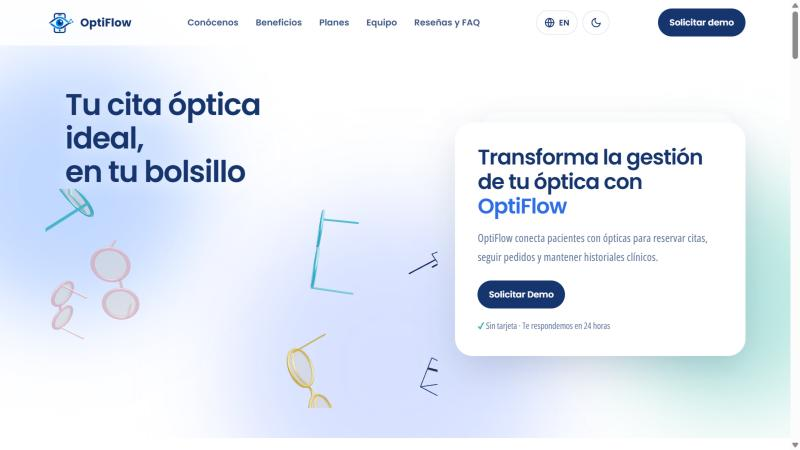

**Recomendación:**

Agregar en la sección principal y en la barra de navegación un botón por segmento, por ejemplo "Soy paciente: descarga la app" y "Tengo una óptica: solicita una demo", con enlace a la descarga de la aplicación.

**PROBLEMA #2:** La opción "Iniciar sesión" no permite ingresar

**Severidad:** 3

**Heurística violada:** Information Architecture - Is it usable?

**Problema:**

En el pie de página, la opción "Iniciar sesión" abre el formulario "Entra a tu óptica", que solicita correo y contraseña. Al presionar "Continuar", el usuario recibe un diálogo titulado "Solicitud lista" que indica que el acceso todavía no valida contraseñas. El usuario completa datos para una función que no está disponible y el título del mensaje no corresponde a la acción que realizó (ver Figura 174).

<a id="figura-174"></a>

**Figura 174**

*Mensaje mostrado después de intentar iniciar sesión desde la Landing Page*

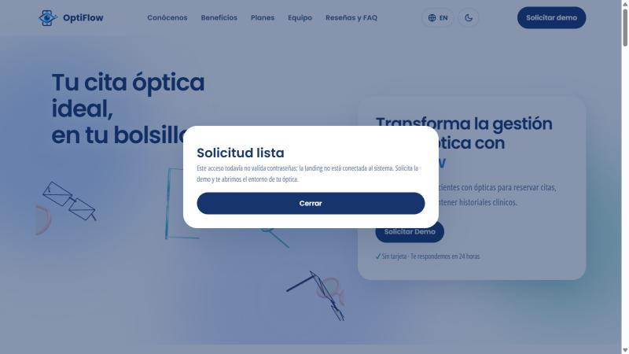

**Recomendación:**

Reemplazar la opción por un enlace a la aplicación móvil hasta que el acceso web esté conectado a los Web Services. Si se mantiene, avisar antes de pedir credenciales y usar un título acorde, como "Acceso no disponible".

**PROBLEMA #3:** Los diálogos de demo y de inicio de sesión no tienen botón para cerrar

**Severidad:** 2

**Heurística violada:** Usabilidad - Libertad y control del usuario

**Problema:**

Los diálogos "Solicita OptiFlow para tu óptica" y "Entra a tu óptica" solo se cierran con la tecla Esc o al hacer clic fuera de ellos. No muestran un botón "Cerrar" ni un ícono ×, a diferencia de los diálogos de privacidad y de términos. En un celular, donde no existe la tecla Esc, el usuario puede no saber cómo salir sin enviar el formulario (ver Figura 175).

<a id="figura-175"></a>

**Figura 175**

*Diálogo de solicitud de demo sin control para cerrarlo*

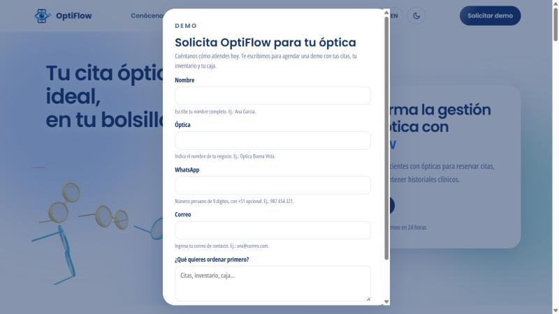

**Recomendación:**

Añadir un botón de cierre visible (×) en la esquina superior de todos los diálogos y un botón "Cancelar" junto a la acción principal.

**PROBLEMA #4:** El plan Básico ofrece "Empezar gratis" aunque es de pago

**Severidad:** 2

**Heurística violada:** Usabilidad - Consistencia y estándares

**Problema:**

El plan Básico cuesta S/ 49 al mes, pero su botón dice "Empezar gratis" y la página no explica si existe un periodo de prueba ni su duración. Además, el botón abre el mismo formulario de demo que los otros planes. El texto genera una expectativa que la página no cumple (ver Figura 176).

<a id="figura-176"></a>

**Figura 176**

*Sección de planes con el botón "Empezar gratis" en un plan de pago*

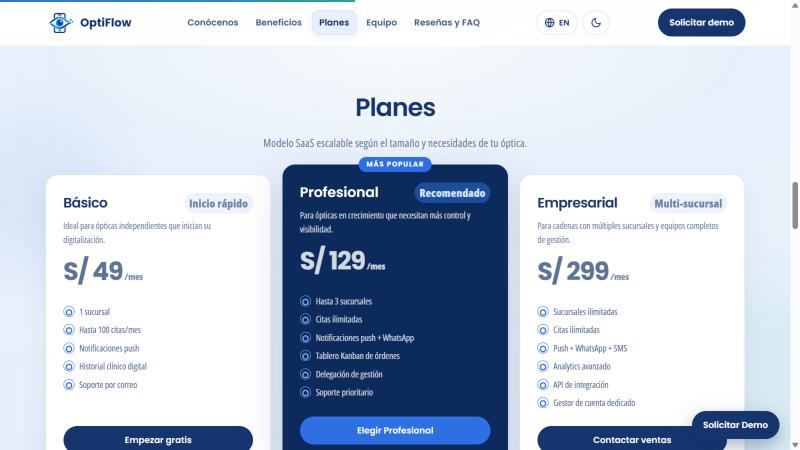

**Recomendación:**

Cambiar el texto a "Elegir Básico" o, si se ofrece una prueba gratuita, indicar su duración junto al precio (por ejemplo, "14 días gratis").

**PROBLEMA #5:** La sección de preguntas frecuentes contradice el uso de la aplicación

**Severidad:** 2

**Heurística violada:** Information Architecture - Is it credible?

**Problema:**

La respuesta a "¿Necesito instalar algo?" indica que no, porque OptiFlow funciona desde el celular y el navegador. Sin embargo, los beneficios de la página y la solución se basan en una aplicación Android que se debe instalar. La contradicción resta credibilidad a la información y no responde cómo obtener la aplicación (ver Figura 177).

<a id="figura-177"></a>

**Figura 177**

*Respuesta de la sección de preguntas frecuentes sobre la instalación*

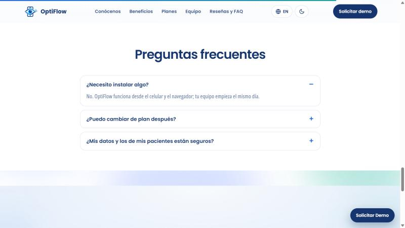

**Recomendación:**

Corregir la respuesta para indicar que pacientes y personal usan la aplicación Android, y agregar preguntas sobre cómo descargarla y cómo reservar una cita como paciente.

**PROBLEMA #6:** Textos de 8 px y contenido desplazado en celular

**Severidad:** 2

**Heurística violada:** Inclusive Design - Proporciona experiencias comparables

**Problema:**

En un ancho de 375 px, las etiquetas de las estadísticas ("Sin recordatorios", "Menos ausentismo" y "Menos tiempo") se muestran con un tamaño de 8 px, difícil de leer para personas mayores o con baja visión. Además, los fondos decorativos sobresalen del ancho de la pantalla, lo que deja una franja vacía a la derecha y descentra el contenido (ver Figura 178).

<a id="figura-178"></a>

**Figura 178**

*Sección de estadísticas de la Landing Page en un ancho de celular*

<p align="center">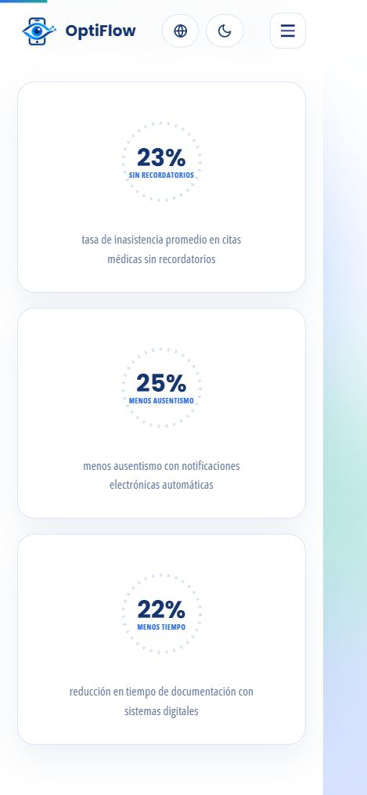</p>

**Recomendación:**

Usar un tamaño mínimo de 12 px (idealmente 14 px) en textos secundarios y recortar los elementos decorativos con `overflow-x: hidden` en el elemento `html` para evitar el desplazamiento horizontal.

**PROBLEMA #7:** Cancelar una cita no pide confirmación

**Severidad:** 3

**Heurística violada:** Usabilidad - Prevención de errores

**Problema:**

En "Detalle de cita", el texto "Cancelar cita" cancela la reserva con un solo toque, muestra el mensaje breve "Cita cancelada" y regresa a "Mis citas". No hay un diálogo de confirmación ni una opción para deshacer la acción, por lo que un toque accidental libera el horario y el paciente pierde su cita (ver Figura 179).

<a id="figura-179"></a>

**Figura 179**

*Detalle de la cita antes de cancelar (izquierda) y resultado inmediato después de un toque (derecha)*

<p align="center">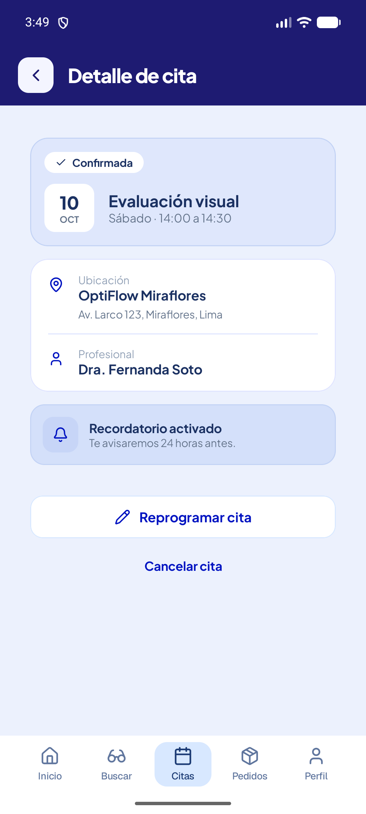 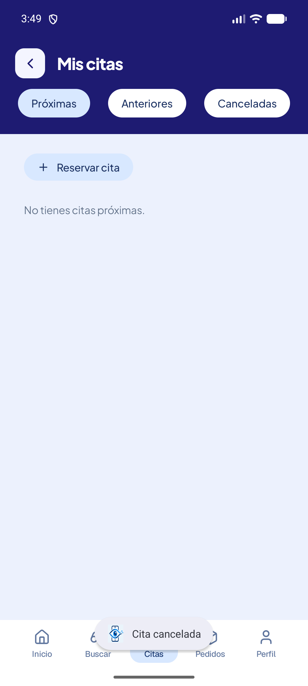</p>

**Recomendación:**

Mostrar un diálogo de confirmación con la fecha y hora de la cita y las opciones "Cancelar cita" y "Mantener cita". Presentar la acción como un botón con color de advertencia para diferenciarla de "Reprogramar cita".

**PROBLEMA #8:** La nueva cita del personal clínico tiene datos fijos

**Severidad:** 3

**Heurística violada:** Usabilidad - Libertad y control del usuario

**Problema:**

En "Nueva cita" del rol de personal clínico, los campos "Servicio", "Óptica / sucursal" y "Fecha" muestran una flecha de selección, pero no responden al tocarlos. La fecha permanece fija en "Miércoles, 20 de junio" (junio de 2025), por lo que el usuario solo puede elegir la hora y no puede agendar una cita en otra fecha, sede o servicio (ver Figura 180).

<a id="figura-180"></a>

**Figura 180**

*Pantalla "Nueva cita" del personal clínico con servicio, sucursal y fecha fijos*

<p align="center">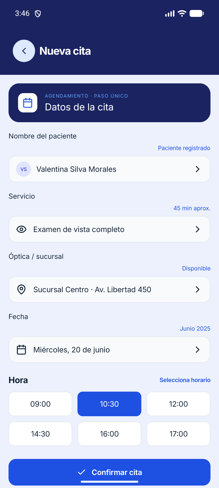</p>

**Recomendación:**

Implementar selectores reales: lista de servicios, sucursales obtenidas de los Web Services y un calendario con la disponibilidad de la óptica. Quitar la flecha de los campos que no sean editables.

**PROBLEMA #9:** El registro de pacientes usa formatos de Chile

**Severidad:** 2

**Heurística violada:** Usabilidad - Correspondencia entre el sistema y el mundo real

**Problema:**

El formulario "Registro rápido de paciente" muestra como ejemplos el teléfono "+56 9 8745 9210" y la identificación "RUT 18.942.105-K", que son formatos de Chile. Las ópticas y los pacientes de OptiFlow están en el Perú, donde se usa el prefijo +51 y el DNI de 8 dígitos, por lo que los ejemplos pueden inducir a registrar datos con un formato incorrecto (ver Figura 181).

<a id="figura-181"></a>

**Figura 181**

*Formulario de registro de pacientes del personal clínico*

<p align="center">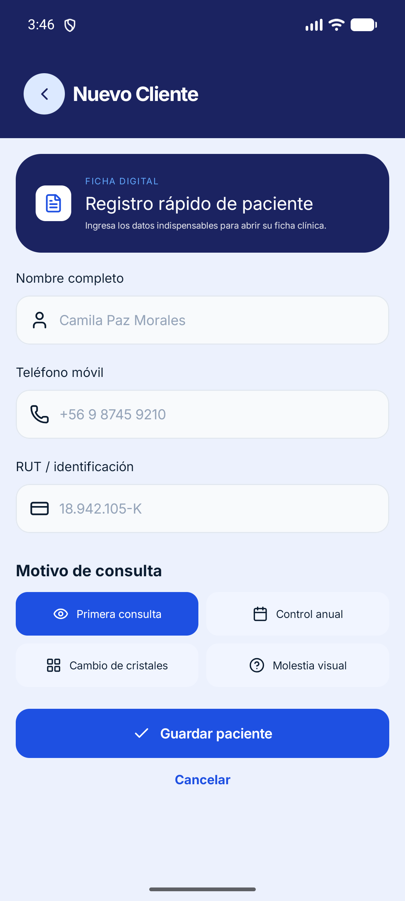</p>

**Recomendación:**

Usar ejemplos locales ("+51 987 654 321" y "DNI / CE") y validar 9 dígitos para el celular y 8 dígitos para el DNI.

**PROBLEMA #10:** La misma entidad se llama "paciente" y "cliente"

**Severidad:** 1

**Heurística violada:** Usabilidad - Consistencia y estándares

**Problema:**

En la pantalla de inicio del personal, el acceso rápido se llama "Nuevo paciente", pero la pantalla que abre se titula "Nuevo Cliente" y su encabezado dice "Registro rápido de paciente". Usar dos términos para la misma entidad genera dudas sobre si se registra a un paciente o a un cliente comercial (ver Figura 181).

**Recomendación:**

Usar el término "paciente" en todo el flujo, de acuerdo con el lenguaje ubicuo del proyecto.

**PROBLEMA #11:** Las opciones de ayuda no muestran contenido

**Severidad:** 2

**Heurística violada:** Usabilidad - Ayuda y documentación

**Problema:**

En "Mi Perfil", la opción "Ayuda y soporte" lleva a la pantalla "Configuración", y allí "Ayuda y documentación" no abre ningún contenido. Lo mismo ocurre con "Privacidad y seguridad", "Idioma" y "Términos y privacidad", y con "Ayuda y documentación" en el menú "Más" del personal clínico. Todas muestran una flecha que sugiere que llevan a otra pantalla (ver Figura 182).

<a id="figura-182"></a>

**Figura 182**

*Pantalla "Configuración" con opciones de ayuda sin contenido*

<p align="center">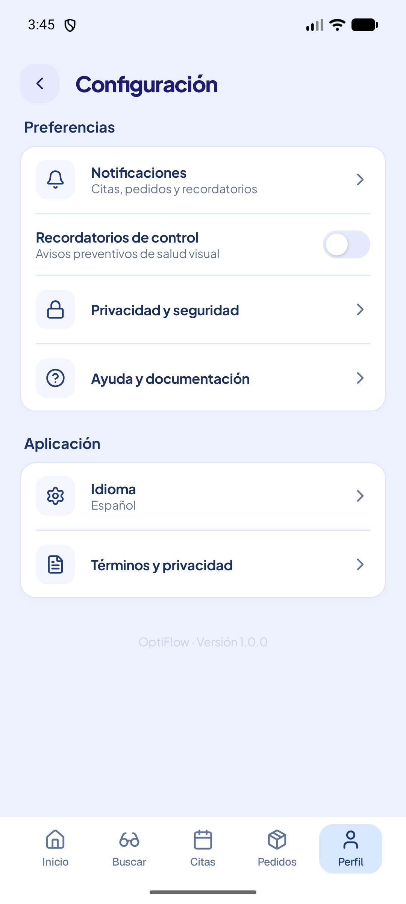</p>

**Recomendación:**

Crear una pantalla de ayuda con preguntas frecuentes y datos de contacto de la óptica (WhatsApp o correo). Mientras no exista, ocultar las opciones que no tienen contenido.

**PROBLEMA #12:** La pantalla de inicio muestra datos que no corresponden al paciente

**Severidad:** 3

**Heurística violada:** Usabilidad - Visibilidad del estado del sistema

**Problema:**

Una cuenta de paciente recién creada, sin recetas ni pedidos registrados, muestra en "Accesos rápidos" los indicadores "Mis recetas · 2 activas" y "Mis pedidos · 1 en camino". En "Mi Perfil", la misma cuenta indica "1 recetas disponibles". La información sobre el estado del paciente no corresponde a sus datos y no coincide entre pantallas (ver Figura 183).

<a id="figura-183"></a>

**Figura 183**

*Inicio (izquierda) y perfil (derecha) de una cuenta de paciente recién creada*

<p align="center">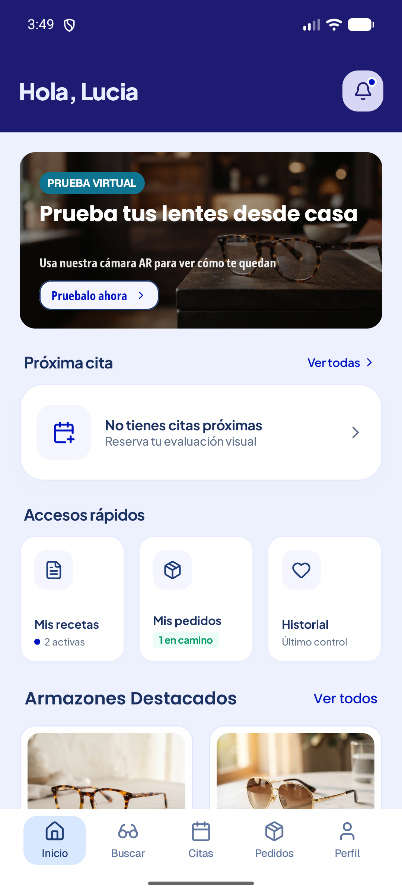 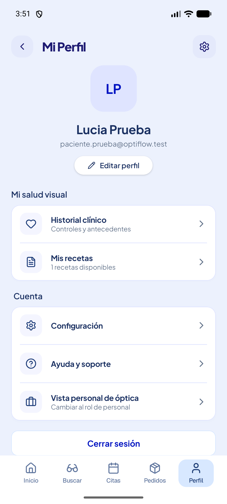</p>

**Recomendación:**

Obtener los indicadores de recetas y pedidos desde los Web Services (historias clínicas y órdenes de trabajo del paciente) y mostrar un estado vacío cuando no existan registros, por ejemplo "Aún no tienes recetas".

**PROBLEMA #13:** Un paciente puede cambiar a la vista del personal clínico sin credenciales

**Severidad:** 3

**Heurística violada:** Information Architecture - Is it credible?

**Problema:**

En "Mi Perfil", la opción "Vista personal de óptica" cambia a la experiencia del personal clínico (agenda, pacientes, inventario y ventas) sin pedir credenciales ni validar el rol. Un paciente puede acceder a información de la óptica, y la elección de rol al iniciar sesión pierde sentido, lo que afecta la confianza en el manejo de los datos (ver Figura 184).

<a id="figura-184"></a>

**Figura 184**

*Vista del personal clínico abierta desde el perfil de un paciente*

<p align="center">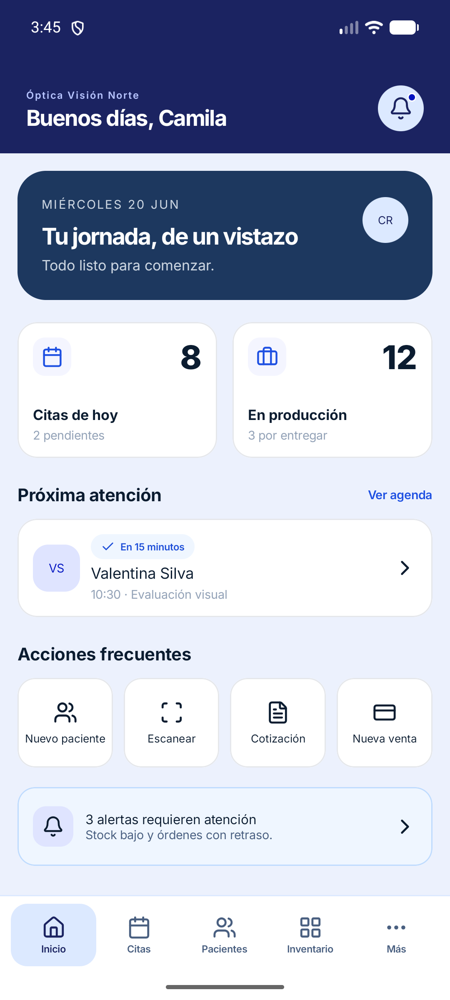</p>

**Recomendación:**

Retirar la opción del perfil del paciente. El acceso a la experiencia del personal clínico debe darse solo al iniciar sesión con una cuenta de personal autorizada.

**PROBLEMA #14:** Los botones de solo ícono no tienen etiqueta accesible

**Severidad:** 2

**Heurística violada:** Inclusive Design - Proporciona experiencias comparables

**Problema:**

Los botones que solo muestran un ícono, como el de notificaciones (campana) de la pantalla de inicio, la flecha para volver y el engranaje de configuración, no tienen descripción de contenido (*content description*) en el árbol de accesibilidad de Android. Un usuario que navega con un lector de pantalla, como TalkBack, escucha un botón sin nombre y no sabe qué acción realiza (ver Figura 185).

<a id="figura-185"></a>

**Figura 185**

*Pantalla de inicio del paciente con el botón de notificaciones sin etiqueta accesible*

<p align="center">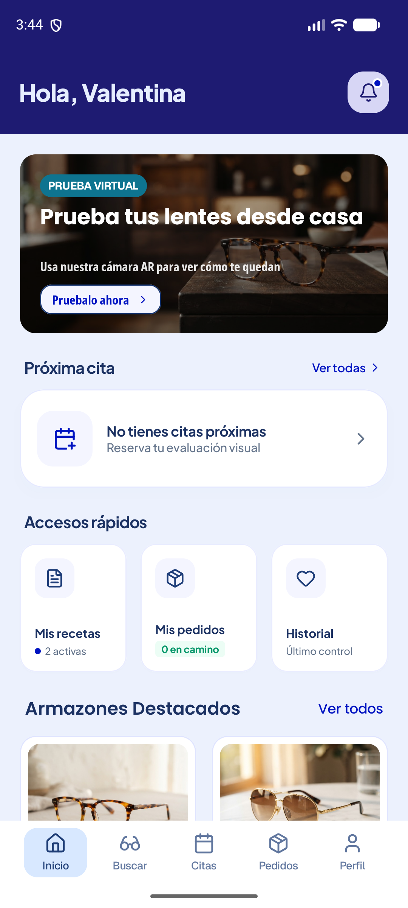</p>

**Recomendación:**

Añadir una `contentDescription` a cada botón de solo ícono (por ejemplo, "Notificaciones", "Volver" y "Configuración") para que el lector de pantalla anuncie su función.

**PROBLEMA #15:** Los montos se muestran en una moneda que no corresponde al Perú

**Severidad:** 2

**Heurística violada:** Usabilidad - Correspondencia entre el sistema y el mundo real

**Problema:**

En el rol de personal clínico, la pantalla "Nueva cotización" muestra precios como "$89.900" y la pantalla "Reportes" muestra ventas totales de "$8.460.200", con el símbolo de dólar y el punto como separador de miles, formato propio del peso chileno. La Landing Page presenta los planes en soles (S/), y las ópticas y pacientes de OptiFlow pagan en soles, por lo que los montos pueden interpretarse de forma incorrecta (ver Figura 186).

<a id="figura-186"></a>

**Figura 186**

*Montos en las pantallas "Nueva cotización" (izquierda) y "Reportes" (derecha)*

<p align="center">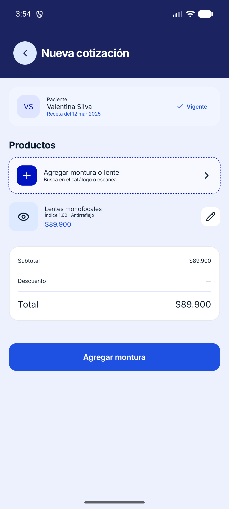 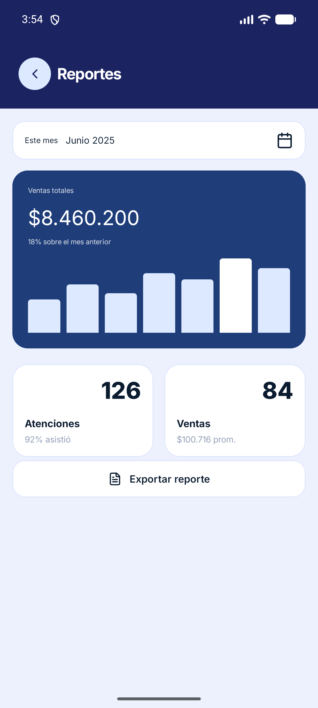</p>

**Recomendación:**

Mostrar todos los montos en soles con el formato peruano (por ejemplo, "S/ 899.00"), usando un formateador de moneda con la configuración regional `es-PE`, igual que en la Landing Page.

#### Seguimiento de las observaciones para AV2

Los hallazgos anteriores se mantienen con sus capturas y severidad. Un cambio de estilos o de navegación en el repositorio no basta para cerrar una observación: se debe repetir la tarea sobre la versión entregada y registrar el resultado. Las pruebas técnicas de 4.2.2 detectaron además dos problemas de integración: rutas antiguas del cliente Flutter y ausencia del encabezado de autenticación en sus solicitudes protegidas.

<!-- EQUIPO: completar la reevaluación con el APK de AV2 y los usuarios entrevistados. -->

La Tabla 138 permite dejar constancia del cierre o de la persistencia de cada observación sin modificar la evidencia histórica.

<a id="tabla-138"></a>

**Tabla 138**

*Seguimiento de validación y compatibilidad para AV2*

| Referencia | Qué debe comprobarse | Versión / fecha | Resultado de la repetición | Evidencia y responsable |
|---|---|---|---|---|
| Hallazgos de la Landing Page | CTA, accesibilidad, navegación y lectura en móvil. | | | |
| Hallazgos de la aplicación anterior | Repetir las tareas en el cliente que se entregará, sin trasladar automáticamente el resultado entre tecnologías. | | | |
| Compatibilidad del contrato | Rutas `/api/v1`, respuesta de autenticación y encabezado Bearer del cliente Flutter. | | | |
| Datos de demostración | Mostrar qué pantallas usan datos locales y cuáles confirman información persistida. | | | |
| Instalación y acceso | APK distribuido, dispositivo de prueba y conexión con la revisión del backend. | | | |
