<div style="break-before: page; page-break-before: always;"></div>

# Capítulo IV: Product Implementation & Validation

## 4. Product Implementation & Validation

Este capítulo presenta la configuración de trabajo, los incrementos de implementación y la validación de OptiFlow. El Sprint 1 conserva las evidencias de la aplicación Android y de la primera integración de búsqueda y reserva. El Sprint 2 documenta los avances de AV2: contrato REST versionado, seguridad, ubicación de ópticas, ajustes de la Landing Page y publicación del cliente Flutter.

Cada evidencia identifica la versión del producto y el entorno de ejecución.

**Recorrido del capítulo:** [configuración](#41-software-configuration-management), [Sprint 1](#421-sprint-1), [Sprint 2](#422-sprint-2) y [validación](#43-validation-interviews).

### 4.1. Software Configuration Management

#### 4.1.1. Software Development Environment Configuration

Esta sección describe las herramientas del entorno de trabajo y su función en el diseño, desarrollo, documentación y validación de OptiFlow.

##### Figma


El logo de Figma se presenta en la Figura 115.

<a id="figura-115"></a>

**Figura 115**

*Logo de Figma*


Se utiliza para definir el diseño de la Landing Page y de la aplicación móvil: wireframes, mock-ups y prototipo interactivo con la simulación de navegación entre pantallas (Figma, s. f.).

Ruta de referencia: https://www.figma.com

##### Android Studio


El logo de Android Studio se observa en la Figura 116.

<a id="figura-116"></a>

**Figura 116**

*Logo de Android Studio*


En el Sprint 1 se utilizó como entorno de desarrollo integrado (IDE) del cliente Android/Kotlin. Además, se emplean el Android SDK, Gradle para la gestión de dependencias y la compilación, el Android Emulator para pruebas durante el desarrollo y un dispositivo físico con depuración USB para validar el funcionamiento real de la aplicación. Ese cliente se desarrolla en Kotlin, cuya adopción en proyectos Android resulta costo-efectiva frente a Java sin afectar la calidad percibida por los usuarios (Coppola et al., 2025), y su interfaz se construye con Jetpack Compose (Google, s. f.-d). El proyecto fija una versión mínima del SDK (API 26), porque la evolución de la API de Android genera problemas de compatibilidad que deben controlarse durante el desarrollo (Mahmud et al., 2024).

Ruta de descarga: https://developer.android.com/studio

##### Docker


El logo de Docker se muestra en la Figura 117.

<a id="figura-117"></a>

**Figura 117**

*Logo de Docker*


Se utiliza para empaquetar el backend (Web Services) en una imagen construida a partir de un `Dockerfile` de dos etapas, de modo que el despliegue sea reproducible y no dependa de la configuración de cada equipo (Docker, s. f.).

Ruta de descarga: https://www.docker.com/products/docker-desktop

##### Structurizr


El logo de Structurizr se presenta en la Figura 118.

<a id="figura-118"></a>

**Figura 118**

*Logo de Structurizr*


Se utiliza para elaborar los diagramas de arquitectura de software del Modelo C4 (Context, Container, Component y Deployment).

Ruta de referencia: https://structurizr.com

##### Miro


El logo de Miro se observa en la Figura 119.

<a id="figura-119"></a>

**Figura 119**

*Logo de Miro*


Se utiliza como pizarra colaborativa para las sesiones de EventStorming: Big Picture, Candidate Context Discovery y modelado de Domain Message Flows.

Ruta de referencia: https://miro.com

##### Flutter y Dart

Para AV2 se incorpora [Logix-OptiFlow-Flutter](https://github.com/BL-App-Movil-1ACC0238-2620-4951/Logix-OptiFlow-Flutter). La revisión `0344413` define la versión `1.0.0+1` y exige Dart `>=3.5.0 <4.0.0`. Utiliza `go_router` para las rutas, `provider` para el estado, `http` para las solicitudes y `shared_preferences` para datos locales de sesión y preferencias. Las dependencias se encuentran declaradas en `pubspec.yaml`.

La configuración y los comandos de Flutter se documentan por separado de Gradle y Android Studio, utilizados por el cliente Kotlin del Sprint 1. Las herramientas se obtienen de la [instalación de Flutter](https://docs.flutter.dev/install) y se comprueban con `flutter --version` y `flutter doctor`; la [referencia de la CLI](https://docs.flutter.dev/reference/flutter-cli) describe los comandos de análisis, pruebas y construcción. **Versión de Flutter empleada para el APK de AV2:** ____________________.

##### Desarrollo y pruebas de servicios

El backend utiliza Java 21 y Maven. El JDK compila y ejecuta los servicios; Maven resuelve dependencias, compila, ejecuta pruebas y empaqueta el JAR. Las versiones del proyecto se encuentran en `pom.xml` y `Dockerfile`. Referencias: [Java](https://dev.java/learn/) y [Maven](https://maven.apache.org/).

PostgreSQL es la base compartida del entorno desplegado. Flyway aplica las migraciones y JPA valida su correspondencia con las entidades. H2 se utiliza en el perfil local de esta revisión; una ejecución con H2 no sustituye la verificación de migraciones en PostgreSQL. Referencias: [PostgreSQL](https://www.postgresql.org/docs/) y [Flyway](https://documentation.red-gate.com/fd).

Las pruebas del backend emplean JUnit, Spring Boot Test y MockMvc para reglas y solicitudes HTTP; Cucumber relaciona escenarios Gherkin con Steps en Java. Swagger UI permite consultar e interactuar con la especificación generada por springdoc. Referencias: [JUnit](https://junit.org/junit5/docs/current/user-guide/), [Spring Boot Testing](https://docs.spring.io/spring-boot/reference/testing/index.html), [Cucumber](https://cucumber.io/docs/) y [springdoc](https://springdoc.org/).

##### Colaboración y publicación

Git y GitHub registran código, documentación, ramas y Pull Requests. El Board organiza las historias y tareas de cada Sprint. GitHub Actions publica la Landing en GitHub Pages. Render aloja los servicios y Firebase App Distribution conserva la distribución Android del primer incremento. Estas herramientas cumplen funciones distintas de seguimiento, automatización, ejecución y entrega. Referencias: [Git](https://git-scm.com/), [GitHub](https://github.com/), [GitHub Pages](https://docs.github.com/en/pages), [Render](https://render.com/docs) y [Firebase App Distribution](https://firebase.google.com/docs/app-distribution).

#### 4.1.2. Source Code Management

El equipo utiliza **Git** para el control de versiones y **GitHub** para alojar los repositorios y colaborar sobre el código y la documentación (GitHub, s. f.). Los productos se agrupan en la organización [BL-App-Movil-1ACC0238-2620-4951](https://github.com/BL-App-Movil-1ACC0238-2620-4951). Los historiales de commits permiten relacionar los cambios registrados con sus autores y fechas.

##### Repositorios del proyecto


Los repositorios del proyecto se detallan en la Tabla 106.

<a id="tabla-106"></a>

**Tabla 106**

*Repositorios del proyecto*


| Producto | Repositorio |
|---|---|
| Informe del proyecto | [Logix-OptiFlow-Report](https://github.com/BL-App-Movil-1ACC0238-2620-4951/Logix-OptiFlow-Report) |
| Landing Page | [Logix-OptiFlow-landing-page](https://github.com/BL-App-Movil-1ACC0238-2620-4951/Logix-OptiFlow-landing-page) |
| Web Services | [Logix-OptiFlow-Back-End](https://github.com/BL-App-Movil-1ACC0238-2620-4951/Logix-OptiFlow-Back-End) |
| Aplicación Android (Kotlin) | [Logix-OptiFlow-Mobile](https://github.com/BL-App-Movil-1ACC0238-2620-4951/Logix-OptiFlow-Mobile) |
| Aplicación Flutter (AV2, en desarrollo) | [Logix-OptiFlow-Flutter](https://github.com/BL-App-Movil-1ACC0238-2620-4951/Logix-OptiFlow-Flutter) |

El informe utiliza ramas por alcance y Pull Requests hacia `develop`. La revisión del Sprint 2 identifica también los repositorios que publican directamente en `main`, como Flutter y la Landing Page, sin atribuirles un flujo de integración que no consta en el historial.

##### Flujo de trabajo con GitFlow

Se establece **GitFlow** como convención para organizar el desarrollo en ramas con responsabilidades definidas. La Tabla 107 describe la política de integración; los historiales de cada producto muestran qué ramas se utilizaron en cada Sprint.


Las ramas del flujo de trabajo GitFlow se presentan en la Tabla 107.

<a id="tabla-107"></a>

**Tabla 107**

*Ramas del flujo de trabajo GitFlow*


| Rama | Propósito | Convención de nombre |
|---|---|---|
| `main` | Contiene las versiones estables y publicadas del producto. | `main` |
| `develop` | Rama de integración donde se reúnen las funcionalidades terminadas. | `develop` |
| `feature/*` | Desarrollo de cada funcionalidad o User Story en su propia rama. | `feature/<descripcion-en-ingles>`, por ejemplo `feature/login-screen` |
| `release/*` | Preparación de una nueva versión antes de publicarla. | `release/<version>`, por ejemplo `release/1.0.0` |
| `hotfix/*` | Corrección urgente de errores detectados en `main`. | `hotfix/<descripcion-en-ingles>`, por ejemplo `hotfix/fix-token-validation` |

La política de trabajo establece Pull Requests hacia `develop` para integrar funcionalidades, con revisión de otro integrante antes de incorporarlas. Flutter y la Landing Page mantienen sus historiales publicados en `main`.

Los mensajes siguen [Conventional Commits 1.0.0](https://www.conventionalcommits.org/en/v1.0.0/): `type(scope): description`, con alcance opcional. Se usan `feat` para funcionalidades, `fix` para correcciones, `test` para pruebas, `docs` para documentación, `refactor` para reorganización y `ci` para automatización. Por ejemplo, `test(auth): verify patient access restrictions`. El cuerpo puede explicar en español lo que cambia. Un cambio incompatible se señala con `!` o con un pie `BREAKING CHANGE:`. Los mensajes históricos se conservan tal como fueron publicados.

Las entregas adoptan [Semantic Versioning 2.0.0](https://semver.org/spec/v2.0.0.html), con formato `MAJOR.MINOR.PATCH`: una corrección compatible incrementa PATCH; una funcionalidad compatible, MINOR; y un cambio incompatible en una API estable, MAJOR. Las ramas de preparación siguen `release/<version>` y la publicación puede identificarse con una etiqueta `v<version>`, asociada con su commit. El cambio de rutas a `/api/v1` debe comunicarse a los clientes aunque el backend todavía declare `0.1.0` en Maven. La versión del artefacto se registra junto con su commit y enlace de distribución.

#### 4.1.3. Source Code Style Guide & Conventions

Las guías de estilo buscan mantener el código legible y consistente entre los integrantes, lo que favorece la mantenibilidad, una de las características de calidad del producto de software (International Organization for Standardization, 2023). Los identificadores de clases, funciones, variables, archivos y ramas se definen en **inglés**. La documentación y la explicación del cuerpo de los commits pueden redactarse en español para describir con claridad el propósito del cambio.

##### Guías de estilo por lenguaje


Las guías de estilo por lenguaje se resumen en la Tabla 108.

<a id="tabla-108"></a>

**Tabla 108**

*Guías de estilo por lenguaje*


| Lenguaje | Producto | Guía adoptada |
|---|---|---|
| Dart | Cliente Flutter | [Effective Dart: Style](https://dart.dev/effective-dart/style) |
| Kotlin | Aplicación Android | [Kotlin Coding Conventions](https://kotlinlang.org/docs/coding-conventions.html) |
| Java | Web Services | [Google Java Style Guide](https://google.github.io/styleguide/javaguide.html) |
| HTML, CSS y JavaScript | Landing Page | [Google HTML/CSS Style Guide](https://google.github.io/styleguide/htmlcssguide.html) |
| Gherkin | Archivos `.feature` de pruebas de aceptación | [Gherkin Conventions for Readable Specifications](https://specflow.org/gherkin/gherkin-conventions-for-readablespecifications/) |

##### Convenciones de nomenclatura


Las convenciones de nomenclatura se detallan en la Tabla 109.

<a id="tabla-109"></a>

**Tabla 109**

*Convenciones de nomenclatura*


| Elemento | Convención | Ejemplo |
|---|---|---|
| Clases, interfaces y enumeraciones | `PascalCase` | `AppointmentRepository` |
| Funciones, métodos y variables | `camelCase` | `getUpcomingAppointments` |
| Constantes | `UPPER_SNAKE_CASE` | `MAX_RETRY_COUNT` |
| Paquetes | minúsculas, sin guiones bajos | `com.optiflow.booking` |
| Archivos CSS y de la Landing Page | `kebab-case` | `main-header.css` |
| Archivos `.feature` | `snake_case` o `kebab-case` en inglés | `book-appointment.feature` |
| Rutas de la API REST | sustantivos en plural, `kebab-case`, con el prefijo `/api/v1` | `/api/v1/work-orders/{id}/status` |

Las rutas de la API REST identifican recursos y no contienen verbos. Las operaciones usan `GET` para consultar, `POST` para crear, `PUT` para reemplazar y `PATCH` para actualizar parcialmente; los cambios de estado se registran con `PATCH .../status` y los filtros se envían como parámetros de consulta (por ejemplo, `minRating` en `GET /api/v1/optical-stores`), y no forman parte de la ruta. Las respuestas usan los códigos `200`, `201` con el encabezado `Location`, `204`, `400`, `401`, `403`, `404` y `409`, y los errores se devuelven con la estructura `ApiError`. Los reportes se descargan en CSV desde la misma ruta enviando `Accept: text/csv`, y el inicio de sesión se realiza con `POST /api/v1/auth/tokens`, porque crea un token de acceso.

En Flutter se emplean archivos en `snake_case`, clases en `UpperCamelCase` y miembros en `lowerCamelCase`. La revisión separa los modelos, el cliente HTTP, el controlador de estado, las pantallas y los componentes visuales. El cliente debe diferenciar datos de demostración y respuestas de servicio, comunicar errores y adjuntar el token cuando una operación lo requiere. El análisis estático se realiza con `flutter analyze` y las pruebas con `flutter test`.

##### Organización del código

El backend se organiza en Domain, Application, Interface e Infrastructure por contexto, como se describe en el capítulo II. Los clientes móviles conservan su propia estructura: Kotlin para el primer incremento y `lib/models`, `lib/data`, `lib/state`, `lib/screens` y `lib/widgets` en Flutter.

#### 4.1.4. Software Deployment Configuration

La Landing Page se publica en **GitHub Pages**, los Web Services se despliegan en **Render** mediante Docker (Render, s. f.) y la aplicación móvil se distribuye a través de **Firebase App Distribution** (Google, s. f.-b). Además, el backend se integra con la Pasarela de Pagos y con **Firebase Cloud Messaging** (Google, s. f.-c), y la aplicación móvil con **OpenStreetMap** mediante osmdroid (OpenStreetMap Foundation, s. f.; osmdroid, s. f.), la base de datos local Room (Google, s. f.-f), la cámara mediante CameraX (Google, s. f.-a) y ML Kit (Google, s. f.-e), que lee los códigos de barras y detecta el rostro en el propio dispositivo. A continuación se describe la configuración de cada producto; la evidencia de cada despliegue se presenta en las secciones 4.2.1.8 (Sprint 1) y 4.2.2.8 (Sprint 2). La aplicación Flutter de AV2 se encuentra en desarrollo y su configuración se describe por separado.

##### Landing Page

La revisión `ef1c032` contiene ajustes de accesibilidad, estilos y el workflow de publicación. La configuración de GitHub Pages se revisa en el repositorio [Logix-OptiFlow-landing-page](https://github.com/BL-App-Movil-1ACC0238-2620-4951/Logix-OptiFlow-landing-page). La URL registrada es [Landing Page de OptiFlow](https://bl-app-movil-1acc0238-2620-4951.github.io/Logix-OptiFlow-landing-page/). La ejecución de Pages del commit `ef1c032` y la página pública se comprobaron el 08/11/2026; las capturas están en 4.2.2.8. La correspondencia del APK enlazado con la versión Flutter sigue por verificar.

Para reproducir la publicación de la Landing:

1. Revisar el commit de `main` y los archivos estáticos de la raíz.
2. Seleccionar GitHub Actions como origen de Pages y conservar el workflow `.github/workflows/static.yml`, que prepara Pages, carga el artefacto y ejecuta el despliegue.
3. Revisar la ejecución y su entorno `github-pages`; abrir la URL publicada en escritorio y móvil.
4. Comprobar los enlaces y la descarga del APK de la entrega. El resultado observado se registra en 4.2.2.8.

##### Web Services

El backend se construye con Maven y Java 21 y se empaqueta mediante el `Dockerfile`. El perfil `postgres` obtiene la conexión de `SPRING_DATASOURCE_URL`, `SPRING_DATASOURCE_USERNAME` y `SPRING_DATASOURCE_PASSWORD`; Flyway aplica las migraciones y JPA valida el esquema. Los valores de credenciales se configuran en el entorno y no se incluyen en las evidencias.

1. Se parte de la rama `develop` del repositorio de los Web Services; Render vuelve a desplegar el servicio cada vez que esta rama se actualiza.
2. Render construye la imagen con el `Dockerfile` del repositorio: compila el proyecto con Maven y ejecuta el JAR generado sobre Java 21.
3. El servicio se conecta a una base de datos PostgreSQL 16 administrada por Render. Las credenciales se registran como variables de entorno (`SPRING_DATASOURCE_URL`, `SPRING_DATASOURCE_USERNAME` y `SPRING_DATASOURCE_PASSWORD`) y no se incluyen en el repositorio.
4. La clave de firma de los tokens de sesión se registra como `JWT_SECRET`; los tokens expiran a las 24 horas (`PT24H` en `application.yml`).
5. Las credenciales de los servicios externos también se registran como variables de entorno: el token de acceso de prueba de Mercado Pago Checkout Pro (`MERCADOPAGO_ACCESS_TOKEN`; Mercado Pago, s. f.), la clave secreta con la que se valida la firma de sus notificaciones (`MERCADOPAGO_WEBHOOK_SECRET`) y la cuenta de servicio de Firebase (`FIREBASE_CREDENTIALS`) que el backend usa para enviar notificaciones con Firebase Cloud Messaging.
6. En el panel de desarrolladores de Mercado Pago se registra como URL de notificaciones la ruta pública `https://logix-optiflow-back-end.onrender.com/api/v1/payment-notifications`. Las URL de retorno de cada preferencia de pago usan el deep link `optiflow://payment-result`, que devuelve al paciente a la aplicación.
7. Se verifica el despliegue en la documentación OpenAPI publicada con Swagger UI (SmartBear Software, s. f.): [https://logix-optiflow-back-end.onrender.com/swagger-ui/index.html](https://logix-optiflow-back-end.onrender.com/swagger-ui/index.html).

La revisión `41bcb44`, consultada el 10/11/2026, publica las rutas de negocio bajo `/api/v1`. El registro de pacientes y la creación de tokens son públicos; las operaciones protegidas requieren un token y verifican los roles autorizados para cada recurso. La documentación se genera en `/v3/api-docs` y se visualiza en `/swagger-ui/index.html`. El perfil local utiliza H2; las capturas de 4.2.2 se tomaron en una instancia aislada, distinta de Render.

El código revisado contiene las migraciones V1 a V9 y 27 tablas en una base PostgreSQL compartida. V6 incorpora inventario, V7 registra dispositivos para notificaciones y V9 amplía el pago de ventas. Los adaptadores de pagos y mensajería push tienen pruebas automatizadas; su ejecución con proveedores reales requiere la configuración del entorno. Render aplica las migraciones con Flyway al iniciar el servicio sobre PostgreSQL.

##### Aplicación móvil (Kotlin)

1. Se parte de la rama `develop` del repositorio de la aplicación móvil.
2. Se configuran los servicios que usa la aplicación: el archivo `app/google-services.json` del proyecto de Firebase para recibir notificaciones de Firebase Cloud Messaging. El mapa (OpenStreetMap con osmdroid), el escáner y el probador virtual (ML Kit en el dispositivo) no requieren claves. La URL del backend de cada variante puede cambiarse en `local.properties` (`api.base.url.local` y `api.base.url.prod`), que no se incluye en el repositorio. El `AndroidManifest.xml` declara un `intent-filter` para el deep link `optiflow://payment-result`, que abre la pantalla del resultado del pago al volver de Mercado Pago Checkout Pro.
3. La firma del release usa un keystore propio del equipo que no se incluye en el repositorio: `local.properties` indica en `release.signing.properties` la ruta del archivo con el keystore, el alias y las contraseñas. Si ese archivo no existe, el release se genera sin firmar.
4. Se genera el APK de la variante `prodRelease`, que consume los Web Services desplegados en Render, con `./gradlew assembleProdRelease` o desde **Build Variants** en Android Studio. El APK queda en `app/build/outputs/apk/prod/release/app-prod-release.apk`.
5. El APK se carga en **Firebase App Distribution** dentro del proyecto `optiflow-d5022` y la versión se distribuye al grupo `optiflow-testers`, formado por los integrantes del equipo.
6. Los evaluadores reciben la invitación por correo o se unen al grupo mediante el vínculo de invitación [https://appdistribution.firebase.dev/i/89d115baa19a781a](https://appdistribution.firebase.dev/i/89d115baa19a781a), e instalan la aplicación en sus dispositivos Android. Cada versión nueva aumenta `versionCode` en `app/build.gradle.kts` para instalarse sobre la anterior.

##### Aplicación Flutter (AV2)

El cliente Flutter de AV2 se configura mediante `--dart-define=API_BASE_URL=...`. Antes de construir el APK, se deben adaptar y comprobar las subrutas, el formato de sesión y el encabezado Bearer descritos en 4.2.2.4. Después se ejecutan el análisis y las pruebas, se genera la versión elegida y se instala en un dispositivo para verificar el flujo. La versión y el enlace de distribución se registran en 4.2.2.8. El proyecto publicado utiliza `shared_preferences`; no se afirma que incluya Room o que sus vistas de demostración estén conectadas a todos los módulos del backend.

##### Deployment Diagram

El Deployment Diagram muestra los nodos de publicación y ejecución de OptiFlow: GitHub Pages para la Landing Page, Render para el backend y su base de datos PostgreSQL, Firebase App Distribution para distribuir la aplicación a los dispositivos Android, y los servicios externos con los que se integran el backend (Pasarela de Pagos y Firebase Cloud Messaging) y la aplicación móvil (OpenStreetMap). Es el mismo diagrama de la sección 2.5.3.3. La evidencia de los entornos utilizados se presenta en la sección 4.2.1.8 (ver Figura 120).


<a id="figura-120"></a>

**Figura 120**

*Deployment Diagram de OptiFlow*


<a id="42-landing-page--mobile-application-implementation"></a>

## 4.2. Landing Page, Services & Applications Implementation
### 4.2.1. Sprint 1
Durante el Sprint 1, el equipo inició la implementación de OptiFlow con dos prioridades: publicar la Landing Page y desarrollar el flujo del paciente para buscar ópticas y reservar una cita de atención optométrica. Este incremento establece una primera integración entre la aplicación móvil y los Web Services, cuyo comportamiento se documenta mediante evidencias de desarrollo, pruebas y ejecución.

Siguiendo el marco de trabajo Scrum (Schwaber & Sutherland, 2020), el trabajo del Sprint se organiza mediante reuniones virtuales realizadas a través de Discord, seguimiento de actividades mediante el Sprint Backlog y control de versiones a través de los repositorios de GitHub de la organización del equipo.

El alcance funcional comprometido en el Sprint 1 se concentra en las User Stories US05 y US06.
#### 4.2.1.1. Sprint Planning 1
El Sprint Planning 1 tuvo como finalidad establecer el objetivo de la primera iteración, seleccionar las User Stories que contribuyen directamente a dicho objetivo, determinar la capacidad inicial del equipo y distribuir las principales responsabilidades de implementación.

La reunión se realizó de manera virtual mediante Discord y fue preparada por Celis Berrospi, Eslander. Debido a que Sprint 1 representa la primera iteración de implementación de la solución, no existe un Sprint anterior sobre el cual realizar un Sprint Review o Sprint Retrospective formal (ver Tabla 110).


<a id="tabla-110"></a>

**Tabla 110**

*Sprint Planning 1*


<table>
<tbody>
<tr><th>Sprint #</th><td>Sprint 1</td></tr>
<tr><th colspan="2">Sprint Planning Background</th></tr>
<tr><th>Date</th><td>2026-09-28</td></tr>
<tr><th>Time</th><td>07:00 PM</td></tr>
<tr><th>Location</th><td>Discord</td></tr>
<tr><th>Prepared By</th><td>Celis Berrospi, Eslander</td></tr>
<tr><th>Attendees (to planning meeting)</th><td>Atoche Gonzales, Nicolas Fernando / Becerra Ttito, Felix Orlando / Celis Berrospi, Eslander / Morocho Pinedo, Mariana / Quispe Llacsahuanga, César Augusto</td></tr>
<tr><th>Sprint 0 Review Summary</th><td>No aplica, debido a que Sprint 1 corresponde a la primera iteración de implementación de OptiFlow. Antes del inicio de este Sprint, el equipo desarrolló las actividades de investigación, análisis de los segmentos objetivo, especificación de requisitos, Domain-Driven Design, arquitectura de software y diseño UX/UI que sirven como base para la implementación del producto.</td></tr>
<tr><th>Sprint 0 Retrospective Summary</th><td>No se realizó una retrospectiva formal debido a que no existió un Sprint de implementación anterior. Sin embargo, a partir del trabajo realizado durante las etapas previas, el equipo identificó la necesidad de distribuir claramente las responsabilidades, dividir el trabajo en tareas de corta duración, mantener una comunicación constante mediante Discord y conservar la trazabilidad del desarrollo mediante GitHub.</td></tr>
<tr><th colspan="2">Sprint Goal &amp; User Stories</th></tr>
<tr><th>Sprint 1 Goal</th><td>Nuestro enfoque consiste en ofrecer a los pacientes una primera experiencia integrada para encontrar ópticas y programar una atención optométrica, junto con una Landing Page que comunique la propuesta de valor de OptiFlow. Consideramos que este incremento facilitará la consulta de establecimientos y la organización de citas. El cumplimiento se verificará cuando un paciente pueda consultar ópticas, seleccionar un horario disponible y obtener la confirmación de su reserva desde la aplicación móvil; cuando el servicio rechace una segunda reserva del mismo horario; y cuando las secciones y la navegación de la Landing Page puedan demostrarse en escritorio y móvil.</td></tr>
<tr><th>Sprint 1 Velocity</th><td>13 Story Points de capacidad planificada, según el registro inicial del equipo.</td></tr>
<tr><th>Sum of Story Points</th><td>13 Story Points: US05 (5) y US06 (8), según el Product Backlog del Capítulo II.</td></tr>
</tbody>
</table>

El alcance estimado en Story Points corresponde a US05 y US06. Las actividades de la Landing Page se incluyen como tareas adicionales. El registro e inicio de sesión del paciente permiten ejecutar la reserva; se documentan como soporte a este flujo y se distinguen de US01, cuyo actor en el Product Backlog es el personal de la óptica.

#### 4.2.1.2. Aspect Leaders and Collaborators
Para organizar las responsabilidades del Sprint se establece una Leadership-and-Collaboration Matrix (LACX). La matriz identifica al integrante responsable de liderar cada aspecto y a los integrantes que participan como colaboradores.

Los principales aspectos considerados durante Sprint 1 son la implementación del Landing Page, la experiencia móvil de búsqueda de ópticas, el flujo móvil de reserva de citas, los servicios asociados a Search & Booking y la integración y coordinación general del Sprint (ver Tabla 111).


<a id="tabla-111"></a>

**Tabla 111**

*Aspect leaders y colaboradores del Sprint 1*


| Team Member (Last Name, First Name) | GitHub Username | Landing Page<br>Leader (L) / Collaborator (C) | Optical Store Search<br>Leader (L) / Collaborator (C) | Appointment Booking<br>Leader (L) / Collaborator (C) | Search & Booking Services<br>Leader (L) / Collaborator (C) | Integration & Sprint Coordination<br>Leader (L) / Collaborator (C) |
| :--- | :--- | :---: | :---: | :---: | :---: | :---: |
| Atoche Gonzales, Nicolas Fernando | `THECOMAX` | C | **L** | C | C | C |
| Becerra Ttito, Felix Orlando | `Felixb14` | C | C | C | **L** | C |
| Celis Berrospi, Eslander | `Eslander-Celis` | C | C | C | C | **L** |
| Morocho Pinedo, Mariana | `Patto04` | C | C | **L** | C | C |
| Quispe Llacsahuanga, César Augusto | `user20-bit` | **L** | C | C | C | C |

**L:** Leader  
**C:** Collaborator

Cada aspecto cuenta con un líder y colaboradores. La matriz expresa la distribución de responsabilidades del Sprint; las contribuciones de implementación se presentan mediante los commits de la sección 4.2.1.4.

#### 4.2.1.3. Sprint Backlog 1

El Sprint Backlog reúne las tareas de búsqueda de ópticas y reserva de citas correspondientes a US05 y US06, junto con las actividades adicionales de la Landing Page. La tabla conserva las estimaciones y responsabilidades del registro de planificación. Las 13 tareas se encuentran en estado Done, ya que la Landing Page está publicada y la búsqueda de ópticas y la reserva de citas funcionan en la aplicación móvil y en los Web Services, como se evidencia en las secciones 4.2.1.6 a 4.2.1.8.

**Board del Sprint:** [Tablero del Sprint 1 en GitHub](https://github.com/BL-App-Movil-1ACC0238-2620-4951/Logix-OptiFlow-Report/blob/develop/assets/cap4/sprint1/sprint-board.md) · [Vista del tablero local](assets/cap4/sprint1/sprint-board.html). El tablero adjunto se elaboró para esta revisión a partir de las tareas del informe y sus evidencias (ver Figura 121).


<a id="figura-121"></a>

**Figura 121**

*Tablero de revisión del Sprint 1*

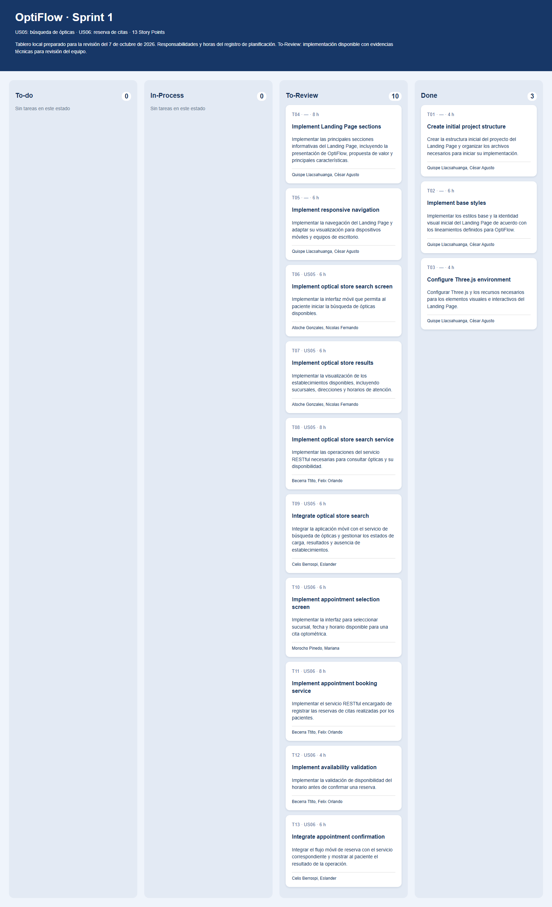


El Sprint Backlog 1 se presenta en la Tabla 112.

<a id="tabla-112"></a>

**Tabla 112**

*Sprint Backlog 1*


<table>
<thead>
<tr><th>Sprint #</th><th colspan="7">Sprint 1</th></tr>
<tr><th colspan="2">User Story</th><th colspan="6">Work-Item / Task</th></tr>
<tr><th>Id</th><th>Title</th><th>Id</th><th>Title</th><th>Description</th><th>Estimation<br>(Hours)</th><th>Assigned To</th><th>Status<br>(To-do / In-Process / To-Review / Done)</th></tr>
</thead>
<tbody>
<tr><td rowspan="5">—</td><td rowspan="5">Actividad adicional: Landing Page</td><td>T01</td><td>Create initial project structure</td><td>Crear la estructura inicial del proyecto del Landing Page y organizar los archivos necesarios para iniciar su implementación.</td><td>4</td><td>Quispe Llacsahuanga, César Augusto</td><td>Done</td></tr>
<tr><td>T02</td><td>Implement base styles</td><td>Implementar los estilos base y la identidad visual inicial del Landing Page de acuerdo con los lineamientos definidos para OptiFlow.</td><td>6</td><td>Quispe Llacsahuanga, César Augusto</td><td>Done</td></tr>
<tr><td>T03</td><td>Configure Three.js environment</td><td>Configurar Three.js y los recursos necesarios para los elementos visuales e interactivos del Landing Page.</td><td>4</td><td>Quispe Llacsahuanga, César Augusto</td><td>Done</td></tr>
<tr><td>T04</td><td>Implement Landing Page sections</td><td>Implementar las principales secciones informativas del Landing Page, incluyendo la presentación de OptiFlow, propuesta de valor y principales características.</td><td>8</td><td>Quispe Llacsahuanga, César Augusto</td><td>Done</td></tr>
<tr><td>T05</td><td>Implement responsive navigation</td><td>Implementar la navegación del Landing Page y adaptar su visualización para dispositivos móviles y equipos de escritorio.</td><td>6</td><td>Quispe Llacsahuanga, César Augusto</td><td>Done</td></tr>
<tr><td rowspan="4">US05</td><td rowspan="4">Búsqueda de ópticas y disponibilidad de atención</td><td>T06</td><td>Implement optical store search screen</td><td>Implementar la interfaz móvil que permita al paciente iniciar la búsqueda de ópticas disponibles.</td><td>6</td><td>Atoche Gonzales, Nicolas Fernando</td><td>Done</td></tr>
<tr><td>T07</td><td>Implement optical store results</td><td>Implementar la visualización de los establecimientos disponibles, incluyendo sucursales, direcciones y horarios de atención.</td><td>6</td><td>Atoche Gonzales, Nicolas Fernando</td><td>Done</td></tr>
<tr><td>T08</td><td>Implement optical store search service</td><td>Implementar las operaciones del servicio RESTful necesarias para consultar ópticas y su disponibilidad.</td><td>8</td><td>Becerra Ttito, Felix Orlando</td><td>Done</td></tr>
<tr><td>T09</td><td>Integrate optical store search</td><td>Integrar la aplicación móvil con el servicio de búsqueda de ópticas y gestionar los estados de carga, resultados y ausencia de establecimientos.</td><td>6</td><td>Celis Berrospi, Eslander</td><td>Done</td></tr>
<tr><td rowspan="4">US06</td><td rowspan="4">Reserva de cita para atención optométrica</td><td>T10</td><td>Implement appointment selection screen</td><td>Implementar la interfaz para seleccionar sucursal, fecha y horario disponible para una cita optométrica.</td><td>6</td><td>Morocho Pinedo, Mariana</td><td>Done</td></tr>
<tr><td>T11</td><td>Implement appointment booking service</td><td>Implementar el servicio RESTful encargado de registrar las reservas de citas realizadas por los pacientes.</td><td>8</td><td>Becerra Ttito, Felix Orlando</td><td>Done</td></tr>
<tr><td>T12</td><td>Implement availability validation</td><td>Implementar la validación de disponibilidad del horario antes de confirmar una reserva.</td><td>4</td><td>Becerra Ttito, Felix Orlando</td><td>Done</td></tr>
<tr><td>T13</td><td>Integrate appointment confirmation</td><td>Integrar el flujo móvil de reserva con el servicio correspondiente y mostrar al paciente el resultado de la operación.</td><td>6</td><td>Celis Berrospi, Eslander</td><td>Done</td></tr>
</tbody>
</table>

#### 4.2.1.4. Development Evidence for Sprint Review

Durante el Sprint 1 se registraron avances en los tres productos principales de OptiFlow. La Landing Page incorpora secciones informativas, ajustes visuales, navegación y validaciones del formulario. El backend incluye operaciones de búsqueda de ópticas, disponibilidad y reserva de citas, además de validaciones de entrada y manejo de errores. La aplicación móvil incorpora el cliente de comunicación con el backend, el registro e inicio de sesión del paciente, la consulta de establecimientos y la selección de horarios para realizar reservas.

La siguiente tabla presenta commits representativos del alcance documentado, obtenidos de los historiales de las clonaciones locales revisadas el 2026-10-07 (ver Tabla 113).


<a id="tabla-113"></a>

**Tabla 113**

*Commits de desarrollo del Sprint 1*


| Repository | Branch | Commit Id | Commit Message | Commit Message Body | Commited on (Date) |
|---|---|---|---|---|---|
| [BL-App-Movil-1ACC0238-2620-4951/Logix-OptiFlow-landing-page](https://github.com/BL-App-Movil-1ACC0238-2620-4951/Logix-OptiFlow-landing-page) | `main` | [52a57c6](https://github.com/BL-App-Movil-1ACC0238-2620-4951/Logix-OptiFlow-landing-page/commit/52a57c6) | `feat: add initial project structure, base styles, and Three.js setup` | Descripción en español: Crea la estructura inicial, los estilos base y la configuración de Three.js. | 03/10/2026 |
| [BL-App-Movil-1ACC0238-2620-4951/Logix-OptiFlow-landing-page](https://github.com/BL-App-Movil-1ACC0238-2620-4951/Logix-OptiFlow-landing-page) | `main` | [8091504](https://github.com/BL-App-Movil-1ACC0238-2620-4951/Logix-OptiFlow-landing-page/commit/8091504) | `Refresh landing page visuals and intro animation` | Descripción en español: Actualiza la apariencia de la Landing Page y la animación introductoria. | 06/10/2026 |
| [BL-App-Movil-1ACC0238-2620-4951/Logix-OptiFlow-landing-page](https://github.com/BL-App-Movil-1ACC0238-2620-4951/Logix-OptiFlow-landing-page) | `main` | [8bf76ec](https://github.com/BL-App-Movil-1ACC0238-2620-4951/Logix-OptiFlow-landing-page/commit/8bf76ec) | `fix: set footer` | Descripción en español: Ajusta el pie de página. | 06/10/2026 |
| [BL-App-Movil-1ACC0238-2620-4951/Logix-OptiFlow-landing-page](https://github.com/BL-App-Movil-1ACC0238-2620-4951/Logix-OptiFlow-landing-page) | `main` | [e5f8254](https://github.com/BL-App-Movil-1ACC0238-2620-4951/Logix-OptiFlow-landing-page/commit/e5f8254) | `style: fix plans and avatars` | Descripción en español: Ajusta la presentación de planes y avatares. | 06/10/2026 |
| [BL-App-Movil-1ACC0238-2620-4951/Logix-OptiFlow-landing-page](https://github.com/BL-App-Movil-1ACC0238-2620-4951/Logix-OptiFlow-landing-page) | `main` | [5a9ff47](https://github.com/BL-App-Movil-1ACC0238-2620-4951/Logix-OptiFlow-landing-page/commit/5a9ff47) | `fix: update navbar` | Descripción en español: Actualiza la barra de navegación. | 06/10/2026 |
| [BL-App-Movil-1ACC0238-2620-4951/Logix-OptiFlow-landing-page](https://github.com/BL-App-Movil-1ACC0238-2620-4951/Logix-OptiFlow-landing-page) | `main` | [774f144](https://github.com/BL-App-Movil-1ACC0238-2620-4951/Logix-OptiFlow-landing-page/commit/774f144) | `style: fix benefits section` | Descripción en español: Ajusta los estilos de beneficios. | 06/10/2026 |
| [BL-App-Movil-1ACC0238-2620-4951/Logix-OptiFlow-landing-page](https://github.com/BL-App-Movil-1ACC0238-2620-4951/Logix-OptiFlow-landing-page) | `main` | [52716d7](https://github.com/BL-App-Movil-1ACC0238-2620-4951/Logix-OptiFlow-landing-page/commit/52716d7) | `feat: highlight active navigation section and fix mobile menu state` | Descripción en español: Resalta la sección activa y corrige el estado del menú móvil. | 07/10/2026 |
| [BL-App-Movil-1ACC0238-2620-4951/Logix-OptiFlow-landing-page](https://github.com/BL-App-Movil-1ACC0238-2620-4951/Logix-OptiFlow-landing-page) | `main` | [1cd0a27](https://github.com/BL-App-Movil-1ACC0238-2620-4951/Logix-OptiFlow-landing-page/commit/1cd0a27) | `feat: add demo form guidance and inline validation` | Descripción en español: Añade instrucciones y validaciones al formulario de demostración. | 07/10/2026 |
| [BL-App-Movil-1ACC0238-2620-4951/Logix-OptiFlow-landing-page](https://github.com/BL-App-Movil-1ACC0238-2620-4951/Logix-OptiFlow-landing-page) | `main` | [4c779f9](https://github.com/BL-App-Movil-1ACC0238-2620-4951/Logix-OptiFlow-landing-page/commit/4c779f9) | `feat: improve active navigation style and smooth scroll tracking` | Descripción en español: Mejora el estilo de navegación activa y el seguimiento del desplazamiento. | 07/10/2026 |
| [BL-App-Movil-1ACC0238-2620-4951/Logix-OptiFlow-Back-End](https://github.com/BL-App-Movil-1ACC0238-2620-4951/Logix-OptiFlow-Back-End) | `develop` | [543aaf2](https://github.com/BL-App-Movil-1ACC0238-2620-4951/Logix-OptiFlow-Back-End/commit/543aaf2) | `Add OptiFlow booking backend` | Descripción en español: Incorpora el backend de búsqueda y reserva de OptiFlow y sus pruebas iniciales. | 06/10/2026 |
| [BL-App-Movil-1ACC0238-2620-4951/Logix-OptiFlow-Back-End](https://github.com/BL-App-Movil-1ACC0238-2620-4951/Logix-OptiFlow-Back-End) | `develop` | [2f3f43f](https://github.com/BL-App-Movil-1ACC0238-2620-4951/Logix-OptiFlow-Back-End/commit/2f3f43f) | `Add local/postgres Spring profiles` | Descripción en español: Añade perfiles de configuración local y PostgreSQL y modifica la configuración de pruebas. | 06/10/2026 |
| [BL-App-Movil-1ACC0238-2620-4951/Logix-OptiFlow-Back-End](https://github.com/BL-App-Movil-1ACC0238-2620-4951/Logix-OptiFlow-Back-End) | `develop` | [ac63183](https://github.com/BL-App-Movil-1ACC0238-2620-4951/Logix-OptiFlow-Back-End/commit/ac63183) | `fix: reject invalid characters in patient phone numbers` | Descripción en español: Rechaza caracteres inválidos en teléfonos e incorpora pruebas de validación. | 07/10/2026 |
| [BL-App-Movil-1ACC0238-2620-4951/Logix-OptiFlow-Back-End](https://github.com/BL-App-Movil-1ACC0238-2620-4951/Logix-OptiFlow-Back-End) | `develop` | [25c3003](https://github.com/BL-App-Movil-1ACC0238-2620-4951/Logix-OptiFlow-Back-End/commit/25c3003) | `feat: standardize malformed request error responses` | Descripción en español: Unifica respuestas a solicitudes mal formadas e incorpora pruebas de errores. | 07/10/2026 |
| [BL-App-Movil-1ACC0238-2620-4951/Logix-OptiFlow-Mobile](https://github.com/BL-App-Movil-1ACC0238-2620-4951/Logix-OptiFlow-Mobile) | `develop` | [067fd5d](https://github.com/BL-App-Movil-1ACC0238-2620-4951/Logix-OptiFlow-Mobile/commit/067fd5d) | `chore(mobile): configure api base url for local and production` | Descripción en español: Configura las URL del backend para los entornos local y de producción. | 07/10/2026 |
| [BL-App-Movil-1ACC0238-2620-4951/Logix-OptiFlow-Mobile](https://github.com/BL-App-Movil-1ACC0238-2620-4951/Logix-OptiFlow-Mobile) | `develop` | [27fef3d](https://github.com/BL-App-Movil-1ACC0238-2620-4951/Logix-OptiFlow-Mobile/commit/27fef3d) | `feat: add retrofit client with timeouts and logging` | Descripción en español: Añade el cliente Retrofit con tiempos de espera y registro de comunicaciones. | 07/10/2026 |
| [BL-App-Movil-1ACC0238-2620-4951/Logix-OptiFlow-Mobile](https://github.com/BL-App-Movil-1ACC0238-2620-4951/Logix-OptiFlow-Mobile) | `develop` | [484564d](https://github.com/BL-App-Movil-1ACC0238-2620-4951/Logix-OptiFlow-Mobile/commit/484564d) | `feat: Add remote booking and search API layer` | Descripción en español: Añade la capa de API remota para búsqueda y reserva. | 07/10/2026 |
| [BL-App-Movil-1ACC0238-2620-4951/Logix-OptiFlow-Mobile](https://github.com/BL-App-Movil-1ACC0238-2620-4951/Logix-OptiFlow-Mobile) | `develop` | [8f950a3](https://github.com/BL-App-Movil-1ACC0238-2620-4951/Logix-OptiFlow-Mobile/commit/8f950a3) | `feat: load optical stores from backend` | Descripción en español: Carga los establecimientos ópticos desde el backend. | 07/10/2026 |
| [BL-App-Movil-1ACC0238-2620-4951/Logix-OptiFlow-Mobile](https://github.com/BL-App-Movil-1ACC0238-2620-4951/Logix-OptiFlow-Mobile) | `develop` | [3e6f97c](https://github.com/BL-App-Movil-1ACC0238-2620-4951/Logix-OptiFlow-Mobile/commit/3e6f97c) | `feat: register patient and login against api` | Descripción en español: Integra el registro y el inicio de sesión del paciente con la API. | 07/10/2026 |
| [BL-App-Movil-1ACC0238-2620-4951/Logix-OptiFlow-Mobile](https://github.com/BL-App-Movil-1ACC0238-2620-4951/Logix-OptiFlow-Mobile) | `develop` | [024cd92](https://github.com/BL-App-Movil-1ACC0238-2620-4951/Logix-OptiFlow-Mobile/commit/024cd92) | `feat: fetch availability and book appointment` | Descripción en español: Consulta horarios disponibles y solicita reservas de citas. | 07/10/2026 |
| [BL-App-Movil-1ACC0238-2620-4951/Logix-OptiFlow-Mobile](https://github.com/BL-App-Movil-1ACC0238-2620-4951/Logix-OptiFlow-Mobile) | `develop` | [557a47c](https://github.com/BL-App-Movil-1ACC0238-2620-4951/Logix-OptiFlow-Mobile/commit/557a47c) | `feat: wire sprint 1 screens to search booking repository` | Descripción en español: Conecta las pantallas del Sprint 1 con los repositorios de búsqueda y reserva. | 07/10/2026 |
| [BL-App-Movil-1ACC0238-2620-4951/Logix-OptiFlow-Mobile](https://github.com/BL-App-Movil-1ACC0238-2620-4951/Logix-OptiFlow-Mobile) | `develop` | [a5f5062](https://github.com/BL-App-Movil-1ACC0238-2620-4951/Logix-OptiFlow-Mobile/commit/a5f5062) | `feat: add store search filter by minimum rating` | Descripción en español: Añade un filtro de búsqueda por valoración mínima. | 07/10/2026 |
| [BL-App-Movil-1ACC0238-2620-4951/Logix-OptiFlow-Mobile](https://github.com/BL-App-Movil-1ACC0238-2620-4951/Logix-OptiFlow-Mobile) | `develop` | [e097ffd](https://github.com/BL-App-Movil-1ACC0238-2620-4951/Logix-OptiFlow-Mobile/commit/e097ffd) | `feat: Redesign auth flow and fix store rating types` | Descripción en español: Rediseña el flujo de acceso y corrige los tipos de las valoraciones. | 07/10/2026 |
| [BL-App-Movil-1ACC0238-2620-4951/Logix-OptiFlow-Mobile](https://github.com/BL-App-Movil-1ACC0238-2620-4951/Logix-OptiFlow-Mobile) | `develop` | [f09d228](https://github.com/BL-App-Movil-1ACC0238-2620-4951/Logix-OptiFlow-Mobile/commit/f09d228) | `feat: Add home dashboard and patient appointment flow` | Descripción en español: Añade la pantalla de inicio y el flujo de citas del paciente. | 07/10/2026 |
| [BL-App-Movil-1ACC0238-2620-4951/Logix-OptiFlow-Mobile](https://github.com/BL-App-Movil-1ACC0238-2620-4951/Logix-OptiFlow-Mobile) | `develop` | [861628c](https://github.com/BL-App-Movil-1ACC0238-2620-4951/Logix-OptiFlow-Mobile/commit/861628c) | `feat: Add notifications and backend setup docs` | Descripción en español: Añade notificaciones y documentación para configurar el backend. | 07/10/2026 |

**Nota:** los commits seleccionados no contienen un cuerpo adicional en Git. La columna Commit Message Body presenta una descripción explicativa en español, no una transcripción de un cuerpo original. Branch identifica la rama revisada que contiene el commit, no necesariamente su rama de creación.

**Repositorios:** [Landing Page](https://github.com/BL-App-Movil-1ACC0238-2620-4951/Logix-OptiFlow-landing-page), [Web Services](https://github.com/BL-App-Movil-1ACC0238-2620-4951/Logix-OptiFlow-Back-End) y [aplicación móvil](https://github.com/BL-App-Movil-1ACC0238-2620-4951/Logix-OptiFlow-Mobile).

#### 4.2.1.5. Testing Suite Evidence for Sprint Review

La verificación de Web Services comprende pruebas unitarias, de integración y de aceptación automatizadas bajo BDD, relacionadas con US05, US06 y el soporte al registro del paciente. La Tabla 114 presenta los commits de testing con la estructura del enunciado: repositorio, rama, identificador, mensaje, cuerpo explicativo y fecha.

<a id="tabla-114"></a>

**Tabla 114**

*Commits de la suite de pruebas*


| Repository | Branch | Commit Id | Commit Message | Commit Message Body | Commited on (Date) |
|---|---|---|---|---|---|
| [BL-App-Movil-1ACC0238-2620-4951/Logix-OptiFlow-Back-End](https://github.com/BL-App-Movil-1ACC0238-2620-4951/Logix-OptiFlow-Back-End) | `develop` | [543aaf2](https://github.com/BL-App-Movil-1ACC0238-2620-4951/Logix-OptiFlow-Back-End/commit/543aaf2) | `Add OptiFlow booking backend` | Descripción en español: Incorpora el backend de búsqueda y reserva de OptiFlow y sus pruebas iniciales. | 06/10/2026 |
| [BL-App-Movil-1ACC0238-2620-4951/Logix-OptiFlow-Back-End](https://github.com/BL-App-Movil-1ACC0238-2620-4951/Logix-OptiFlow-Back-End) | `develop` | [2f3f43f](https://github.com/BL-App-Movil-1ACC0238-2620-4951/Logix-OptiFlow-Back-End/commit/2f3f43f) | `Add local/postgres Spring profiles` | Descripción en español: Añade perfiles de configuración local y PostgreSQL y modifica la configuración de pruebas. | 06/10/2026 |
| [BL-App-Movil-1ACC0238-2620-4951/Logix-OptiFlow-Back-End](https://github.com/BL-App-Movil-1ACC0238-2620-4951/Logix-OptiFlow-Back-End) | `develop` | [ac63183](https://github.com/BL-App-Movil-1ACC0238-2620-4951/Logix-OptiFlow-Back-End/commit/ac63183) | `fix: reject invalid characters in patient phone numbers` | Descripción en español: Rechaza caracteres inválidos en teléfonos e incorpora pruebas de validación. | 07/10/2026 |
| [BL-App-Movil-1ACC0238-2620-4951/Logix-OptiFlow-Back-End](https://github.com/BL-App-Movil-1ACC0238-2620-4951/Logix-OptiFlow-Back-End) | `develop` | [25c3003](https://github.com/BL-App-Movil-1ACC0238-2620-4951/Logix-OptiFlow-Back-End/commit/25c3003) | `feat: standardize malformed request error responses` | Descripción en español: Unifica respuestas a solicitudes mal formadas e incorpora pruebas de errores. | 07/10/2026 |
| [BL-App-Movil-1ACC0238-2620-4951/Logix-OptiFlow-Back-End](https://github.com/BL-App-Movil-1ACC0238-2620-4951/Logix-OptiFlow-Back-End) | `develop` | [706ada9](https://github.com/BL-App-Movil-1ACC0238-2620-4951/Logix-OptiFlow-Back-End/commit/706ada927d4fd49807035e79d4313fbe463e9e54) | `test: add Gherkin acceptance suite for search and booking` | Descripción en español: Implementa cuatro escenarios Gherkin de US05 y US06, Steps con MockMvc y configuración de Cucumber y Surefire. | 07/10/2026 |

La columna Commit Message Body explica en español el alcance del cambio. Branch identifica la rama revisada que contiene el commit.

##### Relación complementaria de pruebas diseñadas

JUnit valida las reglas del dominio; Spring Boot Test y MockMvc comprueban las operaciones de la API; Cucumber ejecuta los escenarios Gherkin mediante Steps en Java. La Tabla 115 detalla las suites, sus clases y los comportamientos relacionados.


<a id="tabla-115"></a>

**Tabla 115**

*Escenarios de prueba del Sprint 1*


| Test Suite | Tipo | Clases y comportamientos relacionados | Relación con el Sprint |
|---|---|---|---|
| `AppointmentBookingRulesTest` | Unit Tests | `AppointmentAvailabilityService`, `AppointmentFactory`, `TimeSlot` y `Appointment`: confirmación de una cita disponible y rechazo de un horario reservado. | US06 |
| `SearchAndBookingApiTest` | Integration Tests | Consulta de ópticas y disponibilidad, reserva confirmada, rechazo de doble reserva, búsqueda sin resultados, credenciales inválidas y validación de teléfonos. | US05, US06 y soporte al paciente |
| `PhoneNumberTest` | Unit Tests | `PhoneNumber`: normalización de formatos admitidos y rechazo de caracteres, formatos y longitudes inválidos. | Soporte al registro |
| `ApiRequestErrorsTest` | Integration Tests | Respuestas HTTP 400 ante UUID inválidos, cuerpos vacíos, JSON mal formado, tipos incorrectos y campos obligatorios ausentes. | Soporte a los servicios |
| `SearchBookingAcceptanceTest` | Acceptance Tests / BDD | Cuatro escenarios de consulta de establecimientos y disponibilidad, búsqueda sin coincidencias, reserva exitosa y rechazo de un horario reservado por otro paciente. | US05 y US06 |

##### Resultados complementarios de ejecución

El 2026-10-07 a las 23:09:57 (America/Lima) se ejecutó `mvn test` sobre el backend con la suite BDD incorporada localmente. Maven finalizó con **BUILD SUCCESS: 53 tests, 0 failures, 0 errors y 0 skipped**. Las suites relacionadas con Search & Booking y soporte suman 38 ejecuciones, incluidos cuatro escenarios de aceptación. Las 15 ejecuciones restantes corresponden a Clinical & Commercial y Production & Tracking (ver Tabla 116).


<a id="tabla-116"></a>

**Tabla 116**

*Resultados de ejecución de la suite de pruebas*


| Test Suite | Tests | Failures | Errors | Skipped |
|---|---:|---:|---:|---:|
| `AppointmentBookingRulesTest` | 2 | 0 | 0 | 0 |
| `SearchAndBookingApiTest` | 4 | 0 | 0 | 0 |
| `PhoneNumberTest` | 20 | 0 | 0 | 0 |
| `ApiRequestErrorsTest` | 8 | 0 | 0 | 0 |
| `SearchBookingAcceptanceTest` | 4 | 0 | 0 | 0 |
| **Subtotal del alcance y soporte** | **38** | **0** | **0** | **0** |
| Clinical & Commercial y Production & Tracking | 15 | 0 | 0 | 0 |
| **Total ejecutado** | **53** | **0** | **0** | **0** |

Los casos parametrizados se contabilizan como ejecuciones individuales. La ejecución utilizó Java 25.0.3 con release 21 configurado en Maven. Las pruebas BDD emplean una base H2 independiente (`optiflow_bdd`), pacientes con correos únicos y horarios nuevos para los escenarios de reserva, sin acceder a datos de producción.

**Evidencias:** [resumen de Maven Surefire](assets/cap4/sprint1/test-results.txt), [reporte HTML de Cucumber](assets/cap4/sprint1/testing/cucumber.html) y [resultados JSON](assets/cap4/sprint1/testing/cucumber.json) (ver Figura 122).


<a id="figura-122"></a>

**Figura 122**

*Resultado de los escenarios de aceptación en Cucumber*

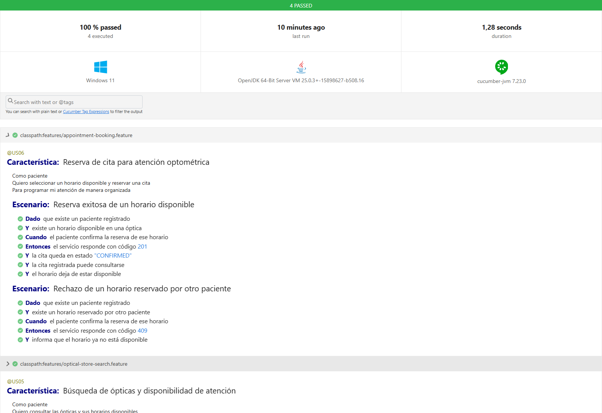


##### Verificación posterior a la integración

Antes de publicar se integraron los tres commits nuevos de Notification & Loyalty existentes en develop remoto (`6c388bc`). Sobre esa base, los cuatro escenarios BDD se ejecutaron sin fallos. La suite general registró 61 ejecuciones con 2 fallos y 4 errores; la base remota sin BDD registró 57 ejecuciones con los mismos 2 fallos y 4 errores. Se reprodujeron los mismos problemas en una copia independiente del código remoto, sin las modificaciones de aceptación.

Los errores de contexto se deben al índice parcial con WHERE de la migración V4, que H2 no admite. Los otros dos fallos corresponden a expectativas de NotificationPersistenceIntegrationTest y SearchAndBookingApiTest. Esta verificación distingue el resultado exitoso de la ejecución inicial de 53 pruebas de los problemas incorporados por la revisión remota posterior. El detalle se conserva en [validación de publicación](assets/cap4/sprint1/publish-validation.txt).

##### Repositorio y archivos de pruebas


Los commits indicados incluyen cambios en `src/test`. Las suites y recursos pueden consultarse en [src/test del backend](https://github.com/BL-App-Movil-1ACC0238-2620-4951/Logix-OptiFlow-Back-End/tree/develop/src/test).

La suite BDD se encuentra registrada en el commit [706ada9](https://github.com/BL-App-Movil-1ACC0238-2620-4951/Logix-OptiFlow-Back-End/commit/706ada927d4fd49807035e79d4313fbe463e9e54) del backend. Los archivos Gherkin, Steps y configuración de ejecución forman parte de ese commit.

##### Archivos de pruebas de aceptación


Los archivos de pruebas de aceptación se detallan en la Tabla 117.

<a id="tabla-117"></a>

**Tabla 117**

*Archivos de pruebas de aceptación*


| Archivo en el backend | Responsabilidad | Copia de evidencia |
|---|---|---|
| `src/test/resources/features/optical-store-search.feature` | Escenarios de US05. | [Gherkin de búsqueda](assets/cap4/sprint1/testing/optical-store-search.feature) |
| `src/test/resources/features/appointment-booking.feature` | Escenarios de US06. | [Gherkin de reserva](assets/cap4/sprint1/testing/appointment-booking.feature) |
| `src/test/java/com/optiflow/platform/searchbooking/acceptance/SearchBookingSteps.java` | Steps que realizan solicitudes MockMvc y verifican códigos, datos, disponibilidad y persistencia de las citas. | [Steps en Java](assets/cap4/sprint1/testing/SearchBookingSteps.java) |
| `src/test/java/com/optiflow/platform/searchbooking/acceptance/CucumberSpringConfiguration.java` | Contexto Spring, MockMvc y base H2 de aceptación. | [Configuración Spring](assets/cap4/sprint1/testing/CucumberSpringConfiguration.java) |
| `src/test/java/com/optiflow/platform/searchbooking/acceptance/SearchBookingAcceptanceTest.java` | Suite JUnit Platform que descubre features, Steps y genera los reportes HTML y JSON. | [Suite de aceptación](assets/cap4/sprint1/testing/SearchBookingAcceptanceTest.java) |

##### Escenarios Gherkin ejecutados

```gherkin
# language: es
@US05
Característica: Búsqueda de ópticas y disponibilidad de atención
  Como paciente
  Quiero consultar las ópticas y sus horarios disponibles
  Para elegir dónde recibir atención optométrica

  Escenario: Consulta de establecimientos y disponibilidad
    Dado que existen ópticas y sucursales registradas
    Cuando el paciente consulta los establecimientos disponibles
    Entonces obtiene la información y las direcciones de los establecimientos
    Y puede consultar los horarios disponibles de una óptica

  Escenario: Búsqueda sin establecimientos coincidentes
    Dado que ninguna óptica coincide con los criterios de búsqueda
    Cuando el paciente realiza la búsqueda
    Entonces obtiene una lista vacía de establecimientos
```

```gherkin
# language: es
@US06
Característica: Reserva de cita para atención optométrica
  Como paciente
  Quiero seleccionar un horario disponible y reservar una cita
  Para programar mi atención de manera organizada

  Escenario: Reserva exitosa de un horario disponible
    Dado que existe un paciente registrado
    Y existe un horario disponible en una óptica
    Cuando el paciente confirma la reserva de ese horario
    Entonces el servicio responde con código 201
    Y la cita queda en estado "CONFIRMED"
    Y la cita registrada puede consultarse
    Y el horario deja de estar disponible

  Escenario: Rechazo de un horario reservado por otro paciente
    Dado que existe un paciente registrado
    Y existe un horario reservado por otro paciente
    Cuando el paciente confirma la reserva de ese horario
    Entonces el servicio responde con código 409
    Y informa que el horario ya no está disponible
```

##### Reproducción

Desde la raíz del backend, ejecutar `mvn test`, o seleccionar Maven → Lifecycle → test en IntelliJ IDEA. Para ejecutar únicamente BDD, utilizar:

```powershell
mvn test "-Dtest=SearchBookingAcceptanceTest"
```

Los reportes se generan en `target/surefire-reports` y `target/cucumber`. La configuración incorpora Cucumber 7.23.0, el motor JUnit Platform, integración con Spring y Maven Surefire 3.5.4. El backend de producción no necesita estar iniciado para estas pruebas.

#### 4.2.1.6. Execution Evidence for Sprint Review

La ejecución del incremento permitió visualizar la Landing Page en escritorio y móvil, interactuar con los Web Services mediante Swagger y completar el flujo del paciente desde el inicio de sesión hasta la confirmación de una reserva. La demostración utilizó datos ficticios en el backend local con el perfil local y una base H2. La reserva creada desde la aplicación se consultó posteriormente en Swagger para verificar su persistencia y estado CONFIRMED.

##### Landing Page

La Landing Page presenta la propuesta de valor de OptiFlow y permite navegar entre sus secciones informativas. Las capturas se obtuvieron desde la clonación local en Chrome, con viewports de 1440 × 1000 píxeles para escritorio y 390 × 844 píxeles para móvil. Se utilizó el control Saltar para finalizar la introducción y acceder a la vista principal.

**Landing Page en escritorio.** Se visualizan la identidad de OptiFlow, la propuesta de valor y los accesos de navegación (ver Figura 123).


<a id="figura-123"></a>

**Figura 123**

*Landing Page en escritorio*


**Landing Page en móvil.** La presentación se adapta a una distribución vertical y la navegación utiliza un menú compacto (ver Figura 124).


<a id="figura-124"></a>

**Figura 124**

*Landing Page en móvil*


**Menú y navegación móvil.** Se abrió el menú y se seleccionó Beneficios para comprobar el acceso a la sección correspondiente (ver Figura 125).


<a id="figura-125"></a>

**Figura 125**

*Menú móvil de la Landing Page*

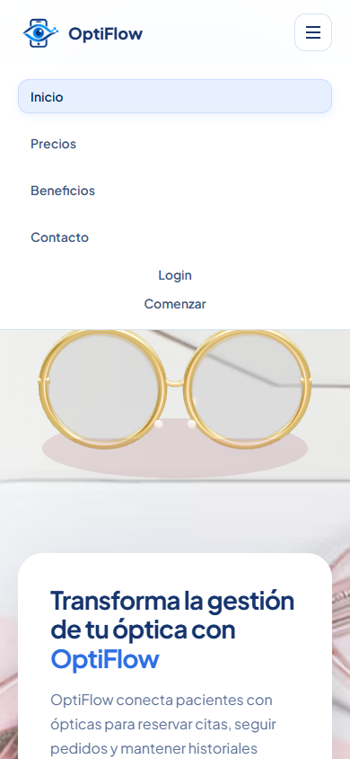


El navegación móvil a Beneficios se presenta en la Figura 126.

<a id="figura-126"></a>

**Figura 126**

*Navegación móvil a Beneficios*

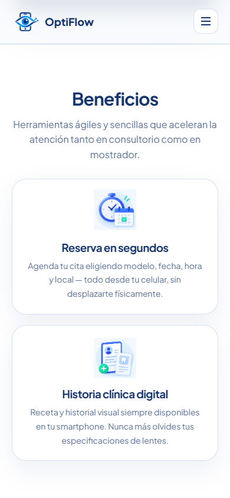


##### Web Services: Swagger UI

Los Web Services se ejecutaron en `http://127.0.0.1:8080` con el perfil local. La documentación OpenAPI se visualizó en [Swagger UI local](http://localhost:8080/swagger-ui/index.html), que permitió ejecutar consultas y solicitudes con datos de demostración. El README de la aplicación también referencia [Swagger del backend desplegado](https://logix-optiflow-back-end.onrender.com/swagger-ui/index.html); las evidencias de esta revisión corresponden al entorno local.

**Vista general de Swagger.** La documentación organiza las operaciones de pacientes, ópticas, disponibilidad y citas dentro de Search & Booking (ver Figura 127).


<a id="figura-127"></a>

**Figura 127**

*Swagger UI de OptiFlow*

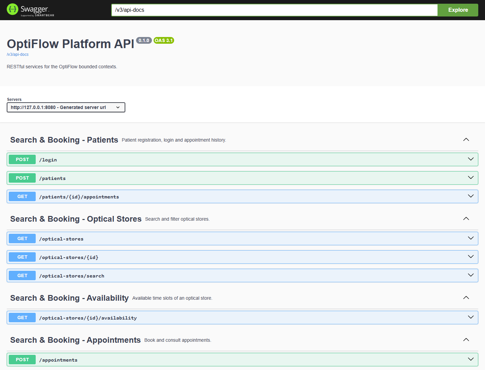


**Consulta de ópticas.** La ejecución de GET /api/v1/optical-stores devuelve HTTP 200 y la información de las sucursales de Miraflores y San Isidro, incluyendo dirección, teléfono, valoración y estado (ver Figura 128).


<a id="figura-128"></a>

**Figura 128**

*Consulta de ópticas en Swagger*

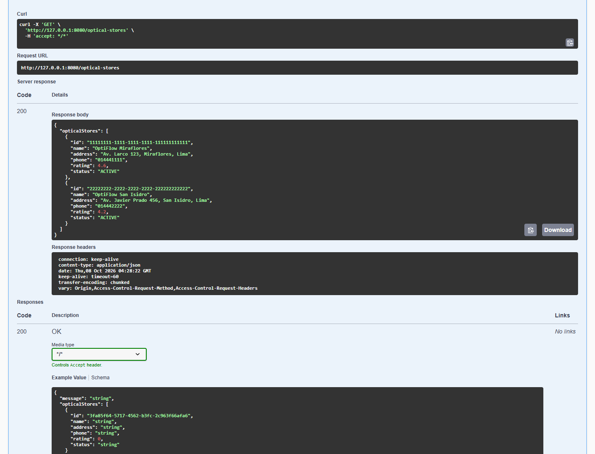


**Reserva confirmada.** POST /api/v1/appointments registra una cita con datos de prueba y devuelve HTTP 201 con estado CONFIRMED (ver Figura 129).


<a id="figura-129"></a>

**Figura 129**

*Reserva confirmada en Swagger*

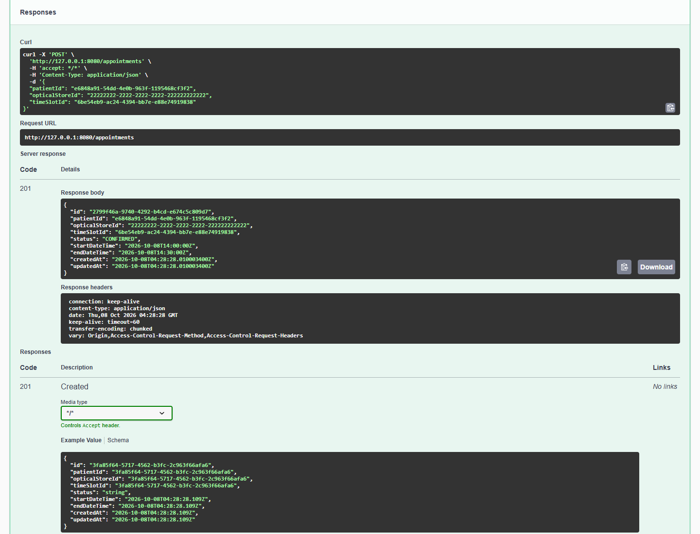


**Prevención de doble reserva.** Al repetir la solicitud sobre el mismo horario, el servicio devuelve HTTP 409 e informa que el horario seleccionado ya no está disponible (ver Figura 130).


<a id="figura-130"></a>

**Figura 130**

*Rechazo de doble reserva en Swagger*

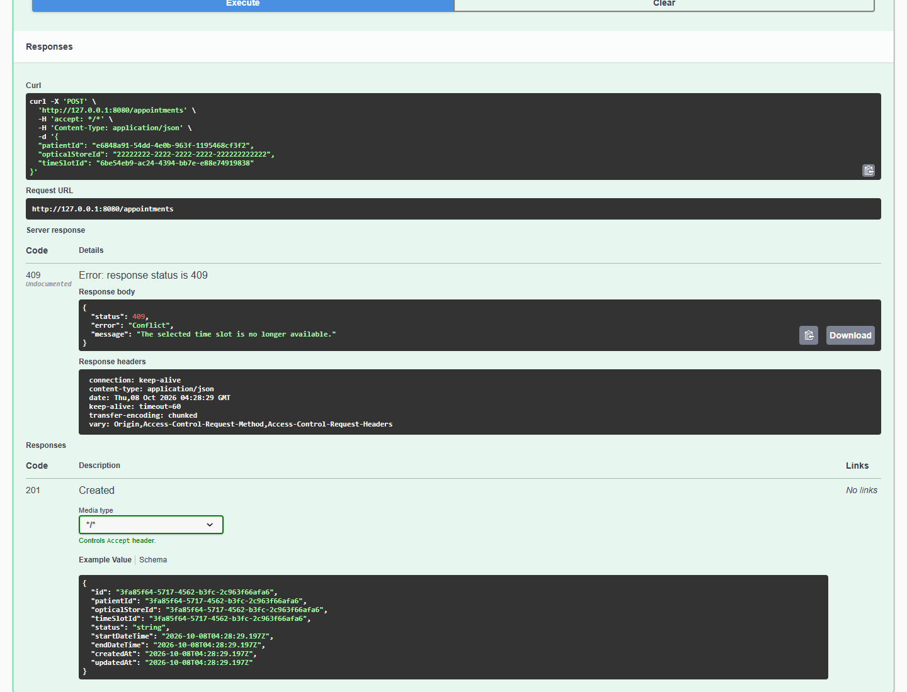


##### Aplicación móvil

La aplicación se compiló desde la rama develop mediante assembleLocalDebug y Gradle finalizó con BUILD SUCCESSFUL. El APK generado se instaló en el emulador Pixel 10 Pro XL. Para conectar la demostración con el backend de la PC se utilizó `adb reverse tcp:8080 tcp:8080` y una URL temporal de compilación `http://127.0.0.1:8080/`, sin modificar el código de producción de la app.

El recorrido utilizó el paciente ficticio Paciente Demo Informe. Tras el inicio de sesión se consultaron las ópticas disponibles, se abrió la sucursal de Miraflores, se solicitaron sus horarios y se confirmó una reserva. Las fechas y horas visibles corresponden a la zona horaria del emulador, configurado en UTC durante esta demostración.

**Acceso del paciente.** Inicio de sesión con una cuenta ficticia del backend local (ver Figura 131).


<a id="figura-131"></a>

**Figura 131**

*Acceso del paciente de demostración*

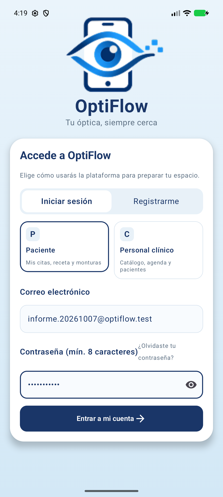


**Búsqueda de ópticas (US05).** La app muestra establecimientos obtenidos del backend, con sus direcciones, teléfonos, valoraciones y controles de búsqueda (ver Figura 132).


<a id="figura-132"></a>

**Figura 132**

*Búsqueda de ópticas en la aplicación*

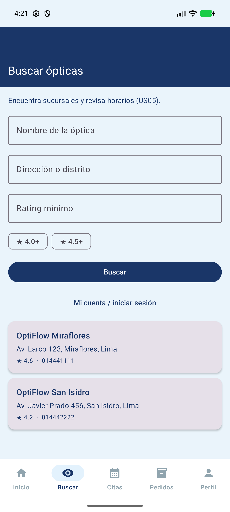


**Disponibilidad de atención.** Se consultan los horarios disponibles de la sucursal de Miraflores antes de solicitar la reserva (ver Figura 133).


<a id="figura-133"></a>

**Figura 133**

*Disponibilidad de horarios en la aplicación*

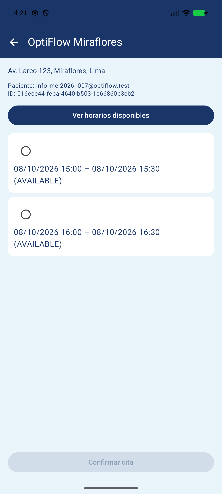


**Reserva confirmada (US06).** La app muestra el identificador de la cita creada y su estado CONFIRMED (ver Figura 134).


<a id="figura-134"></a>

**Figura 134**

*Confirmación de la reserva desde la aplicación*


**Verificación de la cita móvil en el backend.** GET /api/v1/appointments/{id} devuelve HTTP 200 para el mismo identificador mostrado en la app, confirmando que la operación se registró en el backend (ver Figura 135).


<a id="figura-135"></a>

**Figura 135**

*Consulta en Swagger de la cita creada desde la app*

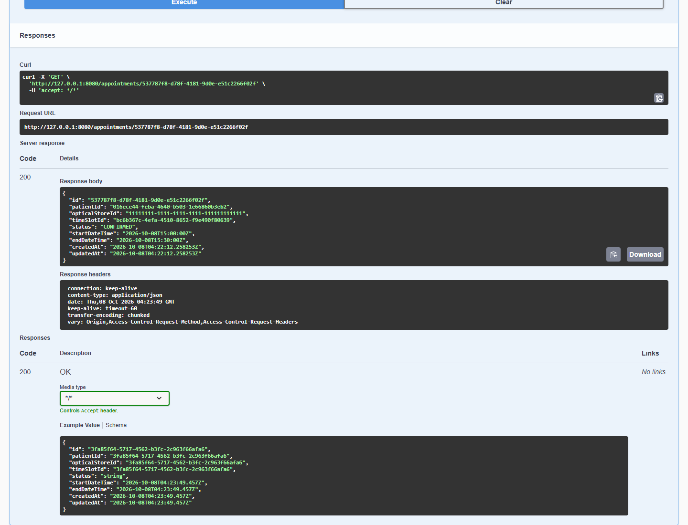


La respuesta de esta consulta se conserva como [evidencia JSON de la reserva móvil](assets/cap4/sprint1/mobile-booking-response.json). El identificador verificado es `537787f8-d78f-4181-9d0e-e51c2266f02f`, con estado CONFIRMED. Al tratarse de una base de demostración en memoria, las capturas y la respuesta adjunta conservan la evidencia de esta ejecución.

#### 4.2.1.7. Services Documentation Evidence for Sprint Review

Esta sección conserva el contrato y las capturas del Sprint 1, revisados el 08/10/2026. Las rutas sin prefijo y `/login` corresponden a ese corte; el contrato `/api/v1` y la autenticación actual se documentan en 4.2.2.7. Los Web Services de **OptiFlow** se documentan mediante **OpenAPI 3.1**. El backend utiliza **Java 21 y Spring Boot**, y **springdoc-openapi** genera la especificación y la interfaz **Swagger UI** a partir de los controladores. La configuración ubicada en `shared/documentation/openapi/configuration` define los datos generales de la API y las etiquetas que agrupan las operaciones por contexto. Esta documentación permite consultar contratos y ejecutar solicitudes para revisar el comportamiento del servicio.

La documentación cubre los tres bounded contexts del **Core Domain** definidos en el Capítulo II: **Search & Booking** (registro e inicio de sesión del paciente, búsqueda de ópticas, disponibilidad y reserva de citas), **Clinical & Commercial** (expediente clínico, receta, cotización y venta) y **Production & Tracking** (órdenes de trabajo y seguimiento del pedido). En el corte del Sprint 1 se registraron **37 operaciones**. El contexto de Notification & Loyalty ya cuenta con su dominio, sus manejadores de eventos y su persistencia, pero todavía no expone endpoints REST, por lo que no aparece en Swagger UI. Store Management & Inventory se documentará cuando se implemente.

**Datos generales de la documentación**


Los datos generales de la documentación de los Web Services se resumen en la Tabla 118.

<a id="tabla-118"></a>

**Tabla 118**

*Datos generales de la documentación de los Web Services*


| Elemento | Valor |
| :--- | :--- |
| Repositorio de Web Services | [Logix-OptiFlow-Back-End](https://github.com/BL-App-Movil-1ACC0238-2620-4951/Logix-OptiFlow-Back-End) |
| Documentación desplegada (Swagger UI) | [https://logix-optiflow-back-end.onrender.com/swagger-ui/index.html](https://logix-optiflow-back-end.onrender.com/swagger-ui/index.html) |
| Especificación OpenAPI desplegada (JSON) | [https://logix-optiflow-back-end.onrender.com/v3/api-docs](https://logix-optiflow-back-end.onrender.com/v3/api-docs) |
| Documentación local (Swagger UI) | `http://localhost:8080/swagger-ui/index.html` |
| URL base de la API | `https://logix-optiflow-back-end.onrender.com` (contrato histórico del Sprint 1, sin prefijo de versión) |
| Formato de intercambio | JSON (`application/json`) |
| Identificadores | UUID en todos los recursos |
| Datos de prueba | Al iniciar, el backend registra en su base de datos las ópticas con su ubicación, sus horarios, el catálogo de monturas con su stock, los proveedores y un usuario por rol: `admin@optiflow.test`, `optometrist@optiflow.test`, `advisor@optiflow.test`, `technician@optiflow.test` y `patient@optiflow.test`, con la contraseña `secret12`. No duplica ni sobrescribe los datos existentes. |
| Autenticación | `POST /api/v1/auth/tokens` crea el token JWT del paciente o del miembro del personal y devuelve su rol. Las demás rutas, salvo las públicas, exigen el encabezado `Authorization: Bearer <token>` y se autorizan según el rol (US16). |

Las respuestas siguen los códigos de estado HTTP estándar: `200 OK` (consulta o actualización exitosa), `201 Created` (recurso creado), `400 Bad Request` (datos inválidos o regla de dominio incumplida), `401 Unauthorized` (credenciales inválidas en `/api/v1/auth/tokens`, o token ausente o inválido), `403 Forbidden` (el rol no tiene permiso o el recurso pertenece a otro paciente), `404 Not Found` (recurso inexistente) y `409 Conflict` (conflicto de negocio, por ejemplo un horario que ya fue reservado). Los errores se devuelven con una estructura uniforme que incluye `status`, `error` y `message`.

##### Search & Booking Context


Los Endpoints del Search & Booking Context se detallan en la Tabla 119.

<a id="tabla-119"></a>

**Tabla 119**

*Endpoints del Search & Booking Context*


| Endpoint | Acción | Verbo HTTP | Sintaxis de llamada | Parámetros | Response (ejemplo y explicación) | User Story | Documentación |
| :--- | :--- | :---: | :--- | :--- | :--- | :---: | :--- |
| `/patients` | Registrar un paciente | POST | `POST /patients` | Body: `name`, `email`, `phone`, `password` (mínimo 8 caracteres) | `201` `{ "id": "dc0315b5-...", "name": "Demo Paciente OptiFlow", "email": "demo.paciente@optiflow.pe", "phone": "999888777" }`: devuelve el paciente creado sin la contraseña. | Soporte a US05 y US06 | [Swagger UI](https://logix-optiflow-back-end.onrender.com/swagger-ui/index.html) · contrato del 08/10/2026 |
| `/login` | Iniciar sesión del paciente | POST | `POST /login` | Body: `email`, `password` | `200` `{ "token": "...", "patient": { "id": "...", "name": "..." } }`. Si las credenciales no son válidas, responde `401` con el mensaje "The credentials are invalid." | Soporte a US05 y US06 | [Swagger UI](https://logix-optiflow-back-end.onrender.com/swagger-ui/index.html) · contrato del 08/10/2026 |
| `/optical-stores` | Listar ópticas | GET | `GET /optical-stores?name=Miraflores` | Query (opcionales): `name`, `address` | `200` `{ "opticalStores": [{ "id": "11111111-...", "name": "OptiFlow Miraflores", "address": "Av. Larco 123, Miraflores, Lima", "rating": 4.60, "status": "ACTIVE" }] }` | US05 | [Swagger UI](https://logix-optiflow-back-end.onrender.com/swagger-ui/index.html) · contrato del 08/10/2026 |
| `/optical-stores/search` | Búsqueda avanzada de ópticas | GET | `GET /optical-stores/search?minRating=4.5` | Query (opcionales): `name`, `address`, `minRating` | `200` lista filtrada y `message` cuando no hay resultados. | US05 | [Swagger UI](https://logix-optiflow-back-end.onrender.com/swagger-ui/index.html) · contrato del 08/10/2026 |
| `/optical-stores/{id}` | Obtener el detalle de una óptica | GET | `GET /optical-stores/11111111-1111-1111-1111-111111111111` | Path: `id` | `200` datos de la sucursal. | US05 | [Swagger UI](https://logix-optiflow-back-end.onrender.com/swagger-ui/index.html) · contrato del 08/10/2026 |
| `/optical-stores/{id}/availability` | Consultar horarios disponibles | GET | `GET /optical-stores/{id}/availability` | Path: `id` | `200` `{ "timeSlots": [{ "id": "4bd5f6be-...", "startDateTime": "2026-10-08T14:00:00Z", "endDateTime": "2026-10-08T14:30:00Z", "status": "AVAILABLE" }] }` | US05, US06 | [Swagger UI](https://logix-optiflow-back-end.onrender.com/swagger-ui/index.html) · contrato del 08/10/2026 |
| `/optical-stores/{id}/ratings` | Calificar una óptica | POST | `POST /optical-stores/{id}/ratings` | Path: `id`. Body: `patientId`, `score` (1 a 5), `comment` | `201` calificación registrada. | US05 | [Swagger UI](https://logix-optiflow-back-end.onrender.com/swagger-ui/index.html) · contrato del 08/10/2026 |
| `/patients/{id}/favorites` | Guardar una óptica favorita | POST | `POST /patients/{id}/favorites` | Path: `id`. Body: `opticalStoreId` | `201` favorito registrado. | US05 | [Swagger UI](https://logix-optiflow-back-end.onrender.com/swagger-ui/index.html) · contrato del 08/10/2026 |
| `/appointments` | Reservar una cita | POST | `POST /appointments` | Body: `patientId`, `opticalStoreId`, `timeSlotId` | `201` cita con estado `CONFIRMED`. Si el horario ya fue tomado, responde `409 Conflict`. | US06 | [Swagger UI](https://logix-optiflow-back-end.onrender.com/swagger-ui/index.html) · contrato del 08/10/2026 |
| `/appointments/{id}` | Consultar una cita | GET | `GET /appointments/{id}` | Path: `id` | `200` detalle de la cita. | US06 | [Swagger UI](https://logix-optiflow-back-end.onrender.com/swagger-ui/index.html) · contrato del 08/10/2026 |
| `/patients/{id}/appointments` | Listar las citas de un paciente | GET | `GET /patients/{id}/appointments` | Path: `id` | `200` lista de citas del paciente. | US06 | [Swagger UI](https://logix-optiflow-back-end.onrender.com/swagger-ui/index.html) · contrato del 08/10/2026 |

Ejemplo de interacción, reserva de una cita:

```http
POST /api/v1/appointments
Content-Type: application/json

{
  "patientId": "016ece44-feba-4640-b503-1e66860b3eb2",
  "opticalStoreId": "11111111-1111-1111-1111-111111111111",
  "timeSlotId": "bc6b367c-4efa-4510-8652-f9e490f80639"
}
```

```http
HTTP/1.1 201 Created
Content-Type: application/json

{
  "id": "537787f8-d78f-4181-9d0e-e51c2266f02f",
  "patientId": "016ece44-feba-4640-b503-1e66860b3eb2",
  "opticalStoreId": "11111111-1111-1111-1111-111111111111",
  "timeSlotId": "bc6b367c-4efa-4510-8652-f9e490f80639",
  "status": "CONFIRMED",
  "startDateTime": "2026-10-08T15:00:00Z",
  "endDateTime": "2026-10-08T15:30:00Z"
}
```

La respuesta confirma la creación de la reserva y devuelve su identificador. El ejemplo corresponde a la cita registrada desde la aplicación móvil y contrastada con el backend en la sección 4.2.1.6, lo que permite relacionar la acción del usuario con el recurso persistido.

##### Clinical & Commercial Context


Los Endpoints del Clinical & Commercial Context se presentan en la Tabla 120.

<a id="tabla-120"></a>

**Tabla 120**

*Endpoints del Clinical & Commercial Context*


| Endpoint | Acción | Verbo HTTP | Sintaxis de llamada | Parámetros | Response (ejemplo y explicación) | User Story | Documentación |
| :--- | :--- | :---: | :--- | :--- | :--- | :---: | :--- |
| `/clinical-records` | Registrar la atención clínica | POST | `POST /clinical-records` | Body: `patientId`, `appointmentId`, `examinationDate`, `observations` | `201` expediente clínico creado. | US03 | [Swagger UI](https://logix-optiflow-back-end.onrender.com/swagger-ui/index.html) · contrato del 08/10/2026 |
| `/clinical-records/{id}` | Consultar un expediente | GET | `GET /clinical-records/{id}` | Path: `id` | `200` expediente con historia clínica y receta. | US04 | [Swagger UI](https://logix-optiflow-back-end.onrender.com/swagger-ui/index.html) · contrato del 08/10/2026 |
| `/patients/{patientId}/clinical-records` | Consultar el historial clínico del paciente | GET | `GET /patients/{patientId}/clinical-records` | Path: `patientId` | `200` lista de atenciones; lista vacía si no hay registros. | US04 | [Swagger UI](https://logix-optiflow-back-end.onrender.com/swagger-ui/index.html) · contrato del 08/10/2026 |
| `/clinical-records/{id}/medical-history` | Registrar la historia clínica | PUT | `PUT /clinical-records/{id}/medical-history` | Path: `id`. Body: `allergies[]`, `previousConditions[]`, `familyOcularHistory` | `200` expediente actualizado. | US03 | [Swagger UI](https://logix-optiflow-back-end.onrender.com/swagger-ui/index.html) · contrato del 08/10/2026 |
| `/clinical-records/{id}/prescription` | Generar la receta óptica | POST | `POST /clinical-records/{id}/prescription` | Path: `id`. Body: `sphereOD`, `cylinderOD`, `axisOD`, `sphereOS`, `cylinderOS`, `axisOS`, `addition`, `treatment`, `recommendedFrameType` | `201` receta generada. | US03 | [Swagger UI](https://logix-optiflow-back-end.onrender.com/swagger-ui/index.html) · contrato del 08/10/2026 |
| `/clinical-records/{id}/prescription` | Consultar la receta óptica | GET | `GET /clinical-records/{id}/prescription` | Path: `id` | `200` parámetros de la receta. | US04 | [Swagger UI](https://logix-optiflow-back-end.onrender.com/swagger-ui/index.html) · contrato del 08/10/2026 |
| `/quotations` | Generar una cotización | POST | `POST /quotations` | Body: `clinicalRecordId`, `items[]` (`itemType`, `productSku`, `description`, `unitPrice`, `quantity`) | `201` cotización con subtotales y total calculado. | US08 | [Swagger UI](https://logix-optiflow-back-end.onrender.com/swagger-ui/index.html) · contrato del 08/10/2026 |
| `/quotations/{id}` | Consultar una cotización | GET | `GET /quotations/{id}` | Path: `id` | `200` detalle de la cotización. | US08 | [Swagger UI](https://logix-optiflow-back-end.onrender.com/swagger-ui/index.html) · contrato del 08/10/2026 |
| `/quotations/{id}/discount` | Aplicar un descuento o promoción | PATCH | `PATCH /quotations/{id}/discount` | Path: `id`. Body: `type`, `value`, `reason` | `200` cotización con el total recalculado. | US08 | [Swagger UI](https://logix-optiflow-back-end.onrender.com/swagger-ui/index.html) · contrato del 08/10/2026 |
| `/quotations/{id}/approve` | Aprobar la cotización | PATCH | `PATCH /quotations/{id}/approve` | Path: `id` | `200` cotización aprobada. | US08 | [Swagger UI](https://logix-optiflow-back-end.onrender.com/swagger-ui/index.html) · contrato del 08/10/2026 |
| `/quotations/{id}/reject` | Rechazar la cotización | PATCH | `PATCH /quotations/{id}/reject` | Path: `id`. Body: `reason` | `200` cotización rechazada. | US08 | [Swagger UI](https://logix-optiflow-back-end.onrender.com/swagger-ui/index.html) · contrato del 08/10/2026 |
| `/sales` | Registrar una venta | POST | `POST /sales` | Body: `quotationId` | `201` venta asociada a la cotización aprobada. | US17 | [Swagger UI](https://logix-optiflow-back-end.onrender.com/swagger-ui/index.html) · contrato del 08/10/2026 |
| `/sales/{id}` | Consultar una venta | GET | `GET /sales/{id}` | Path: `id` | `200` detalle de la venta y sus pagos. | US17 | [Swagger UI](https://logix-optiflow-back-end.onrender.com/swagger-ui/index.html) · contrato del 08/10/2026 |
| `/sales/{id}/payments` | Registrar un pago | POST | `POST /sales/{id}/payments` | Path: `id`. Body: `method`, `amount`, `transactionReference` | `201` venta con el pago registrado. | US17 | [Swagger UI](https://logix-optiflow-back-end.onrender.com/swagger-ui/index.html) · contrato del 08/10/2026 |
| `/sales/{id}/close` | Cerrar la venta | PATCH | `PATCH /sales/{id}/close` | Path: `id` | `200` venta cerrada y comprobante generado. | US17 | [Swagger UI](https://logix-optiflow-back-end.onrender.com/swagger-ui/index.html) · contrato del 08/10/2026 |

Ejemplo de interacción, generación de una cotización:

```http
POST /api/v1/quotations
Content-Type: application/json

{
  "clinicalRecordId": "<id del expediente clínico>",
  "items": [
    { "itemType": "FRAME", "productSku": "RB-5154-51-21", "description": "Montura Ray-Ban Clubmaster", "unitPrice": 320.00, "quantity": 1 },
    { "itemType": "LENS", "description": "Lunas monofocales con antirreflejo", "unitPrice": 169.00, "quantity": 1 }
  ]
}
```

La respuesta devuelve la cotización con el subtotal de cada ítem y el total calculado por el dominio. El asesor puede aplicar un descuento antes de que el paciente la apruebe y, una vez aprobada, registrar la venta.

##### Production & Tracking Context


Los Endpoints del Production & Tracking Context se resumen en la Tabla 121.

<a id="tabla-121"></a>

**Tabla 121**

*Endpoints del Production & Tracking Context*


| Endpoint | Acción | Verbo HTTP | Sintaxis de llamada | Parámetros | Response (ejemplo y explicación) | User Story | Documentación |
| :--- | :--- | :---: | :--- | :--- | :--- | :---: | :--- |
| `/work-orders` | Listar órdenes de trabajo para el tablero Kanban | GET | `GET /work-orders?status=IN_WORKSHOP` | Query (opcionales): `status`, `technicianId`, `opticalStoreId` | `200` lista de órdenes con estado y fecha estimada. | US10 | [Swagger UI](https://logix-optiflow-back-end.onrender.com/swagger-ui/index.html) · contrato del 08/10/2026 |
| `/work-orders` | Generar una orden de trabajo | POST | `POST /work-orders` | Body: `saleId` | `201` orden creada en estado `PENDING`. | US10 | [Swagger UI](https://logix-optiflow-back-end.onrender.com/swagger-ui/index.html) · contrato del 08/10/2026 |
| `/work-orders/{id}` | Obtener una orden de trabajo | GET | `GET /work-orders/{id}` | Path: `id` | `200` detalle técnico e historial de estados. | US10, US11 | [Swagger UI](https://logix-optiflow-back-end.onrender.com/swagger-ui/index.html) · contrato del 08/10/2026 |
| `/patients/{patientId}/work-orders` | Consultar los pedidos de un paciente | GET | `GET /patients/{patientId}/work-orders` | Path: `patientId` | `200` pedidos del paciente con su estado actual. | US11 | [Swagger UI](https://logix-optiflow-back-end.onrender.com/swagger-ui/index.html) · contrato del 08/10/2026 |
| `/work-orders/{id}/technician` | Asignar un técnico | PATCH | `PATCH /work-orders/{id}/technician` | Path: `id`. Body: `technicianId` | `200` orden con técnico asignado. | US10 | [Swagger UI](https://logix-optiflow-back-end.onrender.com/swagger-ui/index.html) · contrato del 08/10/2026 |
| `/work-orders/{id}/laboratory` | Enviar a laboratorio | PATCH | `PATCH /work-orders/{id}/laboratory` | Path: `id`. Body: `laboratoryId` | `200` orden enviada al laboratorio. | US10 | [Swagger UI](https://logix-optiflow-back-end.onrender.com/swagger-ui/index.html) · contrato del 08/10/2026 |
| `/work-orders/{id}/status` | Actualizar el estado | PATCH | `PATCH /work-orders/{id}/status` | Path: `id`. Body: `status` (`PENDING`, `IN_WORKSHOP`, `QUALITY_CONTROL`, `READY_FOR_DELIVERY`, `DELIVERED`) | `200` orden con el nuevo estado y su registro en el historial. | US10, US11 | [Swagger UI](https://logix-optiflow-back-end.onrender.com/swagger-ui/index.html) · contrato del 08/10/2026 |
| `/work-orders/{id}/lenses/complete` | Marcar lentes terminados | PATCH | `PATCH /work-orders/{id}/lenses/complete` | Path: `id`. Body: `lensIds[]` | `200` orden con los lentes completados. | US10 | [Swagger UI](https://logix-optiflow-back-end.onrender.com/swagger-ui/index.html) · contrato del 08/10/2026 |
| `/work-orders/{id}/delays` | Notificar un retraso | POST | `POST /work-orders/{id}/delays` | Path: `id`. Body: `reason`, `newEstimatedDeliveryDate` | `201` retraso registrado con la nueva fecha estimada. | US11, US12 | [Swagger UI](https://logix-optiflow-back-end.onrender.com/swagger-ui/index.html) · contrato del 08/10/2026 |
| `/work-orders/{id}/deliver` | Marcar el pedido como entregado | PATCH | `PATCH /work-orders/{id}/deliver` | Path: `id` | `200` orden en estado `DELIVERED`. | US11 | [Swagger UI](https://logix-optiflow-back-end.onrender.com/swagger-ui/index.html) · contrato del 08/10/2026 |
| `/technicians` | Listar técnicos | GET | `GET /technicians` | — | `200` `[{ "id": "33333333-...", "name": "Jorge Salas" }, { "id": "44444444-...", "name": "María Quispe" }]` | US10 | [Swagger UI](https://logix-optiflow-back-end.onrender.com/swagger-ui/index.html) · contrato del 08/10/2026 |
| `/laboratories` | Listar laboratorios | GET | `GET /laboratories` | — | `200` laboratorios disponibles para enviar órdenes. | US10 | [Swagger UI](https://logix-optiflow-back-end.onrender.com/swagger-ui/index.html) · contrato del 08/10/2026 |

##### Evidencia de interacción con la documentación desplegada

Las capturas del 2026-10-08 registran la documentación publicada en Render. Se presentan primero las operaciones agrupadas por contexto y, después, las respuestas de consultas ejecutadas sobre datos de demostración. Estas evidencias muestran la disponibilidad de la documentación y el resultado de las operaciones consultadas; la cobertura automatizada se detalla en la sección 4.2.1.5.

**Endpoints de Search & Booking: pacientes y ópticas.** Swagger UI desplegado en Render con las operaciones de registro, inicio de sesión, citas del paciente y búsqueda de ópticas (ver Figura 136).


<a id="figura-136"></a>

**Figura 136**

*Endpoints de pacientes y ópticas en Swagger*

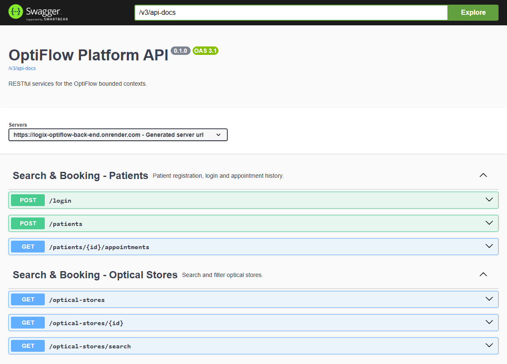


**Endpoints de Search & Booking**: Disponibilidad, citas, favoritos y calificaciones (ver Figura 137).


<a id="figura-137"></a>

**Figura 137**

*Endpoints de disponibilidad y citas en Swagger*

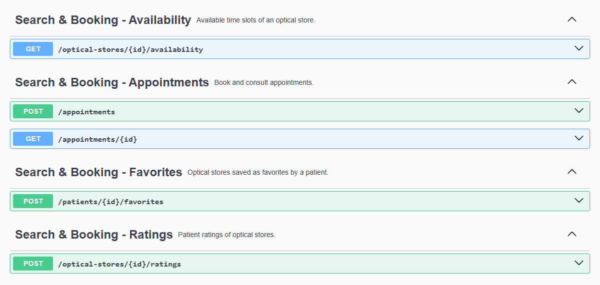


**Endpoints de Clinical & Commercial.** Operaciones de expediente clínico, receta, cotizaciones y ventas (ver Figura 138).


<a id="figura-138"></a>

**Figura 138**

*Endpoints de Clinical & Commercial en Swagger*

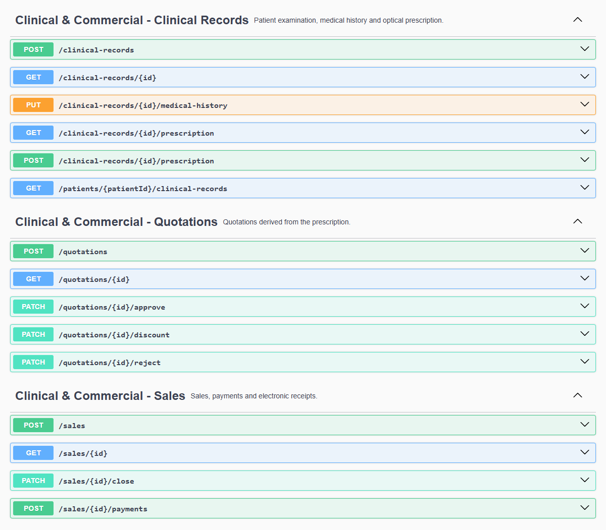


**Endpoints de Production & Tracking.** Operaciones de órdenes de trabajo, técnicos y laboratorios (ver Figura 139).


<a id="figura-139"></a>

**Figura 139**

*Endpoints de Production & Tracking en Swagger*

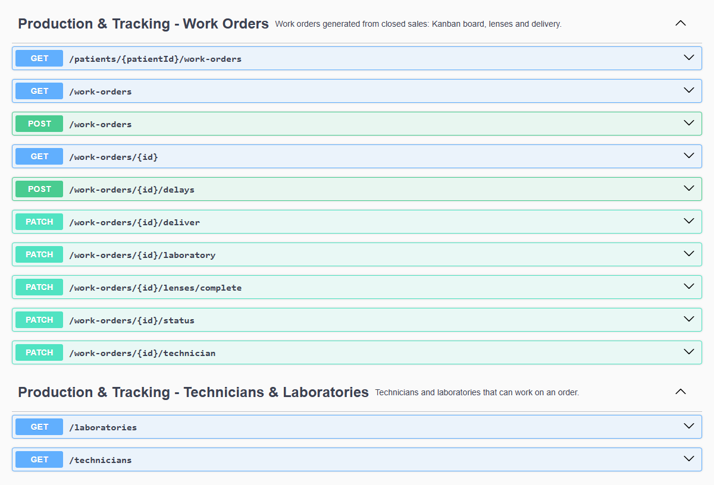


**Consulta de ópticas en el entorno desplegado.** GET /api/v1/optical-stores devuelve HTTP 200 con las sucursales de Miraflores y San Isidro (ver Figura 140).


<a id="figura-140"></a>

**Figura 140**

*Consulta de ópticas en Render*

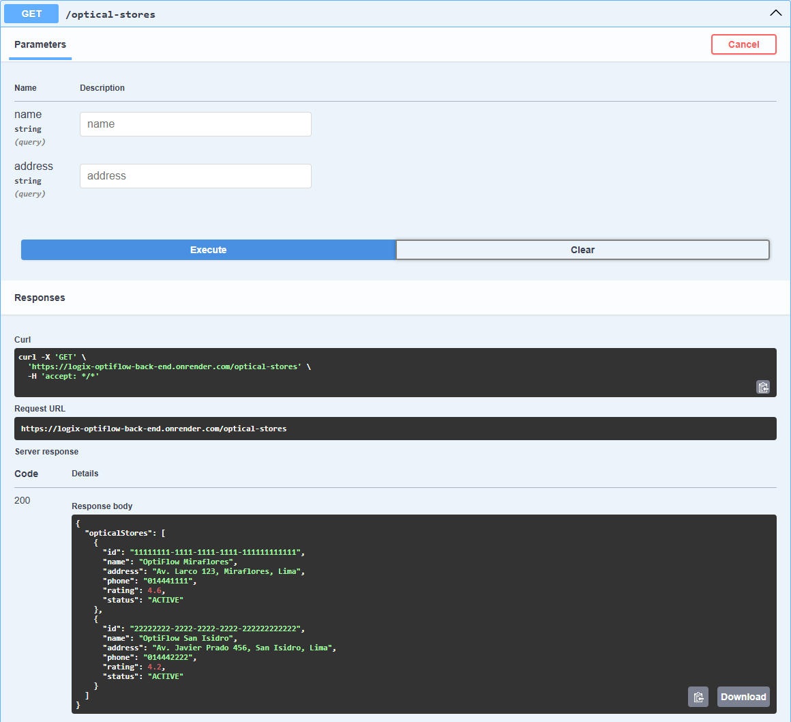


**Consulta de disponibilidad.** GET /api/v1/optical-stores/{id}/time-slots devuelve HTTP 200 con los horarios disponibles de la sucursal de Miraflores (ver Figura 141).


<a id="figura-141"></a>

**Figura 141**

*Disponibilidad de horarios en Render*

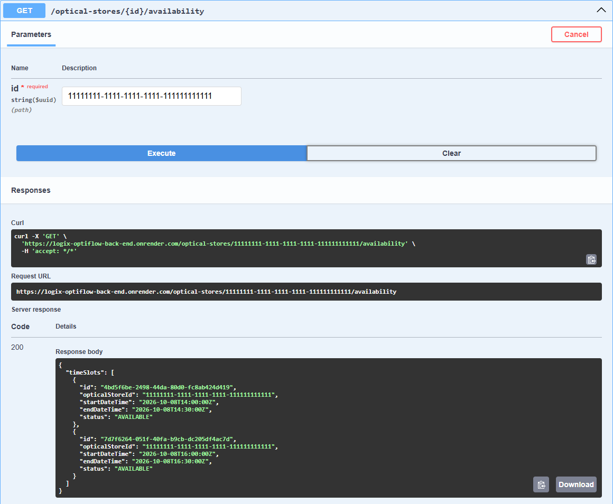


**Consulta de técnicos de Production & Tracking.** GET /api/v1/technicians devuelve HTTP 200 con los técnicos registrados para asignar órdenes de trabajo (ver Figura 142).


<a id="figura-142"></a>

**Figura 142**

*Técnicos en Swagger desplegado*

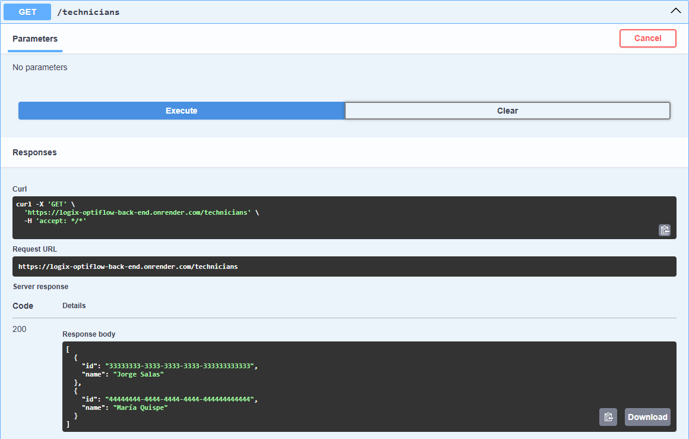


##### Commits relacionados con la documentación

Los commits del repositorio de Web Services que incorporan o modifican la documentación OpenAPI durante el Sprint 1 se detallan en la Tabla 124.

<a id="tabla-124"></a>

**Tabla 124**

*Commits relacionados con la documentación de los Web Services*

| Repository | Branch | Commit Id | Commit Message | Commit Message Body | Commited on (Date) |
|---|---|---|---|---|---|
| [BL-App-Movil-1ACC0238-2620-4951/Logix-OptiFlow-Back-End](https://github.com/BL-App-Movil-1ACC0238-2620-4951/Logix-OptiFlow-Back-End) | `develop` | [543aaf2](https://github.com/BL-App-Movil-1ACC0238-2620-4951/Logix-OptiFlow-Back-End/commit/543aaf2cb3c2f0638b88ea7e9203afe313d9883d) | `Add OptiFlow booking backend` | Agrega la dependencia springdoc-openapi y configura las rutas de Swagger UI y de la especificación OpenAPI. | 06/10/2026 |
| [BL-App-Movil-1ACC0238-2620-4951/Logix-OptiFlow-Back-End](https://github.com/BL-App-Movil-1ACC0238-2620-4951/Logix-OptiFlow-Back-End) | `develop` | [d2dc08b](https://github.com/BL-App-Movil-1ACC0238-2620-4951/Logix-OptiFlow-Back-End/commit/d2dc08b5fbe325ebf7523b7bc469f3e042289e2b) | `refactor: reorganize packages` | Crea la clase `OpenApiConfiguration` en el paquete `shared/documentation/openapi`. | 07/10/2026 |
| [BL-App-Movil-1ACC0238-2620-4951/Logix-OptiFlow-Back-End](https://github.com/BL-App-Movil-1ACC0238-2620-4951/Logix-OptiFlow-Back-End) | `develop` | [8a62f6e](https://github.com/BL-App-Movil-1ACC0238-2620-4951/Logix-OptiFlow-Back-End/commit/8a62f6ec5cd2ab5651f5f8de46afef8d76542f8c) | `docs: group swagger endpoints` | Agrupa los endpoints por bounded context con `OpenApiTags` y la anotación `@Tag` en los controladores. | 07/10/2026 |
| [BL-App-Movil-1ACC0238-2620-4951/Logix-OptiFlow-Back-End](https://github.com/BL-App-Movil-1ACC0238-2620-4951/Logix-OptiFlow-Back-End) | `develop` | [c00cb77](https://github.com/BL-App-Movil-1ACC0238-2620-4951/Logix-OptiFlow-Back-End/commit/c00cb774d340ffb2f1eeab2f625a573cde5a600f) | `feat: add production endpoints` | Agrega a Swagger UI los grupos de órdenes de trabajo y de técnicos y laboratorios de Production & Tracking. | 07/10/2026 |

#### 4.2.1.8. Software Deployment Evidence for Sprint Review

La evidencia de despliegue del Sprint 1 comprende la **Landing Page en GitHub Pages**, los **Web Services en Render mediante Docker** y la distribución de la **aplicación móvil mediante Firebase App Distribution**. Cada producto tiene un mecanismo de publicación distinto. La sección identifica los entornos utilizados y debe interpretarse junto con las evidencias de ejecución y pruebas, sin equiparar la publicación con la validación de todas las funciones del producto (ver Tabla 125).


<a id="tabla-125"></a>

**Tabla 125**

*Productos desplegados en el Sprint 1*


| Producto | Plataforma | URL |
| :--- | :--- | :--- |
| Landing Page | GitHub Pages | [https://bl-app-movil-1acc0238-2620-4951.github.io/Logix-OptiFlow-landing-page/](https://bl-app-movil-1acc0238-2620-4951.github.io/Logix-OptiFlow-landing-page/) |
| Web Services | Render (Docker) | [https://logix-optiflow-back-end.onrender.com/swagger-ui/index.html](https://logix-optiflow-back-end.onrender.com/swagger-ui/index.html) |
| Aplicación móvil | Firebase App Distribution | [https://appdistribution.firebase.dev/i/69aa930a1cd1ad63](https://appdistribution.firebase.dev/i/69aa930a1cd1ad63) |

##### Landing Page

El código de la Landing Page se encuentra en el repositorio [Logix-OptiFlow-landing-page](https://github.com/BL-App-Movil-1ACC0238-2620-4951/Logix-OptiFlow-landing-page). GitHub Pages se eligió porque aloja sitios estáticos sin costo y publica automáticamente los cambios integrados en la rama configurada.

**Paso 1: Acceso a la configuración del repositorio.**

Desde el repositorio de la Landing Page en la organización de GitHub se ingresó a la pestaña **Settings** y luego a la sección **Pages**.

**Paso 2: Configuración de la fuente de publicación.**

Se seleccionó *Deploy from a branch* como fuente, la rama `main` y la carpeta raíz (`/root`). Con esta configuración GitHub Pages publica el sitio en la URL de la organización y fuerza el uso de HTTPS (ver Figura 143).


<a id="figura-143"></a>

**Figura 143**

*Configuración de GitHub Pages del repositorio de la Landing Page*

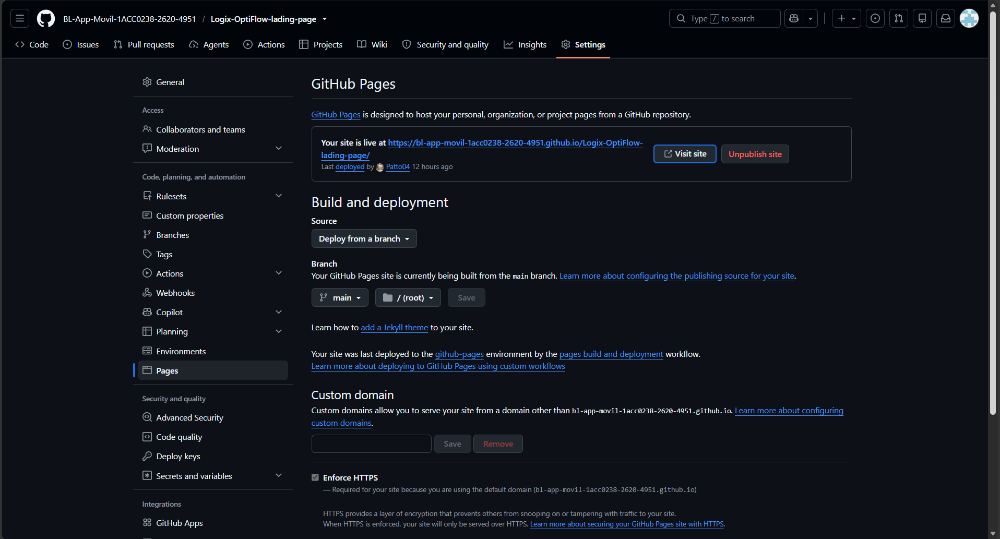

**Paso 3: Verificación del workflow de despliegue.**

Cada integración en `main` ejecuta el workflow `pages build and deployment`. La ejecución #10, lanzada por `Patto04` con el commit `54caeae`, terminó con estado *Success* en 45 segundos tras completar los jobs `build`, `report-build-status` y `deploy` (ver Figura 144).


<a id="figura-144"></a>

**Figura 144**

*Ejecución del workflow pages build and deployment*

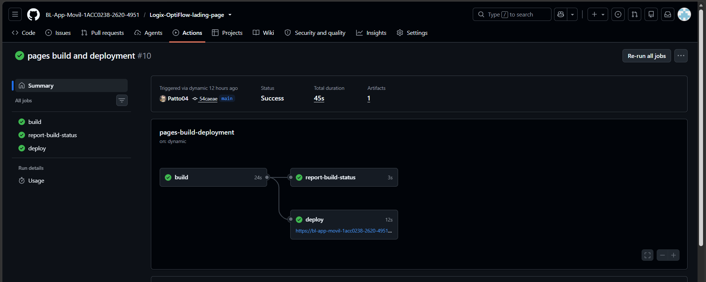

**Paso 4: Verificación del sitio publicado.**

Se ingresó a la URL pública generada por GitHub Pages y se comprobó que la Landing Page carga correctamente (ver Figura 145).


<a id="figura-145"></a>

**Figura 145**

*Landing Page publicada en GitHub Pages*

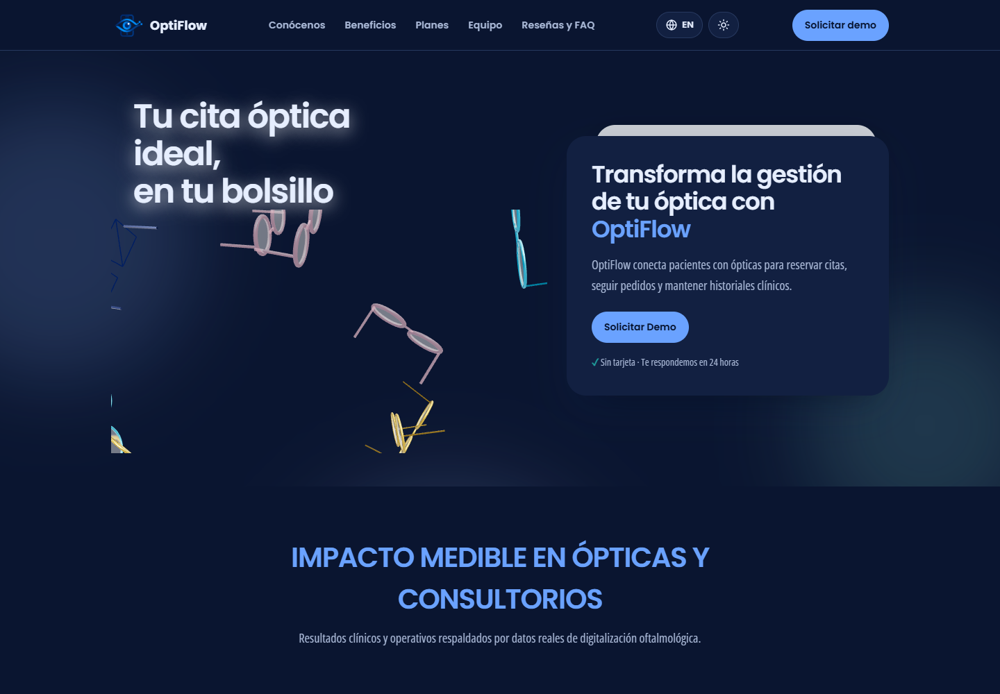

##### Web Services

El código del backend se encuentra en el repositorio [Logix-OptiFlow-Back-End](https://github.com/BL-App-Movil-1ACC0238-2620-4951/Logix-OptiFlow-Back-End). El servicio se desplegó en **Render** a partir del `Dockerfile` del repositorio, junto con una base de datos **PostgreSQL 16** administrada por la misma plataforma.

**Paso 1: Creación del proyecto y sus recursos.**

En Render se creó el proyecto **OptiFlow-Back-end** con un entorno *Production* que agrupa dos recursos en la región Frankfurt: el Web Service `Logix-OptiFlow-Back-End`, con runtime Docker, y la base de datos `Postgres Backend`, con PostgreSQL 16 (ver Figura 146).


<a id="figura-146"></a>

**Figura 146**

*Recursos del proyecto OptiFlow-Back-end en Render*

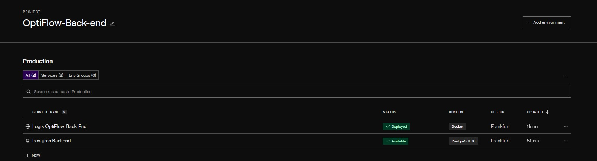

**Paso 2: Configuración del build con Docker.**

El Web Service se vinculó al repositorio del backend y a la rama `develop`. El `Dockerfile` usa una construcción en dos etapas: compila el proyecto con Maven y luego ejecuta el JAR generado sobre una imagen con Java 21, exponiendo el puerto 8080.

```dockerfile
FROM maven:3.9.11-eclipse-temurin-21 AS build
WORKDIR /app
COPY pom.xml .
COPY src ./src
RUN mvn -q -DskipTests package

FROM eclipse-temurin:21-jre
WORKDIR /app
COPY --from=build /app/target/optiflow-platform-0.1.0.jar app.jar
EXPOSE 8080
ENTRYPOINT ["java", "-jar", "app.jar"]
```

**Paso 3: Conexión con la base de datos.**

El backend define dos perfiles de Spring: `local`, con base de datos H2 en memoria, y `postgres`, que lee la conexión desde `SPRING_DATASOURCE_URL`, `SPRING_DATASOURCE_USERNAME` y `SPRING_DATASOURCE_PASSWORD` y aplica las migraciones de Flyway. Estos valores se registran como variables de entorno del servicio en Render y no se incluyen en el repositorio.

**Paso 4: Verificación del despliegue.**

Render vuelve a desplegar el servicio cada vez que se actualiza `develop`. El último despliegue corresponde al commit `6c388bc` y se encuentra en estado *Live* en [https://logix-optiflow-back-end.onrender.com](https://logix-optiflow-back-end.onrender.com). Como el servicio utiliza el plan gratuito, se suspende tras un periodo sin tráfico y la primera solicitud posterior puede demorar alrededor de un minuto. Swagger UI responde en la URL pública con los endpoints de los tres bounded contexts (ver sección 4.2.1.7) (ver Figura 147).


<a id="figura-147"></a>

**Figura 147**

*Web Service en estado Live y su historial de despliegues*

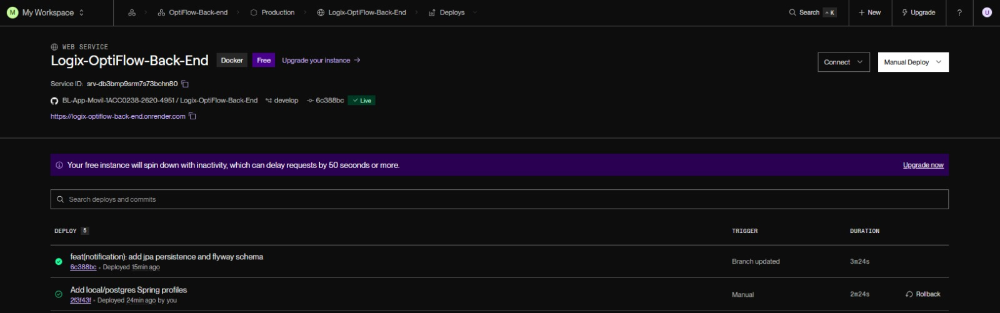

##### Aplicación móvil

La aplicación móvil se desarrolla en **Kotlin con Jetpack Compose** en el repositorio [Logix-OptiFlow-Mobile](https://github.com/BL-App-Movil-1ACC0238-2620-4951/Logix-OptiFlow-Mobile) y se distribuyó mediante **Firebase App Distribution** para que los evaluadores puedan instalarla en sus dispositivos Android. La variante `prodDebug` consume los Web Services desplegados en Render.

**Paso 1: Creación del proyecto en Firebase.**

Se creó el proyecto **Optiflow** en la consola de Firebase, con el plan Spark sin costo (ver Figura 148).


<a id="figura-148"></a>

**Figura 148**

*Proyecto Optiflow en la consola de Firebase*

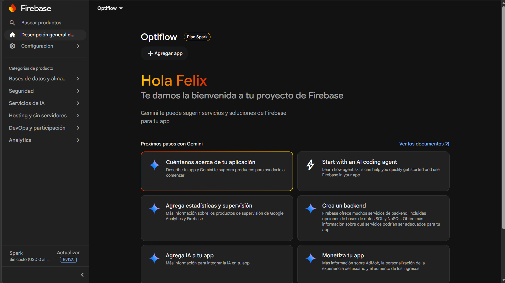

**Paso 2: Registro de la aplicación Android.**

Se registró la aplicación Android dentro del proyecto con los siguientes datos:

```
Alias de la aplicación: OptiFlow
Nombre del paquete: com.logix.optiflow
```


El aplicación Android registrada en Firebase se muestra en la Figura 149.

<a id="figura-149"></a>

**Figura 149**

*Aplicación Android registrada en Firebase*

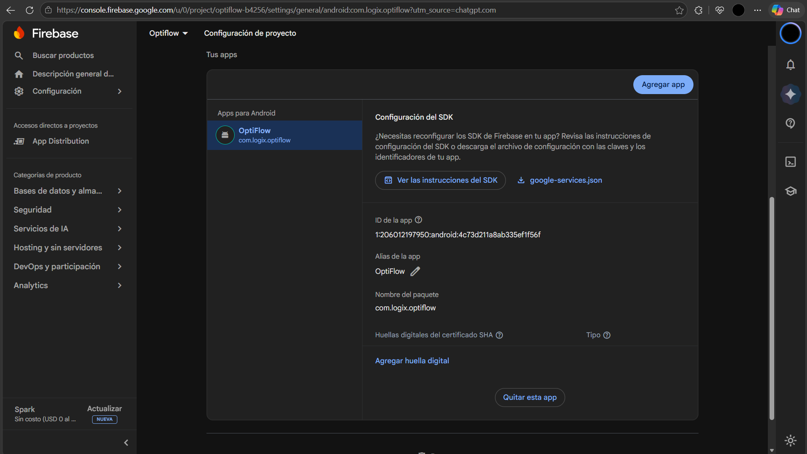

**Paso 3: Generación del APK desde Android Studio.**

En Android Studio se seleccionó la variante `prodDebug` en **Build Variants** y se generó el APK desde el menú **Build → Generate App Bundles or APKs → Generate APKs** (ver Figura 150).


<a id="figura-150"></a>

**Figura 150**

*Variante prodDebug seleccionada en Build Variants*

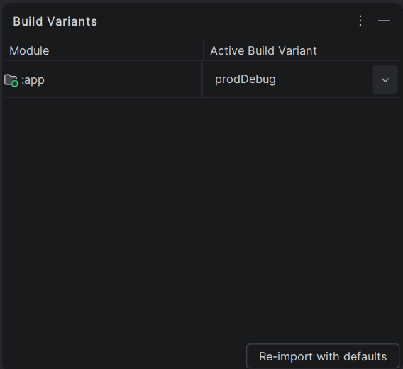


La generación del APK en Android Studio se presenta en la Figura 151.

<a id="figura-151"></a>

**Figura 151**

*Generación del APK en Android Studio*

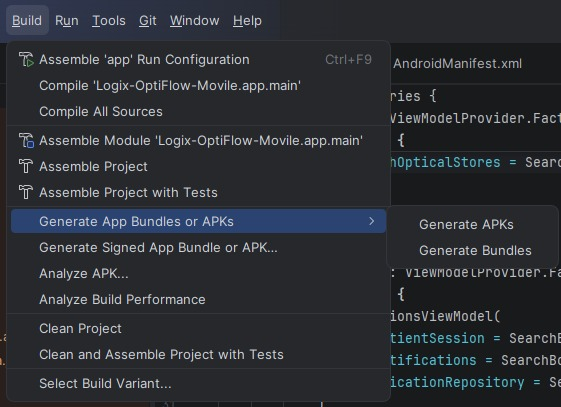

**Paso 4: Ubicación del APK generado.**

El archivo generado se ubicó en la siguiente ruta del proyecto:

```
app/build/outputs/apk/prod/debug/app-prod-debug.apk
```


El APK generado en la carpeta de salida del proyecto se observa en la Figura 152.

<a id="figura-152"></a>

**Figura 152**

*APK generado en la carpeta de salida del proyecto*

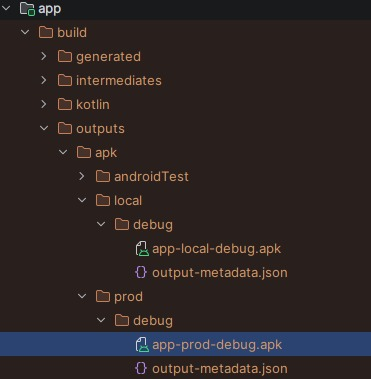

**Paso 5: Carga del APK en Firebase App Distribution.**

Se ingresó al módulo **App Distribution** y se cargó el APK, que se registró como la versión **1.0 (1)** (ver Figura 153).


<a id="figura-153"></a>

**Figura 153**

*Versión 1.0 (1) cargada en Firebase App Distribution*

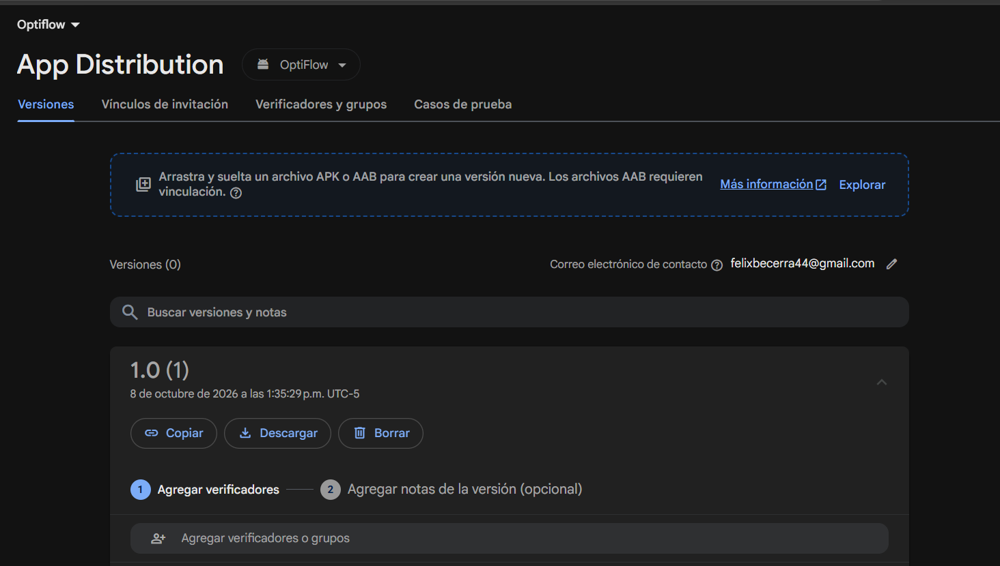

**Paso 6: Registro de evaluadores.**

Se creó el grupo `optiflow-testers` con seis evaluadores y se le distribuyó la versión 1.0 (1) con la nota "Sprint 1 – versión inicial de OptiFlow" (ver Figura 154).


<a id="figura-154"></a>

**Figura 154**

*Grupo de evaluadores optiflow-testers*

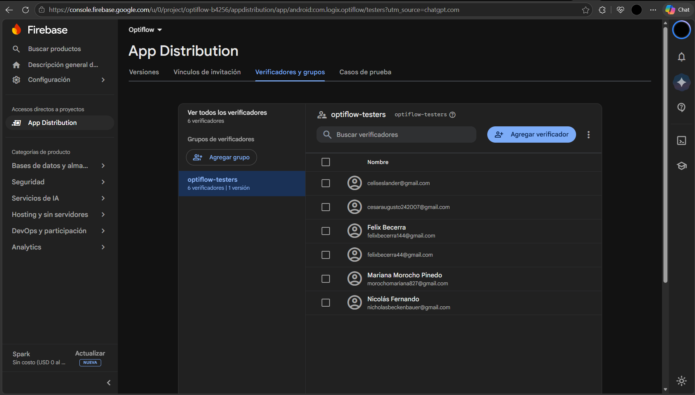

**Paso 7: Creación del vínculo de invitación.**

Se generó un vínculo de invitación asociado al grupo `optiflow-testers`. Cualquier persona que lo abra desde un dispositivo Android puede iniciar sesión con su cuenta de Google, unirse al grupo y descargar la aplicación: [https://appdistribution.firebase.dev/i/69aa930a1cd1ad63](https://appdistribution.firebase.dev/i/69aa930a1cd1ad63) (ver Figura 155).


<a id="figura-155"></a>

**Figura 155**

*Vínculo de invitación de Firebase App Distribution*

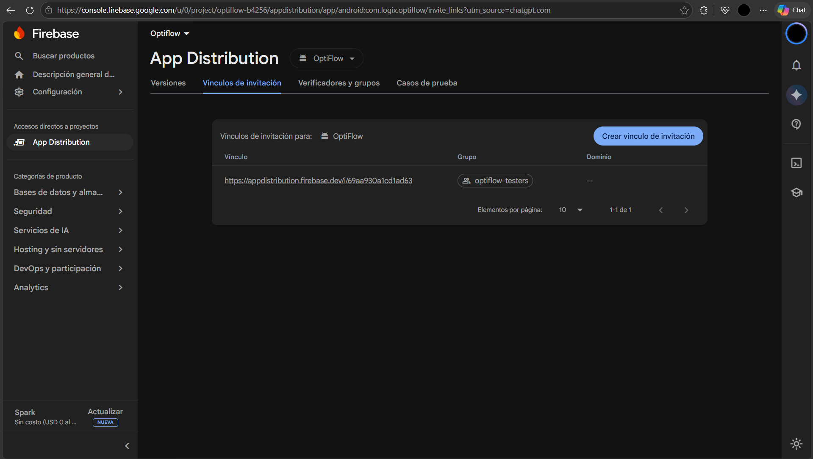

**Paso 8: Instalación en un dispositivo.**

Desde un dispositivo Android se abrió el vínculo de invitación y se instaló la versión 1.0 (1) mediante Firebase App Tester (ver Figura 156).


<a id="figura-156"></a>

**Figura 156**

*Versión 1.0 (1) instalada desde Firebase App Tester*

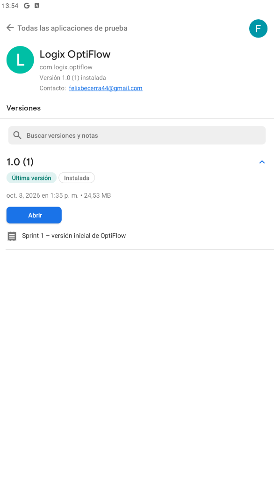

**Paso 9: Verificación de la aplicación contra el backend desplegado.**

Se comprobó que la aplicación instalada se comunica con el backend desplegado en Render: el registro e inicio de sesión del paciente, la búsqueda de ópticas y la consulta de disponibilidad devolvieron los mismos datos que Swagger UI (ver Figura 157).


<a id="figura-157"></a>

**Figura 157**

*Pantalla de inicio del paciente en el dispositivo*

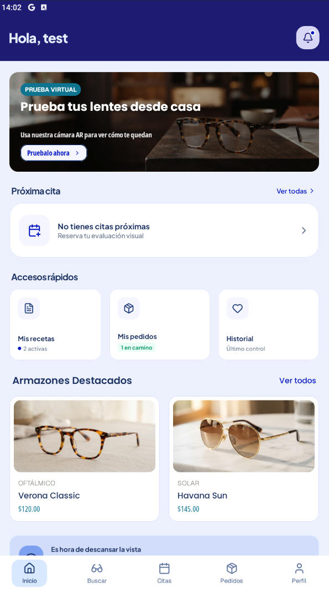


El inicio de sesión del paciente contra el backend desplegado se muestra en la Figura 158.

<a id="figura-158"></a>

**Figura 158**

*Inicio de sesión del paciente contra el backend desplegado*

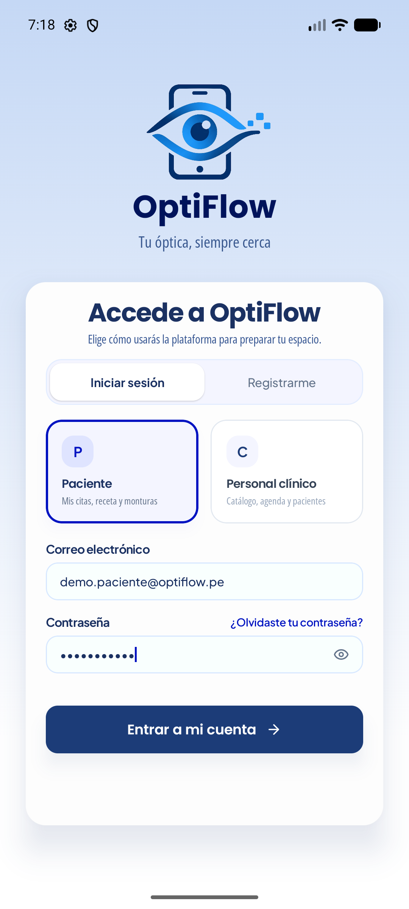


La búsqueda de ópticas obtenida de Render se presenta en la Figura 159.

<a id="figura-159"></a>

**Figura 159**

*Búsqueda de ópticas obtenida de Render*

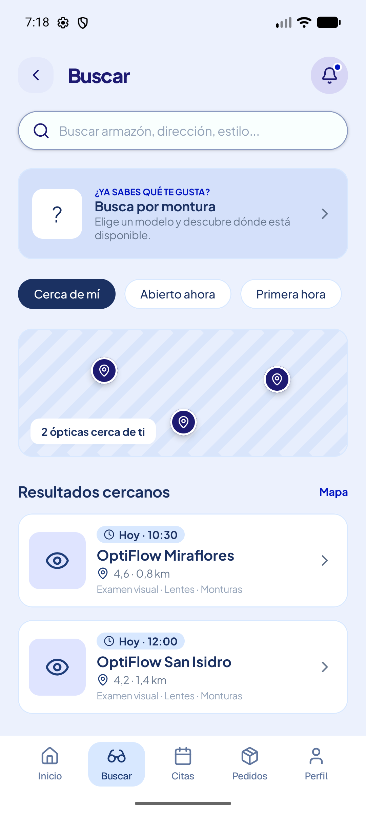


La disponibilidad de horarios obtenida de Render se observa en la Figura 160.

<a id="figura-160"></a>

**Figura 160**

*Disponibilidad de horarios obtenida de Render*

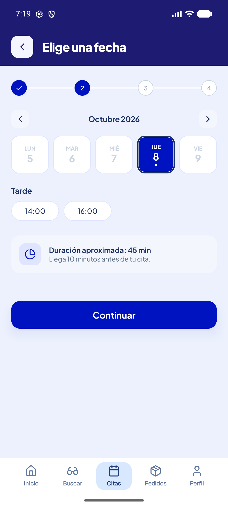

Los horarios de 14:00 y 16:00 coinciden con la respuesta de `GET /api/v1/optical-stores/{id}/time-slots` de la [Figura 141](#figura-141).

#### 4.2.1.9. Team Collaboration Insights during Sprint

Durante el Sprint 1, las tareas de implementación de la Landing Page, los Web Services y la aplicación móvil se distribuyeron entre los integrantes según la matriz de líderes y colaboradores de la sección 4.2.1.2. El trabajo siguió **GitFlow** y **Conventional Commits**: cada integrante trabajó en ramas `feature/*` creadas desde `develop` y los cambios se integraron mediante *pull requests*. En la Landing Page, la publicación se realiza desde `main`, que dispara el workflow de GitHub Pages (ver Tabla 126).


<a id="tabla-126"></a>

**Tabla 126**

*Integrantes del equipo y sus usuarios de GitHub*


| Integrante | Usuario de GitHub | Autor en el historial de commits |
| :--- | :--- | :--- |
| Atoche Gonzales, Nicolas Fernando | `THECOMAX` | Fernando N. / Nicolas-Ato |
| Becerra Ttito, Felix Orlando | `Felixb14` | Felixb14 |
| Celis Berrospi, Eslander | `Eslander-Celis` | Eslander-Celis |
| Morocho Pinedo, Mariana | `Patto04` | Patto04 |
| Quispe Llacsahuanga, César Augusto | `user20-bit` | Cesar Augusto |

Las siguientes figuras muestran la actividad de cada repositorio según **GitHub Insights**, consultada el 2026-10-08. La sección *Contributors* cuenta los commits de cada integrante en la rama principal de trabajo, sin incluir los commits de *merge*, y la sección *Commits* muestra la cantidad de commits por semana. La mayor parte de la actividad se concentra en las semanas del 28 de septiembre y del 5 de octubre de 2026, que corresponden al Sprint 1.

##### Landing Page

En la rama `main` del repositorio de la Landing Page se registran contribuciones de los cinco integrantes: `Patto04` (8 commits), `user20-bit` (3), `Felixb14` (3), `Eslander-Celis` (3) y `THECOMAX` (2) (ver Figura 161).


<a id="figura-161"></a>

**Figura 161**

*Contribuidores del repositorio de la Landing Page*

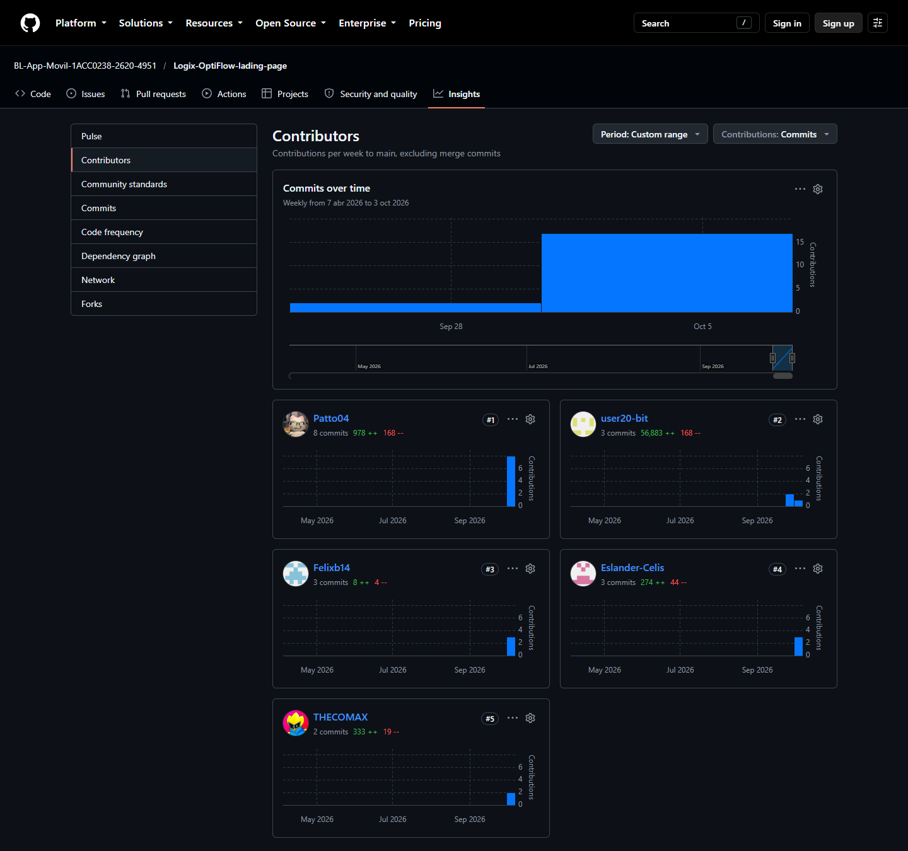


Los commits por semana del repositorio de la Landing Page se muestran en la Figura 162.

<a id="figura-162"></a>

**Figura 162**

*Commits por semana del repositorio de la Landing Page*

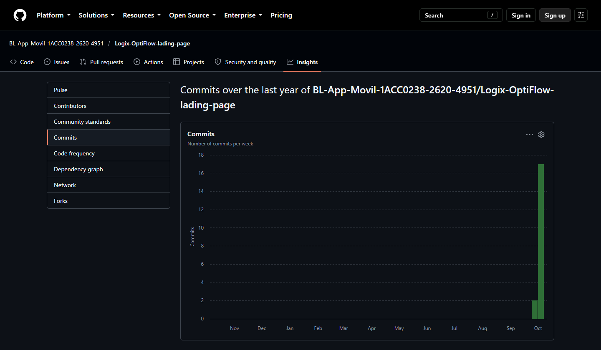

##### Web Services

En la rama `develop` del backend se registran 14 commits de `Felixb14`, 5 de `user20-bit` y 3 de `Eslander-Celis`, correspondientes a la implementación de los bounded contexts, los perfiles de base de datos y la configuración del despliegue (ver Figura 163).


<a id="figura-163"></a>

**Figura 163**

*Contribuidores del repositorio de los Web Services*

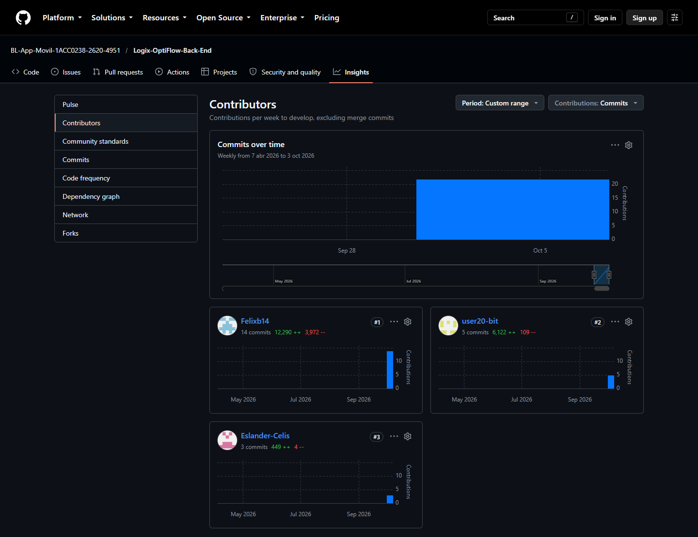


Los commits por semana del repositorio de los Web Services se presentan en la Figura 164.

<a id="figura-164"></a>

**Figura 164**

*Commits por semana del repositorio de los Web Services*

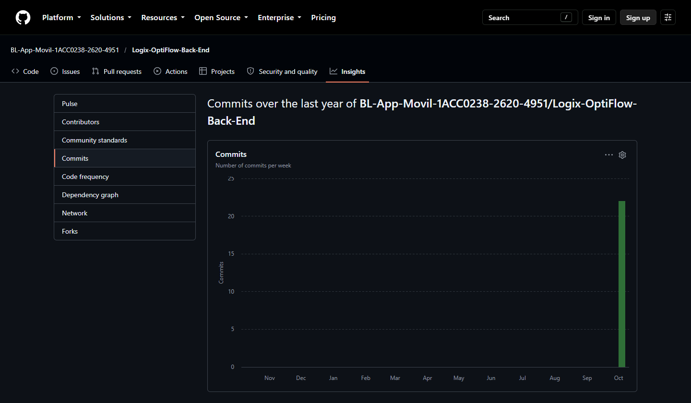

##### Aplicación móvil

En la rama `develop` de la aplicación móvil se registran 15 commits de `user20-bit` y 5 de `Felixb14`, correspondientes a la estructura base del proyecto, la integración con los Web Services y las pantallas de los roles de paciente y personal clínico (ver Figura 165).


<a id="figura-165"></a>

**Figura 165**

*Contribuidores del repositorio de la aplicación móvil*

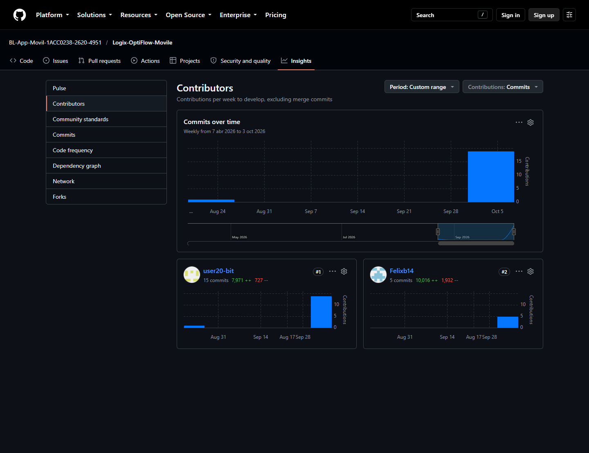


Los commits por semana del repositorio de la aplicación móvil se observan en la Figura 166.

<a id="figura-166"></a>

**Figura 166**

*Commits por semana del repositorio de la aplicación móvil*

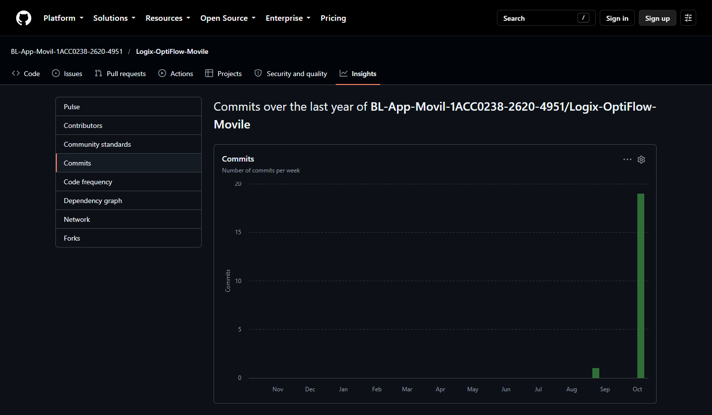

### 4.2.2. Sprint 2

El Sprint 2 amplía el trabajo del primer incremento con la versión `/api/v1` de los servicios, autenticación con tokens, permisos por rol, ubicación de las ópticas y una nueva aplicación Flutter. La Landing Page incorpora ajustes de navegación, accesibilidad y publicación. La revisión de AV2 se actualizó el 10/11/2026 sobre versiones identificadas de cada repositorio.

Se distinguen tres resultados: código publicado, comportamiento comprobado y funcionalidades que todavía usan datos de demostración. La incorporación de una pantalla o de un contrato HTTP no significa, por sí sola, que la historia esté integrada y aceptada de extremo a extremo.

#### 4.2.2.1. Sprint Planning 2

La planificación del Sprint 2 reúne la integración del cliente Flutter, la seguridad de los servicios y la consulta de información del paciente. El alcance se centra en las historias US01, US04, US11 y US16; la búsqueda y reserva de US05 y US06 continúan como integración y regresión del primer incremento.

La Tabla 125 reúne el objetivo del Sprint 2, la capacidad de trabajo y las historias seleccionadas. La coordinación se realiza por Discord y el seguimiento se organiza mediante las tareas del Sprint Backlog.

<a id="tabla-125"></a>

**Tabla 125**

*Sprint Planning 2*

<table>
<tbody>
<tr><th>Sprint #</th><td>Sprint 2</td></tr>
<tr><th colspan="2">Sprint Planning Background</th></tr>
<tr><th>Date</th><td>2026-11-01</td></tr>
<tr><th>Time</th><td>07:00 PM</td></tr>
<tr><th>Location</th><td>Discord, canal de voz del equipo.</td></tr>
<tr><th>Prepared By</th><td>Celis Berrospi, Eslander</td></tr>
<tr><th>Attendees (to planning meeting)</th><td>Atoche Gonzales, Nicolas Fernando / Becerra Ttito, Felix Orlando / Celis Berrospi, Eslander / Morocho Pinedo, Mariana / Quispe Llacsahuanga, César Augusto</td></tr>
<tr><th>Sprint 1 Review Summary</th><td>El primer incremento documentó la Landing Page y la búsqueda y reserva del paciente. Se mantienen sus capturas y resultados históricos. Para AV2 se amplían los servicios con seguridad y cercanía, y se incorpora Flutter. La revisión técnica detectó incompatibilidades en rutas y autenticación y un error de compilación de la suite; estos hallazgos se incluyen en el backlog de cierre.</td></tr>
<tr><th>Sprint 1 Retrospective Summary</th><td>La revisión del primer incremento identifica la coordinación entre el contrato HTTP y las pantallas como un punto de mejora. Para esta iteración se organiza el trabajo en tareas cortas por historia, con un responsable por aspecto. La revisión de permisos utiliza cuentas de prueba y el cierre técnico incluye la ejecución de la suite y el registro del commit y entorno empleados.</td></tr>
<tr><th colspan="2">Sprint Goal &amp; User Stories</th></tr>
<tr><th>Sprint 2 Goal</th><td>Nuestro enfoque consiste en que el paciente encuentre atención cercana, reserve con su cuenta y consulte su información, mientras el personal accede solo a las funciones de su rol. Consideramos que esto facilitará organizar la atención y seguir sus pedidos. El cumplimiento se confirmará cuando el paciente complete búsqueda y reserva sin ayuda en un máximo de cinco minutos, consulte historial y estado de pedido con datos de su cuenta, y todos los casos de acceso sin token y con rol no autorizado sean rechazados. El criterio de cierre combina la ejecución del recorrido móvil, la consulta de datos de la cuenta y la verificación de permisos.</td></tr>
<tr><th>Sprint 2 Velocity</th><td>18 Story Points de capacidad planificada para US01, US04, US11 y US16.</td></tr>
<tr><th>Sum of Story Points</th><td>18 Story Points: US01 (3), US04 (5), US11 (5) y US16 (5), según el Product Backlog. La regresión y adecuación de US05 y US06 del Sprint 1 se controlan como tareas de continuidad y no vuelven a sumar sus puntos originales.</td></tr>
</tbody>
</table>

Los Story Points corresponden a las historias seleccionadas; las estimaciones en horas corresponden a sus tareas. Las actividades de continuidad de US05 y US06 se incluyen en el backlog sin volver a sumar sus puntos originales.

#### 4.2.2.2. Aspect Leaders and Collaborators

Los aspectos del Sprint son servicios y seguridad, cliente Flutter, Landing Page y validación, pruebas, e integración y coordinación. La Tabla 126 identifica un líder por aspecto y relaciona sus colaboradores con las tareas del backlog.

Nicolas coordina la integración de Flutter; Felix, las pruebas; Mariana, la Landing Page y la validación; Eslander, la coordinación y las evidencias; y César, los servicios y la seguridad. Cada líder revisa sus tareas con los colaboradores y comunica los bloqueos que afectan al flujo de búsqueda y reserva.

<a id="tabla-126"></a>

**Tabla 126**

*Aspect leaders y colaboradores del Sprint 2*

| Team Member (Last Name, First Name) | GitHub Username | Servicios y seguridad<br>Leader (L) / Collaborator (C) | Cliente Flutter<br>Leader (L) / Collaborator (C) | Landing Page y validación<br>Leader (L) / Collaborator (C) | Pruebas<br>Leader (L) / Collaborator (C) | Integración y coordinación<br>Leader (L) / Collaborator (C) |
|---|---|:---:|:---:|:---:|:---:|:---:|
| Atoche Gonzales, Nicolas Fernando | `THECOMAX` | C | **L** | C | C | C |
| Becerra Ttito, Felix Orlando | `Felixb14` | C | C | C | **L** | C |
| Celis Berrospi, Eslander | `Eslander-Celis` | C | C | C | C | **L** |
| Morocho Pinedo, Mariana | `Patto04` | C | C | **L** | C | C |
| Quispe Llacsahuanga, César Augusto | `user20-bit` | **L** | C | C | C | C |

**L:** Leader. **C:** Collaborator.

#### 4.2.2.3. Sprint Backlog 2

La Tabla 127 descompone las historias y las actividades adicionales en tareas con un responsable, una estimación en horas y un estado. Las dependencias principales son el contrato de servicios, la adaptación del cliente móvil y la ejecución de pruebas antes de la distribución del APK.

**URL pública del Board del Sprint 2:** ____________________

**Captura del Board del Sprint 2:** ____________________

**Done** identifica tareas con evidencia comprobada; **To-Review**, tareas en revisión; y **To-do**, tareas pendientes de ejecución.

<a id="tabla-127"></a>

**Tabla 127**

*Sprint Backlog 2*

<table>
<thead>
<tr><th>Sprint #</th><th colspan="7">Sprint 2</th></tr>
<tr><th colspan="2">User Story</th><th colspan="6">Work-Item / Task</th></tr>
<tr><th>Id</th><th>Title</th><th>Id</th><th>Title</th><th>Description</th><th>Estimation<br>(Hours)</th><th>Assigned To</th><th>Status<br>(To-do / In-Process / To-Review / Done)</th></tr>
</thead>
<tbody>
<tr><td rowspan="3">—</td><td rowspan="3">Actividades adicionales del Sprint</td><td>S2-T01</td><td>Versionar los servicios REST</td><td>Conservar el prefijo /api/v1, unificar las consultas y devolver Location al crear recursos.</td><td>6</td><td>Quispe Llacsahuanga, César Augusto</td><td>Done</td></tr>
<tr><td>S2-T02</td><td>Publicar la base del cliente Flutter</td><td>Mantener la estructura de navegación, modelos, estado y cliente HTTP publicada en 0344413.</td><td>8</td><td>Quispe Llacsahuanga, César Augusto</td><td>Done</td></tr>
<tr><td>S2-T03</td><td>Coordinar la entrega de AV2</td><td>Revisar la matriz, el alcance y los criterios de cierre con todos los integrantes.</td><td>4</td><td>Celis Berrospi, Eslander</td><td>To-do</td></tr>
<tr><td rowspan="2">US01</td><td rowspan="2">Inicio de sesión en la aplicación móvil</td><td>S2-T04</td><td>Emitir tokens de autenticación</td><td>Exponer /api/v1/auth/tokens con token, expiresAt, userId y role.</td><td>6</td><td>Quispe Llacsahuanga, César Augusto</td><td>Done</td></tr>
<tr><td>S2-T05</td><td>Integrar el inicio de sesión en Flutter</td><td>Sustituir /login, leer el contrato vigente y enviar Authorization en las solicitudes protegidas.</td><td>8</td><td>Atoche Gonzales, Nicolas Fernando</td><td>To-do</td></tr>
<tr><td rowspan="2">US16</td><td rowspan="2">Gestión de permisos por roles</td><td>S2-T06</td><td>Aplicar autorización por rol</td><td>Restringir las operaciones administrativas y separar los permisos de pacientes y personal.</td><td>6</td><td>Quispe Llacsahuanga, César Augusto</td><td>Done</td></tr>
<tr><td>S2-T07</td><td>Revisar permisos de extremo a extremo</td><td>Comprobar 401 sin token, 403 para el paciente y el acceso del rol autorizado desde la versión entregada.</td><td>4</td><td>Becerra Ttito, Felix Orlando</td><td>To-Review</td></tr>
<tr><td rowspan="3">US05</td><td rowspan="3">Búsqueda de ópticas y disponibilidad de atención</td><td>S2-T08</td><td>Consultar ópticas por cercanía</td><td>Revisar latitud, longitud y radio, incluidos parámetros incompletos y coordenadas inválidas.</td><td>6</td><td>Quispe Llacsahuanga, César Augusto</td><td>Done</td></tr>
<tr><td>S2-T09</td><td>Conectar la búsqueda y los horarios</td><td>Usar /optical-stores con filtros y /time-slots; mostrar carga, error y ausencia de resultados.</td><td>6</td><td>Atoche Gonzales, Nicolas Fernando</td><td>To-do</td></tr>
<tr><td>S2-T10</td><td>Automatizar la aceptación de cercanía</td><td>Incorporar el archivo .feature y sus Steps en Java para búsqueda válida y coordenadas inválidas.</td><td>4</td><td>Becerra Ttito, Felix Orlando</td><td>To-do</td></tr>
<tr><td rowspan="2">US06</td><td rowspan="2">Reserva de cita para atención optométrica</td><td>S2-T11</td><td>Integrar la reserva autenticada</td><td>Enviar el token, patientId, opticalStoreId y timeSlotId, y mostrar la confirmación de la API.</td><td>6</td><td>Atoche Gonzales, Nicolas Fernando</td><td>To-do</td></tr>
<tr><td>S2-T12</td><td>Revisar la reserva y su duplicidad</td><td>Repetir el caso 201/Location y el rechazo 409; contrastar el resultado con la interfaz.</td><td>4</td><td>Becerra Ttito, Felix Orlando</td><td>To-Review</td></tr>
<tr><td rowspan="2">US04</td><td rowspan="2">Consulta del historial clínico y receta</td><td>S2-T13</td><td>Conectar la consulta de historial y receta</td><td>Sustituir datos de demostración por las respuestas del paciente y gestionar el historial vacío.</td><td>6</td><td>Atoche Gonzales, Nicolas Fernando</td><td>To-do</td></tr>
<tr><td>S2-T14</td><td>Comprobar el historial del paciente</td><td>Verificar contenido, estados vacíos y tratamiento de errores con la cuenta de prueba.</td><td>4</td><td>Becerra Ttito, Felix Orlando</td><td>To-do</td></tr>
<tr><td rowspan="2">US11</td><td rowspan="2">Seguimiento del estado de los pedidos</td><td>S2-T15</td><td>Conectar el seguimiento de pedidos</td><td>Consumir /patients/{patientId}/work-orders y diferenciar el estado real de los ejemplos locales.</td><td>6</td><td>Atoche Gonzales, Nicolas Fernando</td><td>To-do</td></tr>
<tr><td>S2-T16</td><td>Comprobar los estados del pedido</td><td>Revisar su representación en Flutter y el mensaje que se muestra cuando no existen órdenes.</td><td>4</td><td>Becerra Ttito, Felix Orlando</td><td>To-do</td></tr>
<tr><td rowspan="8">—</td><td rowspan="8">Actividades adicionales del Sprint</td><td>S2-T17</td><td>Mejorar la Landing Page</td><td>Conservar los cambios de accesibilidad, navegación, diseño y configuración de publicación del repositorio.</td><td>6</td><td>Morocho Pinedo, Mariana</td><td>Done</td></tr>
<tr><td>S2-T18</td><td>Verificar la publicación y la descarga</td><td>Confirmar el workflow de Pages y que Descargar APK apunte a la versión que se entregará.</td><td>4</td><td>Morocho Pinedo, Mariana</td><td>To-Review</td></tr>
<tr><td>S2-T19</td><td>Corregir la compilación de las pruebas</td><td>Corregir las solicitudes de AuthenticationAuthorizationApiTest. La corrección c287603 está integrada y la suite compila en 41bcb44.</td><td>2</td><td>Quispe Llacsahuanga, César Augusto</td><td>Done</td></tr>
<tr><td>S2-T20</td><td>Ejecutar la suite y adjuntar reportes</td><td>Maven: 131 pruebas aprobadas el 10/11/2026, incluidos cuatro escenarios de aceptación. La ejecución de Flutter se revisa junto con el APK.</td><td>4</td><td>Becerra Ttito, Felix Orlando</td><td>To-Review</td></tr>
<tr><td>S2-T21</td><td>Preparar evidencias y video de ejecución</td><td>Registrar Swagger, capturas de Flutter y momentos del video con la versión probada.</td><td>6</td><td>Celis Berrospi, Eslander</td><td>To-Review</td></tr>
<tr><td>S2-T22</td><td>Generar y distribuir el APK</td><td>Construir e instalar el APK con la URL compatible y registrar versión, dispositivo y enlace de distribución.</td><td>4</td><td>Atoche Gonzales, Nicolas Fernando</td><td>To-do</td></tr>
<tr><td>S2-T23</td><td>Coordinar las entrevistas de validación</td><td>Realizar tres entrevistas por segmento y registrar datos, tiempos, capturas y observaciones.</td><td>8</td><td>Morocho Pinedo, Mariana</td><td>To-do</td></tr>
<tr><td>S2-T24</td><td>Consolidar el cierre del Sprint</td><td>Revisar evidencias, resultados, tablero e Insights; actualizar el informe con los acuerdos confirmados.</td><td>4</td><td>Celis Berrospi, Eslander</td><td>To-do</td></tr>
</tbody>
</table>

**Estimación del Sprint:** 126 horas distribuidas entre 24 tareas. César tiene 34 horas asignadas a servicios, seguridad y corrección de pruebas; Nicolas, 36 horas a Flutter e integración; Felix, 24 horas a verificación; Mariana, 18 horas a Landing Page y validación; y Eslander, 14 horas a coordinación y evidencias. Las actividades de publicación, pruebas y validación se incluyen sin Story Points adicionales.

#### 4.2.2.4. Development Evidence for Sprint Review

La evidencia se obtiene de los historiales de los repositorios, con fechas expresadas en America/Lima. Los mensajes de commit se conservan y la columna de explicación resume en español el cambio observado. La Tabla 128 reúne los avances del backend, Flutter y la Landing Page.

<a id="tabla-128"></a>

**Tabla 128**

*Commits de desarrollo del Sprint 2*

| Repository | Branch | Commit Id | Commit Message | Commit Message Body | Commited on (Date) |
|---|---|---|---|---|---|
| [BL-App-Movil-1ACC0238-2620-4951/Logix-OptiFlow-Back-End](https://github.com/BL-App-Movil-1ACC0238-2620-4951/Logix-OptiFlow-Back-End) | `develop` | [1c5d3f7](https://github.com/BL-App-Movil-1ACC0238-2620-4951/Logix-OptiFlow-Back-End/commit/1c5d3f7fb1b877df3b1d562fccb7d82a0a2f3b20) | `refactor: add api v1 prefix to controllers` | Introduce el prefijo `/api/v1` en los controladores. | 06/11/2026 |
| [BL-App-Movil-1ACC0238-2620-4951/Logix-OptiFlow-Back-End](https://github.com/BL-App-Movil-1ACC0238-2620-4951/Logix-OptiFlow-Back-End) | `develop` | [c35048f](https://github.com/BL-App-Movil-1ACC0238-2620-4951/Logix-OptiFlow-Back-End/commit/c35048fa938a448e17c52da0a5fa1b743a509f94) | `refactor: return location header on created resources` | Devuelve el encabezado Location al crear recursos. | 06/11/2026 |
| [BL-App-Movil-1ACC0238-2620-4951/Logix-OptiFlow-Back-End](https://github.com/BL-App-Movil-1ACC0238-2620-4951/Logix-OptiFlow-Back-End) | `develop` | [a1db022](https://github.com/BL-App-Movil-1ACC0238-2620-4951/Logix-OptiFlow-Back-End/commit/a1db022c903f52b2e3b3915c8c22eeb2eb50f356) | `refactor: merge optical store search routes` | Unifica la consulta y los filtros de ópticas. | 06/11/2026 |
| [BL-App-Movil-1ACC0238-2620-4951/Logix-OptiFlow-Back-End](https://github.com/BL-App-Movil-1ACC0238-2620-4951/Logix-OptiFlow-Back-End) | `develop` | [5b0bbf2](https://github.com/BL-App-Movil-1ACC0238-2620-4951/Logix-OptiFlow-Back-End/commit/5b0bbf237ddefaa0e10592fa57e95e57a70d6cf1) | `feat: add authentication tokens endpoint` | Añade el contrato para emitir tokens de sesión. | 06/11/2026 |
| [BL-App-Movil-1ACC0238-2620-4951/Logix-OptiFlow-Back-End](https://github.com/BL-App-Movil-1ACC0238-2620-4951/Logix-OptiFlow-Back-End) | `develop` | [f9d0964](https://github.com/BL-App-Movil-1ACC0238-2620-4951/Logix-OptiFlow-Back-End/commit/f9d09646886d555c17fd64b66cad582fe08b150a) | `feat: add staff members and roles` | Incorpora usuarios de personal y sus roles. | 06/11/2026 |
| [BL-App-Movil-1ACC0238-2620-4951/Logix-OptiFlow-Back-End](https://github.com/BL-App-Movil-1ACC0238-2620-4951/Logix-OptiFlow-Back-End) | `develop` | [a5e729a](https://github.com/BL-App-Movil-1ACC0238-2620-4951/Logix-OptiFlow-Back-End/commit/a5e729a45e083224028189b79f16a3022a2964d1) | `feat: add role based authorization` | Aplica autorización por rol a las operaciones protegidas. | 06/11/2026 |
| [BL-App-Movil-1ACC0238-2620-4951/Logix-OptiFlow-Back-End](https://github.com/BL-App-Movil-1ACC0238-2620-4951/Logix-OptiFlow-Back-End) | `develop` | [1eb0524](https://github.com/BL-App-Movil-1ACC0238-2620-4951/Logix-OptiFlow-Back-End/commit/1eb0524798938457b2750c6e87a73024ea823105) | `feat: add optical store location and nearby search` | Añade coordenadas y consulta de ópticas cercanas. | 06/11/2026 |
| [BL-App-Movil-1ACC0238-2620-4951/Logix-OptiFlow-Flutter](https://github.com/BL-App-Movil-1ACC0238-2620-4951/Logix-OptiFlow-Flutter) | `main` | [bf2eeb6](https://github.com/BL-App-Movil-1ACC0238-2620-4951/Logix-OptiFlow-Flutter/commit/bf2eeb65883f13c8660d888e306b839e87d3fe33) | `feat; Add Flutter OptiFlow client foundation` | Publica la estructura del nuevo cliente Flutter. | 08/11/2026 |
| [BL-App-Movil-1ACC0238-2620-4951/Logix-OptiFlow-Flutter](https://github.com/BL-App-Movil-1ACC0238-2620-4951/Logix-OptiFlow-Flutter) | `main` | [0344413](https://github.com/BL-App-Movil-1ACC0238-2620-4951/Logix-OptiFlow-Flutter/commit/03444133bb4889773dda3b250c708e315bb545b6) | `feat: Add cross-platform OptiFlow Flutter app` | Añade pantallas, navegación y estado para las experiencias de paciente y personal. | 08/11/2026 |
| [BL-App-Movil-1ACC0238-2620-4951/Logix-OptiFlow-landing-page](https://github.com/BL-App-Movil-1ACC0238-2620-4951/Logix-OptiFlow-landing-page) | `main` | [d59a496](https://github.com/BL-App-Movil-1ACC0238-2620-4951/Logix-OptiFlow-landing-page/commit/d59a4963a23847a47aa5832a4d64c44b303188b6) | `feat: incorporar mejoras de heurísticas, accesibilidad y animaciones sin diseño de fondos` | Incorpora ajustes de accesibilidad y de la experiencia visual. | 05/11/2026 |
| [BL-App-Movil-1ACC0238-2620-4951/Logix-OptiFlow-landing-page](https://github.com/BL-App-Movil-1ACC0238-2620-4951/Logix-OptiFlow-landing-page) | `main` | [753aa2b](https://github.com/BL-App-Movil-1ACC0238-2620-4951/Logix-OptiFlow-landing-page/commit/753aa2b177e4c0d8c091c552b771e85e160c3775) | `ci: configure GitHub Pages workflow, add .nojekyll and .gitignore` | Configura el workflow y archivos de publicación de GitHub Pages. | 06/11/2026 |
| [BL-App-Movil-1ACC0238-2620-4951/Logix-OptiFlow-landing-page](https://github.com/BL-App-Movil-1ACC0238-2620-4951/Logix-OptiFlow-landing-page) | `main` | [441701b](https://github.com/BL-App-Movil-1ACC0238-2620-4951/Logix-OptiFlow-landing-page/commit/441701b0d71a71171c5cec979c6019640d7576ba) | `fix: page.` | Registra la revisión de la página previa a su integración. | 06/11/2026 |
| [BL-App-Movil-1ACC0238-2620-4951/Logix-OptiFlow-Back-End](https://github.com/BL-App-Movil-1ACC0238-2620-4951/Logix-OptiFlow-Back-End) | `develop` | [f339e00](https://github.com/BL-App-Movil-1ACC0238-2620-4951/Logix-OptiFlow-Back-End/commit/f339e009a8720413a6c328240f3a84288c956912) | `feat: add satisfaction survey flow` | Incorpora el flujo de respuesta de encuestas de satisfacción. | 09/11/2026 |
| [BL-App-Movil-1ACC0238-2620-4951/Logix-OptiFlow-Back-End](https://github.com/BL-App-Movil-1ACC0238-2620-4951/Logix-OptiFlow-Back-End) | `develop` | [6106054](https://github.com/BL-App-Movil-1ACC0238-2620-4951/Logix-OptiFlow-Back-End/commit/61060542a5229d643b238e7aef9549b390a810a1) | `feat: add production report` | Añade la consulta de métricas de producción. | 09/11/2026 |
| [BL-App-Movil-1ACC0238-2620-4951/Logix-OptiFlow-Back-End](https://github.com/BL-App-Movil-1ACC0238-2620-4951/Logix-OptiFlow-Back-End) | `develop` | [37c6808](https://github.com/BL-App-Movil-1ACC0238-2620-4951/Logix-OptiFlow-Back-End/commit/37c6808f24023e0729e060335de7ffe34573371e) | `fix: let staff read patient appointments` | Permite al personal autorizado consultar las citas de un paciente. | 10/11/2026 |

El backend `41bcb44` incorpora un contrato diferente al consumido por el cliente anterior. El cliente Flutter `0344413` todavía usa `/login`, `/optical-stores/search` y `/availability`, y no añade el token a las solicitudes protegidas. La Tabla 129 muestra los ajustes necesarios para cerrar la integración.

<a id="tabla-129"></a>

**Tabla 129**

*Compatibilidad entre Flutter y el contrato versionado*

| Operación | Cliente Flutter publicado | Backend revisado | Resultado de la revisión |
|---|---|---|---|
| URL de servicios | Base sin prefijo y rutas relativas antiguas. | `/api/v1`. | Configurar una base versionada y comprobar todas las rutas. |
| Inicio de sesión | `POST /login`; espera datos dentro de `patient`. | `POST /api/v1/auth/tokens`; devuelve `token`, `expiresAt`, `userId` y `role`. | Adaptar ruta y transformación de la sesión. |
| Búsqueda filtrada | `GET /optical-stores/search`. | `GET /api/v1/optical-stores`, con parámetros. | Unificar listado y búsqueda en el cliente. |
| Disponibilidad | `GET /optical-stores/{id}/availability`. | `GET /api/v1/optical-stores/{id}/time-slots`. | Cambiar la subruta y comprobar la lista de horarios. |
| Recursos protegidos | Las llamadas HTTP no adjuntan el token. | Requiere `Authorization: Bearer <token>`. | Añadir el encabezado a las operaciones autenticadas. |
| Operación de personal y catálogo | Parte de las vistas utiliza `DemoData` y cambios en memoria. | El backend incorpora inventario, checkout, notificaciones y reportes; sus endpoints deben relacionarse con cada vista del cliente. | Identificar el modo de demostración y no contabilizarlo como integración terminada. |

Fuentes de la revisión: [cliente HTTP Flutter](https://github.com/BL-App-Movil-1ACC0238-2620-4951/Logix-OptiFlow-Flutter/blob/03444133bb4889773dda3b250c708e315bb545b6/lib/data/optiflow_api.dart), [controlador de estado](https://github.com/BL-App-Movil-1ACC0238-2620-4951/Logix-OptiFlow-Flutter/blob/03444133bb4889773dda3b250c708e315bb545b6/lib/state/optiflow_controller.dart) y controladores del backend del mismo corte.

#### 4.2.2.5. Testing Suite Evidence for Sprint Review

La revisión de pruebas corresponde al backend `41bcb44`, descargado sin cambios de código el 10/11/2026. La Tabla 130 registra los commits relacionados con el testing del Sprint 2.

<a id="tabla-130"></a>

**Tabla 130**

*Commits relacionados con pruebas*

| Repository | Branch | Commit Id | Commit Message | Commit Message Body | Commited on (Date) |
|---|---|---|---|---|---|
| [BL-App-Movil-1ACC0238-2620-4951/Logix-OptiFlow-Back-End](https://github.com/BL-App-Movil-1ACC0238-2620-4951/Logix-OptiFlow-Back-End) | `develop` | [7575d66](https://github.com/BL-App-Movil-1ACC0238-2620-4951/Logix-OptiFlow-Back-End/commit/7575d662e98b019e4716b90c61d7df04caa0acf0) | `test: add authentication and authorization tests` | Añade la suite de autenticación y autorización; sus correcciones posteriores forman parte de la revisión ejecutada. | 06/11/2026 |
| [BL-App-Movil-1ACC0238-2620-4951/Logix-OptiFlow-Back-End](https://github.com/BL-App-Movil-1ACC0238-2620-4951/Logix-OptiFlow-Back-End) | `develop` | [1eb0524](https://github.com/BL-App-Movil-1ACC0238-2620-4951/Logix-OptiFlow-Back-End/commit/1eb0524798938457b2750c6e87a73024ea823105) | `feat: add optical store location and nearby search` | Incluye pruebas de coordenadas y de búsqueda por cercanía. | 06/11/2026 |
| [BL-App-Movil-1ACC0238-2620-4951/Logix-OptiFlow-Flutter](https://github.com/BL-App-Movil-1ACC0238-2620-4951/Logix-OptiFlow-Flutter) | `main` | [0344413](https://github.com/BL-App-Movil-1ACC0238-2620-4951/Logix-OptiFlow-Flutter/commit/03444133bb4889773dda3b250c708e315bb545b6) | `feat: Add cross-platform OptiFlow Flutter app` | Incluye una prueba de traducción de estados de cita, aún sin ejecutar en esta revisión. | 08/11/2026 |
| [BL-App-Movil-1ACC0238-2620-4951/Logix-OptiFlow-Back-End](https://github.com/BL-App-Movil-1ACC0238-2620-4951/Logix-OptiFlow-Back-End) | `develop` | [c287603](https://github.com/BL-App-Movil-1ACC0238-2620-4951/Logix-OptiFlow-Back-End/commit/c287603381d0028f82cbf78d474b467525f0f2b3) | `test: fix misplaced parenthesis in auth api test` | Corrige el paréntesis de las solicitudes de autenticación para permitir la compilación. | 07/11/2026 |
| [BL-App-Movil-1ACC0238-2620-4951/Logix-OptiFlow-Back-End](https://github.com/BL-App-Movil-1ACC0238-2620-4951/Logix-OptiFlow-Back-End) | `develop` | [b4deec7](https://github.com/BL-App-Movil-1ACC0238-2620-4951/Logix-OptiFlow-Back-End/commit/b4deec7649d9b75e1848e48b9fe6564ad021599a) | `test: run flyway migrations on h2 in api tests` | Prepara la ejecución de las migraciones en el entorno H2 de pruebas. | 07/11/2026 |
| [BL-App-Movil-1ACC0238-2620-4951/Logix-OptiFlow-Back-End](https://github.com/BL-App-Movil-1ACC0238-2620-4951/Logix-OptiFlow-Back-End) | `develop` | [e0b8071](https://github.com/BL-App-Movil-1ACC0238-2620-4951/Logix-OptiFlow-Back-End/commit/e0b8071d12c00c540b16c19ad54f60550ac1583d) | `test: adapt multi column migrations for h2 instead of editing v5` | Adapta las migraciones de varias columnas al dialecto H2 utilizado por las pruebas. | 07/11/2026 |
| [BL-App-Movil-1ACC0238-2620-4951/Logix-OptiFlow-Back-End](https://github.com/BL-App-Movil-1ACC0238-2620-4951/Logix-OptiFlow-Back-End) | `develop` | [b428493](https://github.com/BL-App-Movil-1ACC0238-2620-4951/Logix-OptiFlow-Back-End/commit/b4284936056b235b7c2cd75b5efee8e612e2baf4) | `test: fix booking rules and time slot assertions` | Ajusta las expectativas de reglas de reserva y disponibilidad. | 07/11/2026 |
| [BL-App-Movil-1ACC0238-2620-4951/Logix-OptiFlow-Back-End](https://github.com/BL-App-Movil-1ACC0238-2620-4951/Logix-OptiFlow-Back-End) | `develop` | [1a3055f](https://github.com/BL-App-Movil-1ACC0238-2620-4951/Logix-OptiFlow-Back-End/commit/1a3055f1b3776f0d8e0939f56618db0c3f3c79f1) | `test: make store agenda assertion order independent` | Evita que la prueba de agenda dependa del orden de los resultados. | 07/11/2026 |

La columna Commit Message Body resume en español los cambios de pruebas. Branch identifica la rama revisada que contiene el commit; el estado de ejecución se explica después de la relación de suites.

##### Relación complementaria de pruebas diseñadas

La Tabla 131 relaciona las suites relevantes con los comportamientos y las historias revisadas.

<a id="tabla-131"></a>

**Tabla 131**

*Suites identificadas para el Sprint 2*

| Test Suite | Tipo | Clases y comportamientos relacionados | Relación con el Sprint |
|---|---|---|---|
| `JwtTokenServiceTest` | Unitaria | `JwtTokenService`: emisión, lectura y expiración de tokens. | US01, US16. |
| `AuthenticationAuthorizationApiTest` | Integración | Recurso sin token, reserva autenticada, permisos de paciente, acceso administrativo y consulta de citas ajenas. | US01, US06, US16. |
| `GeoLocationTest` | Unitaria | `GeoLocation`: distancia entre ubicaciones y distancia al mismo punto. | Ampliación de US05. |
| `GetPatientsByBirthdayQueryServiceTest` | Aplicación | `GetPatientsByBirthdayQueryService`: consulta por día y mes de cumpleaños. | Soporte a fidelización. |
| `SearchAndBookingApiTest` | Integración | Búsqueda, cercanía, validación, agenda y reserva. | US05, US06. |
| `SearchBookingAcceptanceTest` | Aceptación, Cucumber | Cuatro escenarios Gherkin de búsqueda y reserva. | US05, US06; regresión del Sprint 1. |
| `ClinicalCommercialRulesTest` y `ClinicalCommercialApiTest` | Unitaria e integración | Receta, cotización, pago y cierre de venta. | US03, US08 y US17, como regresión. |
| `ProductionTrackingRulesTest` y `ProductionTrackingApiTest` | Unitaria e integración | Transiciones de taller, entrega y trazabilidad. | US10 y US11, como regresión. |
| `StoreInventoryApiTest` | Integración | Catálogo de monturas y operaciones de inventario. | Store Management & Inventory. |
| `CheckoutApiTest` y `PaymentGatewayAdapterTest` | Integración y adaptador | Checkout y contrato del proveedor de pagos con respuestas controladas. | Clinical & Commercial. |
| `NotificationApiTest`, `NotificationApplicationServiceTest` y suites de envío | Unitaria e integración | Persistencia, consulta, encuestas, programación y adaptador de mensajería. | Notification & Loyalty. |
| `OpenApiDocumentationTest` | Integración | Códigos de respuesta, esquemas y seguridad documental de las operaciones. | Contrato de los servicios. |
| `test/status_test.dart` del cliente Flutter | Unitaria diseñada | Traduce estados de cita del backend al modelo de la interfaz. | Consulta de citas. No se ejecutó en esta revisión. |

##### Resultados complementarios de ejecución

El 10/11/2026 se ejecutó `mvn -B test` sobre una copia sin cambios del backend `41bcb44`. Maven terminó con **BUILD SUCCESS: 131 pruebas, 0 fallos, 0 errores y 0 omitidas**, distribuidas en 27 suites. El total incluye los cuatro escenarios Cucumber de búsqueda y reserva. La ejecución utilizó Maven 3.9.14 y Java 25.0.2, con `release 21` definido por el proyecto; el workflow de GitHub utiliza Java 21.

La Figura 167 presenta el resumen obtenido de los informes Surefire y del cierre de Maven. El [detalle por suite](assets/cap4/sprint2/revision-20261110/test-summary.json) conserva la revisión, el entorno y los recuentos. Después de aprobar la suite, `mvn -B -DskipTests package` generó el JAR. Este segundo comando omite repetir las pruebas ya ejecutadas.

<a id="figura-167"></a>

**Figura 167**

*Resultado de Maven y detalle de las 27 suites del backend, 10/11/2026*

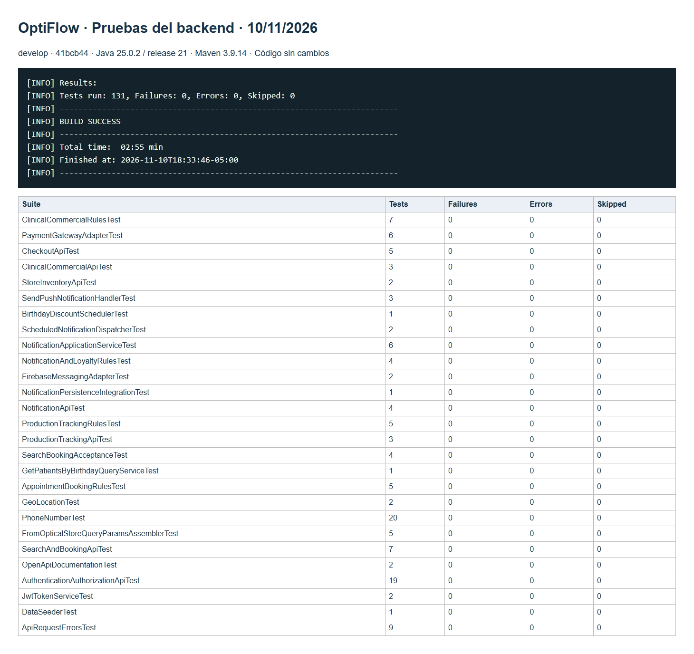

La [ejecución 42771709596](https://github.com/BL-App-Movil-1ACC0238-2620-4951/Logix-OptiFlow-Back-End/actions/runs/42771709596) de GitHub Actions también terminó con `success` para `41bcb44`, mediante `mvn -B test`. La Figura 168 conserva el resultado de integración continua.

<a id="figura-168"></a>

**Figura 168**

*Workflow de pruebas del backend 41bcb44 completado correctamente*

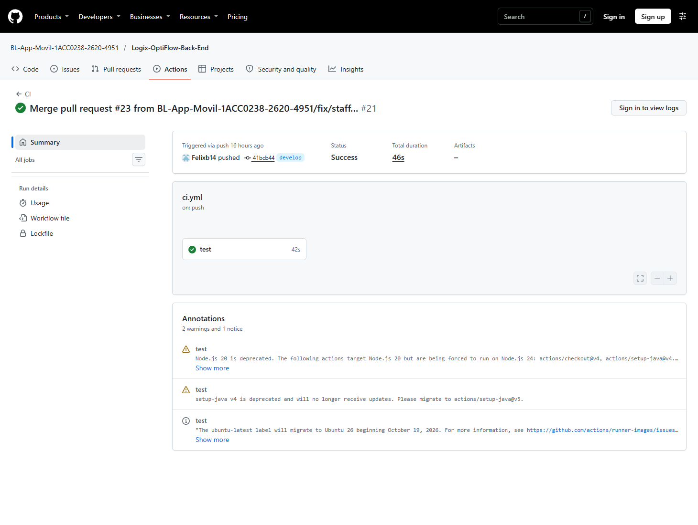

**Pruebas de aceptación.** La Figura 169 muestra el reporte Cucumber de la ejecución local: cuatro escenarios aprobados. Los archivos [búsqueda](https://github.com/BL-App-Movil-1ACC0238-2620-4951/Logix-OptiFlow-Back-End/blob/41bcb448a06abe9aeaf32be9cef46ce2965e30e0/src/test/resources/features/optical-store-search.feature) y [reserva](https://github.com/BL-App-Movil-1ACC0238-2620-4951/Logix-OptiFlow-Back-End/blob/41bcb448a06abe9aeaf32be9cef46ce2965e30e0/src/test/resources/features/appointment-booking.feature) se ejecutan mediante [SearchBookingSteps](https://github.com/BL-App-Movil-1ACC0238-2620-4951/Logix-OptiFlow-Back-End/blob/41bcb448a06abe9aeaf32be9cef46ce2965e30e0/src/test/java/com/optiflow/platform/searchbooking/acceptance/SearchBookingSteps.java), que utiliza la API versionada y adjunta el token en las operaciones protegidas. El [reporte HTML](assets/cap4/sprint2/revision-20261110/cucumber.html) y su [JSON](assets/cap4/sprint2/revision-20261110/cucumber.json) conservan los pasos y resultados.

<a id="figura-169"></a>

**Figura 169**

*Reporte Cucumber: cuatro escenarios de búsqueda y reserva aprobados*

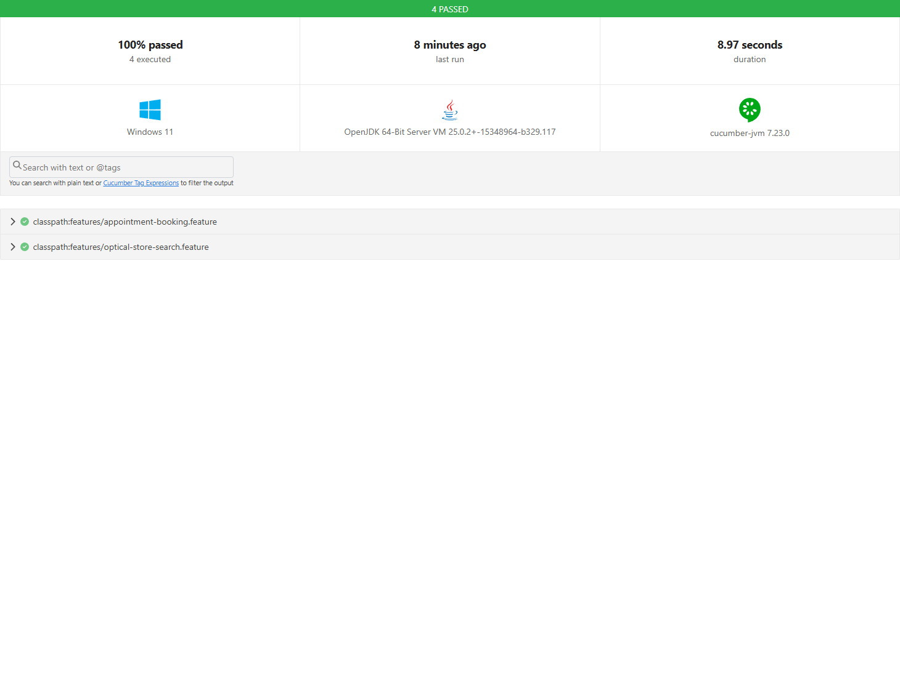

```gherkin
# language: es
@US05
Característica: Búsqueda de ópticas y disponibilidad de atención
  Como paciente
  Quiero consultar las ópticas y sus horarios disponibles
  Para elegir dónde recibir atención optométrica

  Escenario: Consulta de establecimientos y disponibilidad
    Dado que existen ópticas y sucursales registradas
    Cuando el paciente consulta los establecimientos disponibles
    Entonces obtiene la información y las direcciones de los establecimientos
    Y puede consultar los horarios disponibles de una óptica

  Escenario: Búsqueda sin establecimientos coincidentes
    Dado que ninguna óptica coincide con los criterios de búsqueda
    Cuando el paciente realiza la búsqueda
    Entonces obtiene una lista vacía de establecimientos
```

```gherkin
# language: es
@US06
Característica: Reserva de cita para atención optométrica
  Como paciente
  Quiero seleccionar un horario disponible y reservar una cita
  Para programar mi atención de manera organizada

  Escenario: Reserva exitosa de un horario disponible
    Dado que existe un paciente registrado
    Y existe un horario disponible en una óptica
    Cuando el paciente confirma la reserva de ese horario
    Entonces el servicio responde con código 201
    Y la cita queda en estado "CONFIRMED"
    Y la cita registrada puede consultarse
    Y el horario deja de estar disponible

  Escenario: Rechazo de un horario reservado por otro paciente
    Dado que existe un paciente registrado
    Y existe un horario reservado por otro paciente
    Cuando el paciente confirma la reserva de ese horario
    Entonces el servicio responde con código 409
    Y informa que el horario ya no está disponible
```

Los escenarios corresponden a US05 y US06 y se conservan como regresión del primer incremento. La autenticación, los roles y la cercanía se comprobaron además con `AuthenticationAuthorizationApiTest`, `JwtTokenServiceTest`, `GeoLocationTest` y `SearchAndBookingApiTest`; no se contabilizan como nuevos escenarios Gherkin.

**Comprobaciones HTTP.** Se registraron 28 solicitudes en una instancia local con H2 y datos ficticios. Las primeras 25 tienen un código esperado y coincidieron con él: consulta pública, cercanía, validación, registro, token, permisos, reserva, duplicidad, historial, pedidos, notificaciones, personal e inventario. El 404 de fidelización corresponde a un paciente recién creado sin cuenta de puntos; el 400 del reporte identifica la ausencia del periodo obligatorio. Las últimas tres solicitudes conservan las respuestas observadas de rutas antiguas de Flutter. El [registro JSON](assets/cap4/sprint2/revision-20261110/service-results.json) omite los tokens. Esta ejecución no comprueba las migraciones de una instancia PostgreSQL de producción ni el envío real de pagos o mensajes push.

##### Antecedentes de la revisión del 08/11/2026

La revisión anterior, `4a1364e`, se detuvo en `testCompile` por dos solicitudes de `AuthenticationAuthorizationApiTest`; su JAR se construyó por separado con `-Dmaven.test.skip=true`. La Figura 170 y el [registro original](assets/cap4/sprint2/build-results.txt) conservan ese resultado. El error está corregido en la revisión del 10/11/2026.

<a id="figura-170"></a>

**Figura 170**

*Resultados separados de construcción y pruebas del backend*

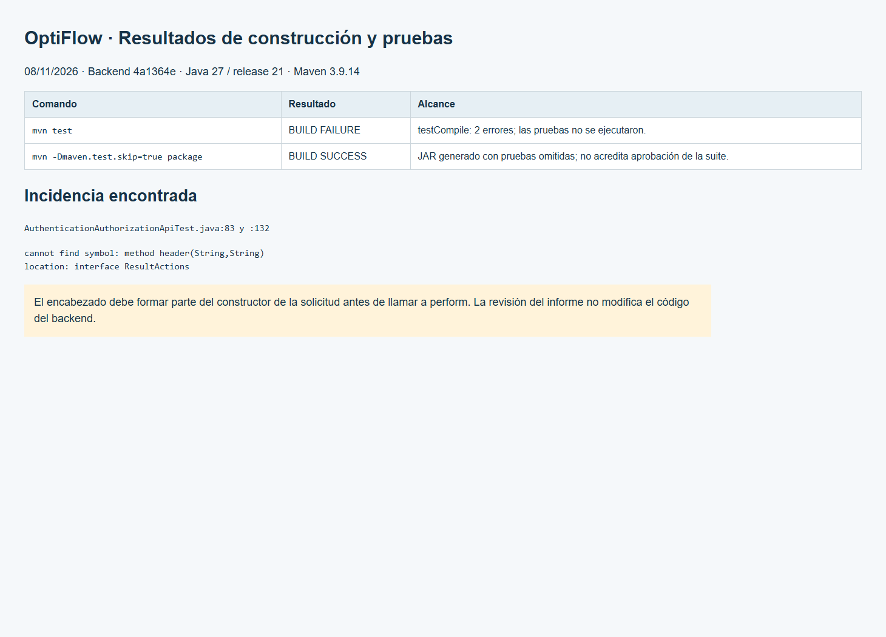

La Figura 171 conserva el resumen de las 17 solicitudes de la revisión anterior. El [archivo de resultados del 08/11/2026](assets/cap4/sprint2/service-results.json) mantiene su fecha y versión.

<a id="figura-171"></a>

**Figura 171**

*Comprobaciones HTTP del backend en el entorno local*

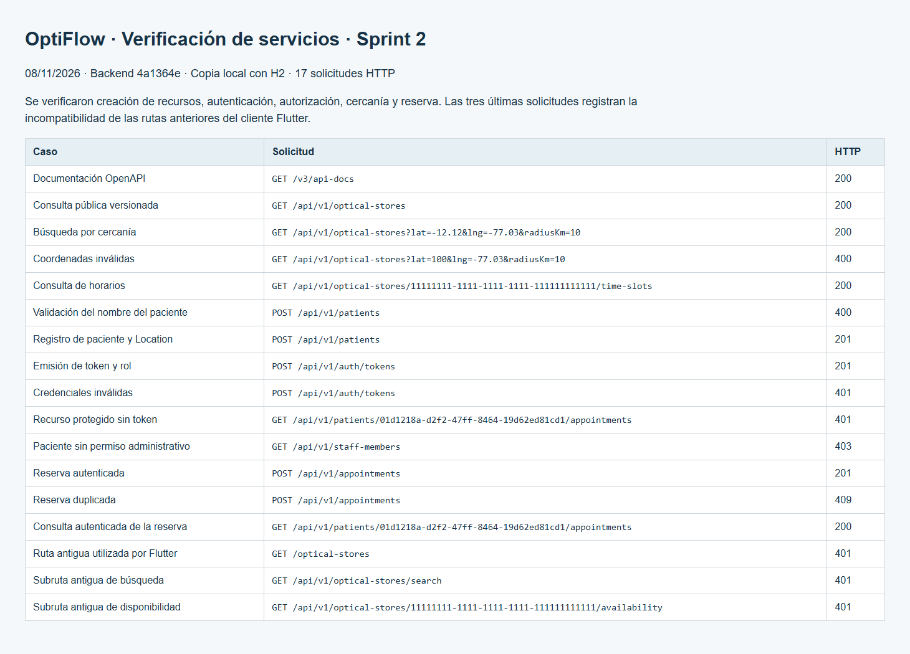

##### Reproducción de la ejecución actual

Desde una copia del backend `41bcb44`:

```powershell
mvn -B test
mvn -B -DskipTests package
java -jar target/optiflow-platform-0.1.0.jar --spring.profiles.active=local --server.port=18082
```

**Resultados de `flutter pub get`, `flutter analyze` y `flutter test`:** ____________________.

#### 4.2.2.6. Execution Evidence for Sprint Review

**Web Services.** La revisión `41bcb44` se ejecutó con el perfil local/H2 en `http://127.0.0.1:18082`, usando datos ficticios. La Figura 172 muestra Swagger y la Figura 173, la consulta de ópticas cercanas con respuesta 200. Las Figuras 174 y 175 registran la creación de una cita con 201 y el rechazo 403 de una consulta administrativa realizada como paciente.

<a id="figura-172"></a>

**Figura 172**

*Swagger UI del backend 41bcb44, 10/11/2026*

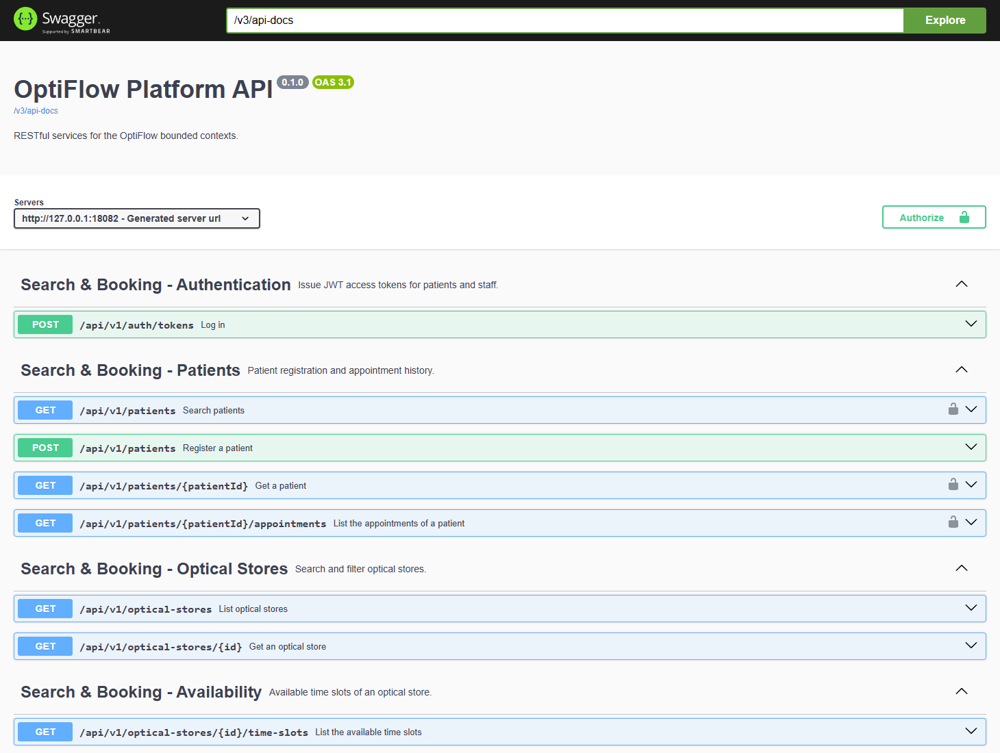

<a id="figura-173"></a>

**Figura 173**

*Respuesta 200 de la consulta de ópticas cercanas en Swagger*

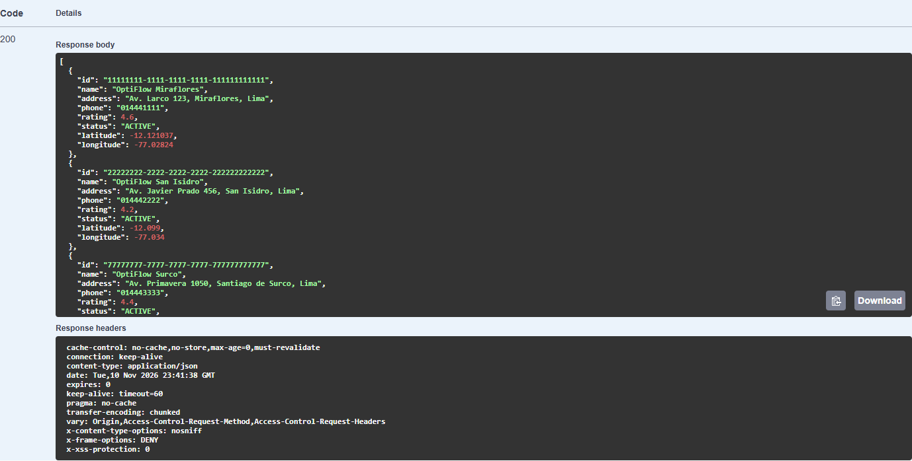

<a id="figura-174"></a>

**Figura 174**

*Reserva autenticada: respuesta 201 y encabezado Location*


<a id="figura-175"></a>

**Figura 175**

*Consulta de personal con rol de paciente: respuesta 403*


Las Figuras 176 y 177 conservan las capturas de Swagger de la revisión anterior, tomadas el 08/11/2026 en el puerto local 18081.

<a id="figura-176"></a>

**Figura 176**

*Swagger UI de la revisión versionada del backend*


<a id="figura-177"></a>

**Figura 177**

*Consulta local de ópticas por cercanía con HTTP 200*


La reserva autenticada devolvió HTTP 201 y un encabezado `Location`; repetir el horario devolvió 409. Un recurso protegido sin token respondió 401, mientras que un paciente que consultó el listado de personal recibió 403. Son resultados de la revisión local, no capturas de Render ni de la aplicación móvil.

**Landing Page.** Las Figuras 178 y 179 corresponden al código de la Landing Page `ef1c032`, abierto localmente en escritorio y ancho de celular. Permiten revisar el contenido y la adaptación visual; no certifican por sí solas el estado de publicación en GitHub Pages.

<a id="figura-178"></a>

**Figura 178**

*Landing Page del Sprint 2 abierta localmente en escritorio*


<a id="figura-179"></a>

**Figura 179**

*Landing Page del Sprint 2 abierta localmente en ancho de celular*


**Aplicación Flutter.** El repositorio contiene las rutas y pantallas de paciente y personal. El controlador mezcla respuestas de servicios con datos de demostración para catálogo, operación clínica y estados locales. Antes de grabar la evidencia de AV2 debe comprobarse la conexión con el contrato versionado y dejar visible cuándo una vista opera en modo demostración.

**Capturas de Flutter:** ____________________

**Video de ejecución del Sprint 2:** ____________________

**Duración y momentos de búsqueda, inicio de sesión y reserva:** ____________________

No se reutilizan capturas de Kotlin del Sprint 1 como evidencia de ejecución del cliente Flutter.

#### 4.2.2.7. Services Documentation Evidence for Sprint Review

La documentación OpenAPI 3.1 del backend `41bcb44` contiene **67 operaciones sobre 58 rutas** bajo `/api/v1`. El recuento se obtuvo de la especificación generada el 10/11/2026 e incluye inventario, checkout, notificaciones, encuestas y reportes. Cada operación documenta un contrato; la aceptación funcional depende de su prueba y de la integración con el cliente.

La especificación consultada se conserva como [OpenAPI de la revisión local](assets/cap4/sprint2/revision-20261110/openapi-local.json). La URL del servicio publicado sigue siendo [Swagger UI en Render](https://logix-optiflow-back-end.onrender.com/swagger-ui/index.html); la confirmación de que ese despliegue ejecuta el mismo commit se registra en 4.2.2.8.

La Tabla 132 presenta los contratos relevantes del Sprint con método, parámetros, autorización, ejemplo de respuesta y enlace a la operación en Swagger. La sintaxis es `<VERBO> https://logix-optiflow-back-end.onrender.com<ruta>`; localmente se usa `http://127.0.0.1:18082<ruta>`. Las rutas incluyen `/api/v1`. Los ejemplos de respuesta son fragmentos ilustrativos del contrato; solo las comprobaciones de 4.2.2.5 se presentan como ejecución.

<a id="tabla-132"></a>

**Tabla 132**

*Contratos de servicios revisados en el Sprint 2*

| Endpoint / acción | Verbo HTTP | Parámetros y autorización | Response (ejemplo y explicación) | Documentación | User Story |
|---|:---:|---|---|---|---|
| `/api/v1/patients`<br>Registrar paciente | POST | Body: `name`, `email`, `phone`, `password`; `birthDate` opcional. Pública. | 201, `Location` y paciente: `{ "id": "<uuid>", "name": "Paciente", "birthDate": null }`. Devuelve datos sin contraseña; 400 para entrada inválida. | [Swagger](https://logix-optiflow-back-end.onrender.com/swagger-ui/index.html#/Search%20%26%20Booking%20-%20Patients/register_3) | Soporte de US05 y US06 |
| `/api/v1/auth/tokens`<br>Crear token | POST | Body: `email`, `password`. Pública. | 201, `Location` y `{ "token": "<omitido>", "expiresAt": "<instante>", "userId": "<uuid>", "role": "PATIENT" }`. 401 con credenciales inválidas. | [Swagger](https://logix-optiflow-back-end.onrender.com/swagger-ui/index.html#/Search%20%26%20Booking%20-%20Authentication/create) | US01, US16; soporte al paciente |
| `/api/v1/optical-stores`<br>Consultar ópticas | GET | Query opcional: `name`, `address`, `minRating`. Pública. | 200, array: `[{ "id": "<uuid>", "name": "OptiFlow Miraflores", "latitude": -12.121037, "longitude": -77.02824 }]`. `[]` si no hay coincidencias. | [Swagger](https://logix-optiflow-back-end.onrender.com/swagger-ui/index.html#/Search%20%26%20Booking%20-%20Optical%20Stores/list_2) | US05 |
| `/api/v1/optical-stores`<br>Consultar cercanía | GET | Query: `lat`, `lng`, `radiusKm`; ejemplo `?lat=-12.12&lng=-77.03&radiusKm=10`. Pública. | 200 con el array de ópticas del radio. 400 si faltan coordenadas o están fuera del intervalo admitido. | [Swagger](https://logix-optiflow-back-end.onrender.com/swagger-ui/index.html#/Search%20%26%20Booking%20-%20Optical%20Stores/list_2) | US05 |
| `/api/v1/optical-stores/{id}/time-slots`<br>Consultar horarios | GET | Path: `id` UUID de la óptica. Pública. | 200, array: `[{ "id": "<uuid>", "status": "AVAILABLE", "startDateTime": "<instante>", "endDateTime": "<instante>" }]`. | [Swagger](https://logix-optiflow-back-end.onrender.com/swagger-ui/index.html#/Search%20%26%20Booking%20-%20Availability/list_1) | US05, US06 |
| `/api/v1/appointments`<br>Reservar | POST | Body: `patientId`, `opticalStoreId`, `timeSlotId`. Bearer. | 201 y `Location`; `{ "id": "<uuid>", "status": "CONFIRMED", "timeSlotId": "<uuid>" }`. 409 si el horario ya fue reservado. | [Swagger](https://logix-optiflow-back-end.onrender.com/swagger-ui/index.html#/Search%20%26%20Booking%20-%20Appointments/book) | US06 |
| `/api/v1/patients/{patientId}/appointments`<br>Consultar citas | GET | Path: `patientId` del paciente. Bearer y reglas de acceso. | 200 con un array de citas; `[]` si no tiene reservas. 401 sin autenticación. | [Swagger](https://logix-optiflow-back-end.onrender.com/swagger-ui/index.html#/Search%20%26%20Booking%20-%20Patients/appointments) | US06 |
| `/api/v1/staff-members`<br>Consultar personal | GET | Sin parámetros. Bearer con rol ADMIN. | 200, array: `[{ "id": "<uuid>", "role": "SALES_ADVISOR", "active": true }]` según el esquema. Se comprobó 403 para un paciente y 200 para el administrador local. | [Swagger](https://logix-optiflow-back-end.onrender.com/swagger-ui/index.html#/Search%20%26%20Booking%20-%20Staff%20Members/list) | US16 |
| `/api/v1/staff-members/{id}/role`<br>Cambiar rol | PATCH | Path: `id`; body: `role`. Bearer con rol ADMIN. | 200 con el miembro actualizado: `{ "id": "<uuid>", "role": "OPTOMETRIST" }`. Operación identificada en el contrato; no ejecutada en esta revisión. | [Swagger](https://logix-optiflow-back-end.onrender.com/swagger-ui/index.html#/Search%20%26%20Booking%20-%20Staff%20Members/updateRole) | US16 |
| `/api/v1/appointments/{id}/status`<br>Actualizar cita | PATCH | Path: `id`; body: `status`. Bearer. | 200 con la cita y su nuevo estado: `{ "id": "<uuid>", "status": "CANCELLED" }`. Ejemplo del contrato; no ejecutado en esta revisión. | [Swagger](https://logix-optiflow-back-end.onrender.com/swagger-ui/index.html#/Search%20%26%20Booking%20-%20Appointments/updateStatus_3) | US06 |
| `/api/v1/patients/{patientId}/clinical-records`<br>Consultar historial | GET | Path: `patientId`. Bearer. | 200, array: `[{ "id": "<uuid>", "patientId": "<uuid>", "medicalHistory": {}, "prescription": {} }]`; `[]` si no hay atenciones. La consulta propia devolvió 200 en el entorno local. | [Swagger](https://logix-optiflow-back-end.onrender.com/swagger-ui/index.html#/Clinical%20%26%20Commercial%20-%20Clinical%20Records/findByPatient_2) | US04 |
| `/api/v1/patients/{patientId}/work-orders`<br>Consultar pedidos | GET | Path: `patientId`. Bearer. | 200, array: `[{ "id": "<uuid>", "status": "PENDING", "delayed": false }]`; `[]` si no tiene órdenes. La consulta propia devolvió 200 en el entorno local. | [Swagger](https://logix-optiflow-back-end.onrender.com/swagger-ui/index.html#/Production%20%26%20Tracking%20-%20Work%20Orders/findByPatient) | US11 |
| `/api/v1/inventory/frames`<br>Catálogo de monturas | GET | Sin parámetros. Bearer de personal. | 200 con el catálogo; consulta ejecutada con administrador local. | [Swagger](https://logix-optiflow-back-end.onrender.com/swagger-ui/index.html#/Store%20Management%20%26%20Inventory%20-%20Frame%20Models/catalog) | Store Management & Inventory |
| `/api/v1/inventory/stock`<br>Stock por óptica | GET | Query: opticalStoreId. Bearer de personal. | 200 con existencias; consulta ejecutada localmente. | [Swagger](https://logix-optiflow-back-end.onrender.com/swagger-ui/index.html#/Store%20Management%20%26%20Inventory%20-%20Inventory/stock) | Store Management & Inventory |
| `/api/v1/suppliers`<br>Proveedores | GET | Bearer de personal. | 200 con proveedores; consulta ejecutada localmente. | [Swagger](https://logix-optiflow-back-end.onrender.com/swagger-ui/index.html#/Store%20Management%20%26%20Inventory%20-%20Suppliers/suppliers) | Store Management & Inventory |
| `/api/v1/reports/inventory`<br>Reporte de inventario | GET | Query: opticalStoreId, from, to. Bearer de personal. | 200 con métricas; 400 si se omite el periodo obligatorio. | [Swagger](https://logix-optiflow-back-end.onrender.com/swagger-ui/index.html#/Store%20Management%20%26%20Inventory%20-%20Reports/metrics_2) | Reportes de inventario |
| `/api/v1/patients/{patientId}/notifications`<br>Notificaciones del paciente | GET | Path: patientId. Bearer con reglas de acceso. | 200 con la lista; consulta propia ejecutada localmente. | [Swagger](https://logix-optiflow-back-end.onrender.com/swagger-ui/index.html#/Notification%20%26%20Loyalty%20-%20Notifications/findByPatient_1) | Notification & Loyalty |

**Correspondencia del contrato.** La especificación actual declara `201` para pacientes, tokens y citas y distingue las operaciones públicas mediante su configuración de seguridad. `OpenApiDocumentationTest` aprobó sus dos pruebas. Las diferencias detectadas el 08/11/2026 quedaron resueltas en esta revisión; el [OpenAPI anterior](assets/cap4/sprint2/openapi-local.json) se conserva como antecedente.

Ejemplo de solicitud de autenticación, con valores ilustrativos:

```http
POST /api/v1/auth/tokens
Content-Type: application/json

{"email":"paciente@ejemplo.test","password":"<contraseña>"}
```

```json
{
  "token": "<token omitido>",
  "expiresAt": "<fecha y hora de expiración>",
  "userId": "<UUID del usuario>",
  "role": "PATIENT"
}
```

El cliente debe leer `userId` y `role` de esta respuesta y adjuntar el token a las llamadas protegidas. La forma anterior, que esperaba un objeto `patient` dentro del login, no corresponde a esta versión.

##### Cambios relacionados con la documentación del Sprint 2

La Tabla 133 identifica tanto los cambios de rutas y parámetros como las ampliaciones de documentación de inventario y reportes.

<a id="tabla-133"></a>

**Tabla 133**

*Commits que modifican el contrato documentado del Sprint 2*

| Repository | Branch | Commit Id | Commit Message | Commit Message Body | Commited on (Date) |
|---|---|---|---|---|---|
| [BL-App-Movil-1ACC0238-2620-4951/Logix-OptiFlow-Back-End](https://github.com/BL-App-Movil-1ACC0238-2620-4951/Logix-OptiFlow-Back-End) | `develop` | [1c5d3f7](https://github.com/BL-App-Movil-1ACC0238-2620-4951/Logix-OptiFlow-Back-End/commit/1c5d3f7fb1b877df3b1d562fccb7d82a0a2f3b20) | `refactor: add api v1 prefix to controllers` | Introduce /api/v1 en los controladores y cambia la ruta base de las operaciones documentadas. | 06/11/2026 |
| [BL-App-Movil-1ACC0238-2620-4951/Logix-OptiFlow-Back-End](https://github.com/BL-App-Movil-1ACC0238-2620-4951/Logix-OptiFlow-Back-End) | `develop` | [a1db022](https://github.com/BL-App-Movil-1ACC0238-2620-4951/Logix-OptiFlow-Back-End/commit/a1db022c903f52b2e3b3915c8c22eeb2eb50f356) | `refactor: merge optical store search routes` | Consolida la búsqueda de ópticas en una sola operación con parámetros. | 06/11/2026 |
| [BL-App-Movil-1ACC0238-2620-4951/Logix-OptiFlow-Back-End](https://github.com/BL-App-Movil-1ACC0238-2620-4951/Logix-OptiFlow-Back-End) | `develop` | [1eb0524](https://github.com/BL-App-Movil-1ACC0238-2620-4951/Logix-OptiFlow-Back-End/commit/1eb0524798938457b2750c6e87a73024ea823105) | `feat: add optical store location and nearby search` | Añade coordenadas y filtros de cercanía al contrato de ópticas. | 06/11/2026 |
| [BL-App-Movil-1ACC0238-2620-4951/Logix-OptiFlow-Back-End](https://github.com/BL-App-Movil-1ACC0238-2620-4951/Logix-OptiFlow-Back-End) | `develop` | [2a94c5c](https://github.com/BL-App-Movil-1ACC0238-2620-4951/Logix-OptiFlow-Back-End/commit/2a94c5ce84c374b34be4990bc7fc133a310eb21d) | `docs: document inventory endpoints in swagger` | Documenta los endpoints de inventario y sus contratos en Swagger. | 09/11/2026 |
| [BL-App-Movil-1ACC0238-2620-4951/Logix-OptiFlow-Back-End](https://github.com/BL-App-Movil-1ACC0238-2620-4951/Logix-OptiFlow-Back-End) | `develop` | [567f363](https://github.com/BL-App-Movil-1ACC0238-2620-4951/Logix-OptiFlow-Back-End/commit/567f3630d55aa79c0918d663bb32ddef479da315) | `docs: document remaining endpoints in swagger` | Completa la documentación de las operaciones restantes de la API. | 09/11/2026 |

#### 4.2.2.8. Software Deployment Evidence for Sprint Review

Se mantienen las evidencias históricas de GitHub Pages, Render y Firebase App Distribution de 4.2.1.8. Para AV2 se debe identificar el commit o la versión realmente instalada: que una URL exista no demuestra que ya ejecute el incremento del Sprint 2.

La Tabla 134 resume las versiones revisadas y su estado de publicación.

<a id="tabla-134"></a>

**Tabla 134**

*Código y confirmación de despliegue del Sprint 2*

| Producto | Revisión de código | Evidencia disponible | Confirmación de despliegue AV2 |
|---|---|---|---|
| Landing Page | `main`, `ef1c032`. | [Workflow completado correctamente](https://github.com/BL-App-Movil-1ACC0238-2620-4951/Logix-OptiFlow-landing-page/actions/runs/42338220243) y página pública con HTTP 200, comprobados el 08/11/2026. | Publicación confirmada; capturas en las Figuras 180 y 181. Falta contrastar la versión del APK enlazado. |
| Backend | `develop`, `41bcb44`. | 131 pruebas aprobadas, CI exitosa, JAR construido, 67 operaciones y 28 solicitudes HTTP locales. | Commit activo en Render y captura actual: ____________________. |
| Android/Kotlin | Repositorio de la primera aplicación. | Capturas y distribución del Sprint 1. | Se conservan como antecedentes, no como publicación de Flutter. |
| Flutter | `main`, `0344413`, versión `1.0.0+1`. | Código publicado y definición de pantallas, cliente HTTP y prueba de estados. | APK, enlace de distribución y captura de versión: ____________________. |

##### Publicación comprobada de la Landing Page

La [ejecución 42338220243](https://github.com/BL-App-Movil-1ACC0238-2620-4951/Logix-OptiFlow-landing-page/actions/runs/42338220243) del workflow `Deploy static content to Pages` se inició el 06/11/2026 a las 11:23 PM (America/Lima), para `main` y el commit `ef1c032`, y terminó con `success`. La Figura 180 muestra el resumen de la ejecución. La captura conserva los avisos de mantenimiento de las acciones y del parámetro `include-hidden-files`; no se interpretan como un fallo del despliegue.

<a id="figura-180"></a>

**Figura 180**

*Workflow de GitHub Pages del commit ef1c032 completado correctamente*


La [Landing pública](https://bl-app-movil-1acc0238-2620-4951.github.io/Logix-OptiFlow-landing-page/) respondió HTTP 200 en la revisión del 08/11/2026. La Figura 181 corresponde a esa URL, a diferencia de las capturas locales de 4.2.2.6. La presencia del botón Descargar APK no demuestra por sí sola que distribuya el cliente Flutter de AV2.

<a id="figura-181"></a>

**Figura 181**

*Landing Page pública de OptiFlow comprobada el 08/11/2026*


La consulta a `/v3/api-docs` de Render del 10/11/2026 no respondió dentro del límite de 22 segundos. La ejecución local y la CI no identifican por sí solas el commit activo en Render. La Tabla 134 reserva el registro de ese despliegue.

Para distribuir Flutter se debe generar el APK de la revisión elegida con la URL compatible, instalarlo en un dispositivo y comprobar el flujo con el backend antes de cargarlo en Firebase App Distribution. La invitación del Sprint 1 no se presenta como evidencia de una nueva versión hasta verificar qué APK distribuye.

```powershell
flutter pub get
flutter analyze
flutter test
flutter build apk --release --dart-define="API_BASE_URL=<URL-compatible-del-backend>"
```

Cambiar la URL base no resuelve por sí solo las subrutas y el formato de autenticación de la Tabla 129. La configuración debe probarse como un conjunto.

#### 4.2.2.9. Team Collaboration Insights during Sprint

La Tabla 135 resume los commits sin merge registrados entre el 09/10/2026 y el 10/11/2026 en las ramas revisadas. Los autores se conservan tal como aparecen en GitHub. Este recuento describe actividad de código, no horas trabajadas ni historias aceptadas.

<a id="tabla-135"></a>

**Tabla 135**

*Contribuciones registradas hasta el 10/11/2026*

| Repositorio / rama | Intervalo revisado | Autor registrado | Commits sin merge | Interpretación |
|---|---|---|:---:|---|
| `Logix-OptiFlow-Back-End` / `develop` | 09/10/2026–10/11/2026 | Felixb14 | 46 | Cambios incluidos en la revisión `41bcb44`. |
| `Logix-OptiFlow-Back-End` / `develop` | 09/10/2026–10/11/2026 | user20-bit | 18 | Cambios incluidos en la revisión `41bcb44`. |
| `Logix-OptiFlow-Back-End` / `develop` | 09/10/2026–10/11/2026 | Patto04 | 5 | Cambios incluidos en la revisión `41bcb44`. |
| `Logix-OptiFlow-Back-End` / `develop` | 09/10/2026–10/11/2026 | THECOMAX | 5 | Cambios incluidos en la revisión `41bcb44`. |
| `Logix-OptiFlow-Back-End` / `develop` | 09/10/2026–10/11/2026 | Eslander-Celis | 7 | Cambios incluidos en la revisión `41bcb44`. |
| `Logix-OptiFlow-Flutter` / `main` | 09/10/2026–10/11/2026 | user20-bit | 3 | Base del cliente y pantallas de AV2; revisión `0344413`. |
| `Logix-OptiFlow-landing-page` / `main` | 09/10/2026–10/11/2026 | Patto04 | 7 | Accesibilidad, contenido y publicación; revisión `ef1c032`. |

Los 81 commits del backend abarcan seguridad, inventario, pagos, mensajería, reportes, pruebas y documentación. Entre las últimas integraciones se encuentran los PR #22 y #23, que corrigen el tratamiento de errores y el acceso del personal a las citas. La Landing Page integra su publicación mediante Pages; Flutter conserva tres commits en `main` en el corte consultado.

Las Figuras 182, 183 y 184 corresponden a los paneles públicos de contribuciones de [backend](https://github.com/BL-App-Movil-1ACC0238-2620-4951/Logix-OptiFlow-Back-End/graphs/contributors), [Flutter](https://github.com/BL-App-Movil-1ACC0238-2620-4951/Logix-OptiFlow-Flutter/graphs/contributors) y [Landing Page](https://github.com/BL-App-Movil-1ACC0238-2620-4951/Logix-OptiFlow-landing-page/graphs/contributors), capturados el 10/11/2026. Los gráficos muestran el periodo de tres meses seleccionado en GitHub y excluyen merges; sus totales no usan el intervalo reducido de la Tabla 135.

<a id="figura-182"></a>

**Figura 182**

*GitHub Insights: contribuciones al backend develop*


<a id="figura-183"></a>

**Figura 183**

*GitHub Insights: contribuciones al cliente Flutter main*


<a id="figura-184"></a>

**Figura 184**

*GitHub Insights: contribuciones a la Landing Page main*


La revisión del backend cierra la incidencia de compilación y conserva resultados de pruebas y servicios. La integración del cliente se contrasta con la Tabla 129 y con la versión instalada para la demostración.

## 4.3. Validation Interviews

### 4.3.1. Diseño de entrevistas

Preguntas generales:

1.  Datos de perfil: ¿Podrías indicarme tu nombre, edad, estado civil y ocupación exacta?
2.  Contexto personal: ¿En qué distrito resides?
3.  Entorno digital: ¿Qué dispositivo utilizas con mayor frecuencia para navegar por internet y cómo describirías tu experiencia con páginas web de servicios similares (agendamiento, gestión de pedidos o atención al cliente)?

**Primer Segmento: *Staff de la óptica (Optómetras y Asesores comerciales)***

Tareas del Landing Page: explorar libremente la página, buscar las funciones que le servirían en su óptica, localizar el botón de llamada a la acción dirigido a su segmento y revisar la información disponible para decidir si probaría OptiFlow.

4.  Después de recorrer el Landing Page, explícame con tus propias palabras qué es OptiFlow, qué ofrece a una óptica y qué fue lo primero que te llamó la atención.
5.  Cuéntame cómo fue buscar en la página las funciones que te servirían en tu óptica (gestión de pacientes, inventario, cotizaciones, órdenes de trabajo): ¿dónde las buscaste, qué encontraste y qué te faltó saber?
6.  Menciona con tus palabras qué significa cada sección, menú y botón por los que pasaste, y señala cuáles interpretaste de forma distinta a lo esperado o te costó ubicar.
7.  Describe qué esperabas que ocurriera al presionar el botón de llamada a la acción dirigido a tu segmento y qué pensaste al ver adónde te llevó.
8.  ¿Qué información necesitarías ver en la página (precios, planes, testimonios, demostración del producto) para decidir probar OptiFlow en tu óptica? Cuéntame por qué.
9.  Describe cómo se ve y se lee la página en tu celular y en una computadora (texto, colores, imágenes, botones) y qué situaciones se te harían difíciles de leer o de usar.
10. Si pudieras rediseñar este Landing Page, ¿qué cambiarías, quitarías o agregarías y por qué? ¿Qué tendría que mostrar la página para que confíes en OptiFlow y contactes al equipo?

**Segundo Segmento: *Clientes de la óptica (Pacientes)***

Tareas del Landing Page: explorar libremente la página, buscar cómo reservar una cita o consultar el estado de un pedido, localizar el botón de llamada a la acción dirigido a su segmento y revisar la información disponible para decidir si usaría OptiFlow.

4.  Después de recorrer el Landing Page, explícame con tus propias palabras qué es OptiFlow, qué podrías hacer con él como paciente y qué fue lo primero que te llamó la atención.
5.  Cuéntame cómo fue buscar en la página la forma de reservar una cita o consultar el estado de tu pedido: ¿dónde lo buscaste, qué encontraste y qué te faltó saber?
6.  Menciona con tus palabras qué significa cada sección, menú y botón por los que pasaste, y señala cuáles interpretaste de forma distinta a lo esperado o te costó ubicar.
7.  Describe qué esperabas que ocurriera al presionar el botón de llamada a la acción dirigido a los clientes y qué pensaste al ver adónde te llevó.
8.  ¿Qué información o elementos (opiniones de otros usuarios, video del producto, imágenes de la aplicación) te darían confianza para registrarte? Cuéntame por qué.
9.  Describe cómo se ve y se lee la página en tu celular y en una computadora (tamaño de letra, colores, imágenes, botones) y qué dificultades imaginas que tendría un familiar de mayor edad al usarla sin ayuda.
10. Si pudieras rediseñar este Landing Page, ¿qué cambiarías, quitarías o agregarías y por qué? ¿Qué haría que quieras usar OptiFlow y recomendarlo a tus familiares o amigos?

#### Tareas de validación de la aplicación móvil

La sesión utiliza una cuenta de prueba y la versión de AV2 identificada al inicio. El participante recibe el objetivo de cada tarea y elige cómo resolverla. El entrevistador observa el recorrido y registra los comentarios sin indicar qué botón presionar. La información de muestra permite repetir las mismas condiciones entre sesiones.

**Recorrido del paciente**

1. **P01 — Acceso:** iniciar sesión y reconocer las opciones de la cuenta. Se comprueba si el participante distingue el acceso a su perfil y comprende los mensajes ante credenciales incorrectas.
2. **P02 — Búsqueda y reserva:** encontrar una óptica, consultar un horario y confirmar una cita. El resultado esperado es una confirmación visible y la posibilidad de localizar después esa cita en su listado.
3. **P03 — Historial y receta:** localizar sus antecedentes y la receta disponible. También se revisa la comprensión del mensaje mostrado cuando la cuenta no tiene registros.
4. **P04 — Seguimiento:** localizar un pedido e interpretar su estado. Se observa si el participante identifica el avance y la información disponible sobre la entrega, o comprende que todavía no tiene pedidos.

**Recorrido del personal de la óptica**

1. **S01 — Acceso por rol:** iniciar sesión con una cuenta del personal y reconocer las funciones habilitadas. Se contrasta el acceso con una cuenta de paciente para comprobar la separación de permisos.
2. **S02 — Consulta del paciente:** localizar una cuenta de prueba y revisar la información clínica o las citas disponibles en la versión evaluada. Se registra si la identificación del paciente y la navegación resultan claras.
3. **S03 — Consulta operativa:** revisar una cita o una orden, interpretar su estado y ubicar la siguiente acción disponible. Los módulos de demostración se identifican al inicio del recorrido.

**Preguntas durante la sesión**

Después de cada tarea se pregunta: ¿qué intentaste hacer primero?, ¿qué esperabas que ocurriera?, ¿qué te indicó que habías terminado? y ¿en qué paso necesitaste ayuda? Al finalizar se consulta qué información fue difícil de encontrar, qué mensaje o término causó dudas y qué cambio facilitaría repetir el recorrido. Para cerrar, el participante explica qué función le sería más útil y qué tendría que mejorar antes de usar OptiFlow en su atención habitual.

**Criterios de evaluación**

Cada tarea se registra como completada sin ayuda, completada con ayuda o no completada. Se anota el tiempo empleado, el punto de bloqueo, el mensaje encontrado y el comentario del participante. El flujo P02 se cronometra desde el inicio de la búsqueda hasta la confirmación y se contrasta con el criterio de cinco minutos del Sprint Goal.

La reserva se contrasta con su registro en el servicio. En las consultas de historial y pedidos se distingue la respuesta del backend de los datos locales de demostración. En el acceso por rol se revisan tanto el permiso de la operación como la claridad del mensaje que recibe el usuario. Estos criterios permiten relacionar una dificultad con la interfaz, la integración o la disponibilidad de datos.

#### Alcance de la validación de AV2

La sesión registra el cliente, la versión del APK, el dispositivo y la revisión del backend. Las evidencias de Android/Kotlin del primer incremento conservan su alcance histórico. La evaluación de Flutter utiliza una instalación y un recorrido propios, con el modo de datos identificado en cada tarea.

Se consideran entre tres y cinco participantes de cada segmento. El registro individual reúne nombres y apellidos, edad, distrito, fecha, versión y dispositivo, enlace del video, inicio y duración, captura representativa y resumen de sus comentarios. Las observaciones se relacionan con los hallazgos de usabilidad y se revisan nuevamente sobre la versión corregida.

**Cliente, versión y dispositivo usados en AV2:** ____________________.

### 4.3.2. Registro de entrevistas

Se conserva la evidencia audiovisual de las entrevistas anteriores en el [Anexo H](Anexos.md#anexo-h-entrevistas-de-validación). Para AV2, cada sesión debe asociarse con el cliente y la versión efectivamente probados. La captura y el enlace previos no se consideran por sí solos evidencia de validación del cliente Flutter.

**Video de entrevistas de validación:** [evidencia audiovisual en el Anexo H](Anexos.md#anexo-h-entrevistas-de-validación). La Figura 185 conserva la captura histórica; no acredita por sí sola la validación de Flutter.

<a id="figura-185"></a>

**Figura 185**

*Captura del video histórico de entrevistas de validación*


#### Registro de sesiones de AV2

La validación contempla entre tres y cinco entrevistas por segmento. La Tabla 136 reúne los datos de identificación, la versión evaluada y la evidencia audiovisual de cada sesión.

<a id="tabla-136"></a>

**Tabla 136**

*Registro de entrevistas de validación de AV2*

| ID | Segmento | Nombre y apellidos | Edad | Distrito | Fecha | Versión / dispositivo | URL del video | Inicio y duración | Resumen de tareas y comentarios | Captura del cuadro de video |
|---|---|---|---|---|---|---|---|---|---|---|
| V2-P01 | Paciente | | | | | | | |  |
| V2-P02 | Paciente | | | | | | | |  |
| V2-P03 | Paciente | | | | | | | |  |
| V2-S01 | Personal de óptica | | | | | | | |  |
| V2-S02 | Personal de óptica | | | | | | | |  |
| V2-S03 | Personal de óptica | | | | | | | |  |

**Capturas de los cuadros de video de AV2:** ____________________.

### 4.3.3. Evaluaciones según heurísticas

La evaluación de OptiFlow considera las diez heurísticas de usabilidad de Jakob Nielsen para las experiencias del paciente y del personal de óptica. Las Tablas 137 y 138 reúnen las observaciones y recomendaciones de los recorridos registrados en la aplicación Android/Kotlin. Las capturas y el detalle de los hallazgos se encuentran en el [Anexo K](Anexos.md#anexo-k-registro-de-evaluación-heurística).

#### OptiFlow - Pacientes

<a id="tabla-137"></a>

**Tabla 137**

*Evaluación heurística de la experiencia del paciente*

| Heurística | Descripción | Observaciones en la experiencia del paciente | Recomendaciones de mejora |
|---|---|---|---|
| **Visibilidad del estado del sistema** | Comunicar qué ocurrió y mostrar el estado de la información que consulta el usuario. | En Inicio se muestran dos recetas activas y un pedido en camino para una cuenta nueva; el número de recetas tampoco coincide con Perfil ([problema 12](Anexos.md#problema-12)). | Obtener los contadores de la cuenta autenticada y mostrar un estado vacío cuando no existan registros. |
| **Correspondencia entre el sistema y el mundo real** | Usar términos, fechas y formatos cercanos a la experiencia del usuario. | Los accesos “Mis recetas”, “Mis pedidos” e “Historial” usan términos relacionados con la atención óptica y aparecen agrupados en Inicio (ver [captura](Anexos.md#figura-k11)). | Mantener estos nombres en el menú, los títulos y las respuestas del servicio. |
| **Control y libertad del usuario** | Permitir salir de un flujo y corregir o deshacer una acción. | La cancelación de una cita se realiza con un toque y vuelve al listado; no ofrece confirmación ni una opción para deshacer ([problema 7](Anexos.md#problema-7)). | Pedir confirmación con la fecha y hora de la cita y permitir volver al detalle sin cancelarla. |
| **Consistencia y estándares** | Dar el mismo nombre y comportamiento a elementos que cumplen la misma función. | Inicio y Perfil presentan cantidades distintas para las recetas de una misma cuenta ([problema 12](Anexos.md#problema-12)). | Usar una misma fuente de datos y actualizar ambas pantallas después de cada cambio. |
| **Prevención de errores** | Anticipar equivocaciones antes de confirmar cambios o registrar información. | La acción “Cancelar cita” libera el horario inmediatamente, lo que permite una cancelación accidental ([problema 7](Anexos.md#problema-7)). | Separar la selección de la acción y su confirmación; impedir envíos repetidos mientras se procesa la solicitud. |
| **Reconocimiento antes que recuerdo** | Mantener las opciones y los datos necesarios a la vista durante la tarea. | La barra inferior identifica Inicio, Buscar, Citas, Pedidos y Perfil. En cambio, algunos botones de solo ícono carecen de etiqueta accesible ([problema 14](Anexos.md#problema-14)). | Conservar los rótulos de navegación y añadir descripciones para campana, volver y configuración. |
| **Flexibilidad y eficiencia de uso** | Facilitar las tareas frecuentes y evitar pasos que no aportan al recorrido. | Inicio incluye accesos directos a recetas, pedidos e historial. Los contadores incorrectos dificultan decidir qué información revisar ([problema 12](Anexos.md#problema-12)). | Mantener los accesos y mostrar cantidades reales para que conduzcan a información de la misma cuenta. |
| **Estética y diseño minimalista** | Priorizar el contenido útil y reducir elementos que compiten con la tarea. | La pantalla inicial reúne una promoción de prueba virtual, la próxima cita, accesos rápidos y monturas destacadas (ver [captura](Anexos.md#figura-k11)). | Dar prioridad a la próxima cita y al seguimiento; mantener las promociones por debajo de las tareas de atención. |
| **Ayuda para reconocer, diagnosticar y recuperarse de errores** | Explicar el problema y ofrecer una forma concreta de resolverlo. | Tras cancelar se muestra “Cita cancelada”, pero la acción no se puede revertir desde ese mensaje ([problema 7](Anexos.md#problema-7)). | Ofrecer una salida desde la confirmación y explicar cómo volver a reservar cuando la cancelación ya se haya registrado. |
| **Ayuda y documentación** | Ofrecer orientación accesible desde el punto en que el usuario la necesita. | Las opciones de ayuda y documentación llevan a Configuración o no abren contenido ([problema 11](Anexos.md#problema-11)). | Incluir ayuda para reserva, cancelación y consulta de pedidos, con un canal de contacto visible. |

#### OptiFlow - Personal de óptica

<a id="tabla-138"></a>

**Tabla 138**

*Evaluación heurística de la experiencia del personal de óptica*

| Heurística | Descripción | Observaciones en la experiencia del personal de óptica | Recomendaciones de mejora |
|---|---|---|---|
| **Visibilidad del estado del sistema** | Comunicar qué ocurrió y mostrar el estado de la información que consulta el usuario. | Nueva cita presenta un horario seleccionado, pero conserva una fecha fija de junio de 2025 y no permite cambiarla ([problema 8](Anexos.md#problema-8)). | Mostrar la fecha elegida y la disponibilidad del servicio; actualizar el resumen antes de confirmar. |
| **Correspondencia entre el sistema y el mundo real** | Usar términos, fechas y formatos cercanos a la experiencia del usuario. | El registro de pacientes usa ejemplos de teléfono y RUT de Chile; cotizaciones y reportes muestran montos con “$” ([problemas 9](Anexos.md#problema-9) y [15](Anexos.md#problema-15)). | Usar ejemplos de DNI o CE, teléfono peruano y montos en soles con configuración regional es-PE. |
| **Control y libertad del usuario** | Permitir salir de un flujo y corregir o deshacer una acción. | Los campos Servicio, Óptica/sucursal y Fecha parecen selectores, pero no responden al tocarlos ([problema 8](Anexos.md#problema-8)). | Permitir cambiar cada selección y regresar a la agenda sin guardar una cita. |
| **Consistencia y estándares** | Dar el mismo nombre y comportamiento a elementos que cumplen la misma función. | El acceso “Nuevo paciente” abre una pantalla titulada “Nuevo Cliente”, cuyo encabezado vuelve a decir “Registro rápido de paciente” ([problema 10](Anexos.md#problema-10)). | Usar “paciente” en el acceso, el título, los campos y la confirmación del registro. |
| **Prevención de errores** | Anticipar equivocaciones antes de confirmar cambios o registrar información. | Los ejemplos de datos extranjeros pueden inducir al personal a registrar información con un formato incorrecto ([problema 9](Anexos.md#problema-9)). | Acompañar cada campo con un ejemplo local y validar el formato antes de guardar. |
| **Reconocimiento antes que recuerdo** | Mantener las opciones y los datos necesarios a la vista durante la tarea. | Nueva cita mantiene visibles el paciente, el servicio, la sucursal, la fecha y las horas en una sola pantalla (ver [captura](Anexos.md#figura-k8)). | Conservar el resumen de la selección e identificar los datos que faltan antes de habilitar la confirmación. |
| **Flexibilidad y eficiencia de uso** | Facilitar las tareas frecuentes y evitar pasos que no aportan al recorrido. | La fecha y la sucursal fijas impiden adaptar la reserva a otra atención desde el mismo formulario ([problema 8](Anexos.md#problema-8)). | Cargar los horarios disponibles según la sede y la fecha, evitando que el personal tenga que reiniciar el recorrido. |
| **Estética y diseño minimalista** | Priorizar el contenido útil y reducir elementos que compiten con la tarea. | El formulario Nueva cita organiza los datos en una columna y presenta una acción principal de confirmación al final (ver [captura](Anexos.md#figura-k8)). | Mantener esta jerarquía y limitar las indicaciones secundarias a las que ayudan a completar la reserva. |
| **Ayuda para reconocer, diagnosticar y recuperarse de errores** | Explicar el problema y ofrecer una forma concreta de resolverlo. | El registro de hallazgos no documenta mensajes de error al guardar pacientes o cotizaciones. | Comprobar los mensajes de campo inválido, horario ocupado y fallo de conexión; indicar cómo corregir el dato sin perder lo ingresado. |
| **Ayuda y documentación** | Ofrecer orientación accesible desde el punto en que el usuario la necesita. | En el menú Más, la opción de ayuda y documentación no abre contenido ([problema 11](Anexos.md#problema-11)). | Incorporar instrucciones breves para registrar pacientes, agendar citas, generar cotizaciones y consultar soporte. |
