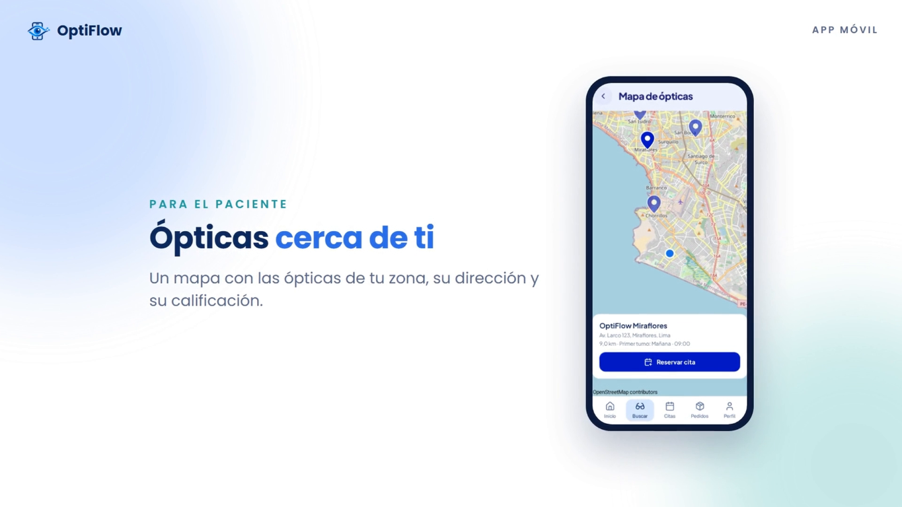
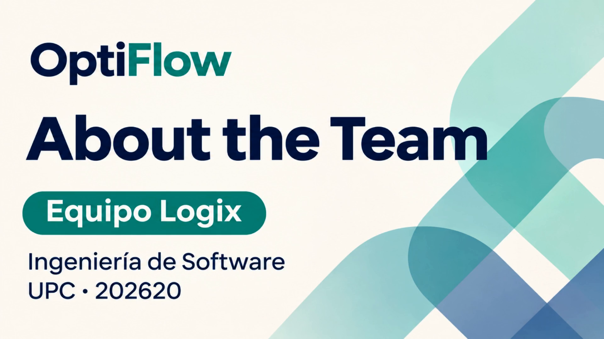

# Conclusiones

La entrega AV2 de OptiFlow reúne el diseño de la solución y dos incrementos de implementación orientados a la búsqueda y reserva de atención óptica. El problema identificado sigue siendo la dispersión de información entre establecimientos, pacientes y canales de coordinación. El flujo del primer incremento y los servicios del Sprint 2 muestran que es posible reunir la consulta de ópticas, los horarios y la reserva en una misma solución. Su efecto sobre el tiempo de atención y la continuidad del seguimiento requiere observar el uso del producto con ambos segmentos.

La literatura respalda la relevancia de estudiar la asistencia a citas y el acceso digital a la agenda. Abbas et al. (2025) identifican características del paciente y de la cita asociadas con la inasistencia en una práctica de retina; Kammrath Betancor et al. (2025) examinan la programación en línea en dos entornos de atención oftalmológica. Para OptiFlow, estos trabajos orientan la selección de indicadores de reserva, asistencia y seguimiento. Sus resultados pertenecen a otros establecimientos y no se trasladan como porcentajes de mejora obtenidos por el proyecto.

El trabajo con EventStorming, Domain Message Flows y Bounded Context Canvases permitió separar las responsabilidades de Search & Booking, Clinical & Commercial, Production & Tracking, Store Management & Inventory y Notification & Loyalty. Estos límites organizan el dominio, aunque la implementación del backend comparte una base relacional PostgreSQL. El [Anexo F](Anexos.md#anexo-f-diagramas-de-diseño-táctico) distingue los diagramas de diseño de las tablas identificadas en la revisión de AV2. La revisión `41bcb44` incorpora las tablas de inventario y dispositivos, además de adaptadores de pagos y mensajería. Las pruebas de estos adaptadores usan respuestas controladas; su operación con proveedores externos y la experiencia de realidad aumentada requieren evidencias propias.

El Sprint 1 documenta la consulta de ópticas y la reserva desde el cliente Android/Kotlin. En el Sprint 2, el backend incorpora rutas `/api/v1`, tokens de sesión, autorización por roles y búsqueda por cercanía. También se publica la base del cliente Flutter y se actualiza la Landing Page. La publicación de esta última se comprobó mediante una ejecución exitosa de GitHub Pages y acceso público con HTTP 200. La integración de Flutter todavía requiere adaptar las rutas, la respuesta de autenticación y el envío del token.

La revisión del 10/11/2026 aprobó 131 pruebas automatizadas, incluidos cuatro escenarios Cucumber de búsqueda y reserva, sin fallos, errores ni omisiones. GitHub Actions también completó la ejecución del backend `41bcb44`. Se registraron 28 solicitudes HTTP locales sobre H2 y un contrato de 67 operaciones; la base PostgreSQL compartida está definida por nueve migraciones y 27 tablas. Los resultados del [Anexo I](Anexos.md#anexo-i-evidencias-técnicas-del-sprint-2) permiten seguir la corrección de los problemas detectados el 08/11/2026. Su alcance es técnico y local: la validación del APK y del despliegue activo debe corresponder a la versión entregada.

Las decisiones móviles también requieren una evaluación propia de cada cliente. Coppola et al. (2025) estudian la adopción de Kotlin y su relación con métricas de mantenibilidad en Android. Kuroishi et al. (2025) clasifican las infraestructuras de pruebas móviles y destacan la diversidad de dispositivos y entornos. En OptiFlow, estos aportes sustentan la atención a la organización del código, la comprobación en emulador y la prueba posterior del APK en un dispositivo físico. Las evidencias del cliente Kotlin se mantienen asociadas con su versión; Flutter necesita sus propios resultados de ejecución y validación.

La revisión del modelado de datos distingue los límites del dominio de la distribución física: los cinco contextos comparten una sola base PostgreSQL con 27 tablas definidas por V1–V9. Las claves, restricciones y referencias lógicas se documentan según las migraciones y los mapeos JPA. La arquitectura integra además la Pasarela de Pagos y Firebase Cloud Messaging en el backend, y OpenStreetMap y ML Kit (escáner y probador virtual, en el propio dispositivo) en la aplicación móvil.

Las entrevistas y la evaluación heurística anteriores identificaron problemas de navegación, retroalimentación, formatos locales, accesibilidad y separación de roles. Estos hallazgos aportan criterios concretos para revisar AV2. El cambio de tecnología o la incorporación de una pantalla no permite cerrar una observación sin repetir la tarea con la versión entregada. El registro de sesiones y su seguimiento se encuentran en [4.3. Validation Interviews](Capitulo4.md#43-validation-interviews) y en el [Anexo H](Anexos.md#anexo-h-entrevistas-de-validación).

Las hipótesis de Lean UX continúan como metas de evaluación: aumentar la conversión comercial en 20%, reducir los tiempos de entrega al menos en 25%, superar el 95% de cumplimiento de plazos y disminuir las consultas manuales en 80% durante los primeros tres meses de uso. La hipótesis de inventario requiere medir tiempos de consulta y diferencias de stock. Las comprobaciones técnicas de AV2 no aportan todavía una comparación operativa que permita confirmar esas mejoras. La conclusión de esta entrega es, por tanto, un avance verificable en servicios, publicación y definición de la experiencia, acompañado de trabajo pendiente de integración y medición del impacto en el negocio.

## Recomendaciones

1. Cerrar el contrato de integración: actualizar en Flutter las rutas, el formato de sesión y los encabezados Bearer; comprobar con cuentas separadas las funciones del paciente y del personal.
2. Mantener la regresión automatizada en cada integración. Conservar los resultados de Maven y Cucumber por commit y comprobar que OpenAPI siga reflejando los códigos HTTP y permisos implementados.
3. Asociar la entrega con una versión del APK, un commit del backend y un entorno identificados. Comprobar la instalación, las migraciones de PostgreSQL y el flujo principal antes de distribuir la versión a los evaluadores.
4. Repetir las tareas con entre tres y cinco participantes por segmento. Registrar tiempo, ayuda requerida, errores y comentarios, y contrastar los hallazgos con la evaluación heurística anterior.
5. Medir las hipótesis con una línea base y un periodo de observación: conversión, tiempos de entrega, cumplimiento de plazos, consultas manuales y diferencias de inventario. Priorizar en el siguiente incremento las funciones que permitan obtener esas medidas con datos persistidos.
6. Mantener actualizados el tablero, la matriz de responsabilidades y las evidencias por versión. Los anexos deben conservar el vínculo entre cada afirmación del informe, el artefacto y la revisión de código que la sustenta.

## Video App Validation

La validación de OptiFlow se centra en la facilidad con la que el paciente encuentra atención, reserva una cita y consulta su información. Para el personal de la óptica, el recorrido comprende el acceso por rol y la consulta de los datos disponibles para la atención. Las tareas se relacionan con la búsqueda, la reserva y el seguimiento que motivaron el desarrollo del producto.

Durante cada sesión se observa cómo el participante interpreta la navegación, reconoce los mensajes y resuelve una dificultad. El registro considera el tiempo empleado, la ayuda requerida y sus comentarios al terminar. La versión de la aplicación y el dispositivo se identifican para relacionar cada observación con el producto evaluado.

La grabación de AV2 se vincula con la distribución del APK y con la evaluación heurística del capítulo IV. La Tabla CO1 reúne sus datos de publicación y los momentos de inicio de las sesiones de ambos segmentos.

**Tabla CO1**

*Registro del Video App Validation de AV2*

| Dato | Registro |
|---|---|
| Versión de la aplicación / commit | |
| Dispositivo y sistema operativo | |
| Enlace de distribución | |
| Video en OneDrive / Microsoft Stream | |
| Duración total | |
| Inicio de las sesiones por segmento | |
| Captura representativa | |

## Video About the Product

Este video presenta la propuesta de OptiFlow como una solución para centralizar información y procesos relacionados con la atención en ópticas. En la revisión visual se identifican funciones dirigidas al paciente —búsqueda de ópticas en un mapa, reserva de citas, pedidos, avisos y prueba virtual de monturas— y al personal de la óptica —cotizaciones, ventas, inventario, taller y reportes—, además de referencias a seguridad y servicios en la nube. La captura muestra la búsqueda de ópticas cercanas y la opción de reservar una cita.

**Figura 207**

*Búsqueda de ópticas cercanas y opción de reservar una cita en OptiFlow*

*Fuente: Captura del video del equipo en 00:00:57.*

**Duración:** 00:02:03 minutos.

**Video:**

- [YouTube](https://www.youtube.com/watch?v=kp8q3Ojp2LI)
- [OneDrive](https://upcedupe-my.sharepoint.com/:v:/g/personal/u202417405_upc_edu_pe/IQDkcvZ_f404Q7KTI0hx7GlBAcd_AJtuvGxw_VgAyL_fvk0?nav=eyJyZWZlcnJhbEluZm8iOnsicmVmZXJyYWxBcHAiOiJTdHJlYW1XZWJBcHAiLCJyZWZlcnJhbFZpZXciOiJTaGFyZURpYWxvZy1MaW5rIiwicmVmZXJyYWxBcHBQbGF0Zm9ybSI6IldlYiIsInJlZmVycmFsTW9kZSI6InZpZXcifX0%3D&e=pagewO)

## Video About the Team

El video presenta una portada del equipo Logix y, a continuación, cinco bloques visuales por orden como testimonios de cada uno de los participantes del proyecto.

**Figura 208**

*Portada del video About the Team del equipo Logix*

*Fuente: Captura del video del equipo en 00:00:01.*

**Duración:** 00:06:09 minutos.

**Video:**

- [YouTube](https://www.youtube.com/watch?v=_Kak03FkP5s)
- [OneDrive](https://upcedupe-my.sharepoint.com/:v:/g/personal/u202417405_upc_edu_pe/IQB2eKOGMeJZQbxlasnPLsHIAQ7wSQyj9SjgZlo6ltTBmaA?nav=eyJyZWZlcnJhbEluZm8iOnsicmVmZXJyYWxBcHAiOiJTdHJlYW1XZWJBcHAiLCJyZWZlcnJhbFZpZXciOiJTaGFyZURpYWxvZy1MaW5rIiwicmVmZXJyYWxBcHBQbGF0Zm9ybSI6IldlYiIsInJlZmVycmFsTW9kZSI6InZpZXcifX0%3D&e=BPE4Eo)

| Sección visual | Inicio | Fin |
| :--- | :---: | :---: |
| Portada | 00:00:00 | 00:00:05 |
| Testimonio 1 Eslander Celis | 00:00:05 | 00:01:05 |
| Testimonio 2 Mariana Morocho | 00:01:05 | 00:02:15 |
| Testimonio 3 Cesar Augusto | 00:02:15 | 00:03:15 |
| Testimonio 4 Nicolas Fernando | 00:03:16 | 00:04:42 |
| Testimonio 5 Felix Orlando | 00:04:42 | 00:06:04 |
| Cierre | 00:06:04 | 00:06:09 |
| Fin del archivo | 00:06:09 | 00:06:09 |
